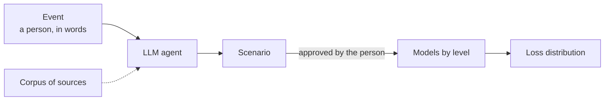
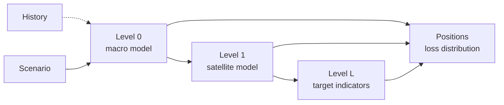

# MacroStress

[English](README.md) | [Русский](README.ru.md) | [中文](README.zh.md)

[](https://github.com/LeoLourson/MacroStress-DSH/actions/workflows/ci.yml)
[](LICENSE)
[](pyproject.toml)

MacroStress answers one question: what happens to a portfolio if a given event occurs. A person
states only the event, in words: "the central bank raises the policy rate to 21 % and holds it
for a year", or "fertiliser exports are banned". An LLM agent turns the event into a scenario, a
formal record the models can compute, using a corpus of sources known at the calculation date:
news, regulator decisions, descriptions of past episodes. The person checks and approves the
scenario. The models then simulate the economy under it, level by level, and reprice every
position on the same paths. The result is the distribution of portfolio losses month by month.



The platform itself names no model: macro models, satellite models and asset types are plugins,
and a new one is a package added without edits to the core. The agent works through MCP; every
step is also a command.

## Event and scenario

An event is what a person expects to happen, said in words and possibly without numbers. The
models cannot compute words: they need to know which values the event decides and which outcomes
it requires. The agent writes this down as a scenario $s=(N,I,\mathcal A)$:

| Part | What it holds | For "the policy rate is cut to 16 % in December" |
|---|---|---|
| $N$ | the event in text, with links to the sources of its numbers | the text and the regulator's statement |
| $I$ | interventions: decisions of a subject outside the models, a value set or shifted, with a law when the number is not exact | the key rate set at 16 % in months 1 to 3 |
| $\mathcal A$ | observations: what the event requires of the outcome, a condition on a path, a mean or a probability | the rouble down 10 % by month 3 |

A statement is an intervention when a subject outside the models fixes the value: a decision on
the policy rate, an export ban, the price of oil for an economy it acts on from outside. It is an
observation when it names an outcome the system itself produces: the exchange rate after
sanctions, the fall of output. The same number can be either, and the difference changes the
consequences.

Every number in $I$ and $\mathcal A$ is labelled by its origin: the event itself, a named source,
or an explicit assumption. If the event leaves the direction of a move open, the agent writes one
scenario per direction, and each is computed separately. The agent does not start the
calculation until the person approves the scenario.

The platform executes the interventions in the structural form the model declares: in the default
form a set value replaces only its own cell and a shift moves only its own path. Then it changes
the law of the other coordinates as little as possible so that the observations hold. The size of
that change, $\mathrm{dist}(s)=\mathrm{KL}(P_s\Vert P)$, is reported as the scenario price: the
higher it is, the less the scenario agrees with the models. A scenario names no model versions,
horizon or number of paths: the calculation request names them, so one file is computed on any
system of models, and the spread of the results shows how much the answer depends on that choice.

## Levels of the economy

Quantities are split into levels $l=0,\dots,L$, from the general to the particular: for example
the economy, an industry, a company. Each level has its own model, which takes the paths of the
levels above it as inputs. The last level holds the target indicators.

| Level | Model | Example quantities |
|---|---|---|
| $0$ | macro model: joint paths of the macro variables | policy rate, inflation, exchange rate, output |
| $1,\dots,L$ | satellite model of the level: its quantities from the levels above plus its own noise | overdue loans of an industry, a company's share price, a bond spread, housing prices |



The definitions are in [docs/concept/formalization.en.md](docs/concept/formalization.en.md).

## Plugins

| Kind | What it models | Shipped examples |
|---|---|---|
| macro | level 0: shocks and paths of the macro variables | `bvar.sv`, a Bayesian VAR with stochastic volatility; `msvar.markov`, a VAR with Markov-switching regimes |
| satellite | a level above 0: its quantities from the paths of the levels above | `hier.gibbs`, a hierarchical regression, the default for every quantity; `reflevel2.regression`, a reference second level |
| position | an asset type: the value of a position on the paths | `equity`, `bond`, `credit` (loans and deposits), `housing` |

The macro model is chosen when it is estimated. A quantity goes to the satellite model that
declares it, or to the one named explicitly. A position goes to the plugin of its asset type.
Every shipped plugin describes its model in `REFERENCE.en.md` next to the code.

```bash
python -m mst.plugin new my_model --kind macro    # a package with plugin.py, a model and tests
python -m mst.plugin check my_model               # the contract checks
python -m mst.plugin demo-run my_model            # a calculation on a toy workspace
```

The platform finds a plugin in `mst.plugins`, through an entry point of the group `mst.plugins`,
or in a directory listed in `MST_PLUGINS_PATH`. The guide is
[docs/howto/plugins.en.md](docs/howto/plugins.en.md).

The shipped models are examples under development and change between releases. The episode
backtest scores every version on historical events against a random walk with drift. Its
episodes and the other check sets with known answers are in [bench/](bench/README.en.md).

## Data

The series, their sources and release lags are configuration: `src/mst/data/sources.toml`, the
variable registry `src/mst/macro/registry.toml` and the driver registry
`src/mst/drivers/registry.toml`. The shipped set is a sample. Every value keeps its release
date, so a model estimated as of a date sees only what was published by then. Data are not part
of the repository; you download them under each source's terms.

## Output

For every month of the horizon: quantiles of the target indicators and of the portfolio loss
($P_5$, $P_{50}$, $P_{95}$), ES95 (the mean loss over the worst 5 % of paths) and the scenario
price. The reverse search answers the opposite question: the worst loss among scenarios no
dearer than a given price, or the cheapest scenario that reaches a given loss.

## Working with an agent

The server speaks MCP, so any MCP client can drive it: Claude Desktop, Claude Code, Cursor,
Codex. It offers seven tools: `jobs`, `series`, `corpus`, `scenario`, `run`, `portfolio`,
`model`; long operations run as jobs. The `dsh/` folder holds a plugin for DeepSeek Harness (DSH)
with three skills, among them `scenario-from-corpus`, the agent's instructions for turning an
event into a scenario, and a workspace summary in the agent prompt. All state lives in one
workspace directory: there is no web interface, database or scheduler.

## Install

Python 3.12 or newer and [uv](https://docs.astral.sh/uv/) are enough.

```bash
git clone https://github.com/LeoLourson/MacroStress-DSH
cd MacroStress-DSH
uv sync
uv run macrostress --workspace C:/data/macrostress
```

The server talks over stdio, prints only errors and waits for a client. Connecting a client:
[docs/howto/mcp.en.md](docs/howto/mcp.en.md); the DSH plugin:
[docs/howto/install.en.md](docs/howto/install.en.md).

## First session

1. `series(action="update")`: the history.
2. `model(kind="macro", action="estimate", as_of=...)`: level 0.
3. `series(action="update", quantity=...)`, then
   `model(kind="satellites", action="estimate", version=...)`: the levels above.
4. `corpus(action="search", ...)`, `scenario(action="save")`, `scenario(action="validate")`: the
   scenario from the event.
5. `run(action="start")`, `run(action="result")`: the forecast and the portfolio report.

Step by step: [docs/howto/first-session.en.md](docs/howto/first-session.en.md).

## Documentation

| Layer | File | Question |
|---|---|---|
| Concept | [docs/concept/formalization.en.md](docs/concept/formalization.en.md) | What the system computes: levels, scenario, overlay, result, quality metrics |
| Concept | [docs/concept/architecture.en.md](docs/concept/architecture.en.md) | How the scheme maps to code: packages, workspace, model versions, jobs |
| Concept | [docs/concept/bvar-method-legacy.en.md](docs/concept/bvar-method-legacy.en.md) | The first BVAR method; outdated, kept for history |
| How-to | [docs/howto/install.en.md](docs/howto/install.en.md) | Installing the Python package and the DSH plugin |
| How-to | [docs/howto/mcp.en.md](docs/howto/mcp.en.md) | Connecting any MCP client and fixing common errors |
| How-to | [docs/howto/first-session.en.md](docs/howto/first-session.en.md) | The first session, from series to report |
| How-to | [docs/howto/plugins.en.md](docs/howto/plugins.en.md) | Adding a macro model, a satellite or an asset type as a plugin |
| Reference | [docs/reference/tools.en.md](docs/reference/tools.en.md) | What the MCP tools and `python -m mst.*` commands take and return |
| Reference | [docs/reference/platform.en.md](docs/reference/platform.en.md) | The contracts: position, paths, model, registry, run and report |

Every document exists in Russian (`*.md`) and English (`*.en.md`); the index is
[docs/README.en.md](docs/README.en.md). Every package folder has its own README naming its files.

## Development

```bash
uv sync
uv run pytest -q -m "not slow"
uv run ruff check .
```

The `slow` tests estimate the macro models and take minutes; the nightly workflow runs the full
suite. CI runs the fast suite on Linux and Windows with Python 3.12 and 3.13.

## Contributing and license

Contributing rules and the release process are in [CONTRIBUTING.md](CONTRIBUTING.md);
vulnerabilities go through [SECURITY.md](SECURITY.md). The code is MIT-licensed, see
[LICENSE](LICENSE); the license does not cover the data you download. Citations are described in
[CITATION.cff](CITATION.cff).
