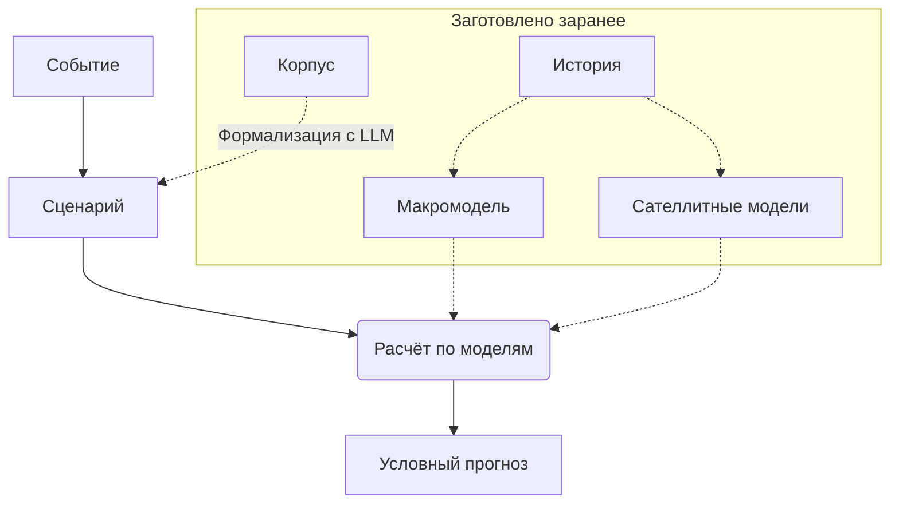

# MacroStress

[English](README.md) | [Русский](README.ru.md) | [中文](README.zh.md)

[](https://github.com/LeoLourson/MacroStress-DSH/actions/workflows/ci.yml)
[](LICENSE)
[](pyproject.toml)

MacroStress прогнозирует, как поведут себя целевые показатели портфеля, если произойдёт заданное
событие. Событие формализуется в сценарий $(N, D, C, O)$ — нарратив, причины, условия,
воздействия. Расчёт по моделям, заготовленным по истории, строит условный прогноз: распределение
целевых показателей по месяцам горизонта. На тех же путях считается распределение потерь портфеля:
$P_5$, $P_{50}$, $P_{95}$, ES95 и цена сценария $\mathrm{dist}(s)$.

Целевые показатели — последний уровень цепочки моделей. Уровень 0 — макропеременные: их пути
строит макромодель, оценённая на истории. Уровни выше — величины объектов: цены акций, спреды
облигаций, просрочка отраслей, цены жилья; их строят сателлитные модели. Сценарий меняет
распределение причин $D$ так, чтобы выполнились ограничения $C$; воздействия $O$
добавляют эффекты, которые не проходят через верхние уровни, — например запрет экспорта для
одной отрасли. Качество моделей проверяется бэктестом на исторических эпизодах.

Общая схема с определениями — [docs/concept/formalization.md](docs/concept/formalization.md).

## Как устроена система



| Узел схемы | Реализация |
|---|---|
| История | `mst.data`: месячные ряды MOEX, Банка России, Росстата и FRED с датой публикации каждого значения |
| Макромодель | `mst.macro` и плагин `bvar.sv`: BVAR со стохастической волатильностью, идентификация шоков знаками, условный прогноз; второй плагин `msvar.markov` — MS-VAR с режимами |
| Сателлитные модели | `mst.drivers` и плагины: каталоги объектов, иерархические сателлиты величин, проверка вне выборки, пути драйверов на общих розыгрышах |
| Корпус | `mst.corpus`: манифест, тексты, карточки эпизодов, фрагменты и поиск |
| Сценарий | `mst.scenario`: файл $(N, D, C, O)$, проверка выполнимости, пути сценария |
| Расчёт по моделям | `mst.engine`, `mst.runs` и модели позиций из плагинов: акция, облигация, кредит, депозит, недвижимость |
| Условный прогноз | `mst.runs`, `mst.portfolio`: квантили целевых показателей по месяцам и отчёт портфеля с ES95, ценой сценария и покрытием |
| Метрики качества | `mst.metrics`: эпизодный бэктест, CRPS, калибровка, допуск версий |

Макромодель, сателлиты и модели позиций подключаются плагинами; ядро не знает ни одной конкретной
модели. Как написать свой плагин — [docs/howto/plugins.md](docs/howto/plugins.md).

## Работа с агентом

Сервер говорит по MCP, поэтому работает с любым клиентом: Claude Desktop, Claude Code, Cursor,
Codex, DeepSeek Harness. Клиенту доступны семь инструментов: `jobs`, `series`, `corpus`,
`scenario`, `run`, `portfolio`, `model`; долгие операции идут задачами. Подключение —
[docs/howto/mcp.md](docs/howto/mcp.md), справочник вызовов —
[docs/reference/tools.md](docs/reference/tools.md).

Для DSH есть плагин в `dsh/`: он запускает тот же сервер, регистрирует три скилла и добавляет
в системный промпт агента снимок workspace. Установка —
[docs/howto/install.md](docs/howto/install.md).

## Установка

Нужны Python 3.12 или новее и [uv](https://docs.astral.sh/uv/).

```powershell
git clone https://github.com/LeoLourson/MacroStress-DSH
cd MacroStress-DSH
uv sync
uv run macrostress --workspace C:/data/macrostress
```

Сервер говорит по stdio и печатает только ошибки: он ждёт клиента. Дальше —
[docs/howto/mcp.md](docs/howto/mcp.md).

## Первый сеанс

Полный пошаговый сеанс — [docs/howto/first-session.md](docs/howto/first-session.md). Шаги
повторяют схему:

1. `series(action="update")` — ряды истории.
2. `model(kind="macro", action="estimate", as_of=...)` — макромодель, уровень 0.
3. `series(action="update", quantity=...)` и `model(kind="satellites", action="estimate", version=...)` — сателлиты, уровни выше.
4. `scenario(action="save")` и `scenario(action="validate")` — сценарий $(N, D, C, O)$.
5. `run(action="start")` и `run(action="result")` — расчёт, условный прогноз, отчёт портфеля.

## Документация

Документация делится на три слоя по вопросу читателя.

| Слой | Файл | Вопрос |
|---|---|---|
| Концепция | [docs/concept/formalization.md](docs/concept/formalization.md) | Что система делает: уровни, сценарий, наложение, результат, метрики качества |
| Концепция | [docs/concept/bvar-method-legacy.md](docs/concept/bvar-method-legacy.md) | Устаревшее описание первой версии метода на BVAR, не канон |
| Концепция | [docs/concept/architecture.md](docs/concept/architecture.md) | Как схема реализована в коде: пакеты, workspace, версии моделей, задачи |
| Как работать | [docs/howto/install.md](docs/howto/install.md) | Как поставить Python-часть и подключить плагин к профилю DSH |
| Как работать | [docs/howto/mcp.md](docs/howto/mcp.md) | Как подключить сервер к любому MCP-клиенту и разобрать типовые ошибки |
| Как работать | [docs/howto/first-session.md](docs/howto/first-session.md) | Как провести первый сеанс от рядов до отчёта |
| Как работать | [docs/howto/plugins.md](docs/howto/plugins.md) | Как добавить плагином модель позиции, макромодель или сателлит |
| Справочник | [docs/reference/tools.md](docs/reference/tools.md) | Что принимают и возвращают MCP-инструменты и команды `python -m mst.*` |
| Справочник | [docs/reference/platform.md](docs/reference/platform.md) | Контракты расчёта: позиция, пути, модель, реестр, расчёт и отчёт |

## Словарь

Термины общей схемы. Термины данных и реализации — в словаре
[docs/concept/architecture.md](docs/concept/architecture.md).

| Термин | Что это |
|---|---|
| Уровень | Группа наблюдаемых величин $l=0,\dots,L$ от общего к частному: уровень 0 — макропеременные, уровни выше — величины объектов |
| Макромодель | Распределение шоков и передача $G_0$: строит пути уровня 0; версия — файлы с хешем |
| Сателлитные модели | Передачи $G_1,\dots,G_L$: строят величины объектов из уровней выше; величина уровня — драйвер |
| Сценарий | Формальная запись события: нарратив $N$, причины $D$, условия $C$, воздействия $O$ |
| Воздействие | Прибавка к траектории уровня для эффекта, который не проходит через верхние уровни |
| Целевые показатели | Траектория последнего уровня $v=x^L$ |
| Условный прогноз | Распределение целевых показателей при сценарии: квантили по месяцам из $R$ розыгрышей |
| Пути | $R$ розыгрышей на $H$ месяцев: макропеременные и величины в исходных единицах |
| Цена сценария | $\mathrm{dist}(s)=\mathrm{KL}(P_s\Vert P)$ — расстояние наложения от базовой меры; больше цена — дальше сценарий от моделей |
| Позиция | То, что переоценивается на путях: тип актива, валюта, номинал, коды объекта |
| Портфель | Позиции в базовой валюте; отчёт — квантили потерь, ES95 и покрытие |

## Статус

0.2.0, beta. Интерфейсы могут измениться до 1.0. Источники данных — российский рынок
(MOEX, Банк России, Росстат) и FRED для глобальных рядов.

## Проверки

```powershell
uv run pytest -q -m "not slow"
uv run ruff check .
```

Тяжёлые тесты оценки BVAR (`tests/macro/test_estimate.py`, `test_forecast.py`,
`test_identify.py`) помечены `slow` и идут минуты; полный набор — `uv run pytest -q`.

## Участие и лицензия

Правила и порядок релиза — [CONTRIBUTING.md](CONTRIBUTING.md), уязвимости —
[SECURITY.md](SECURITY.md). Код под лицензией MIT: [LICENSE](LICENSE). Ряды MOEX, Банка
России, Росстата, FRED и BIS в репозиторий не входят: их загружает пользователь на условиях
источника, лицензия на код эти данные не покрывает.
