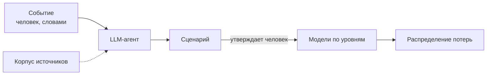
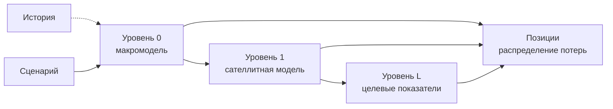

# MacroStress

[English](README.md) | [Русский](README.ru.md) | [中文](README.zh.md)

[](https://github.com/LeoLourson/MacroStress-DSH/actions/workflows/ci.yml)
[](LICENSE)
[](pyproject.toml)

MacroStress отвечает на вопрос, что будет с портфелем, если произойдёт заданное событие. Человек
называет только событие, словами: «центральный банк поднимает ставку до 21 % и держит её год»
или «экспорт удобрений запрещён». LLM-агент переводит событие в сценарий — формальную запись,
которую могут посчитать модели. Для этого он берёт корпус источников, известных на дату
расчёта: новости, решения регулятора, описания прошлых эпизодов. Человек проверяет и утверждает
сценарий, после чего модели строят пути экономики при нём, уровень за уровнем, и на тех же путях
переоценивают каждую позицию. Результат — распределение потерь портфеля по месяцам.



Сама платформа не знает ни одной модели: макромодели, сателлитные модели и типы активов
подключаются плагинами, и новый плагин — это пакет, который добавляется без правок ядра. Агент
работает через MCP; каждый шаг доступен и как команда.

## Событие и сценарий

Событие — это то, чего ждёт человек, сказанное словами и, возможно, без чисел. Слова модели
посчитать не могут: им нужно знать, какие пути допустимы, какие шоки их вызывают и что лежит
вне моделей. Агент записывает это как сценарий $s=(N,m,O,D,\mathcal C)$:

| Часть | Что содержит | Для «ставка держится на 21 % год» |
|---|---|---|
| $N$ | событие текстом со ссылками на источники его чисел | текст события и пресс-релиз регулятора |
| $m$ | версии моделей, на которых считается сценарий | текущие версии макромодели и сателлитов |
| $\mathcal C$ | условия на пути любого уровня: значение с допуском, диапазон, среднее или вероятность | ставка от 20,5 до 21,5 % в месяцы с 1 по 12 |
| $D$ | причины: шоки моделей, которым разрешено вызвать событие | шок денежно-кредитной политики |
| $O$ | воздействия: сдвиги пути уровня для эффектов, которых нет в моделях | нет; для запрета экспорта — падение продаж одной отрасли |

У каждого числа в $\mathcal C$ и $O$ есть метка происхождения: само событие, названный источник
или явное допущение. Если событие оставляет открытым направление движения, агент пишет по
сценарию на каждое направление, и каждый считается отдельно. Расчёт агент не запускает, пока
человек не утвердит сценарий.

Платформа меняет распределение причин $D$ как можно меньше, так чтобы выполнились условия
$\mathcal C$, и затем добавляет воздействия $O$. Величина этого изменения,
$\mathrm{dist}(s)=\mathrm{KL}(P_s\Vert P)$, выводится как цена сценария: чем она выше, тем хуже
сценарий согласуется с моделями.

## Уровни экономики

Величины разбиты на уровни $l=0,\dots,L$ от общего к частному, например: экономика, отрасль,
компания. У каждого уровня своя модель, и её входы — пути уровней выше. Последний уровень
содержит целевые показатели.

| Уровень | Модель | Примеры величин |
|---|---|---|
| $0$ | макромодель: совместные пути макропеременных | ставка, инфляция, курс, выпуск |
| $1,\dots,L$ | сателлитная модель уровня: его величины по уровням выше плюс собственный шум | просрочка отрасли, цена акции компании, спред облигации, цены жилья |



Определения — в [docs/concept/formalization.md](docs/concept/formalization.md).

## Плагины

| Вид | Что моделирует | Примеры в поставке |
|---|---|---|
| macro | уровень 0: шоки и пути макропеременных | `bvar.sv` — байесовская VAR со стохастической волатильностью; `msvar.markov` — VAR с марковским переключением режимов |
| satellite | уровень выше 0: его величины по путям уровней выше | `hier.gibbs` — иерархическая регрессия, по умолчанию для всех величин; `reflevel2.regression` — эталон второго уровня |
| position | тип актива: стоимость позиции на путях | `equity`, `bond`, `credit` (кредиты и депозиты), `housing` |

Макромодель выбирается при оценке. Величина достаётся сателлитной модели, которая её объявляет,
или той, что названа явно. Позиция достаётся плагину своего типа актива. Каждый плагин из
поставки описывает свою модель в `REFERENCE.md` рядом с кодом.

```powershell
python -m mst.plugin new my_model --kind macro    # пакет с plugin.py, моделью и тестами
python -m mst.plugin check my_model               # проверки контракта
python -m mst.plugin demo-run my_model            # расчёт на игрушечном workspace
```

Платформа находит плагин в `mst.plugins`, через точку входа группы `mst.plugins` или в каталоге
из `MST_PLUGINS_PATH`. Руководство — [docs/howto/plugins.md](docs/howto/plugins.md).

Модели из поставки — примеры, они дорабатываются и меняются от релиза к релизу. Бэктест по
эпизодам оценивает каждую версию на исторических событиях против случайного блуждания со
сносом. Его эпизоды и другие проверочные наборы с известными ответами лежат в
[bench/](bench/README.md).

## Данные

Ряды, их источники и задержки публикации задаются конфигурацией: `src/mst/data/sources.toml`,
реестр переменных `src/mst/macro/registry.toml` и реестр драйверов
`src/mst/drivers/registry.toml`. Набор в поставке — образец. Каждое значение хранит дату
публикации, поэтому модель, оценённая на дату, видит только то, что к ней вышло. Данных в
репозитории нет: их загружает пользователь на условиях каждого источника.

## Результат

Для каждого месяца горизонта: квантили целевых показателей и потерь портфеля ($P_5$, $P_{50}$,
$P_{95}$), ES95 (средняя потеря на худших 5 % путей) и цена сценария. Обратный поиск отвечает
на обратный вопрос: худшая потеря среди сценариев не дороже заданной цены или самый дешёвый
сценарий, который даёт заданную потерю.

## Работа с агентом

Сервер говорит по MCP, поэтому им управляет любой MCP-клиент: Claude Desktop, Claude Code,
Cursor, Codex. Клиенту доступны семь инструментов: `jobs`, `series`, `corpus`, `scenario`,
`run`, `portfolio`, `model`; долгие операции идут задачами. В `dsh/` лежит плагин для DeepSeek
Harness (DSH): три скилла, среди них `scenario-from-corpus` — инструкция агенту, как перевести
событие в сценарий, и снимок workspace в системном промпте агента. Всё состояние хранится в
одном каталоге workspace: веб-интерфейса, базы данных и планировщика нет.

## Установка

Нужны Python 3.12 или новее и [uv](https://docs.astral.sh/uv/).

```powershell
git clone https://github.com/LeoLourson/MacroStress-DSH
cd MacroStress-DSH
uv sync
uv run macrostress --workspace C:/data/macrostress
```

Сервер говорит по stdio, печатает только ошибки и ждёт клиента. Подключение клиента —
[docs/howto/mcp.md](docs/howto/mcp.md), плагин DSH — [docs/howto/install.md](docs/howto/install.md).

## Первый сеанс

1. `series(action="update")` — история.
2. `model(kind="macro", action="estimate", as_of=...)` — уровень 0.
3. `series(action="update", quantity=...)`, затем
   `model(kind="satellites", action="estimate", version=...)` — уровни выше.
4. `corpus(action="search", ...)`, `scenario(action="save")`, `scenario(action="validate")` —
   сценарий из события.
5. `run(action="start")`, `run(action="result")` — прогноз и отчёт портфеля.

По шагам — [docs/howto/first-session.md](docs/howto/first-session.md).

## Документация

| Слой | Файл | Вопрос |
|---|---|---|
| Концепция | [docs/concept/formalization.md](docs/concept/formalization.md) | Что считает система: уровни, сценарий, наложение, результат, метрики качества |
| Концепция | [docs/concept/architecture.md](docs/concept/architecture.md) | Как схема реализована в коде: пакеты, workspace, версии моделей, задачи |
| Концепция | [docs/concept/bvar-method-legacy.md](docs/concept/bvar-method-legacy.md) | Первый метод на BVAR; устарел, хранится для истории |
| Как работать | [docs/howto/install.md](docs/howto/install.md) | Как поставить Python-пакет и плагин DSH |
| Как работать | [docs/howto/mcp.md](docs/howto/mcp.md) | Как подключить любой MCP-клиент и разобрать типовые ошибки |
| Как работать | [docs/howto/first-session.md](docs/howto/first-session.md) | Первый сеанс от рядов до отчёта |
| Как работать | [docs/howto/plugins.md](docs/howto/plugins.md) | Как добавить плагином макромодель, сателлит или тип актива |
| Справочник | [docs/reference/tools.md](docs/reference/tools.md) | Что принимают и возвращают MCP-инструменты и команды `python -m mst.*` |
| Справочник | [docs/reference/platform.md](docs/reference/platform.md) | Контракты: позиция, пути, модель, реестр, расчёт и отчёт |

Каждый документ есть на русском (`*.md`) и английском (`*.en.md`); оглавление —
[docs/README.md](docs/README.md). В каждой папке пакета свой README с перечнем файлов.

## Разработка

```powershell
uv sync
uv run pytest -q -m "not slow"
uv run ruff check .
```

Тесты с меткой `slow` оценивают макромодели и идут минуты; ночной workflow запускает полный
набор. CI запускает быстрый набор на Linux и Windows с Python 3.12 и 3.13.

## Участие и лицензия

Правила и порядок релиза — [CONTRIBUTING.md](CONTRIBUTING.md), уязвимости —
[SECURITY.md](SECURITY.md). Код под лицензией MIT: [LICENSE](LICENSE); загружаемые данные она
не покрывает. Цитирование описано в [CITATION.cff](CITATION.cff).
