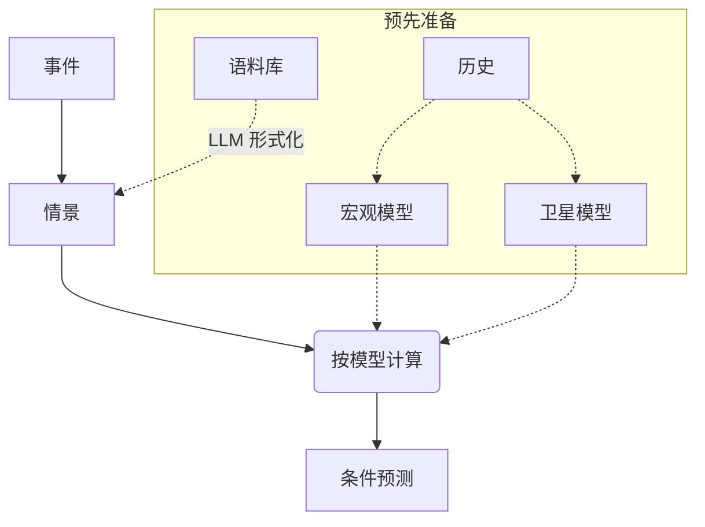

# MacroStress

[English](README.md) | [Русский](README.ru.md) | [中文](README.zh.md)

[](https://github.com/LeoLourson/MacroStress-DSH/actions/workflows/ci.yml)
[](LICENSE)
[](pyproject.toml)

MacroStress 预测：在给定事件发生时，投资组合的目标指标会如何变化。事件被形式化为情景
$(N, D, C, O)$ —— 叙述、驱动冲击、约束、直接作用。基于历史上估计的模型进行计算，得到条件预测：
目标指标在预测期内逐月的分布。沿同一路径还可以得到组合的损失分布：$P_5$、$P_{50}$、$P_{95}$、
ES95，以及情景的价格 $\mathrm{dist}(s)$。

目标指标位于模型链的最后一层。第 0 层是宏观变量：其路径由在历史上估计的宏观模型生成。更上层是
各类对象的量：股票价格、债券利差、行业不良率、房价，由卫星模型生成。情景改变驱动冲击 $D$ 的分布，
使约束 $C$ 得到满足；直接作用 $O$ 补充那些不经由上层传导的效应，例如针对某一行业的出口禁令。模型
质量通过历史情节（episode）上的回测检验。

总体方案及定义见 [docs/concept/formalization.md](docs/concept/formalization.md)，方法及其实现见
[docs/concept/scenario-formalization.md](docs/concept/scenario-formalization.md)（俄文）。

## 系统如何工作



| 方案节点 | 实现 |
|---|---|
| 历史 | `mst.data`：来自 MOEX、俄罗斯央行、Rosstat 和 FRED 的月度序列，每个数值带发布日期 |
| 宏观模型 | `mst.macro` 和插件 `bvar.sv`：带随机波动率的 BVAR、按符号识别冲击、条件预测 |
| 卫星模型 | `mst.drivers` 和插件：对象目录、分层卫星模型、样本外检验、共享抽样上的驱动因子路径 |
| 语料库 | `mst.corpus`：清单、文本、情节卡片、片段与搜索 |
| 情景 | `mst.scenario`：$(N, D, C, O)$ 文件、可行性校验、情景路径 |
| 按模型计算 | `mst.engine`、`mst.runs` 和插件中的持仓模型：股票、债券、信贷、存款、房地产 |
| 条件预测 | `mst.runs`、`mst.portfolio`：目标指标逐月分位数，以及带 ES95、情景价格和覆盖率的组合报告 |
| 质量指标 | `mst.metrics`：情节回测、CRPS、校准、版本准入 |

宏观模型、卫星模型和持仓模型都以插件接入；核心不知道任何具体模型。如何编写自己的插件见
[docs/howto/plugins.md](docs/howto/plugins.md)。

## 与智能体协同

服务器使用 MCP，因此任何客户端都能驱动它：Claude Desktop、Claude Code、Cursor、Codex、
DeepSeek Harness。客户端可见七个工具：`jobs`、`series`、`corpus`、`scenario`、`run`、
`portfolio`、`model`；耗时操作以任务运行。连接见
[docs/howto/mcp.md](docs/howto/mcp.md)，调用参考见
[docs/reference/tools.md](docs/reference/tools.md)。

`dsh/` 中有 DeepSeek Harness 插件：它启动同一服务器，注册三个技能，并把工作区快照放进智能体的
系统提示词。安装见 [docs/howto/install.md](docs/howto/install.md)。

## 安装

需要 Python 3.12 或更新版本，以及 [uv](https://docs.astral.sh/uv/)。

```bash
git clone https://github.com/LeoLourson/MacroStress-DSH
cd MacroStress-DSH
uv sync
uv run macrostress --workspace C:/data/macrostress
```

服务器通过 stdio 通信，只输出错误信息，等待客户端连接。后续见
[docs/howto/mcp.md](docs/howto/mcp.md)。

## 第一次会话

完整的逐步会话见 [docs/howto/first-session.md](docs/howto/first-session.md)。步骤与方案一致：

1. `series(action="update")` —— 历史序列。
2. `model(kind="macro", action="estimate", as_of=...)` —— 宏观模型，第 0 层。
3. `series(action="update", quantity=...)` 和 `model(kind="satellites", action="estimate", version=...)` —— 卫星模型，更上层。
4. `scenario(action="save")` 和 `scenario(action="validate")` —— 情景 $(N, D, C, O)$。
5. `run(action="start")` 和 `run(action="result")` —— 计算、条件预测、组合报告。

## 文档

文档按读者的问题分为三层。

| 层 | 文件 | 问题 |
|---|---|---|
| 概念 | [docs/concept/formalization.md](docs/concept/formalization.md) | 系统做什么：层、情景、叠加、结果、质量指标（俄文） |
| 概念 | [docs/concept/scenario-formalization.md](docs/concept/scenario-formalization.md) | 方法如何构造，代码实现了其中哪些部分（俄文） |
| 概念 | [docs/concept/architecture.md](docs/concept/architecture.md) | 方案在代码中的实现：包、工作区、模型版本、任务（俄文） |
| 操作 | [docs/howto/install.md](docs/howto/install.md) | 安装 Python 部分并把插件接入 DSH 配置（俄文） |
| 操作 | [docs/howto/mcp.md](docs/howto/mcp.md) | 连接任意 MCP 客户端并排查典型错误（俄文） |
| 操作 | [docs/howto/first-session.md](docs/howto/first-session.md) | 从序列到报告的第一次会话（俄文） |
| 操作 | [docs/howto/plugins.md](docs/howto/plugins.md) | 以插件形式添加持仓、宏观或卫星模型（俄文） |
| 参考 | [docs/reference/tools.md](docs/reference/tools.md) | MCP 工具和 `python -m mst.*` 命令的参数与返回值（俄文） |
| 参考 | [docs/reference/platform.md](docs/reference/platform.md) | 计算契约：持仓、路径、模型、注册表、运行与报告（俄文） |

## 术语

总体方案的术语。数据与实现术语见
[docs/concept/architecture.md](docs/concept/architecture.md) 的术语表（俄文）。

| 术语 | 含义 |
|---|---|
| 层 | 从一般到具体的可观测量的分组 $l=0,\dots,L$：第 0 层 —— 宏观变量，更上层 —— 对象的量 |
| 宏观模型 | 冲击的分布与传递 $G_0$：生成第 0 层的路径；版本是带哈希的文件 |
| 卫星模型 | 传递 $G_1,\dots,G_L$：由上层生成对象的量；层中的量称为驱动因子 |
| 情景 | 事件的形式化记录：叙述 $N$、驱动冲击 $D$、约束 $C$、直接作用 $O$ |
| 直接作用 | 对某层轨迹的加项，用于不经上层传导的效应 |
| 目标指标 | 最后一层的轨迹 $v=x^L$ |
| 条件预测 | 情景下目标指标的分布：由 $R$ 次抽样得到的逐月分位数 |
| 路径 | $R$ 次抽样 × $H$ 个月：原始单位的宏观变量与量 |
| 情景价格 | $\mathrm{dist}(s)=\mathrm{KL}(P_s\Vert P)$ —— 叠加到基础测度的距离；价格越大，情景离模型越远 |
| 持仓 | 沿路径重估的对象：资产类型、币种、名义金额、对象代码 |
| 组合 | 以基础币种计的持仓集合；报告 —— 损失分位数、ES95 和覆盖率 |

## 状态

0.2.0，beta。1.0 之前接口可能变化。数据源是俄罗斯市场（MOEX、俄罗斯央行、Rosstat），全球序列来自
FRED。

## 检查

```bash
uv run pytest -q -m "not slow"
uv run ruff check .
```

带 `slow` 标记的 BVAR 估计测试（`tests/macro/test_estimate.py`、`test_forecast.py`、
`test_identify.py`）耗时数分钟；完整测试集是 `uv run pytest -q`。

## 参与和许可证

参与规则和发布流程见 [CONTRIBUTING.md](CONTRIBUTING.md)，漏洞报告见 [SECURITY.md](SECURITY.md)。
代码使用 MIT 许可证，见 [LICENSE](LICENSE)。MOEX、俄罗斯央行、Rosstat、FRED 和 BIS 的序列不在
本仓库中：用户按各来源的条件自行加载，许可证不覆盖这些数据。
