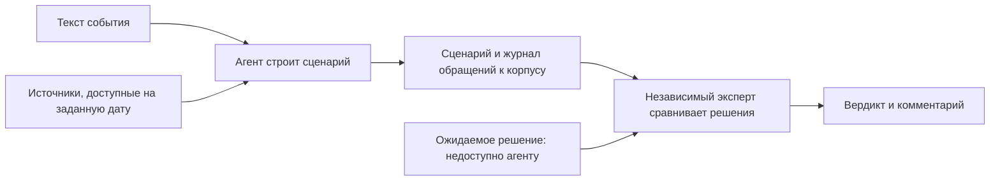

# Проверочные наборы MacroStress

Проверочные наборы измеряют качество работы MacroStress: поиск источников, построение
сценария, исторический прогноз или расход контекста при экспертном опросе. Выберите набор
по проверяемой задаче и сравнивайте результаты при одинаковых входах. Успех одного набора
не подтверждает качество остальных задач и сам по себе не разрешает расчёт портфеля.

[Программные тесты](<../tests/README.md>) проверяют выполнение правил кода и заканчиваются
ответом «прошёл» или «не прошёл». Проверочный набор даёт числовую оценку или экспертный
вердикт, по которому сравнивают версии поиска, модели или инструкции агента.

## Как выбрать набор

| Задача | Входы | Что оценивается |
|---|---|---|
| Поиск по корпусу | [Вопросы с датами и правильными фрагментами](<corpus-search/questions.md>) | `recall@5`: средняя доля правильных фрагментов среди первых пяти результатов по размеченным вопросам |
| Построение сценария | [Тексты событий](<scenario-from-corpus/events.toml>) | Доли экспертных вердиктов «соответствует», «частично», «не соответствует» |
| Историческая проверка моделей | [План эпизодов и сетки дат](<model-backtest/episodes.toml>) | Ошибка распределения прогноза, покрытие интервалов, допуск модели и цена сценария относительно случайного блуждания |
| Контекст экспертного опроса | [Описание отдельного эксперимента](<elicitation-context/README.md>) | Число входных и выходных токенов и экономическая согласованность ответов при разной длине истории |

В исторической проверке используется CRPS — непрерывная ранговая оценка вероятностей,
которая сравнивает всё прогнозное распределение с наблюдённым значением; меньшее значение
означает меньшую ошибку. План одинаков для сравниваемых моделей и содержит исторические
эпизоды, регулярную сетку дат `rolling` и семейство событий для проверки цены сценария.
Набор расширяется через план, поэтому перечень эпизодов и параметры читайте в
[плане проверки](<model-backtest/episodes.toml>), а не выводите из старого отчёта.

## Где проходит граница проверки



При проверке построения сценария агенту дают текст события и доступный на дату корпус,
но не ожидаемое решение. Если агент заранее прочитал правильный ответ, измерение уже
не проверяет самостоятельное решение.

Называйте каталог по работе системы, которую измеряет набор. Для нового набора создайте
собственный каталог и опишите входы, формат ответа, метрику и команду. Материалы для построения
ответа — корпус, ряды и рабочие сценарии — остаются за пределами набора. Исторический эпизод
ссылается на карточку корпуса полем `card`, а месяц `start` повторяет только как параметр
плана; [тест согласованности](<../tests/test_bench.py>) проверяет совпадение месяца.

Если набор выполняет агент с доступом к репозиторию, ожидаемые решения держат вне его
рабочего каталога. Для набора сценариев в [перечне событий](<scenario-from-corpus/events.toml>)
допустимы только идентификатор и текст события; экспертные ожидания вносятся отдельно.
Сохранённые ответы прошлых запусков также нельзя использовать как подсказку при повторной
проверке агента.

## Запуск и сохранение результатов

Выполняйте команды из корня репозитория в установленном окружении Python. При оценке
поиска команда печатает результат без сохранения:

```powershell
python -m mst.corpus eval --corpus workspace/corpus --questions bench/corpus-search/questions.md
```

Аргумент `--save` сохраняет оценку поиска в каталог результатов набора. Для исторической
проверки используйте `backtest` и `rolling` с одним планом. В схеме команды замените
`MODEL_ID` идентификатором установленной модели, `DATE` — датой отсечения доступных
сведений в виде `YYYY-MM-DD`, а `SERIES_DIR` и `MODELS_DIR` — путями к хранилищам рядов
и версий моделей. Дополнительные параметры описывает справка команды.

```text
python -m mst.metrics backtest MODEL_ID --as-of DATE --store SERIES_DIR --models MODELS_DIR --episodes bench/model-backtest/episodes.toml
python -m mst.metrics rolling MODEL_ID --as-of DATE --store SERIES_DIR --models MODELS_DIR --episodes bench/model-backtest/episodes.toml
python -m mst.metrics backtest --help
python -m mst.metrics rolling --help
```

При сохранении `backtest` нужен весь план без ограничения `--only`, иначе отчёт нельзя
выдать за сопоставимый результат набора. Полный отчёт JSON можно затем назвать аргументом
`--against`; Markdown-отчёт содержит таблицы, напечатанные командой.

| Набор | Как сохранить | Содержимое каталога `results/` |
|---|---|---|
| Поиск | `eval ... --save` | `recall.json` и `recall.md`: число вопросов, число размеченных и `recall@5` |
| Историческая проверка | `backtest ... --save` по всему плану | `<модель>.json` с полным отчётом и `<модель>.md` с таблицами |
| Построение сценария | `scenario(action="bench_save", event=..., spec=..., notes=...)` | Сценарий, журнал получения источников и форма экспертной оценки |

Команды сохраняют результаты этих наборов рядом с входами в `results/`, а участник
включает опубликованную оценку в Git. Для одной модели или поиска каталог содержит
последнюю оценку, а прежние доступны в истории Git. Пробное вычисление без явного
сохранения не должно заменять опубликованный результат. Эксперимент контекста использует
отдельную папку, которую явно задаёт исследователь; порядок описан в
[инструкции эксперимента](<elicitation-context/README.md>).

### Построение сценария агентом

В сессии с Model Context Protocol (MCP), протоколом вызова инструментов, попросите агента:
«Построй сценарий проверочного набора для события E017». Агент получает событие через
`scenario(action="bench", event="E017")`, ищет источники и сохраняет ответ через `bench_save`.
Журнал ведётся от `bench` до `bench_save` и содержит текст события, каждый вызов `corpus`
с ответом и пояснения агента `notes`.

Сохраняются файлы по следующей схеме:

```text
bench/scenario-from-corpus/results/<событие>/
  scenario.json   построенный сценарий
  journal.json    событие, обращения к корпусу и пояснения
  review.toml     поля verdict и comment для независимого эксперта
```

Эксперт сравнивает сценарий с ожидаемым решением и вручную заполняет вердикт и комментарий.
Проверочный сценарий остаётся неутверждённым: поле `approved_by` пусто, расчёт портфеля
не запускается. Повторное `bench_save` заменяет сценарий, журнал и оценку события; для
сравнения версий сначала сохраните прежний результат в истории Git. Создайте сводку вердиктов
отдельной командой:

```powershell
python -m mst.bench scenarios
```

Команда записывает [сводную таблицу вердиктов](<scenario-from-corpus/results/summary.md>) набора сценариев. Пустая форма
оценки означает отсутствие экспертного решения, поэтому её нельзя считать положительным
вердиктом. Для архивных сценариев смену формата объясняет
[запись о переносе](<scenario-from-corpus/MIGRATION.md>).
