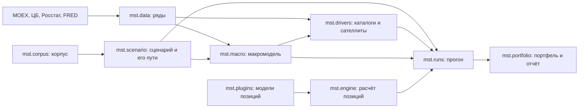

# Устройство

## Части и поток данных



| Пакет | Что делает | Где описан |
|---|---|---|
| `mst.data` | Загружает месячные ряды и хранит каждую версию значения с датой публикации | [src/mst/data](../src/mst/data/README.md) |
| `mst.macro` | Оценивает BVAR, идентифицирует шоки, строит условный прогноз и тяжесть сценария, проверяет модель на эпизодах | [src/mst/macro](../src/mst/macro/README.md) |
| `mst.drivers` | Находит объекты величин, загружает их ряды, оценивает и проверяет сателлиты, строит пути драйверов | [src/mst/drivers](../src/mst/drivers/README.md) |
| `mst.corpus` | Хранит манифест корпуса, скачивает оригиналы, переводит их в Markdown, пишет карточки эпизодов, режет корпус на фрагменты и ищет по ним | [src/mst/corpus](../src/mst/corpus/README.md) |
| `mst.scenario` | Хранит сценарий $(N, C, D, O)$, проверяет его и строит пути: условный прогноз с ограничениями и пути драйверов на тех же розыгрышах | [src/mst/scenario](../src/mst/scenario/README.md) |
| `mst.plugin_sdk` | Поверхность модели позиции: что она объявляет, читает из путей и возвращает; `plugin_sdk.testing` — конформанс-проверка и демо-расчёт | [src/mst/plugin_sdk](../src/mst/plugin_sdk/__init__.py) |
| `mst.engine` | Каталог моделей, подготовка входов, расчёт позиции и проверка того, что модель вернула; ветвления по типу актива нет | [src/mst/engine](../src/mst/engine/__init__.py) |
| `mst.plugins` | Пакеты типов активов: обнаружение `mst.plugins.<id>`, реестр объявлений и модели позиций | [src/mst/plugins](../src/mst/plugins/README.md) |
| `mst.portfolio` | Портфель, его проверка против версий, стоимость позиций и отчёт прогона | [src/mst/portfolio](../src/mst/portfolio/__init__.py) |
| `mst.mcp`, `mst.jobs`, `mst.runs`, `mst.store` | MCP-сервер, задачи, прогон и каталог workspace | [src/mst](../src/mst/README.md) |
| `dsh/` | Плагин DSH: запуск сервера, скиллы, раздел промпта | [dsh](../dsh/README.md) |

`python -m mst.plugin new|check|demo-run` создаёт пакет типа актива, проверяет его
объявление и считает демо-позицию; как устроен плагин — в [plugins.md](plugins.md),
контракты расчёта — в [platform.md](platform.md).

Пакеты зависят друг от друга в одну сторону: `data` ни от кого, `macro` от `data` (и от
контракта сценария), `drivers` от `data` и `macro`, `scenario` от `macro`, `drivers` и
`corpus`, `engine` от `plugin_sdk` и `plugins`, `runs` от `scenario`, `engine` и `portfolio`.
MCP-сервер только разбирает аргументы и вызывает одну функцию пакета или запускает задачу.
## Workspace

Всё состояние — файлы одного каталога. Путь к нему передаётся серверу ключом
`--workspace`; в git каталог не входит.

```
workspace/
  workspace.json          снимок для раздела промпта; пишет jobs(action="state")
  sources.toml            источники рядов, добавленные через series(action="add")
  series/<id>.csv         ряды: month, value, published, approximate
  drivers/catalog.json    объекты и драйверы, найденные каталогами
  models/macro/<sha256>/  версии макромодели: meta.json, arrays.npz
  models/satellites/<sha256>/  версии сателлитов
  models/backtest/        модели эпизодов бэктеста: macro/<sha256>/ и указатели <key>
  corpus/manifest.json    манифест корпуса; нужен бэктесту макромодели
  corpus/sources/, corpus/episodes/  тексты в Markdown и карточки эпизодов
  corpus/raw/, corpus/text/, corpus/series/  оригиналы, конспекты, дневные ряды D1–D5
  corpus/downloads.json   что скачано: адрес, хеш, размер, дата
  corpus/index/           chunks.jsonl, vectors.npy, vectors.json, state.json
  scenarios/<id>.json     сценарий: нарратив, ограничения, движущие шоки, надбавки, версии
  portfolios/<id>.json    портфель: базовая валюта и позиции (тип, валюта, номинал, коды, terms)
  runs/<id>/request.json  что запускать: сценарий, число розыгрышей, сид, портфель или позиции
  runs/<id>/meta.json     версии, дата расчёта, горизонт, сид, переменные и драйверы, статус
  runs/<id>/paths.npz     пути макропеременных и драйверов, (R, H + 1, n) и (R, H + 1, k)
  runs/<id>/results.json  результат каждой позиции: статус, метрики, причина отказа
  runs/<id>/changes.npz   изменение стоимости каждой позиции в каждом розыгрыше, (R, n)
  runs/<id>/summary.json  отчёт прогона портфеля: P5/P50/P95, ES95, δ, покрытие
  jobs/<id>/job.json, log.txt     задачи
  jobs/<resource>.lock    блокировка ресурса
```

Прогон — это функция от сценария, двух версий моделей, числа розыгрышей и сида: тот же
запрос даёт те же числа побитно. Позиция без обслуживаемого драйвера не исчезает из прогона:
она остаётся со статусом `invalid`, причиной и долей стоимости, которую отчёт не покрыл.

Конфигурация моделей (реестры переменных и величин, спецификации оценки, эпизоды
проверки) лежит в коде, в `src/mst/*/*.toml`, и входит в git. Версия модели хранит копию
своей спецификации, поэтому правка `.toml` не меняет уже оценённые версии.

## Ряды и даты публикации

Строка ряда `month, value, published, approximate` значит: значение за `month` стало
известно в день `published`. Пересмотр добавляет строку и сохраняет старую, поэтому
`as_of(day)` возвращает то, что было известно в тот день. Это нужно для проверки на прошлых
эпизодах: модель на дату 2014 года не должна видеть пересмотры 2016 года.

При первой загрузке пересматриваемого ряда истинные даты прошлых публикаций неизвестны:
дата оценивается как конец месяца плюс `lag_days` источника, а строка помечается
`approximate = 1`.

## Версии

Версия модели — неизменяемый каталог `<sha256>/` с `meta.json` и `arrays.npz`. Хеш
считается по каноническому JSON метаданных и по имени, типу, форме и байтам каждого массива;
одинаковая оценка даёт то же имя, а изменённый файл при загрузке отклоняется. Оценка
воспроизводима побитно: сид сэмплера записан в спецификации. Код версий общий для
макромодели и сателлитов (`mst.versions`); его хеш отличается от `store.sha256_of`, которым
хешируются объекты, потому что покрывает ещё и массивы.

Сателлиты оцениваются на панели конкретной макроверсии и хранят её хеш в поле `macro`.

## Задачи

Оценка моделей, загрузка данных и прогон идут минуты и часы, поэтому сервер не выполняет их
сами, а запускает дочерний процесс `python -m mst.<пакет> ...` (`mst.jobs.start`). У задачи
есть каталог `jobs/<id>/` с записью и логом. Задачи делят пять ресурсов: `series`, `models`,
`corpus`, `code`, `runs`; на одном ресурсе одновременно идёт одна задача, вторая получает
отказ `ResourceBusy`. Блокировка, чей процесс завершился, считается устаревшей и снимается.

Процесс задачи — обёртка `python -m mst.jobs`: она запускает команду и пишет её код выхода в
`jobs/<id>/exit.json`. `jobs(action="status")` возвращает его как `exit_code`; пока задача
идёт или если её отменили, там `null`. `jobs(action="state")` отмечает завершёнными задачи,
чьих процессов уже нет, и переносит код выхода в `job.json`.

## Раздел системного промпта

`dsh/index.js` добавляет в промпт каждого агента пять строк: путь workspace, короткие хеши
последних версий макромодели и сателлитов, дату индекса корпуса, число портфелей,
сценариев, прогонов и незавершённых задач. Строки строятся из `workspace.json`, и файл
перечитывается, только когда изменился. Последней версией считается каталог с `meta.json` и
самым поздним временем изменения; черновики `.draft-` не считаются, а модели бэктеста лежат
в другом каталоге.
