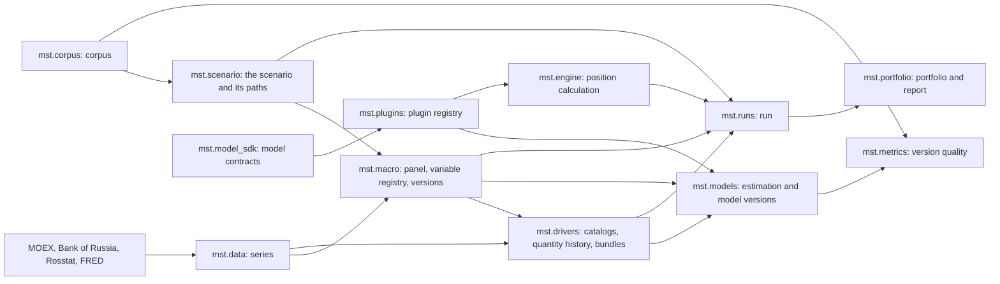

# System layout

The general scheme is in [formalization.en.md](formalization.en.md); this page shows how the code implements it.

## Parts and data flow



| Package | What it does | Described in |
|---|---|---|
| `mst.data` | Downloads monthly series and stores each version of a value with its publication date | [src/mst/data](../../src/mst/data/README.en.md) |
| `mst.macro` | Stores the macro variable registry, builds the panel on a date and stores macro model versions; the model itself is a plugin | [src/mst/macro](../../src/mst/macro/README.en.md) |
| `mst.drivers` | Finds the objects of quantities, downloads their series, prepares a quantity's history on the panel, assembles the satellite version bundle and builds driver paths level by level | [src/mst/drivers](../../src/mst/drivers/README.en.md) |
| `mst.corpus` | Stores the corpus manifest, downloads originals, converts them to Markdown, writes episode cards, cuts the corpus into fragments and searches them | [src/mst/corpus](../../src/mst/corpus/README.en.md) |
| `mst.scenario` | Stores the scenario, checks it and builds the paths: the conditional forecast under the conditions, the tilt for conditions on means, driver paths on the same draws, the reverse problem | [src/mst/scenario](../../src/mst/scenario/README.en.md) |
| `mst.plugin_sdk` | The surface of a position model: what it declares, reads from the paths and returns; `plugin_sdk.testing` is the conformance check and demo calculation | [src/mst/plugin_sdk](../../src/mst/plugin_sdk/README.en.md) |
| `mst.model_sdk` | The contracts of macro and satellite models: the scenario plan, the macro simulation, version parts, estimation contexts and the common conditional machinery | [src/mst/model_sdk](../../src/mst/model_sdk/README.en.md) |
| `mst.engine` | The model catalog, input preparation, position calculation and the check of what a model returned; no branching by asset type | [src/mst/engine](../../src/mst/engine/README.en.md) |
| `mst.plugins` | Model packages of three kinds: discovery of `mst.plugins.<id>`, entry points and `MST_PLUGINS_PATH`, one declaration registry; the reference models are BVAR, MS-VAR, the hierarchical satellite and the second-level regression | [src/mst/plugins](../../src/mst/plugins/README.en.md) |
| `mst.models` | The life cycle of model versions: estimation of the macro model and the satellite bundle, publication, list, description and the plugin catalog | [src/mst/models](../../src/mst/models/README.en.md) |
| `mst.metrics` | Version quality on historical episodes: cells $(e, t, q)$, CRPS, benchmarks, admission | [src/mst/metrics](../../src/mst/metrics/README.en.md) |
| `mst.portfolio` | The portfolio, its check against versions, position value and the run report | [src/mst/portfolio](../../src/mst/portfolio/README.en.md) |
| `mst.mcp`, `mst.jobs`, `mst.runs`, `mst.store` | The MCP server, jobs, runs and the workspace directory | [src/mst](../../src/mst/README.en.md) |
| `dsh/` | The DSH plugin: server start, skills, the prompt section | [dsh](../../dsh/README.en.md) |

In the terms of the general scheme: `mst.data` is the history; `mst.macro` with a plugin is the macro model, level 0; `mst.drivers` with plugins are the satellite models, the levels above; `mst.corpus` is the corpus; `mst.scenario` is the scenario; `mst.engine`, `mst.runs` and `mst.portfolio` are the calculation, the conditional forecast and the report; `mst.metrics` are the quality metrics.

`python -m mst.plugin new --kind position|satellite|macro` creates a working package of any kind, `check` verifies the declaration, and `demo-run` calculates a demo position; the structure of a plugin is in [../howto/plugins.en.md](../howto/plugins.en.md), the calculation contracts in [../reference/platform.en.md](../reference/platform.en.md).

Packages depend on each other in one direction: `data` on nothing, `model_sdk` on contracts, `macro` on `data`, `drivers` on `data` and `macro`, `scenario` on `macro`, `drivers` and `corpus`, `engine` on `plugin_sdk` and `plugins`, `models` and `metrics` on plugins, `runs` on `scenario`, `engine` and `portfolio`. The core (`scenario`, `runs`, `portfolio`, `engine`, `metrics`) names no concrete model: it asks the registry `mst.plugins`, and the registry is assembled from the packages `mst.plugins.<id>`, the entry points of installed distributions and the directories of `MST_PLUGINS_PATH`, so a model is developed separately and connected in any of the three ways. The MCP server only parses arguments and calls one package function or starts a job.

## Workspace

All state is the files of one directory. Its path reaches the server through the key `--workspace`, and the directory is not in git.

```
workspace/
  workspace.json          snapshot for the prompt section; written by jobs(action="state")
  sources.toml            series sources added through series(action="add")
  series/<id>.csv         series: month, value, published, approximate
  drivers/catalog.json    objects and drivers found by the catalogs
  models/macro/<sha256>/  macro model versions: meta.json, arrays.npz; meta["model"] names the plugin
  models/satellites/<sha256>/  satellite bundles: its own model for each quantity
  models/backtest/        backtest episode versions: macro/<sha256>/, satellites/<sha256>/ and pointers <key>
  corpus/manifest.json    the corpus manifest; the episode backtest needs it
  corpus/sources/, corpus/episodes/  texts in Markdown and episode cards
  corpus/raw/, corpus/text/, corpus/series/  originals, summaries, daily series D1–D5
  corpus/downloads.json   what was downloaded: address, hash, size, date
  corpus/index/           chunks.jsonl, vectors.npy, vectors.json, state.json
  scenarios/<id>.json     scenario: narrative, causes, conditions, impacts, versions, approver
  portfolios/<id>.json    portfolio: base currency and positions (type, currency, notional, codes, terms)
  runs/<id>/request.json  what to run: scenario, number of draws, seed, portfolio or positions
  runs/<id>/meta.json     versions, calculation date, horizon, seed, variables and drivers, status
  runs/<id>/paths.npz     paths of macro variables and drivers, (R, H + 1, n) and (R, H + 1, k)
  runs/<id>/results.json  the result of each position: status, metrics, refusal reason
  runs/<id>/changes.npz   the value change of each position in each draw, (R, n)
  runs/<id>/summary.json  the portfolio report: P5/P50/P95, ES95, the price, the coverage
  jobs/<id>/job.json, log.txt     jobs
  jobs/<resource>.lock    resource lock
```

A run is a function of the scenario, two model versions, the number of draws and the seed: the same request gives the same numbers bit for bit. The result of a run is twofold, as in the scheme: the conditional forecast of the target indicators (`forecast.json` with $P_5/P_{50}/P_{95}$ by month in own units, `run(action="result")`) and the portfolio report (`summary.json`); `targets` in the request names the indicators, all path drivers by default. A position without a served driver does not vanish from the run: it stays with the status `invalid`, a reason and the share of value the report did not cover.

The data configuration (the registries of variables and quantities, the check episodes) lives in the code, in `src/mst/*/*.toml`, and is in git; estimation specifications belong to the models and live in their packages (`src/mst/plugins/*/*.toml`). A model version stores a copy of its specification and the name of the plugin that estimated it, so editing a `.toml` does not change estimated versions, and only the plugin that created a version reads it back.

## Series and publication dates

A series row `month, value, published, approximate` means: the value for `month` became known on the day `published`. A revision adds a row and keeps the old one, so `as_of(day)` returns what was known on that day. Checks on past episodes depend on this: a model dated 2014 must not see the revisions of 2016.

On the first download of a revised series the true dates of past publications are unknown: the date is estimated as the end of the month plus the source's `lag_days`, and the row is marked `approximate = 1`.

## Versions

A model version is an immutable directory `<sha256>/` with `meta.json` and `arrays.npz`. The hash covers the canonical JSON of the metadata and the name, type, shape and bytes of each array; the same estimate gives the same name, and a changed file is rejected on load. Estimation is reproducible bit for bit: the sampler's seed is written in the specification. The version code is common to macro models and satellites (`mst.versions`); its hash differs from `store.sha256_of`, which hashes objects, because it also covers arrays.

Satellites are estimated on the panel of a specific macro version and store its hash in the field `macro`.

## Jobs

Model estimation, data download and runs take minutes to hours, so the server does not execute them itself but starts a child process `python -m mst.<package> ...` (`mst.jobs.start`). A job has a directory `jobs/<id>/` with a record and a log. Jobs share five resources: `series`, `models`, `corpus`, `code`, `runs`; one job runs on a resource at a time, and a second gets the refusal `ResourceBusy`. A lock whose process has ended counts as stale and is removed.

The job process is the wrapper `python -m mst.jobs`: it starts the command and writes its exit code to `jobs/<id>/exit.json`. `jobs(action="status")` returns it as `exit_code`, which is `null` while the job runs or if it was cancelled. `jobs(action="state")` marks jobs with no process left as finished and moves the exit code to `job.json`.

## System prompt section

`dsh/index.js` adds five lines to each agent's prompt: the workspace path, short hashes of the latest macro and satellite versions, the date of the corpus index, and the number of portfolios, scenarios, runs and jobs in progress. The lines are built from `workspace.json`, and the file is reread only when it has changed. The latest version is the directory with `meta.json` and the latest modification time; `.draft-` drafts do not count, and backtest models live in another directory.

There the plugin also registers three skills from `dsh/skills/`: `scenario-from-corpus` (how to assemble a scenario from corpus fragments), `run-report` (how to read $P_5$/$P_{50}$/$P_{95}$, ES95, the price and the flags) and `drivers` (what "satellite rejected" means and how to update the catalog). The skills are registered for the plugin's lifetime and removed on its shutdown. `node dsh/test/smoke.mjs` checks the registration and the prompt section without starting DSH.

## Glossary

Terms of data and implementation; the terms of the general scheme are in the [repository README](../../README.md).

| Term | Meaning |
|---|---|
| Series | A time series with the publication date of each value (`series/<id>.csv`) |
| Source | A loader of series of one kind (MOEX ISS, Bank of Russia, Rosstat, FRED) |
| Quantity | A kind of value of a level above: a stock price, a bond spread, an industry's overdue share, a housing price |
| Object | The bearer of a quantity: a security, an issuer, an industry, a region; codes `secid`, `isin`, `inn`, `okved`, `okato` |
| Catalog | Finds all objects of a quantity at a source |
| Asset type | A plugin extension: what inputs a position needs, how to find it, how to value it on paths |
| Run | Scenario × two model versions × number of draws × seed; a repeat gives the same numbers bit for bit |
| Job | A child process on one of the five resources; a record and a log in `jobs/<id>/` |
