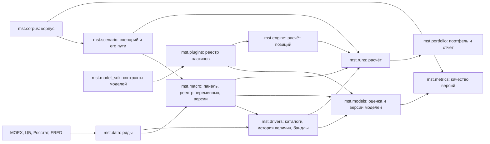

# Устройство системы

Общая схема — [formalization.md](formalization.md); ниже — как она реализована в коде.

## Части и поток данных



| Пакет | Что делает | Где описан |
|---|---|---|
| `mst.data` | Загружает месячные ряды и хранит каждую версию значения с датой публикации | [src/mst/data](../../src/mst/data/README.md) |
| `mst.macro` | Хранит реестр макропеременных, собирает панель на дату и хранит версии макромодели; сама модель — плагин | [src/mst/macro](../../src/mst/macro/README.md) |
| `mst.drivers` | Находит объекты величин, загружает их ряды, готовит историю величины на панели, собирает бандл сателлитной версии и строит пути драйверов | [src/mst/drivers](../../src/mst/drivers/README.md) |
| `mst.corpus` | Хранит манифест корпуса, скачивает оригиналы, переводит их в Markdown, пишет карточки эпизодов, режет корпус на фрагменты и ищет по ним | [src/mst/corpus](../../src/mst/corpus/README.md) |
| `mst.scenario` | Хранит сценарий, проверяет его и строит пути: условный прогноз при условиях, наклон под условия на средние, пути драйверов на тех же розыгрышах, обратная задача | [src/mst/scenario](../../src/mst/scenario/README.md) |
| `mst.plugin_sdk` | Поверхность модели позиции: что она объявляет, читает из путей и возвращает; `plugin_sdk.testing` — конформанс-проверка и демо-расчёт | [src/mst/plugin_sdk](../../src/mst/plugin_sdk/README.md) |
| `mst.model_sdk` | Контракты макро- и сателлитных моделей: план сценария, макросимуляция, части версии, контексты оценки и общая условная механика | [src/mst/model_sdk](../../src/mst/model_sdk/README.md) |
| `mst.engine` | Каталог моделей, подготовка входов, расчёт позиции и проверка того, что модель вернула; ветвления по типу актива нет | [src/mst/engine](../../src/mst/engine/README.md) |
| `mst.plugins` | Пакеты моделей трёх видов: обнаружение `mst.plugins.<id>`, entry points и `MST_PLUGINS_PATH`, один реестр объявлений; ссылочные модели — BVAR, MS-VAR, иерархический сателлит и регрессия второго уровня | [src/mst/plugins](../../src/mst/plugins/README.md) |
| `mst.models` | Жизненный цикл версий моделей: оценка макромодели и бандла сателлитов, публикация, список, описание и каталог плагинов | [src/mst/models](../../src/mst/models/README.md) |
| `mst.metrics` | Качество версий на исторических эпизодах: ячейки $(e, t, q)$, CRPS, эталоны, допуск | [src/mst/metrics](../../src/mst/metrics/README.md) |
| `mst.portfolio` | Портфель, его проверка против версий, стоимость позиций и отчёт расчёта | [src/mst/portfolio](../../src/mst/portfolio/README.md) |
| `mst.mcp`, `mst.jobs`, `mst.runs`, `mst.store` | MCP-сервер, задачи, расчёт и каталог workspace | [src/mst](../../src/mst/README.md) |
| `dsh/` | Плагин DSH: запуск сервера, скиллы, раздел промпта | [dsh](../../dsh/README.md) |

В терминах общей схемы: `mst.data` — история; `mst.macro` с плагином — макромодель, уровень 0;
`mst.drivers` с плагинами — сателлитные модели, уровни выше; `mst.corpus` — корпус;
`mst.scenario` — сценарий; `mst.engine`, `mst.runs` и `mst.portfolio` — расчёт,
условный прогноз и отчёт; `mst.metrics` — метрики качества.

`python -m mst.plugin new --kind position|satellite|macro` создаёт рабочий пакет любого
вида, `check` проверяет объявление, `demo-run` считает демо-позицию; как устроен плагин —
в [../howto/plugins.md](../howto/plugins.md), контракты расчёта — в
[../reference/platform.md](../reference/platform.md).

Пакеты зависят друг от друга в одну сторону: `data` ни от кого, `model_sdk` от контрактов,
`macro` от `data`, `drivers` от `data` и `macro`, `scenario` от `macro`, `drivers` и
`corpus`, `engine` от `plugin_sdk` и `plugins`, `models` и `metrics` от плагинов,
`runs` от `scenario`, `engine` и `portfolio`. Ядро (`scenario`, `runs`, `portfolio`,
`engine`, `metrics`) не называет ни одной конкретной модели: оно спрашивает реестр
`mst.plugins`, и реестр собирается из пакетов `mst.plugins.<id>`, entry points
установленных распределений и каталогов `MST_PLUGINS_PATH` — модель разрабатывается отдельно
и подключается любым из трёх способов. MCP-сервер только разбирает аргументы и вызывает одну
функцию пакета или запускает задачу.

## Workspace

Всё состояние — файлы одного каталога. Путь к нему передаётся серверу ключом
`--workspace`; в git каталог не входит.

```
workspace/
  workspace.json          снимок для раздела промпта; пишет jobs(action="state")
  sources.toml            источники рядов, добавленные через series(action="add")
  series/<id>.csv         ряды: month, value, published, approximate
  drivers/catalog.json    объекты и драйверы, найденные каталогами
  models/macro/<sha256>/  версии макромоделей: meta.json, arrays.npz; meta["model"] называет плагин
  models/satellites/<sha256>/  бандлы сателлитов: своя модель на каждую величину
  models/backtest/        версии эпизодов бэктеста: macro/<sha256>/, satellites/<sha256>/ и указатели <key>
  corpus/manifest.json    манифест корпуса; нужен эпизодному бэктесту
  corpus/sources/, corpus/episodes/  тексты в Markdown и карточки эпизодов
  corpus/raw/, corpus/text/, corpus/series/  оригиналы, конспекты, дневные ряды D1–D5
  corpus/downloads.json   что скачано: адрес, хеш, размер, дата
  corpus/index/           chunks.jsonl, vectors.npy, vectors.json, state.json
  scenarios/<id>.json     сценарий: нарратив, причины, условия, воздействия, версии, утвердивший
  portfolios/<id>.json    портфель: базовая валюта и позиции (тип, валюта, номинал, коды, terms)
  runs/<id>/request.json  что запускать: сценарий, число розыгрышей, сид, портфель или позиции
  runs/<id>/meta.json     версии, дата расчёта, горизонт, сид, переменные и драйверы, статус
  runs/<id>/paths.npz     пути макропеременных и драйверов, (R, H + 1, n) и (R, H + 1, k)
  runs/<id>/results.json  результат каждой позиции: статус, метрики, причина отказа
  runs/<id>/changes.npz   изменение стоимости каждой позиции в каждом розыгрыше, (R, n)
  runs/<id>/summary.json  отчёт расчёта портфеля: P5/P50/P95, ES95, цена, покрытие
  jobs/<id>/job.json, log.txt     задачи
  jobs/<resource>.lock    блокировка ресурса
```

Расчёт — это функция от сценария, двух версий моделей, числа розыгрышей и сида: тот же
запрос даёт те же числа побитно. Результат расчёта двойной, как в схеме: условный прогноз
целевых показателей (`forecast.json` — $P_5/P_{50}/P_{95}$ по месяцам в собственных
единицах, `run(action="result")`) и отчёт портфеля (`summary.json`); `targets` запроса
называет показатели, по умолчанию все драйверы путей. Позиция без обслуживаемого драйвера
не исчезает из расчёта: она остаётся со статусом `invalid`, причиной и долей стоимости,
которую отчёт не покрыл.

Конфигурация данных (реестры переменных и величин, эпизоды проверки) лежит в коде, в
`src/mst/*/*.toml`, и входит в git; спецификации ОЦЕНКИ принадлежат моделям и лежат в их
пакетах (`src/mst/plugins/*/*.toml`). Версия модели хранит копию своей спецификации и
имя оценившего плагина, поэтому правка `.toml` не меняет уже оценённые версии, а читает
версию обратно только тот плагин, который её создал.

## Ряды и даты публикации

Строка ряда `month, value, published, approximate` значит: значение за `month` стало
известно в день `published`. Пересмотр добавляет строку и сохраняет старую, поэтому
`as_of(day)` возвращает то, что было известно в тот день. Это нужно для проверки на прошлых
эпизодах: модель на дату 2014 года не должна видеть пересмотры 2016 года.

При первой загрузке пересматриваемого ряда истинные даты прошлых публикаций неизвестны:
дата оценивается как конец месяца плюс `lag_days` источника, а строка помечается
`approximate = 1`.

## Версии

Версия модели — неизменяемый каталог `<sha256>/` с `meta.json` и `arrays.npz`. Хеш
считается по каноническому JSON метаданных и по имени, типу, форме и байтам каждого массива;
одинаковая оценка даёт то же имя, а изменённый файл при загрузке отклоняется. Оценка
воспроизводима побитно: сид сэмплера записан в спецификации. Код версий общий для
макромодели и сателлитов (`mst.versions`); его хеш отличается от `store.sha256_of`, которым
хешируются объекты, потому что покрывает ещё и массивы.

Сателлиты оцениваются на панели конкретной макроверсии и хранят её хеш в поле `macro`.

## Задачи

Оценка моделей, загрузка данных и расчёт идут минуты и часы, поэтому сервер не выполняет их
сами, а запускает дочерний процесс `python -m mst.<пакет> ...` (`mst.jobs.start`). У задачи
есть каталог `jobs/<id>/` с записью и логом. Задачи делят пять ресурсов: `series`, `models`,
`corpus`, `code`, `runs`; на одном ресурсе одновременно идёт одна задача, вторая получает
отказ `ResourceBusy`. Блокировка, чей процесс завершился, считается устаревшей и снимается.

Процесс задачи — обёртка `python -m mst.jobs`: она запускает команду и пишет её код выхода в
`jobs/<id>/exit.json`. `jobs(action="status")` возвращает его как `exit_code`; пока задача
идёт или если её отменили, там `null`. `jobs(action="state")` отмечает завершёнными задачи,
чьих процессов уже нет, и переносит код выхода в `job.json`.

## Раздел системного промпта

`dsh/index.js` добавляет в промпт каждого агента пять строк: путь workspace, короткие хеши
последних версий макромодели и сателлитов, дату индекса корпуса, число портфелей,
сценариев, расчётов и задач в работе. Строки строятся из `workspace.json`, и файл
перечитывается, только когда изменился. Последней версией считается каталог с `meta.json` и
самым поздним временем изменения; черновики `.draft-` не считаются, а модели бэктеста лежат
в другом каталоге.

Там же плагин регистрирует три скилла из `dsh/skills/`: `scenario-from-corpus` (как собрать
сценарий из фрагментов корпуса), `run-report` (как читать $P_5$/$P_{50}$/$P_{95}$,
ES95, цену и пометки) и `drivers` (что значит «сателлит отвергнут» и как обновить
каталог). Скиллы регистрируются на время жизни плагина и снимаются при его выключении.
`node dsh/test/smoke.mjs` проверяет регистрацию и раздел промпта без запуска DSH.

## Словарь

Термины данных и реализации; термины общей схемы — в [README репозитория](../../README.ru.md).

| Термин | Что это |
|---|---|
| Ряд | Временной ряд с датой публикации каждого значения (`series/<id>.csv`) |
| Источник | Загрузчик рядов одного вида (MOEX ISS, Банк России, Росстат, FRED) |
| Величина | Вид величины уровня выше: цена акции, спред облигации, доля просрочки отрасли, цена жилья |
| Объект | Носитель величины: бумага, эмитент, отрасль, регион; коды `secid`, `isin`, `inn`, `okved`, `okato` |
| Каталог | Находит все объекты величины у источника |
| Тип актива | Плагинное расширение: какие входы нужны позиции, как её найти, как оценить позицию на путях |
| Расчёт | Сценарий × две версии моделей × число розыгрышей × сид; повтор даёт те же числа побитно |
| Задача | Дочерний процесс на одном из пяти ресурсов; запись и лог в `jobs/<id>/` |

