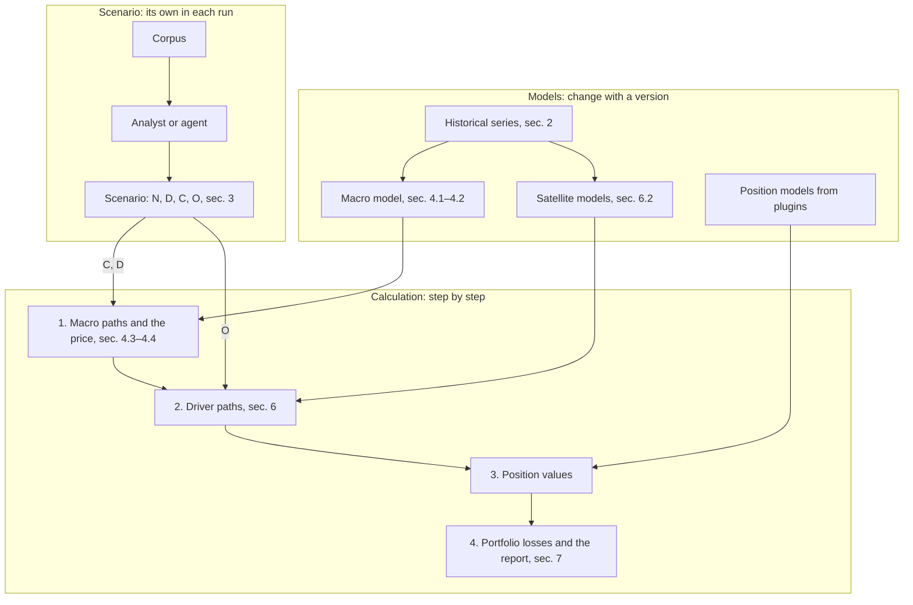

# Legacy description of the BVAR method

**This document is outdated and is not the canon.** It describes the first version of the method with a single BVAR macro model and in places differs from the current scenario contract. The canon is [formalization.en.md](formalization.en.md); the code refers here only for details of estimating the BVAR and the satellites.

A stress-test scenario sets the paths of several macro variables, for example the key rate and the oil price, and names the economic shocks that cause these paths. A macro model estimated on history completes them with consistent paths of the other macro variables, and satellite models translate macro variables into drivers: indicators of industries, regions, companies and other parts of the economy on which the value of positions depends. Position values give the portfolio loss.

In the diagram, the models, which are estimated on history and change only with a new version, are separated from the scenario, which is different in each run. The calculation goes step by step, and each step takes one of the models and a part of the scenario.

The reverse stress test (sec. 5) starts the same calculation, varying the width of the scenario's conditions.

## 1. Time

Time is counted in months and denoted $t$. Month $t=0$ corresponds to the calculation date, months $t\le 0$ belong to history, and months $t=1,\dots,H$ form the scenario horizon of length $H$ months. If a report needs quarters, monthly values are aggregated in it, and the model stays monthly.

**Implementation.** Month $t=0$ is the last month for which at least one variable is known on the calculation date, not the month of the date itself (`mst.macro.panel.build_panel`). The horizon is limited to 360 months (`mst.contracts.Horizon`).

## 2. Macro variables

The platform keeps a registry of $n$ macro variables numbered by the index $i=1,\dots,n$. Let $X_{i,t}$ be the value of variable $i$ in month $t$ in original units: a rate in percent, an exchange rate in rubles per dollar. Models work with the transformed series $y_{i,t}=g_i(X_{i,t})$, where the function $g_i$ is written in the registry below. Rates and spreads are not transformed, $g_i(X)=X$. Exchange rates, prices, indices and volumes are taken in logarithms, $g_i(X)=100\ln X$, so the difference of two values approximates the change in percent. Volumes and prices are seasonally adjusted. The vector of all transformed variables for month $t$ is $y_t=(y_{1,t},\dots,y_{n,t})^\top$.

The registry variables split into a global and a Russian block. Global variables affect Russian ones, while Russian ones do not affect global ones; section 4.1 writes this as a ban on the corresponding coefficients.

GDP is published quarterly, so in the registry it is replaced by the monthly output index of basic activities.

Series are stored with the publication date of each value, because Rosstat and the Bank of Russia revise published data. A calculation on the date $t=0$ sees each value in the version published by that date. Without this, the check on past episodes (section 9) would use data that did not yet exist at the time of the episode.

The registry of variables and their transformations:

| Identifier | Variable | Block | $g_i(X)$ | Source |
|---|---|---|---|---|
| `gl.brent` | Brent oil, USD per barrel | global | $100\ln X$ | FRED |
| `gl.fed_rate`, `gl.ust_10y` | Fed rate and 10-year UST yield, % | global | $X$ | FRED |
| `gl.vix` | VIX volatility index | global | $100\ln X$ | FRED |
| `ru.key_rate` | key rate, % | Russian | $X$ | Bank of Russia |
| `ru.ruonia` | RUONIA rate, % | Russian | $X$ | Bank of Russia |
| `ru.ofz_1y`, `ru.ofz_5y`, `ru.ofz_10y` | OFZ yield at 1, 5 and 10 years on the G-curve, % | Russian | $X$ | MOEX |
| `ru.spread_aa`, `ru.spread_a`, `ru.spread_bbb` | spread of corporate bonds of a rating group over the G-curve, pp | Russian | $X$ | calculated from MOEX quotes |
| `ru.usdrub`, `ru.cnyrub` | official dollar and yuan exchange rate | Russian | $100\ln X$ | Bank of Russia |
| `ru.cpi` | consumer price index | Russian | $100\ln X$ | Rosstat |
| `ru.output` | output index of basic activities | Russian | $100\ln X$ | Rosstat |
| `ru.unemployment` | unemployment, % | Russian | $X$ | Rosstat |
| `ru.real_wage` | real wage index | Russian | $100\ln X$ | Rosstat |
| `ru.retail` | retail turnover index | Russian | $100\ln X$ | Rosstat |
| `ru.credit` | credit to organizations and households, RUB | Russian | $100\ln X$ | Bank of Russia |
| `ru.mortgage_rate` | average mortgage rate, % | Russian | $X$ | Bank of Russia |
| `ru.housing_price` | housing price, RUB per m² | Russian | $100\ln X$ | Rosstat |
| `ru.imoex` | MOEX index | Russian | $100\ln X$ | MOEX |

**Implementation.** The registry is `src/mst/macro/registry.toml`, the series sources are in `src/mst/data/sources.toml`. Rosstat series are stored without seasonal adjustment. The seasonality of `ru.cpi`, `ru.output`, `ru.unemployment`, `ru.real_wage` and `ru.retail` (the list `seasonal` in `src/mst/macro/spec.toml`) is removed when the panel is built: a constant calendar profile, estimated from the mean increments in each calendar month on data known by the calculation date, is subtracted from the series. OFZ yields come from the zero-coupon curve table on the Bank of Russia site. A month with no value (quarterly housing prices, a series that starts later, a jagged edge of publications) stays missing, and the model draws it (section 4.1).

## 3. Scenario

Write the path of all variables over the horizon as one vector $\mathbf y=(y_1^\top,\dots,y_H^\top)^\top$ of length $nH$. A scenario has four parts: the narrative $N$, the set of causes $D$, the set of conditions $C$ on the path $\mathbf y$ and the set of direct impacts $O$.

The narrative $N$ explains in text what is happening and why, with references to corpus sources.

A condition $c\in C$ is a triple $c=(w_c,a_c,b_c)$ and means $a_c\le w_c^\top\mathbf y\le b_c$. The weight vector $w_c$ of length $nH$ selects what is restricted, and the numbers $a_c<b_c$ set the allowed range; an exact value is expanded to an interval of half-width $\tau$. One such record covers all the needed kinds of restriction. If $w_c$ has a single non-zero weight 1 at variable $i$ in month $t$, the value $y_{i,t}$ is restricted. A weight $+1$ at month $t_2$ and $-1$ at month $t_1$ of the same variable restricts its change between these months. Three weights of $1/3$ restrict a quarterly mean, and weights $+1$ and $-1$ at two different variables in one month restrict the difference between them, for example a spread. The scenario does not set paths with no conditions: the macro model completes them. The number of conditions is denoted $m$.

The set $D$ names the shocks from the list in section 4.2 that cause the paths from $C$ in this scenario. For example, "a 21 % rate because of an inflation shock" means a condition on the key rate and $D=\lbrace\text{inflation}\rbrace$. The other shocks are drawn from their usual distribution. An empty $D$ means the cause of the paths is not stated and any shock may meet the conditions.

Impacts $O$ are described in section 6.3.

**Implementation.** The contract is `mst.scenario.contracts.Scenario`: `narrative`, `sources`, `horizon`, `constraints`, `causes`, `regime_event`, `impacts`, `approved_by`. A condition is a list of terms `terms` (variable, month, weight), bounds `low < high` in the model scale $y=g(X)$ or an exact `value` (the platform expands it to an interval), and a mark `basis`: corpus sources or the word `assumption`. A scenario is stored in the workspace as the file `scenarios/<id>.json`, and `scenario(action="validate")` names each infeasible combination before the calculation; a scenario with no approver is not calculated.

## 4. Macro model

### 4.1. Model

Macro variables follow a vector autoregression: the value of each variable in month $t$ depends linearly on the values of all variables in the previous $p$ months plus a random error,

$$
y_t=\kappa+A_1y_{t-1}+\dots+A_py_{t-p}+u_t.
$$

Here $p$ is the number of past months taken into account, $\kappa$ is a constant vector of length $n$, $A_1,\dots,A_p$ are coefficient matrices of size $n\times n$, and $u_t$ is the error vector of month $t$. The coefficients through which Russian variables would affect global ones equal zero.

The errors are sums of economic shocks, independent causes of movement: $u_t=B\varepsilon_t$. The vector $\varepsilon_t=(\varepsilon_{1,t},\dots,\varepsilon_{n,t})^\top$ holds $n$ shocks numbered by the index $j$, and the square matrix $B$ of size $n\times n$ shows how each shock moves each variable in the month it appears. Global shocks move Russian variables, while Russian shocks do not move global variables.

Shock $j$ in month $t$ equals

$$
\varepsilon_{j,t}=e^{h_{j,t}/2}\sqrt{\omega_{j,t}}\,z_{j,t},
$$

where $z_{j,t}$ is a standard normal variable and the two factors before it set the size of the shock.

The factor $e^{h_{j,t}/2}$ is the shock's volatility, which changes over time. The log variance $h_{j,t}$ wanders: $h_{j,t}=h_{j,t-1}+s_j\xi_{j,t}$, where $\xi_{j,t}$ is a standard normal variable and $s_j$ the speed of volatility change. This way the model accounts for all series moving more in a crisis.

The factor $\omega_{j,t}$ has an inverse gamma law with parameters $\nu_j/2$ and $\nu_j/2$. It makes the shock's distribution Student with $\nu_j$ degrees of freedom, that is, heavy-tailed, and the model allows rare very large moves like December 2014. All variables $z$, $\xi$, $\omega$ are independent of each other and over time.

All parameters of the model together are denoted $\theta$: these are $\kappa$, $A_1,\dots,A_p$, $B$, the speeds $s_j$ and the degrees of freedom $\nu_j$. They are estimated in a Bayesian way on history starting from month $T_0<0$. The prior pulls the coefficients towards a simple model in which a non-stationary variable stays at its past level and a stationary one returns to its mean; the number $\lambda>0$ sets the strength of this pull. The result of estimation is a sample of $\theta$ from the posterior together with the historical paths of the volatilities $h_{j,t}$ for $t\le 0$. The numbers $T_0$, $p$, $\lambda$ and the dummies for regime changes (the move to a floating exchange rate in November 2014, February–March 2022) are stored in the model version.

**Implementation** (`mst.plugins.bvar.estimate`, `mst.plugins.bvar.sv`, parameters in `src/mst/plugins/bvar/spec.toml`; the macro model is the plugin `bvar.sv`, and the core `mst.macro` stores the variable registry, the panel and the versions).

- $T_0$ is January 2012, $p=3$, $\lambda=0.2$. `gl.vix` and the three spreads count as stationary.
- The sampler is the triangular algorithm of Carriero, Clark, Marcellino (2019) in its corrected form (Carriero, Chan, Clark, Marcellino, 2022): $u_t=Ce_t$ with a unit lower triangular $C$, and each component $e_{j,t}$ has its own stochastic volatility and Student tails. The matrix $B$ follows from $C$ by a rotation (section 4.2). The walk $h$ is drawn with the mixture of Kim, Shephard, Chib (1998).
- The prior of $s_j^2$ is an inverse gamma with mean 0.03 and 60 degrees of freedom. It is narrow on purpose: with 5 degrees of freedom the median of $s_j$ for `gl.fed_rate` reached 4.0 per month, and the paths exploded within three months.
- The prior of $\nu_j$ is uniform on the integers from 3 to 50.
- There is a variant with constant volatility (`volatility = "constant"`): a conjugate BVAR with block exogeneity after Zha (1999), without MCMC.
- Missing panel values are drawn inside the sampler from the conditional normal distribution.
- Dummies: impulses 2014-11, 2022-02, 2022-03 and a step 2021-01 for the splice of spreads (the international rating scale until 2020-12, the national one from 2021-01).

The second installed macro model is the MS-VAR `msvar.markov`, in which the constant, the lag coefficients and the error covariance switch by a Markov regime; its equation is in the canon, and the details are in [../../src/mst/plugins/msvar/README.en.md](../../src/mst/plugins/msvar/README.en.md).

### 4.2. Identification of shocks

Data determine the covariance of the errors but not the matrix $B$: many matrices give the same covariance. To give shocks economic meaning, some of them are set by sign restrictions: a shock must move the listed variables in the listed direction in the month it appears and the next two months. Only matrices $B$ that satisfy all signs fit, and in each parameter draw one of them is chosen with equal probability (Rubio-Ramírez, Waggoner, Zha, 2010). The other shocks stay unnamed.

| Shock | Rises | Falls |
|---|---|---|
| monetary | `ru.key_rate`, `ru.ruonia`, `ru.ofz_1y` | `ru.usdrub`, `ru.imoex` |
| inflation | `ru.cpi`, `ru.key_rate` | `ru.real_wage` |
| exchange rate and risk premium | `ru.usdrub`, `ru.ofz_10y`, `ru.spread_bbb` | `ru.imoex` |
| oil | `gl.brent` | `ru.usdrub` |
| global financial | `gl.vix` | `gl.ust_10y`, `ru.imoex` |

The sign table is a hypothesis: it is stored in the model version and checked with it (section 9).

**Implementation** (`mst.plugins.bvar.identify`). The shock identifiers in the model's sign table (`src/mst/plugins/bvar/signs.toml`) are `ru.monetary`, `ru.inflation`, `ru.fx_risk`, `gl.oil`, `gl.financial`; unnamed ones get the names `gl.unnamed_k` and `ru.unnamed_k`. The impact matrix is $B=C\mathrm{diag}(e^{h_0/2})Q$, where $h_0$ are the volatilities of the last month of history and the orthogonal $Q$ is block-diagonal (the global block first), so a Russian shock cannot move a global variable. The named columns of $Q$ are drawn from the uniform distribution until the signs hold; each parameter draw gets up to 20 000 rotations, and a draw with no admissible rotation is discarded. The remaining share is visible in `model(kind="macro", action="describe")`.

### 4.3. Conditional forecast

Collect the shocks over the horizon in a vector $\boldsymbol\varepsilon=(\varepsilon_1^\top,\dots,\varepsilon_H^\top)^\top$ of length $nH$. Given the parameters $\theta$ and the history, the path is linear in the shocks:

$$
\mathbf y=\mu+\Phi\boldsymbol\varepsilon.
$$

The vector $\mu$ is the forecast at zero shocks, and the matrix $\Phi$ shows how each shock moves each variable in this and later months. If the future volatilities $h_{j,t}$ and the factors $\omega_{j,t}$ have been drawn, each shock $\varepsilon_{j,t}$ is normal with zero mean and known variance $e^{h_{j,t}}\omega_{j,t}$. The diagonal matrix of these variances is denoted $\Lambda$.

Write all conditions of the scenario as one inequality $\mathbf a\le W\mathbf y\le\mathbf b$: the rows of $W$ are the vectors $w_c^\top$, and the vectors $\mathbf a$ and $\mathbf b$ collect the bounds $a_c$ and $b_c$.

Split the shocks into causes, the shocks from $D$ in all months of the horizon, and the rest; with an empty $D$ all shocks are causes. The parts of the shock vector are $\boldsymbol\varepsilon_D$ and $\boldsymbol\varepsilon_{\bar D}$, the corresponding parts of $\Phi$ are $\Phi_D$ and $\Phi_{\bar D}$, those of $\Lambda$ are $\Lambda_D$ and $\Lambda_{\bar D}$. The other shocks are drawn as usual from the normal $\mathcal N(0,\Lambda_{\bar D})$. The causes are drawn from their distribution $\mathcal N(0,\Lambda_D)$ given that the conditions hold:

$$
\mathbf a-W\mu-W\Phi_{\bar D}\boldsymbol\varepsilon_{\bar D}\ \le\ W\Phi_D\boldsymbol\varepsilon_D\ \le\ \mathbf b-W\mu-W\Phi_{\bar D}\boldsymbol\varepsilon_{\bar D}.
$$

Put $Z=W\Phi_D$. A scenario is admissible if the rows of $Z$ are linearly independent, that is, there are enough causes to meet all conditions. Otherwise the calculation rejects the scenario and names the conditions that cannot be met.

The law of the causes is a normal truncated by the inequality above, and they are drawn from it with the Gibbs sampler for the truncated normal distribution (Geweke, 1991). The approach is described in Antolín-Díaz, Petrella, Rubio-Ramírez, "Structural scenario analysis with SVARs" (Journal of Monetary Economics, 2021).

Hidden coordinates, the future volatilities of the BVAR and the regime path of the MS-VAR, are part of the causes when no causes are named or when they are named themselves. They cannot be drawn before the conditions: a candidate is chosen with the weight $\pi_\theta(\zeta)P(S\mid\theta,\zeta)$ the canon prescribes.

**Implementation** (`mst.plugins.bvar.forecast.simulate`, `mst.plugins.msvar.forecast.simulate`; the common machinery of conditions is `mst.model_sdk.conditional`). The scale of the shocks is moved into the impact matrix: $B_t=C\mathrm{diag}(e^{h_t/2}\sqrt{\omega_t})Q$, and $\boldsymbol\varepsilon$ is standard normal, so $\Lambda=I$ and the formulas above simplify. The matrix $\Phi$ is not built in full, only the rows of $W\Phi$ are calculated. A condition counts as dependent if the causes move it beyond the already fixed rows by less than $10^{-9}$ of how much all shocks move it; the scenario is then rejected with the condition numbers (`InfeasibleScenario`). Interval conditions get 50 Gibbs sweeps. A group of $R$ holds `LATENT_CANDIDATES` = 64 candidates of a hidden coordinate; the log probability of the box for each comes from the GHK sampler (`log_box_probability`), which stays accurate in both tails, and the effective size of the weights goes to the run diagnostics.

### 4.4. Price of a scenario

The price of a scenario is the Kullback–Leibler divergence of its overlay from the base measure, $\mathrm{dist}(s)=\mathrm{KL}(P_s\Vert P)$; with a support condition alone it equals

$$
\mathrm{dist}(s)=\mathbb E_P\big[-\log P(S\mid R)\big],\qquad R=(\theta,\omega_{\bar D}).
$$

An event some value of $R$ cannot reach has an infinite price, and the scenario contradicts the models (Lemma 2 of the canon). The price grows when fewer causes explain the event, and $-\log P(S)$ beside it shows the lower bound; the difference at $R=\theta$ comes from parameter uncertainty alone.

A condition on a mean or a probability, $\ell\le\mathbb E_Qf\le r$, is imposed by the exponential tilt of the causes inside each value of $R$, and the price of the tilt adds to the price of the support. For an exact value the price depends on the tolerance $\tau$, so scenarios can be compared only at equal tolerances.

**Implementation** (`mst.model_sdk.dist.price_of_law`, the model interface `constraint_law`, the field `dist` in `mst.scenario.build.Paths` and in the run report). A model returns the rows of the law of $W\mathbf y$: a Gaussian law per row, grouped by the value of $R$, with candidates of a hidden coordinate and importance weights. The platform turns the rows of a group into $P(S\mid R)$ by GHK and averages over the groups. The tilt is `mst.scenario.overlay`: it finds $\lambda$ from the convex dual and turns the weights into a plain sample by systematic resampling inside the groups. Conditions on the drivers of the levels above are met in the same overlay: paths that break them are dropped inside each group of $R$, and the price is the mean of $-\log$ of the surviving share, split by level by the chain rule (`Dist.by_level`). A scenario with no conditions has no price.

## 5. Reverse stress test

The reverse stress test keeps the versions, the impacts $O$ and the causes $D$ and varies the width $c$ of the conditions. Two questions are solved:

$$
\sup\big\lbrace\rho(s(c)):\ \mathrm{dist}(s(c))\le\kappa\big\rbrace,
\qquad
\inf\big\lbrace\mathrm{dist}(s(c)):\ \rho(s(c))\ge L^\ast\big\rbrace,
$$

where $\rho$ is the expected shortfall of the portfolio loss at 95 %. The result is an ordinary scenario that goes through the same calculation and the same approval.

**Implementation** (`mst.scenario.reverse`, `scenario(action="reverse")`, `python -m mst.scenario reverse`). `width_family` narrows and widens each support condition around its midpoint by one factor, and $c=1$ is the scenario itself; a family whose impacts move with $c$ is refused. The search evaluates a coarse grid of $c$ and refines the boundary by five bisections. Conditions on means and probabilities stay fixed.

## 6. Drivers and satellite models

### 6.1. Drivers

Macro variables describe the economy as a whole, while a position's value often depends on quantities of a part of it. Such a quantity is called a driver. In the terms of the general scheme, level 0 is the macro variables, the drivers are the quantities of the levels above, and a satellite model is the transmission $G^l$ (section 6.2).

A driver is a pair of an object and a quantity. An object is what the quantity refers to: an industry, a region, a rating group, an asset class, a single company or a bond issue. A quantity is a measurable property of an object: a price, a rate, a spread, revenue, a share of overdue loans, a default frequency. Objects of one level form a class (all industries, all companies), and objects of different levels are nested: a company belongs to an industry. The type of a driver is a pair of an object class and a quantity, for example "industry revenue" or "company spread".

Drivers are numbered by the index $k=1,\dots,K$. The value of driver $k$ in month $t$ is denoted $d_{k,t}$ and is transformed like macro variables in section 2. A quantity becomes a driver if it has a recorded unit and transformation, a history of observations of this object or objects of its class, and at least one position model needs it. Observations can be rarer than monthly, for example a company's annual accounts: the model stays monthly, and estimation accounts for observing a sum or a mean over the period.

A macro variable differs from a driver in that it affects other macro variables and is needed for the consistency of the scenario, while a driver does not affect macro variables. One quantity therefore cannot be both. A position model can read both drivers and macro variables: a bond needs the OFZ curve, which is a macro variable. A model declares which quantities it needs and does not know how they were obtained.

**Implementation** (`src/mst/drivers/registry.toml`, `mst.drivers.catalogs`). Five quantities are declared:

| Quantity | Objects | Transformation | Regressors | Source of objects |
|---|---|---|---|---|
| `share_price` | shares under MOEX industry indices | $100\ln d$ | `ru.imoex`, `ru.usdrub`, `ru.key_rate`, `gl.brent` | catalog `moex_shares` |
| `bond_spread` | issues under issuers and rating groups | $d$ | three spreads, `ru.key_rate`, `ru.ofz_5y` | catalog `moex_bonds` |
| `overdue_share` | industries of the Bank of Russia table 01_02_A | logit | `ru.key_rate`, `ru.output`, `ru.usdrub`, `ru.imoex` and the rate above 15 % | catalog `cbr_activities` |
| `housing_price_primary`, `housing_price_secondary` | Russia, federal districts, regions | $100\ln d$, quarterly values | `ru.mortgage_rate`, `ru.key_rate`, `ru.cpi`, `ru.real_wage` | catalog `rosstat_regions` |

A catalog finds objects at a source and writes them to `workspace/drivers/catalog.json`; a driver series is stored as an ordinary series `drv.<quantity>.<object>`. An object has codes (`secid`, `isin`, `inn`, `okved`, `okato`), and a position is matched with the deepest object whose code is a prefix of its code (`Registry.match`).

### 6.2. Satellite model

Each driver is linked to the macro variables by the model

$$
d_{k,t}=\alpha_k+\rho_kd_{k,t-1}+\beta_{k,0}^\top x_t+\beta_{k,1}^\top x_{t-1}+\dots+\beta_{k,\bar\ell_k}^\top x_{t-\bar\ell_k}+e_{k,t}.
$$

The vector $x_t$ holds the macro variables $y_t$ and their transformations declared in advance, for example $\max(0, y_{i,t}-25)$ for a rate above 25 %. Non-linearity enters the model through such transformations, and estimation stays linear in the parameters. Further, $\alpha_k$ is a constant, $\rho_k$ the share of the driver's past value carried into the current one, $\beta_{k,\ell}$ a vector of the driver's sensitivities to the elements of $x$ lagged by $\ell$ months, $\bar\ell_k$ the largest lag and $e_{k,t}$ a random residual.

The residuals of different drivers in one month are correlated: the vector $e_t=(e_{1,t},\dots,e_{K,t})^\top$ is normal with zero mean and covariance $\Sigma_e$. If a driver is a share or a probability, the model describes its logit $\ln\frac{d}{1-d}$.

Collect the parameters of driver $k$ in a vector $\gamma_k=(\alpha_k,\rho_k,\beta_{k,0},\dots,\beta_{k,\bar\ell_k})$. Drivers are estimated together by a hierarchical model that repeats the nesting of objects. Let $\tau$ be the type of driver $k$ and $\gamma^\uparrow_k$ the parameters of the driver of the same quantity at the object one level up: for a company's revenue these are the parameters of its industry's revenue. If there is no such object, $\gamma^\uparrow_k=\bar\gamma_\tau$, the common parameters of all drivers of type $\tau$. Then

$$
\gamma_k=\gamma^\uparrow_k+\eta_k,
$$

where the deviation $\eta_k$ is normal with zero mean and covariance $\Psi_\tau$, which is estimated too. If an object has little data or its data differ little from the object one level up, the estimate of $\eta_k$ is close to zero and the object gets the parameters of the level above; if they differ markedly, the object gets its own. An object with no history of its own takes the parameters of the level above entirely, and the result carries a flag about it. A model version stores the data, the estimation period, the composition of $x_t$, a sample of parameters from the posterior and the out-of-sample forecast errors.

**Implementation** (`mst.plugins.hier.estimate`, parameters in `src/mst/plugins/hier/spec.toml`; quantity history preparation is `mst.drivers.history`, the assembly of a version from parts of several models is `mst.drivers.bundle`).

- $\Psi_\tau$ is diagonal, a special case of the full covariance.
- $\Sigma_e$ is estimated after the sampler, from the residuals at the posterior mean over the months two drivers observe together (at least 12).
- $\lvert\rho_k\rvert\le 0.99$: a draw above the bound is cut off by a truncated conditional distribution, because an explosive root has no finite path. The first month of the chain comes from the stationary distribution.
- Unobserved months of a driver are drawn in the sampler; a quarterly value (`span = 3`) sets the mean of three months. A path ends at the last month for which the panel knows $x$.
- The largest lag $\bar\ell_k$ is from 0 to 3; now it is 1 for all quantities.
- Estimation runs in a scale where regressor columns are centered and divided by the standard deviation within an object, so one prior deviation `spread = 0.1` fits all coefficients.

### 6.3. Direct impacts

Some shocks do not reach drivers through macro variables, for example sanctions against one industry or an export ban. For them a scenario has an impact $o=(k,t_1,t_2,\Delta)\in O$: to a quantity $k$, a driver of a level above 0 or a macro variable of level 0, the number $\Delta$ is added in months $t_1$ to $t_2$ in the model scale of its level. An impact comes with a text justification referring to a source and is reflected in the result by a separate flag.

An impact on a macro variable is an additive shift $x^0=G^0(\omega^0)+o^0$: it applies to the path of level 0 after $G^0$ and does not spread within level 0, so the other macro variables do not get the reaction a shock of $D$ would give. The conditions $C$ refer to the final path $F_O(\omega)$, so the macro model solves them against the shifted path: for each term of a condition with weight $w$ whose variable the impact touches in this month, both bounds fall by $w\Delta$, and after the draw the impact is added to the paths. The price is measured on the same shifted bounds, so it describes the event the paths carry.

**Implementation.** `mst.scenario.contracts.Impact` with the address `target`: a macro variable of level 0 or a driver `<quantity>:<object>`; $\Delta$ is added in the model scale of the level, a driver path gets the flag `impact`, and an impact on a macro variable enters the path before the satellites. `mst.scenario.build.plan_with_impacts` shifts the condition bounds, and `mst.scenario.build` changes the path.

## 7. Draw and result

The calculation repeats $R$ times; the repetition number is $r$. In repetition $r$:

1. the macro model parameters $\theta^{(r)}$ are taken from the posterior sample with a sign-admissible matrix $B$ and historical volatilities;
2. the future volatilities $h_{j,t}$ and the factors $\omega_{j,t}$ over the horizon are drawn;
3. by section 4.3 the shocks and the macro path $\mathbf y^{(r)}$ are drawn;
4. the parameters $\gamma_k^{(r)}$ are taken from the posterior sample of the satellites, and the residuals $e_t^{(r)}$ are drawn;
5. by section 6.2 and the impacts $O$ the driver paths $d^{(r)}$ are calculated;
6. for each position $q$ its plugin model $F_q$ gives the value change $V_q^{(r)}=F_q(\mathbf y^{(r)},d^{(r)})$ by the macro variables and drivers it declared;
7. the portfolio loss equals $L^{(r)}=-\sum_qV_q^{(r)}$.

The report shows the 5th, 50th and 95th percentiles $P_5$, $P_{50}$, $P_{95}$ of the losses $L^{(1)},\dots,L^{(R)}$ together with the price $\mathrm{dist}(s)$. The spread of the percentiles reflects the imprecision of the macro model, the satellites and the position models under the given scenario.

**Implementation.** Steps 1–3 are the macro model plugin (`mst.plugins.bvar.forecast.simulate`), steps 4–5 the satellite models through the bundle (`mst.drivers.bundle.simulate`, each model with its own stream `[seed, stream, r]`), so the paths reproduce bit for bit. A driver whose last known value is older than $t=0$ is first brought to $t=0$ along the observed panel. A driver with no history of its own starts from the level of the nearest object above and gets the flag `parameters_from_above`. Steps 6–7 are `mst.engine` and the models of `mst.plugins`, the run is `mst.runs` (the conditional forecast of target indicators is `forecast.json`), the report is `mst.portfolio.report`.

## 8. Who sets what

| What | Who sets it | When it changes |
|---|---|---|
| variable registry, blocks, transformations $g_i$ | the platform | with a new registry version |
| macro model parameters $\theta$ and the sign table | the platform, estimation on history | when data or sign hypotheses are updated |
| satellite parameters $\gamma_k$, $\Psi_\tau$, $\Sigma_e$ and the composition of $x_t$ | the platform, estimation on history | when data are updated |
| scenario: $N$, $D$, $C$, $O$ | an analyst or an agent from the corpus; an analyst approves it | in each run |
| position models $F_q$ | plugins | with a new plugin version |

## 9. Check

The macro model is checked on the historical episodes of the corpus with data in the version of the calculation date. The calculation date is set before the start of an episode, the conditions record the paths of two or three variables that really occurred, $D$ records the shocks by which the sources of that time explain the episode, and the paths of the other variables are forecast. If the model conveys uncertainty correctly, the realized values of the unconstrained variables fall between $P_5$ and $P_{95}$ in about 90 % of cases. The sign table is checked there too: if coverage is markedly better under another table, a new model version is released.

Satellites are checked out of sample. Realized macro paths are put into the model, and the driver's forecast error is compared with the error of the model $d_{k,t}=\alpha_k+\rho_kd_{k,t-1}+e_{k,t}$, which uses no macro variables. A satellite no more accurate than that does not enter the registry.

**Implementation.** The episode backtest is `mst.metrics.backtest`, the episodes are in `src/mst/metrics/episodes.toml` (episodes are data, not a model). The calculation date is the day before the first month of an episode from the corpus manifest, and the window is 12 months after it; the model itself excludes the dummies of later months from estimation (a model on a date cannot know a future regime). Seasonal variables are compared after removing the profile estimated on the calculation date. Episode versions are cached in `models/backtest/` by the state of the data. Episodes R1–R12 are not checked: the history from 2012 is shorter than two years for them.

Quality metrics are calculated in `mst.metrics`. The report holds: the normalized CRPS beside the random walk, the base calculation and the naive forecast; the shares of cells that broke each admission condition, and the 1 % gate on the probability of interval conditions, over all cells and separately by the tuning and validation halves; band coverage and sharpness; the aggregate by level and horizon; the value of the scenario split by hand-made and LLM; three kinds of interval (the episode bootstrap of the same statistic, wild with Webb weights, Monte Carlo separately); the verdict by two standard errors on the same cells; the Acerbi–Székely tail of the portfolio with `--portfolio`; the sensitivity to the causes; and, with a `[rolling]` block in the plan, the uniformity at $s_0$ over the dates and the check of the price on a family of events. A satellite's tail is checked against the recorded training window of the node.

Satellites have an out-of-sample check in the part of the version (`mst.plugins.hier.check`): the models are estimated without the last 24 months, from each observation of this period the driver is forecast 12 months ahead at the posterior mean, and the comparison goes by root mean squared error. A driver that fails stays in the version but is marked as not served, and no paths are built for it (`NotServed`). A driver with no history of its own is served if the nearest checked driver above it is served.

## 10. What the method does not do

The method ignores the feedback of the portfolio on the economy, because a portfolio does not move rates and exchange rates. Such loops are needed in a supervisory stress test of a whole banking system, where bank losses cut credit and hit output. The method does not estimate the probability that a scenario will happen, as regulators do not either; the price $\mathrm{dist}(s)$ shows how unusual a scenario is.
