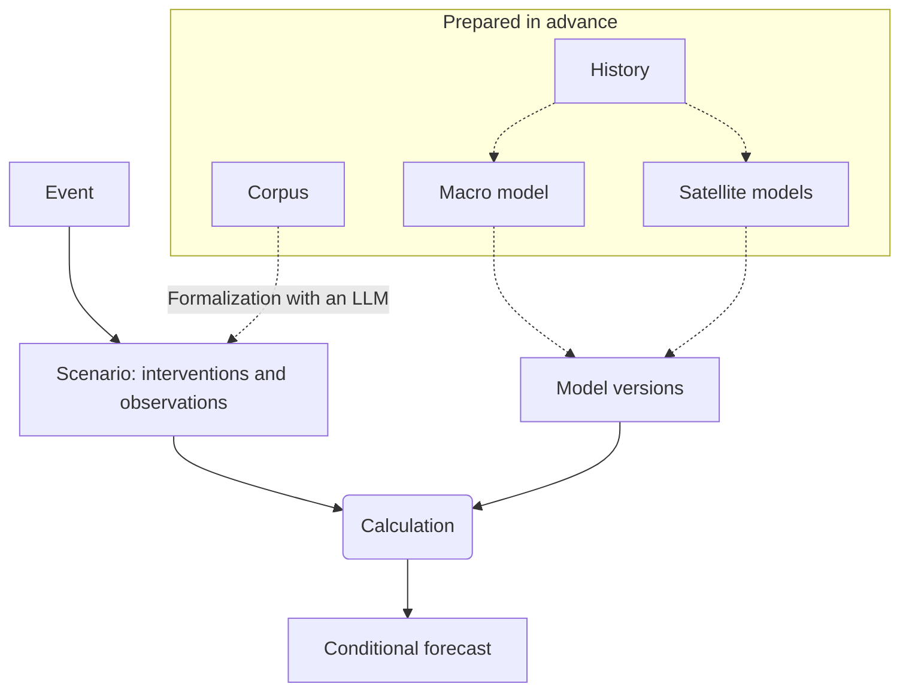

# General scheme of stress testing

The system answers one question: how are the target indicators of an object distributed if a given event has occurred? The event is written as statements about the paths of observable quantities and refers to no model's internals, so one scenario is computed on any system of models. A statement either sets a quantity from outside — an intervention — or asserts an outcome we have learned — an observation. An intervention changes the mechanism that produces the paths; an observation picks, among the outcomes of the changed mechanism, the measure closest to the base one in Kullback–Leibler divergence. The price of a scenario measures how unlikely the observations are under the interventions; the interventions themselves are imposed by the scenario and have no price.

## 1. Levels and quantities

Fix the calculation date, the information available on it, and a horizon of $H$ months. The months of the horizon are numbered $t=1,\dots,H$; month $t=0$ is the last month of history.

Quantities are split into levels numbered $l=0,\dots,L$ from the general to the particular, for example: the economy, an industry, a company. Denote by $K^l$ the finite set of quantities of level $l$. The quantities and their scales are set by the platform registry, common to all models: rates are written in their own units, prices and indices as $100\ln X$. The value of quantity $k\in K^l$ in month $t$ is $x_{k,t}\in\mathbb R$, the path of the level is $x^l=(x_{k,t})_{k\in K^l,\,1\le t\le H}$, and the space of such paths is $\mathcal X^l=\mathbb R^{K^l\times\lbrace 1,\dots,H\rbrace}$. Put $x=(x^0,\dots,x^L)$ and $\mathcal X=\prod_l\mathcal X^l$; $x^{<l}$ denotes the paths of the levels with smaller numbers. The last level holds the target indicators, and $v=x^L$.

## 2. Models

A *macro model* is a triple $(\Omega^0,P^0,G^0)$, where $P^0$ is a probability measure on the space $\Omega^0$ of random outcomes of level 0, and the path of level 0 is $x^0=G^0(\omega^0)$ for $\omega^0\in\Omega^0$. A macro model is only required to give the law of $x^0$ given the available information; linearity, shocks and regimes are not part of the definition.

A *satellite model* of level $l\ge 1$ is a triple $(\Omega^l,P^l,G^l)$, where $P^l$ is a probability measure on the space $\Omega^l$ of random outcomes of this level, and for $\omega^l\in\Omega^l$

$$
x^l=G^l(x^{<l},\omega^l).
$$

A lower level does not affect the upper ones: there is no feedback between levels.

A *system of models* is the space $\Omega=\prod_l\Omega^l$ with points $\omega=(\omega^0,\dots,\omega^L)$, the product measure $P=\bigotimes_lP^l$, and a map $F:\Omega\to\mathcal X$. The value $x=F(\omega)$ is defined by recursion: first $x^0=G^0(\omega^0)$, then for $l=1,\dots,L$ in turn $x^l=G^l(x^{<l},\omega^l)$. The measure $P$ is called the *base* measure: the distribution of outcomes obtained from history, without the event.

The coordinates of $\omega$ form the representation of the model. They usually include noise, shocks, regimes and the parameters estimated from history; the vector of all parameters is $\theta$.

### Structural form

The map $G^l$ gives the path of a level as a whole and does not say which values of the level are computed from which. That is enough for an observation, which selects outcomes and leaves the map alone. An intervention replaces the value of one quantity, and to define its consequences on the same level one needs to know which values depend on it. The model states this knowledge by a structural form.

**Definition 1.** A *structural form* of a model of level $l$ is a linear order $\prec$ on the pairs $(k,t)$, $k\in K^l$, $1\le t\le H$, such that $(k,t)\prec(k',t')$ whenever $t<t'$, together with measurable maps $g_{k,t}$ for which

$$
x_{k,t}=g_{k,t}\Big(x^{<l},\ (x_{k',t'})_{(k',t')\prec(k,t)},\ \omega^l\Big),
$$

and computing the values in the order $\prec$ gives $G^l(x^{<l},\omega^l)$.

So the value of a quantity in month $t$ depends on the upper levels, on the outcome and on the values of its own level that precede it in $\prec$: past months and, if the model says so, some quantities of the same month.

Every model has the *default form*: $g_{k,t}(x^{<l},\cdot,\omega^l)=G^l(x^{<l},\omega^l)_{k,t}$, that is, a value does not depend on other values of its level. A model that does not replace it claims nothing about links within the level.

Different structural forms of one model give the same law of paths but different results of an intervention. The choice of form is the model's assumption about which quantities act on which. The model states it, and the report of a calculation names it. Examples of forms are in section 8.

## 3. Scenario

The measure $P$ does not account for the event, and we are interested in a future where it has happened. The event is described by statements about paths.

**Definition 2.** An *intervention* is a triple $(k,T,\varphi)$, where $k\in K^l$ is a quantity of some level $l$, $T\subseteq\lbrace 1,\dots,H\rbrace$ are months, and $\varphi=(\varphi_t)_{t\in T}$ are maps $\mathbb R\to\mathbb R$ of one of the kinds: constant, $\varphi_t\equiv a_t$ — the quantity is *set* to $a_t$; shift, $\varphi_t(z)=z+o_t$ — the quantity is *shifted* by $o_t$. An intervention replaces the value the model would give by $\varphi_t$ of it. A pair $(k,t)$ enters at most one intervention of a scenario.

If the scenario does not know the value exactly, the intervention is random. Denote by $\psi=(\psi_{k,t})$ the tuple of the maps of all interventions of the scenario, where $\psi_{k,t}$ is a constant map, a shift or the identity $\mathrm{id}$, and by $\Psi$ the set of such tuples. The scenario gives a law $\mu_I$ on $\Psi$. For example, an interval $[a_-,a_+]$ with no other information gives a constant map whose value is uniform on the interval; a decision taken with probability $p$ gives a constant map with probability $p$ and $\mathrm{id}$ with probability $1-p$. A deterministic intervention has a Dirac measure.

**Definition 3.** An *observation* is a requirement on a measure $Q$ of outcomes of one of the kinds: $Q(x\in A)=1$ for a measurable set of paths $A\subseteq\mathcal X$ (a support condition), or $\ell\le\mathbb E_Qf(x)\le r$ for a measurable $f:\mathcal X\to\mathbb R^m$ and vectors $\ell\le r$ (a condition on a mean). For example, $Q(x\in C)\ge p$ is obtained with $f=\mathbf 1_C$, $\ell=p$, $r=1$. If an observation states an exact value of a quantity, an interval of half-width $\tau>0$ is taken: a condition on a set of measure zero does not define a measure. An intervention needs no tolerance, because the value is set, not conditioned on.

A statement is an intervention if the quantity is set by an actor outside the system of models and its value would not depend on the other quantities: a central bank's decision on the rate, an export ban, the oil price for an economy it acts on from outside. A statement is an observation if it asserts an outcome formed inside the system: the exchange rate after sanctions, a fall in output. The same number can be either. "Brent at 130 dollars because a strait was closed" is an intervention for the Russian economy; "Brent at 130 dollars amid a world boom" is an observation, and their consequences differ. The author of the scenario classifies the statements by the text of the event, and a human approves the classification.

**Definition 4.** A *scenario* is a tuple $s=(N,I,\mathcal A)$, where $N$ is the description of the event in text with references to sources, $I$ is a finite set of interventions with the law $\mu_I$, and $\mathcal A$ is a finite set of observations. The support conditions of $\mathcal A$ reduce to one set $A$, their intersection, and the conditions on means to one function $f$ with bounds $\ell,r$. Every number in $I$ and $\mathcal A$ is marked by the event if the description of the event names it, by a source if a source gives it, or by the word "assumption". Numbers are written in the units of the quantity with calendar dates; the platform translates them to the registry scale and month numbers.

A scenario names no models. A *calculation* is a scenario together with the chosen model versions, the number of paths and the seed of the random number generator. Hence one scenario is computed on different systems of models without editing, and the spread of the results shows how much the conclusion depends on the choice of models. The *empty scenario* $s_0$ contains neither interventions nor observations.

## 4. Overlay of a scenario

### An intervention changes the map

Fix a tuple of maps $\psi\in\Psi$. The map $F^\psi:\Omega\to\mathcal X$ is defined by the same recursion over levels as $F$, but each level is computed by its structural form in the order $\prec$, and for every pair $(k,t)$ in an intervention the value $g_{k,t}(\dots)$ is replaced by $\psi_{k,t}\big(g_{k,t}(\dots)\big)$. The later values of the same level and the lower levels are computed from the replaced value. If $\psi=\mathrm{id}$ on every pair, $F^\psi=F$.

**Lemma 1.** Let the model of level $l$ be taken in its default form, and let the intervention touch only quantity $k\in K^l$ in months $T$. Then for every $\omega$ the path $F^\psi(\omega)$ coincides with $F(\omega)$ on the levels above $l$ and on every pair of level $l$ except $(k,t)$ with $t\in T$; the lower levels differ from the base only through their models.

*Proof.* The levels above $l$ are computed earlier and do not depend on the intervention. In the default form $g_{k',t'}$ reads no values of its own level, so replacing $x_{k,t}$ does not change $x_{k',t'}$ for $(k',t')\ne(k,t)$. The lower levels receive the changed $x^l$ as an argument of their maps. $\square$

The lemma shows that a shift in the default form is a given displacement of a path without dynamics of its own: in a month outside $T$ the quantity again equals the model's output, the quantities of the same level do not react to the shift, and the lower levels react through their models. An aftereffect the model does not carry is written by the scenario as interventions in the following months.

### The space with random interventions

Put

$$
\Omega'=\Omega\times\Psi,\qquad P'=P\otimes\mu_I,\qquad F^I(\omega,\psi)=F^\psi(\omega).
$$

We assume $\Psi$ is a standard Borel space and the map $(\omega,\psi)\mapsto F^\psi(\omega)$ is measurable; with finitely many kinds of maps and measurable $g_{k,t}$ this holds. The measure $P'$ describes the world with interventions before the observations are taken into account: the law of the interventions was set by the author and does not depend on the outcomes of the models.

Let $S=(F^I)^{-1}(A)\subseteq\Omega'$ be the set of outcomes on which the support condition holds, and $R=(\theta,\psi)$ the coordinates whose law the scenario keeps. Denote by $\mathcal Q_s$ the set of probability measures $Q\ll P'$ on $\Omega'$ for which the law of $R$ under $Q$ is the same as under $P'$, $Q(S)=1$, the function $f\circ F^I$ is integrable under $Q$, and $\ell\le\mathbb E_Q f(F^I)\le r$.

The law of the parameters is kept, otherwise a rare event would select the parameters under which it is common. The law of the interventions is kept because it is a statement of the scenario: the observation "rouble at 100" does not make the central bank's decision more likely than the author set it. The other coordinates — noise, shocks, regimes — are changed by the observations.

### The overlay measure

For probability measures $Q\ll M$ the Kullback–Leibler divergence is

$$
\mathrm{KL}(Q\Vert M)=\mathbb E_Q\log\frac{dQ}{dM},
$$

and if $Q\not\ll M$, it equals $+\infty$. The *overlay of scenario $s$* is the measure

$$
P_s=\arg\min_{Q\in\mathcal Q_s}\mathrm{KL}(Q\Vert P').
$$

If $\mathcal Q_s$ is empty or the minimum is infinite, the scenario *contradicts the models*.

**Lemma 2.** For probability measures $\mathrm{KL}(Q\Vert M)\ge 0$, with equality only for $Q=M$.

*Proof.* For $Q\not\ll M$ the claim holds by definition. Otherwise put $h=dQ/dM$. Then $\mathbb E_Mh=1$ and $\mathrm{KL}(Q\Vert M)=\mathbb E_M[h\log h]$. The function $u\log u$ is strictly convex on $[0,\infty)$, so Jensen's inequality gives $\mathbb E_M[h\log h]\ge 1\cdot\log 1=0$, with equality only for constant $h$, that is, $h=1$ almost surely. $\square$

**Lemma 3.** If $P'(S\mid R)=0$ with positive probability, then $\mathcal Q_s$ is empty.

*Proof.* Let $B=\lbrace P'(S\mid R)=0\rbrace$ and $P'(B)>0$. Then $P'(S\cap B)=\mathbb E_{P'}[\mathbf 1_BP'(S\mid R)]=0$. For $Q\in\mathcal Q_s$ we have $Q(S)=1$, and $B$ depends on $R$ alone, so $Q(S\cap B)=Q(B)=P'(B)>0$. This contradicts $Q\ll P'$. $\square$

For example, an observation that requires a quantity set by an intervention to take a value other than the set one contradicts the models for any system of models.

**Theorem.** Let $P'(S\mid R)>0$ almost surely, and let a vector $\lambda\in\mathbb R^m$ be such that

$$
\Lambda(R)=\mathbb E_{P'}\big[\mathbf 1_S\,e^{\lambda^\top f(F^I)}\mid R\big]
$$

is finite almost surely and $\log\Lambda(R)$ is integrable under $P'$. Define the measure $Q^\ast$ by the density

$$
\frac{dQ^\ast}{dP'}=\frac{\mathbf 1_S\,e^{\lambda^\top f(F^I)}}{\Lambda(R)}.
$$

Let $f\circ F^I$ be integrable under $Q^\ast$, $\ell\le\mathbb E_{Q^\ast}f(F^I)\le r$, and for all $i=1,\dots,m$

$$
\lambda_i>0\ \Rightarrow\ \mathbb E_{Q^\ast}f_i(F^I)=\ell_i,\qquad \lambda_i<0\ \Rightarrow\ \mathbb E_{Q^\ast}f_i(F^I)=r_i.
$$

Then $P_s=Q^\ast$ and

$$
\mathrm{KL}(Q^\ast\Vert P')=\lambda^\top\mathbb E_{Q^\ast}f(F^I)-\mathbb E_{P'}\log\Lambda(R).
$$

*Proof.* For brevity put $\bar f=f\circ F^I$. First we check that $Q^\ast\in\mathcal Q_s$. The quantity $\Lambda(R)$ is positive because $P'(S\mid R)>0$. For a bounded measurable $g$, by the property of conditional expectation,

$$
\mathbb E_{Q^\ast}g(R)=\mathbb E_{P'}\Big[\frac{g(R)}{\Lambda(R)}\,\mathbb E_{P'}\big[\mathbf 1_S\,e^{\lambda^\top \bar f}\mid R\big]\Big]=\mathbb E_{P'}g(R).
$$

With $g=1$ this shows that $Q^\ast$ is a probability measure, and in general that the law of $R$ under $Q^\ast$ is the same as under $P'$. The density vanishes outside $S$, so $Q^\ast(S)=1$. The remaining conditions are given in the theorem. Taking the logarithm of the density and averaging under $Q^\ast$ gives the formula for $\mathrm{KL}(Q^\ast\Vert P')$.

Now take $Q\in\mathcal Q_s$ with $\mathrm{KL}(Q\Vert P')<\infty$; measures with an infinite value do not affect the minimum. On $S$ the density $dQ^\ast/dP'$ is positive, so $Q\ll P'$ and $Q(S)=1$ give $Q\ll Q^\ast$, and $Q$-almost surely

$$
\log\frac{dQ}{dP'}=\log\frac{dQ}{dQ^\ast}+\lambda^\top \bar f-\log\Lambda(R).
$$

The last two terms are integrable under $Q$: the first by the definition of $\mathcal Q_s$, the second because the law of $R$ under $Q$ is the same as under $P'$. Averaging under $Q$ gives

$$
\mathrm{KL}(Q\Vert P')=\mathrm{KL}(Q\Vert Q^\ast)+\lambda^\top\mathbb E_Q\bar f-\mathbb E_{P'}\log\Lambda(R).
$$

Subtracting the formula for $\mathrm{KL}(Q^\ast\Vert P')$ we find

$$
\mathrm{KL}(Q\Vert P')-\mathrm{KL}(Q^\ast\Vert P')=\mathrm{KL}(Q\Vert Q^\ast)+\lambda^\top\big(\mathbb E_Q\bar f-\mathbb E_{Q^\ast}\bar f\big).
$$

The second term on the right is non-negative: for $\lambda_i>0$ we have $\mathbb E_Q\bar f_i\ge\ell_i=\mathbb E_{Q^\ast}\bar f_i$, for $\lambda_i<0$ we have $\mathbb E_Q\bar f_i\le r_i=\mathbb E_{Q^\ast}\bar f_i$, and for $\lambda_i=0$ the term is absent. The first term is non-negative by Lemma 2. Hence $\mathrm{KL}(Q\Vert P')\ge\mathrm{KL}(Q^\ast\Vert P')$, and equality implies $\mathrm{KL}(Q\Vert Q^\ast)=0$, that is, $Q=Q^\ast$. $\square$

**Corollary.** Let the observations reduce to a support condition, $P'(S\mid R)>0$ almost surely and $\log P'(S\mid R)$ integrable. Then

$$
\frac{dP_s}{dP'}=\frac{\mathbf 1_S}{P'(S\mid R)},\qquad P_s(d\omega')=P'(dR)\,P'(d\omega'\mid R,S).
$$

In other words, for every value of the parameters and the interventions the measure $P_s$ equals $P'$ conditioned on the event $S$.

*Proof.* The first formula is the theorem without $f$, where $\Lambda(R)=P'(S\mid R)$. The second follows by dividing the first by the marginal of $R$, which does not change. $\square$

If there are no observations, then $S=\Omega'$ and $P_s=P'$: the result is determined by the interventions alone. Under a random intervention the law of the paths is a mixture over $\mu_I$ of the laws under deterministic interventions, and the conditioning works within each value of $\psi$.

## 5. Price of a scenario

The price of a scenario is

$$
\mathrm{dist}(s)=\mathrm{KL}(P_s\Vert P').
$$

For a measure of the form $Q^\ast$ it is computed by

$$
\mathrm{dist}(s)=\lambda^\top\mathbb E_{P_s}f(F^I)-\mathbb E_{P'}\log\Lambda(R).
$$

If the observations reduce to a support condition,

$$
\mathrm{dist}(s)=\mathbb E_{P'}\big[-\log P'(S\mid R)\big]\ \ge\ -\log P'(S),
$$

with equality for constant $R$, so that $e^{-\mathrm{dist}(s)}=P'(S)$. The difference $\mathrm{dist}(s)+\log P'(S)$ equals $\log\mathbb E_{P'}P'(S\mid R)-\mathbb E_{P'}\log P'(S\mid R)$ and is non-negative by Jensen's inequality. It grows with the spread of $P'(S\mid R)$ over the values of the parameters and interventions, so the price can be far above $-\log P'(S)$.

The price measures the observations under the interventions only. For a scenario of interventions alone it is zero: the event is imposed, not observed. How far an intervention lies from the base forecast the report shows separately. For a constant intervention with value $a$ on the pair $(k,t)$ this is the *remoteness* $\alpha_{k,t}=P\big(F(\omega)_{k,t}\le a\big)$, the quantile of the set value in the base law of the quantity; for a random intervention, the law of $\alpha_{k,t}$ under $\mu_I$. Remoteness is a diagnostic: it enters neither the price nor the admission of a calculation.

Given $R$, denote by $P^l_R$ and $Q^l_R$ the conditional laws of level $l$ given $x^{<l}$ under $P'$ and $P_s$. Since $S$ and $f$ depend on the paths alone, the price splits by level:

$$
\mathrm{dist}(s)=\mathbb E_{P'}\Big[\sum_{l=0}^{L}\mathbb E_{P_s}\big[\mathrm{KL}(Q^l_R\Vert P^l_R)\mid R\big]\Big].
$$

The split shows at which level the scenario departs furthest from the base models.

Let, given $R$, the law of $d$ constrained quantities have a continuous positive density $p_R$, and let the event be a box $\mathcal B$ of volume $\lvert\mathcal B\rvert$ shrinking to a point $\eta$. Then

$$
-\log P'(S\mid R)=-\log p_R(\eta)-\log\lvert\mathcal B\rvert+o(1).
$$

The first term measures how far the point is from the law; the second is set by the width the author chose. An exact value with tolerance $\tau$ is the case $\lvert\mathcal B\rvert=(2\tau)^d$, where the price grows as $-d\log(2\tau)$. The price of a narrow event therefore speaks mainly of its width, and prices are directly comparable only for events with equal boxes.

Severity is compared by the *one-sided price* $\mathrm{dist}^+(s)$, the price of the event $A^+$ in which every interval observation of a quantity is replaced by a ray. An interval below the median of the quantity under $P'$ is replaced by a ray downward from its upper bound, an interval above the median by a ray upward from its lower bound, and an observation whose interval contains the median is dropped. Since $A\subseteq A^+$, under a support condition $\mathrm{dist}^+(s)\le\mathrm{dist}(s)$, and the width of the interval does not enter $\mathrm{dist}^+(s)$. The report gives both.

## 6. Result

The *conditional forecast* is the law of $v$, the last component of $F^I(\omega')$, for $\omega'\sim P_s$. The system represents it by a sample, possibly weighted, and computes from it the probabilities of events and risk functionals $\rho$, for example the expected shortfall over the worst 5 % of cases, $\mathrm{ES}_{95\%}$.

The indicator $v$ is a path, so a functional is tied to a moment. Let $\Delta_t$ be the loss by month $t$, a function of $v$. The system computes $\rho_t(s)=\rho(\Delta_t)$ for each $t\le H$ and the value over the whole path $\rho_{\max}(s)=\rho(\max_{t\le H}\Delta_t)$; for a monotone $\rho$, $\rho_{\max}(s)\ge\max_t\rho_t(s)$. The value at the end of the horizon is not enough, because it shows neither an intervention that ended before $H$ nor consequences the models damped by $H$.

The forecast is compared with the calculation under the empty scenario $s_0$, whose overlay is $P$. An observation pins down part of the path, and by the law of total variance the spread of the indicator averaged over the outcomes of the observation does not grow. So $\rho(s)<\rho(s_0)$ does not yet mean that the event lowers risk: the law may only have narrowed. The comparison separates the shift of the centre of the law from the change of its width $p_{95}-p_5$, the difference between the 95th and 5th percentiles, each with an error interval.

The contribution of one intervention or observation is the difference $\rho(s)-\rho(s')$ with an error interval, where $s'$ is $s$ without this element. Both calculations use the same random numbers, and the error falls as far as their paths are linked. If the scenario has no observations, the measure on $\Omega$ does not depend on the interventions, and the difference of paths at one $\omega$ expresses the action of the intervention. An observation changes the measure, so one draw number under $s$ and $s'$ means different outcomes, and the difference on a single path is not the contribution of the observation.

In the inverse problem the interventions, the form of the observations with a parameter $c$, and one of the functionals $\rho_t$, $\rho_{\max}$, denoted $\rho$, are fixed, and one of the problems

$$
\sup\big\lbrace\rho(s(c)):\ \mathrm{dist}(s(c))\le\kappa\big\rbrace,
\qquad
\inf\big\lbrace\mathrm{dist}(s(c)):\ \rho(s(c))\ge L^\ast\big\rbrace
$$

is solved, where $\kappa$ is the admissible price and $L^\ast$ a given level of risk. The interventions must be fixed: they cost nothing, and with free interventions a bound on the price would bound nothing.

## 7. Quality metrics

### Accuracy of the conditional forecast

For a historical episode $e$ we put the calculation date before its start, estimate the models only on data known by that date, and set the scenario $s_e$: the decisions of outside actors that were actually taken as interventions with their actual values, the other statements of the episode as observations. An observation is a cell $(e,t,k)$: the episode, the month of the horizon and a quantity of any level. To a cell correspond the fact $y$ and the distribution function $\Gamma$ of the quantity under $P_{s_e}$ with quantiles $q_{05}=\Gamma^{-1}(0.05)$ and $q_{95}=\Gamma^{-1}(0.95)$. A cell where the quantity is set by an intervention or given by an exact observation is excluded: there the forecast equals the fact by construction.

The main metric is the continuous ranked probability score:

$$
\mathrm{CRPS}(\Gamma,y)=\int_{-\infty}^{\infty}\big(\Gamma(z)-\mathbf 1\lbrace z\ge y\rbrace\big)^2dz.
$$

The value of quantity $k$ at horizon $t$ is divided by $\sigma_k(t)$, the median absolute change of the quantity over $t$ months in history. Then we average within a quantity and with equal weights across quantities, separately by level and horizon. The baselines are computed on the same cells: a random walk with drift, and for target indicators also the value a year earlier with trend. The 95 % interval comes from a bootstrap over episodes with 1000 repetitions, since the cells of one episode are dependent; with few episodes we check it by a cluster wild bootstrap with Webb weights.

If $y$ has a continuous distribution function $\Gamma$, then $u=\Gamma(y)$ is uniform on $[0,1]$, and the fact falls below $q_{05}$, between $q_{05}$ and the median, between the median and $q_{95}$, and above $q_{95}$ with shares 0.05, 0.45, 0.45 and 0.05. Sharpness is the median width $q_{95}-q_{05}$; we compare it only when the observed shares agree with these.

For a target indicator with loss $\Delta_e$ in episode $e$ and forecast value at risk $\mathrm{VaR}_e$ and expected shortfall $\mathrm{ES}_e$ at 95 % over $E$ episodes we compute the statistic of Acerbi and Székely (2014):

$$
Z=\frac{1}{0.05\,E}\sum_{e=1}^{E}\frac{\Delta_e\mathbf 1\lbrace\Delta_e>\mathrm{VaR}_e\rbrace}{\mathrm{ES}_e}-1.
$$

With a correct tail $\mathbb E Z=0$, and $Z>0$ means the tail is understated.

### When the uniformity check applies

Uniformity of $u$ requires the fact to be distributed by the law of the forecast. If the models and their structural forms are correct and the event has occurred, the fact is distributed by $P'(\cdot\mid S)$: the world with interventions conditioned on the observations. Put $P'_R=P'(\cdot\mid R)$. Then

$$
P'(d\omega'\mid S)=\int P'_R(d\omega'\mid S)\frac{P'_R(S)}{P'(S)}P'(dR),\qquad
P_s(d\omega')=\int P'_R(d\omega'\mid S)P'(dR).
$$

The measures differ by the factor $P'_R(S)/P'(S)$ and coincide for constant $R$. In an episode the interventions are deterministic, so $R$ reduces to $\theta$, and uniformity holds the more accurately the smaller the parameter uncertainty. A wrong structural form gives a wrong law even with a correct measure $P$, so the uniformity check tests the models together with their forms.

For $s_0$ the forecast has the law $P$, while on episodes selected by the event the fact is distributed by $P(\cdot\mid S)$. So uniformity under $s_0$ is checked over all dates of history.

### Value of a scenario

A scenario is useful if on the episodes the CRPS under $s_e$ is below that under $s_0$. Hand-labelled scenarios and scenarios from an LLM are counted separately. The result for an LLM is reliable only in forward calculations, since an LLM remembers the outcomes of past episodes.

### Check of the price

The episode metrics do not touch $\mathrm{dist}(s)$. The price is checked separately on a family of observations $A_1,\dots,A_K$ without interventions, fixed before the calculation and not depending on dates. For every date $d$ of history and every $A_k$, with the models estimated on data before $d$, we compute the forecast probability $\pi=P(S)$ and the indicator $\xi$ that the event occurred. The metric is the mean logarithmic score

$$
-\xi\log\pi-(1-\xi)\log(1-\pi)
$$

against the score of the historical frequency, and a table of mean $\pi$ against the frequency of $\xi$ in groups by $\pi$. The horizon windows overlap, so the intervals come from a block bootstrap. On a monthly history of 20 years an event of probability 1 % is expected about 2–3 times, so this check confirms the tail of the price weakly, and the report says so.

This check concerns $-\log P(S)$. The difference $\mathrm{dist}(s)+\log P(S)$ without interventions comes from parameter uncertainty alone, and the report gives it separately. History does not check the price under random interventions: their law is set by the author of the scenario.

### Admission of versions

A version is admitted to comparison if fewer than 5 % of the cells break each condition: the band $[q_{05},q_{95}]$ lies in the admissible domain of the quantity; the width $q_{95}-q_{05}$ is not larger than the range of the quantity over the whole history. The same conditions are checked on the paths under a scenario, since observations and interventions can widen the fan.

The probability of every interval observation under $P'$ must be above 1 %, otherwise the scenario rests on a rare tail. For an observation of an exact value the probability would measure the tolerance $\tau$, not the scenario, and the threshold does not apply. For a satellite model the share of paths whose output lies outside the range of the training sample must be below 1 %; until this holds and the backtest is passed, the tail of the target indicator is marked unverified.

The episodes are split in advance into two halves: the models are tuned on the first and checked on the second, and the final table is built on all episodes. Versions are compared pairwise on the same cells by target indicators:

1. A version that fails admission is rejected regardless of CRPS.
2. A version is accepted if its CRPS is better than that of the baseline and of the current version by more than two standard errors and the admission conditions did not worsen.
3. A version is rejected if its CRPS is worse by more than two standard errors.
4. Otherwise the difference is considered undetected, and the current version stays.

### Admission of a calculation

The admission conditions on paths belong to the pair of version and scenario, since one version can give admissible paths under one scenario and inadmissible ones under another. A calculation is admitted if fewer than 5 % of the cells of month and quantity on its paths break each of these conditions. Otherwise its result is not read as an estimate of losses: the report gets the status "not admitted" and names the broken conditions and quantities, and the numbers are kept for diagnostics. The mark of an unverified tail passes from a quantity to the whole report, because losses add up over all positions within one path.

The remoteness of interventions and the models' own diagnostics, for example the size of the shocks by which a model meets the observations, are shown in the report, but admission does not depend on them: the unlikelihood of the event is measured by the price. The report also names the structural form of every model by which the interventions were carried out.

### Accuracy of a calculation

For a sample of size $n$ with weights $w_i$ the report gives the effective size $(\sum_iw_i)^2/\sum_iw_i^2$. On the sample we check $Q(S)=1$ and $\ell\le\mathbb E_Qf\le r$, and for $\lambda$ the conditions of the theorem on the form of $Q^\ast$. Values of $\mathrm{ES}$ come with an interval, the sensitivity to dropping the 1 % most extreme paths and the horizon mark. The Monte Carlo error is estimated by a bootstrap over realisations, separately from the sampling error. For reproducibility the report records the versions of models and data, the date, the seed of the random number generator and the commit.

The price is estimated by an average over values of $R$, and the term $-\log P'(S\mid R)$ is unbounded above, so the average can be driven by rare values of $R$ under which the event is almost unreachable. Every estimate of the price comes with a standard error. If the error exceeds 10 % of the estimate, the price is considered not estimated: the report gives it only with this mark, and the inverse problem does not use such a point, otherwise the bound on the price would be set by noise.

## 8. Special cases

### Vector autoregression with regimes — MS-VAR

Let the macro model be given by

$$
y_t=\mu(\zeta_t)+\sum_{j=1}^{p}A_j(\zeta_t)y_{t-j}+B(\zeta_t)z_t,\qquad t=1,\dots,H,
$$

where $y_t$ is the vector of the quantities of level 0 in month $t$, the shocks $z_t$ are independent with law $N(0,I)$, the regime $\zeta_t$ is a Markov chain with transition matrix $\Pi$, and the values $y_t$ for $t\le 0$ come from history. Then $\omega^0=(\theta,\zeta,\mathbf z)$, where $\theta$ consists of $\mu,A_j,B,\Pi$, $\zeta$ is the path of regimes, and $\mathbf z$ are all shocks of the horizon. The probability of a path of regimes given the parameters is $\pi_\theta(\zeta)$.

The model gives its structural form by an order of the quantities within a month. If the matrix $B(\zeta)$ is lower-triangular in this order, the value of quantity $k$ in month $t$ is computed from past values, from the values of the preceding quantities of the same month and from the shock $z_{k,t}$. An intervention on the rate in month $t$ then moves the quantities that follow it in the same month through $B$ and all quantities of the following months through $A_j$. The order of the quantities is the model's identification assumption. The most cautious choice puts the set quantity last in the month: then in the month of the intervention it does not act on the other quantities, and all its action goes through the lags.

Let an observation have the form $Wy\in\mathcal B$, where $W$ is a matrix and $\mathcal B$ a rectangle. Given $\theta,\psi,\zeta$ the vector $Wy$ is affine in the shocks: $Wy=b+Z\mathbf z$, where $b$ and $Z$ depend on $\theta,\psi,\zeta$. By the corollary of the theorem the path of regimes under $P_s$ has the law

$$
P_s(\zeta\mid\theta,\psi)=\frac{\pi_\theta(\zeta)\,P'(S\mid\theta,\psi,\zeta)}{P'(S\mid\theta,\psi)},
$$

and given $\theta,\psi,\zeta$ the shocks have a normal law truncated to $S$. The price is $\mathbb E_{P'}[-\log P'(S\mid\theta,\psi)]$.

A regime is a hidden coordinate of the model, not a quantity of the registry, so a scenario makes no statement about it. A crisis is written in observable quantities, and the model reports the probability of a regime under the scenario as a diagnostic.

### Random walk

Let $y_t=y_{t-1}+\mu+\varepsilon_t$ with independent increments $\varepsilon_t$. The recursion in time is a natural structural form: the value of month $t$ is computed from that of month $t-1$. An intervention that sets the rate in month $t$ then carries into month $t+1$ as the starting point of the next step. In the default form the same rate would return to the base path in month $t+1$. The example shows that the choice of form changes the result of an intervention under one and the same law of paths.

### Satellite with a regression

Let $x^l_t=\beta^\top\chi(x^{<l}_t)+\sigma e_t$, where $\chi$ is a given function and $e_t$ are independent standard noises. Then $\omega^l=(\beta,\sigma,e)$, and $\beta,\sigma$ belong to $\theta$. The structural form is the default form: a value depends on the upper levels and its own noise. An intervention on an upper level reaches the satellite through $\chi$.

### Model given by a sample of paths

Let the model be given by paths $x_1,\dots,x_n$ with equal weights. Then $\Omega=\lbrace 1,\dots,n\rbrace$, $P$ is uniform, $F(i)=x_i$, and the structural form is the default form: an intervention replaces components of a path. By the theorem, path $i$ given $\psi$ gets a weight proportional to $\mathbf 1_S(i,\psi)\,e^{\lambda^\top f(F^\psi(i))}$. With deterministic interventions and a single support condition the price is $-\log(\lvert S\rvert/n)$, where $\lvert S\rvert$ is the number of paths on which the condition holds.

## The previous edition

The previous edition of the scheme is [formalization-legacy.en.md](formalization-legacy.en.md). There a scenario named the model versions and the causes of the event, coordinates of the outcome of a particular model, so one scenario did not carry over between models, and the difference between what is set from outside and what is observed was expressed by the choice of causes. Here interventions express that difference, and the links through which an intervention acts are declared by the model in its structural form.
