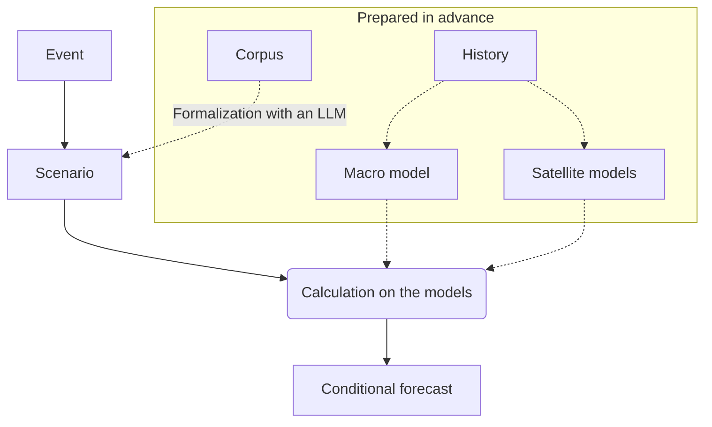

# General scheme of stress testing

The system answers one question: how are the target indicators of an object distributed if a given event $S$ has occurred?

## 1. Levels

Fix the calculation date, the information available by that date and a horizon of $H$ months. Quantities are split into levels numbered $l=0,\dots,L$ from the general to the particular, for example: economy, industry, company. Let $\mathcal X^l$ be the measurable space of paths of level $l$ over the horizon, $x^l$ a path of that level and $x^{<l}$ the paths of the levels with smaller numbers. Put $x=(x^0,\dots,x^L)$. The last level holds the target indicators, and $v=x^L$.

## 2. Models

A *macro model* is a triple $(\Omega^0,P^0,G^0)$, where $P^0$ is a probability measure on the space $\Omega^0$ of random outcomes of level 0, and the path of level 0 is $x^0=G^0(\omega^0)$ for $\omega^0\in\Omega^0$. All that is required of a macro model is the law of $x^0$ given the available information; linearity, shocks and regimes are not part of the definition.

A *satellite model* of level $l\ge 1$ is a triple $(\Omega^l,P^l,G^l)$, where $P^l$ is a probability measure on the space $\Omega^l$ of random outcomes of this level, and for $\omega^l\in\Omega^l$

$$
x^l=G^l(x^{<l},\omega^l).
$$

Formally, this assumes there is no feedback.

A *system of models* is the space $\Omega=\prod_l\Omega^l$ with points $\omega=(\omega^0,\dots,\omega^L)$, the product measure $P=\bigotimes_lP^l$ and the map $F:\Omega\to\mathcal X$, where $\mathcal X=\prod_l\mathcal X^l$. The value $x=F(\omega)$ is defined by recursion: first $x^0=G^0(\omega^0)$, then $x^l=G^l(x^{<l},\omega^l)$ for $l=1,\dots,L$ in turn. The measure $P$ is called the base measure: it is the distribution of outcomes obtained from history, without regard to the event.

The coordinates of $\omega$ form a representation of the model. They usually include noise, shocks, regimes and model parameters estimated on history; the vector of all parameters is denoted $\theta$.

## 3. Scenario

The measure $P$ ignores the event, while we care about a future in which it has occurred. A scenario therefore replaces $P$ with another probability measure $Q$ on $\Omega$ and states restrictions on it.

An event is written as a set of paths $A\subseteq\mathcal X$, for example the paths where the rate in March lies between 18 and 21 %. It corresponds to the set of outcomes $S=F^{-1}(A)$, and we require $Q(S)=1$. If $A$ fixes the exact value of a quantity, we take an interval of half-width $\tau>0$. If the event is asserted only on average or with some probability, the requirement reads $\ell\le\mathbb E_Qf\le r$ for a measurable $f:\Omega\to\mathbb R^k$. For example, $Q(S)\ge p$ follows with $f=\mathbf 1_S$, $\ell=p$, $r=1$.

The scenario names the causes of the event: a set $D$ of coordinates of $\omega$ other than $\theta$. Write $\omega=(\theta,\omega_D,\omega_{\bar D})$, where $\omega_D$ are the coordinates in $D$ and $\omega_{\bar D}$ the rest. If no causes are named, $\omega_D$ holds everything except $\theta$. The measure $Q$ has the form

$$
Q(d\omega)=P(d\theta,d\omega_{\bar D})\,Q(d\omega_D\mid\theta,\omega_{\bar D}),
$$

so only the conditional distribution of the causes changes. The distribution of $\theta$ is always kept, because otherwise a rare event would select the parameters under which it is common.

Effects absent from the models, such as an export ban, are written as a direct impact $O=(o^0,\dots,o^L)$: given shifts of the paths, where $o^l\in\mathcal X^l$ and the spaces $\mathcal X^l$ are linear:

$$
x^0=G^0(\omega^0)+o^0,\qquad x^l=G^l(x^{<l},\omega^l)+o^l,\quad l=1,\dots,L.
$$

This recursion defines the map $F_O$. The maps $G^l$ themselves do not change, and a shift reaches the lower levels only through them.

So a *scenario* is a tuple $s=(N,m,O,D,\mathcal C)$, where $N$ describes the event in text with references to sources, $m$ are the model versions and $\mathcal C$ are the requirements on $Q$. If the outcomes of an event diverge, there are several scenarios, each calculated separately. Every element of $O$ and $\mathcal C$ is marked with the event itself when the description of the event states its number, with a source, or with the word "assumption", and a person approves the scenario.

## 4. Overlay of a scenario

Put $R=(\theta,\omega_{\bar D})$. The form of $Q$ in section 3 means that the laws of $R$ under $Q$ and under $P$ coincide. Let $\mathcal Q_s$ be the set of probability measures $Q\ll P$ of this form for which $Q(S)=1$, the function $f$ is integrable and $\ell\le\mathbb E_Qf\le r$.

For probability measures $Q\ll M$ the Kullback–Leibler divergence equals

$$
\mathrm{KL}(Q\Vert M)=\mathbb E_Q\log\frac{dQ}{dM},
$$

and if $Q\not\ll M$, it equals $+\infty$. The *overlay of a scenario $s$* is the measure

$$
P_s=\arg\min_{Q\in\mathcal Q_s}\mathrm{KL}(Q\Vert P).
$$

If $\mathcal Q_s$ is empty or the minimum is infinite, the scenario contradicts the models.

**Lemma 1.** For probability measures $\mathrm{KL}(Q\Vert M)\ge 0$, with equality only for $Q=M$.

*Proof.* For $Q\not\ll M$ the claim holds by definition. Otherwise put $h=dQ/dM$. Then $\mathbb E_Mh=1$ and $\mathrm{KL}(Q\Vert M)=\mathbb E_M[h\log h]$. The function $u\log u$ is strictly convex on $[0,\infty)$, so Jensen's inequality gives $\mathbb E_M[h\log h]\ge 1\cdot\log 1=0$, and equality is possible only for constant $h$, that is, for $h=1$ almost surely. $\square$

**Lemma 2.** If $P(S\mid R)=0$ with positive probability, then $\mathcal Q_s$ is empty.

*Proof.* Let $B=\lbrace P(S\mid R)=0\rbrace$ and $P(B)>0$. Then $P(S\cap B)=\mathbb E_P[\mathbf 1_BP(S\mid R)]=0$. For $Q\in\mathcal Q_s$ we have $Q(S)=1$, and the event $B$ depends only on $R$, so $Q(S\cap B)=Q(B)=P(B)>0$. This contradicts $Q\ll P$. $\square$

**Theorem.** Let $P(S\mid R)>0$ almost surely, and let a vector $\lambda$ of the same dimension as $f$ be such that

$$
\Lambda(R)=\mathbb E_P\big[\mathbf 1_S\,e^{\lambda^\top f}\mid R\big]
$$

is finite almost surely and $\log\Lambda(R)$ is integrable under $P$. Define the measure $Q^\ast$ by the density

$$
\frac{dQ^\ast}{dP}=\frac{\mathbf 1_S\,e^{\lambda^\top f}}{\Lambda(R)}.
$$

Let $f$ be integrable under $Q^\ast$, $\ell\le\mathbb E_{Q^\ast}f\le r$, and for all $i$

$$
\lambda_i>0\ \Rightarrow\ \mathbb E_{Q^\ast}f_i=\ell_i,\qquad \lambda_i<0\ \Rightarrow\ \mathbb E_{Q^\ast}f_i=r_i.
$$

Then $P_s=Q^\ast$ and

$$
\mathrm{KL}(Q^\ast\Vert P)=\lambda^\top\mathbb E_{Q^\ast}f-\mathbb E_P\log\Lambda(R).
$$

*Proof.* First we check that $Q^\ast\in\mathcal Q_s$. The value $\Lambda(R)$ is positive because $P(S\mid R)>0$. For a bounded measurable $g$, by the property of conditional expectation,

$$
\mathbb E_{Q^\ast}g(R)=\mathbb E_P\Big[\frac{g(R)}{\Lambda(R)}\,\mathbb E_P\big[\mathbf 1_S\,e^{\lambda^\top f}\mid R\big]\Big]=\mathbb E_Pg(R).
$$

With $g=1$ this shows that $Q^\ast$ is a probability measure, and in general that the law of $R$ under $Q^\ast$ is the same as under $P$. The density vanishes outside $S$, so $Q^\ast(S)=1$. The remaining conditions are given in the theorem. Taking the logarithm of the density and averaging over $Q^\ast$ gives the formula for $\mathrm{KL}(Q^\ast\Vert P)$.

Now take $Q\in\mathcal Q_s$ with $\mathrm{KL}(Q\Vert P)<\infty$; measures with an infinite value do not affect the minimum. On $S$ the density $dQ^\ast/dP$ is positive, so $Q\ll P$ and $Q(S)=1$ imply $Q\ll Q^\ast$, and $Q$-almost surely

$$
\log\frac{dQ}{dP}=\log\frac{dQ}{dQ^\ast}+\lambda^\top f-\log\Lambda(R).
$$

The last two terms are integrable under $Q$: the first by the definition of $\mathcal Q_s$, the second because the law of $R$ under $Q$ is the same as under $P$. Averaging over $Q$ gives

$$
\mathrm{KL}(Q\Vert P)=\mathrm{KL}(Q\Vert Q^\ast)+\lambda^\top\mathbb E_Qf-\mathbb E_P\log\Lambda(R).
$$

Subtracting the formula for $\mathrm{KL}(Q^\ast\Vert P)$, we find

$$
\mathrm{KL}(Q\Vert P)-\mathrm{KL}(Q^\ast\Vert P)=\mathrm{KL}(Q\Vert Q^\ast)+\lambda^\top\big(\mathbb E_Qf-\mathbb E_{Q^\ast}f\big).
$$

The second term on the right is non-negative. Indeed, for $\lambda_i>0$ there is equality with the lower bound, whence $\mathbb E_Qf_i\ge\ell_i=\mathbb E_{Q^\ast}f_i$; for $\lambda_i<0$ there is equality with the upper bound, whence $\mathbb E_Qf_i\le r_i=\mathbb E_{Q^\ast}f_i$; and for $\lambda_i=0$ the term is absent. The first term is non-negative by Lemma 1. Hence $\mathrm{KL}(Q\Vert P)\ge\mathrm{KL}(Q^\ast\Vert P)$, and equality implies $\mathrm{KL}(Q\Vert Q^\ast)=0$, that is, $Q=Q^\ast$. $\square$

**Corollary.** Let only the condition $Q(S)=1$ be given, with $P(S\mid R)>0$ almost surely and $\log P(S\mid R)$ integrable. Then

$$
\frac{dP_s}{dP}=\frac{\mathbf 1_S}{P(S\mid R)},\qquad P_s(d\omega)=P(dR)\,P(d\omega_D\mid R,S).
$$

In other words, at each value of $R$ the measure $P_s$ coincides with $P$ conditioned on the event $S$.

*Proof.* The first formula is the theorem without $f$, where $\Lambda(R)=P(S\mid R)$. The second follows by dividing the first by the marginal of $R$, which does not change. $\square$

## 5. Price of a scenario

The price of a scenario equals

$$
\mathrm{dist}(s)=\mathrm{KL}(P_s\Vert P).
$$

For a measure of the form $Q^\ast$ it is computed by the formula

$$
\mathrm{dist}(s)=\lambda^\top\mathbb E_{P_s}f-\mathbb E_P\log\Lambda(R).
$$

With a support condition alone,

$$
\mathrm{dist}(s)=\mathbb E_P\big[-\log P(S\mid R)\big]\ \ge\ -\log P(S),
$$

and for constant $R$ equality holds, so that $e^{-\mathrm{dist}(s)}=P(S)$. If $R'$ determines $R$, the set of admissible measures under $R'$ is narrower and the price under it is no smaller. Explaining an event through fewer causes therefore costs more.

If no causes are named, $\omega_{\bar D}$ is empty and $R=\theta$. The price then decomposes by levels: for given $\theta$, let $P^l_\theta$ and $Q^l_\theta$ be the conditional laws of level $l$ given $x^{<l}$ under $P$ and $P_s$. Then

$$
\mathrm{dist}(s)=\mathbb E_P\Big[\sum_{l=0}^{L}\mathbb E_{P_s}\big[\mathrm{KL}(Q^l_\theta\Vert P^l_\theta)\mid\theta\big]\Big].
$$

Here $S$ and $f$ are assumed to depend only on $(\theta,x)$. The decomposition shows at which level the scenario moves furthest from the base models.

If the conditional law of the restricted quantities has a density, then for a small tolerance $\tau$ of an exact value the price grows as $-k\log(2\tau)$, where $k$ is the number of such conditions. Scenarios can therefore be compared only at equal tolerances.

The impact $O$ is not random and has no price of its own, although through $F_O$ it changes the price of the restrictions. The report shows $\mathrm{dist}(s)$ together with the list of $O$.

## 6. Result

The conditional forecast is the law of $v$ under $\omega\sim P_s$, where $v$ is the last component of $F_O(\omega)$. The system represents it by a sample, possibly weighted, and computes from it the probabilities of events and functionals $\rho$, for example $\mathrm{ES}_{95\%}$.

The forecast is compared with the calculation under the scenario $s_0$ with no restrictions or impacts, whose overlay equals $P$. The contribution of a single condition or impact is found by removing it from the scenario and repeating the calculation with the same random numbers.

In the reverse problem $m$, $O$, $D$ and the form of the restrictions with a parameter $c$ are fixed, and one of two problems is solved:

$$
\sup\big\lbrace\rho(s(c)):\ \mathrm{dist}(s(c))\le\kappa\big\rbrace,
\qquad
\inf\big\lbrace\mathrm{dist}(s(c)):\ \rho(s(c))\ge L^\ast\big\rbrace.
$$

The impact $O$ must be fixed: it costs nothing, and with a free $O$ the bound on the price would bound nothing.

## 7. Quality metrics

### Accuracy of the conditional forecast

For a historical episode $e$ we set the calculation date before its start, estimate the models only on data known by that date and specify a scenario $s_e$. An observation is a cell $(e,t,q)$: an episode, a month of the horizon and a quantity of any level. A cell has a fact $y$ and the distribution function $\Psi$ of this quantity under $P_{s_e}$ with the quantiles $a=\Psi^{-1}(0.05)$ and $b=\Psi^{-1}(0.95)$. If $A$ fixes the value of the quantity in a cell with tolerance $\tau$, the forecast matches the fact up to the tolerance, and we exclude that cell.

The main metric is the continuous ranked probability score:

$$
\mathrm{CRPS}(\Psi,y)=\int_{-\infty}^{\infty}\big(\Psi(z)-\mathbf 1\lbrace z\ge y\rbrace\big)^2dz.
$$

The value for a quantity $q$ at horizon $t$ is divided by $\sigma_q(t)$, the median absolute change of the quantity over $t$ months in history. We then average within a quantity and with equal weights across quantities, separately by level and horizon. Benchmarks are computed on the same cells: a random walk with drift, and for target indicators also the value a year earlier with a trend. The 95 % interval comes from a bootstrap over episodes with 1000 repetitions, since the cells of one episode are dependent; with few episodes we check it with a cluster wild bootstrap with Webb weights.

If $y$ has a continuous distribution function $\Psi$, then $u=\Psi(y)$ is uniform on $[0,1]$, and the fact lands below $a$, between $a$ and the median, between the median and $b$, and above $b$ with the shares 0.05, 0.45, 0.45 and 0.05. Sharpness is the median width $b-a$; we compare it only if the observed shares agree with those listed.

For a target indicator with loss $\Delta_e$ and forecast $\mathrm{VaR}_e$, $\mathrm{ES}_e$ at the 95 % level over $n$ episodes we compute the statistic of Acerbi and Székely (2014):

$$
Z=\frac{1}{0.05\,n}\sum_{e=1}^{n}\frac{\Delta_e\mathbf 1\lbrace\Delta_e>\mathrm{VaR}_e\rbrace}{\mathrm{ES}_e}-1.
$$

With a correct tail $\mathbb E Z=0$, and $Z>0$ means the tail is understated.

### When the uniformity check applies

Uniformity of $u$ requires the fact to be distributed by the law of the forecast. If the system is correct and the event has occurred, the fact is distributed by $P(\cdot\mid S)$, so we compare this measure with $P_s$.

Let no causes be named, so $R=\theta$. Put $P_\theta=P(\cdot\mid\theta)$. Then

$$
P(d\omega\mid S)=\int P_\theta(d\omega\mid S)\frac{P_\theta(S)}{P(S)}P(d\theta),\qquad
P_s(d\omega)=\int P_\theta(d\omega\mid S)P(d\theta).
$$

The measures differ by the factor $P_\theta(S)/P(S)$ and coincide for constant $\theta$. In the other cases uniformity of $u$ holds approximately.

Now let causes be named. Then $P_s$ changes only the law of $\omega_D$, and $P_s\ne P(\cdot\mid S)$ even for constant $\theta$ if the law of $\omega_{\bar D}$ changes given $S$. A deviation of $u$ from the uniform law can then come both from the models and from the choice of $D$. We therefore check uniformity only for scenarios without named causes. The influence of $D$ is shown separately: we calculate one scenario under different $D$ and report the spread of losses.

For $s_0$ the forecast has the law $P$, while on episodes selected by the event the fact is distributed by $P(\cdot\mid S)$. Uniformity at $s_0$ is therefore checked over all dates of history.

### Value of a scenario

A scenario is useful if on the episodes the CRPS under $s_e$ is lower than under $s_0$. Scenarios marked up by hand and scenarios from an LLM are counted separately. A result for an LLM is reliable only in forward calculations, because an LLM remembers the outcomes of past episodes.

### Check of the price

Episode metrics do not touch $\mathrm{dist}(s)$. The price is checked separately on a family of events $A_1,\dots,A_K$ fixed before the calculation and independent of the dates. For each date $d$ of history and each $A_k$, on models estimated on data before $d$, we compute the forecast probability $\pi=P(S)$ and the indicator $\xi$ that the event occurred. The metric is the mean logarithmic score

$$
-\xi\log\pi-(1-\xi)\log(1-\pi)
$$

compared with the score of the historical frequency, plus a table of mean $\pi$ against the frequency of $\xi$ in groups by $\pi$. The horizon windows overlap, so intervals come from a block bootstrap. On 20 years of monthly history an event of probability 1 % is expected about 2–3 times, so this check confirms the tail of the price only weakly, and the report says so.

This check concerns $-\log P(S)$. The difference $\mathrm{dist}(s)+\log P(S)$ at $R=\theta$ comes only from parameter uncertainty, and the report gives it separately. History does not check the price under a named $D$.

### Admission of versions

A version is admitted to comparison if fewer than 5 % of cells break each of these conditions: the band $[a,b]$ lies within the admissible values of the quantity; the width $b-a$ is no larger than the range of the quantity over all history. The same conditions are checked on the paths under a scenario, since restrictions can widen the fan.

The probability of each condition given as an interval must exceed 1 % under $P$, otherwise the scenario rests on a rare tail. For a condition given as an exact value the probability would measure the tolerance $\tau$ and not the scenario, and the threshold does not apply. For a satellite model the share of paths whose output lies outside the range of the training sample must be below 1 %; until this holds and the backtest has passed, the tail of the target indicator is marked unverified.

Episodes are split in advance into two halves: the models are tuned on the first and checked on the second, and the final table is built over all episodes. Versions are compared pairwise on the same cells by target indicators:

1. A version that fails admission is rejected whatever its CRPS.
2. A version is accepted if its CRPS beats the CRPS of the benchmark and of the current version by more than two standard errors and the admission conditions have not worsened.
3. A version is rejected if its CRPS is worse by more than two standard errors.
4. In all other cases the difference counts as undetected, and the current version stays.

### Accuracy of the calculation

For a sample of size $n$ with weights $w_i$ the report gives the effective size $(\sum_iw_i)^2/\sum_iw_i^2$. On the sample we check $Q(S)=1$ and $\ell\le\mathbb E_Qf\le r$, and for $\lambda$ the conditions of the theorem on the form of $Q^\ast$. Values of $\mathrm{ES}$ come with an interval, the sensitivity to dropping the 1 % most extreme paths and a horizon mark. The Monte Carlo error is estimated by a bootstrap over realizations, separately from the sampling error. For reproducibility the report records the versions of models and data, the date, the initial value of the random number generator and the commit.

## 8. Special cases

### Vector autoregression with regimes: MS-VAR

Let the macro model be given by the equation

$$
y_t=\mu(\zeta_t)+\sum_{j=1}^{p}A_j(\zeta_t)y_{t-j}+B(\zeta_t)z_t,\qquad t=1,\dots,H,
$$

where the shocks $z_t$ are independent with the law $N(0,I)$, and the regime $\zeta_t$ is a Markov chain with transition matrix $\Pi$. Then $\omega^0=(\theta,\zeta,\mathbf z)$, where $\theta$ consists of $\mu,A_j,B,\Pi$, $\zeta$ is the regime path and $\mathbf z$ all shocks of the horizon. The probability of a path given the parameters is denoted $\pi_\theta(\zeta)$.

Let the event have the form $Wy\in\mathcal B$, where $W$ is a matrix and $\mathcal B$ a rectangle. Given $\theta,\zeta$ the vector $Wy$ is linear in the shocks:

$$
Wy=c+Z_D\mathbf z_D+Z_{\bar D}\mathbf z_{\bar D},
$$

where $c,Z_D,Z_{\bar D}$ depend on $\theta,\zeta$. The corollary on the law under a support condition gives three cases.

If no causes are named, then $R=\theta$. The regime path has the law

$$
P_s(\zeta\mid\theta)=\frac{\pi_\theta(\zeta)P(S\mid\theta,\zeta)}{P(S\mid\theta)},
$$

and given $\theta,\zeta$ the shocks have a normal law truncated to $S$. The price equals $\mathbb E_P[-\log P(S\mid\theta)]$.

If the causes are the shocks $\mathbf z_D$, then $R=(\theta,\zeta,\mathbf z_{\bar D})$. The regimes and the other shocks keep their base law, and $\mathbf z_D$ given $R$ has a normal law truncated to $S$. Suppose $n^\top Z_D=0$ and $n^\top Z_{\bar D}\ne 0$ for some vector $n$ given $\theta,\zeta$ from a set of positive probability. Then $n^\top Wy$ given $R$ is not random and with positive probability leaves the bounded rectangle $\mathcal B$. Hence $P(S\mid R)=0$ with positive probability, and by Lemma 2 the scenario contradicts the models.

If the causes are the shocks $\mathbf z_D$ and the regimes, then $R=(\theta,\mathbf z_{\bar D})$, and

$$
P_s(\zeta\mid R)\propto\pi_\theta(\zeta)P(S\mid R,\zeta).
$$

Consider separately the event $\zeta=(k,\dots,k)$ with no conditions on $y$ and no named causes. The shocks keep their base law, and the price equals $\mathbb E_P[-\log\pi_\theta(k,\dots,k)]$.

### Satellite with a regression

Let $x^l_t=\beta^\top g(x^{<l}_t)+\sigma e_t$, where $g$ is a given function. Then $\omega^l=(\beta,\sigma,e)$, and $\beta,\sigma$ belong to $\theta$.

### Model given by a sample of paths

Let the model be given by paths $x_1,\dots,x_n$ with equal weights. Then $\Omega=\lbrace 1,\dots,n\rbrace$, $P$ is uniform, $F(i)=x_i$ and $R$ is constant. By the theorem, path $i$ receives a weight proportional to $\mathbf 1_S(i)e^{\lambda^\top f(i)}$. With one support condition the price equals $-\log(\lvert S\rvert/n)$.
