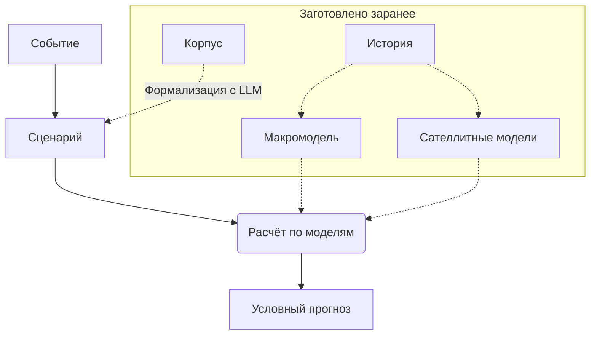

# Общая схема стресс-тестирования

Цель системы — ответить на вопрос, как распределены целевые показатели объекта, если произошло заданное событие $S$.

## 1. Уровни

Зафиксируем дату расчёта, доступную к ней информацию и горизонт в $H$ месяцев. Величины разбиты на уровни с номерами $l=0,\dots,L$ от общего к частному, например: экономика, отрасль, компания. Через $\mathcal X^l$ обозначим измеримое пространство траекторий уровня $l$ на горизонте, через $x^l$ — траекторию этого уровня, через $x^{<l}$ — траектории уровней с меньшими номерами. Положим $x=(x^0,\dots,x^L)$. Последний уровень содержит целевые показатели, и $v=x^L$.

## 2. Модели

*Макромодель* — это тройка $(\Omega^0,P^0,G^0)$, где $P^0$ — вероятностная мера на пространстве $\Omega^0$ случайных исходов уровня 0, а траектория уровня 0 равна $x^0=G^0(\omega^0)$ при $\omega^0\in\Omega^0$. От макромодели требуется только закон $x^0$ при доступной информации, а линейность, шоки и режимы в определение не входят.

*Сателлитная модель* уровня $l\ge 1$ — это тройка $(\Omega^l,P^l,G^l)$, где $P^l$ — вероятностная мера на пространстве $\Omega^l$ случайных исходов этого уровня, и при $\omega^l\in\Omega^l$

$$
x^l=G^l(x^{<l},\omega^l).
$$

Формально, это означает предположение об отсутствии обратной связи.

*Система моделей* — это пространство $\Omega=\prod_l\Omega^l$ с точками $\omega=(\omega^0,\dots,\omega^L)$, произведение мер $P=\bigotimes_lP^l$ и отображение $F:\Omega\to\mathcal X$, где $\mathcal X=\prod_l\mathcal X^l$. Значение $x=F(\omega)$ определено рекурсией: сначала $x^0=G^0(\omega^0)$, затем для $l=1,\dots,L$ по очереди $x^l=G^l(x^{<l},\omega^l)$. Мера $P$ называется базовой — это распределение исходов, полученное из истории, без учёта события.

Координаты $\omega$ образуют представление модели. Обычно туда входят шум, шоки, режимы и параметры моделей, оценённые по истории; вектор всех параметров обозначим $\theta$.

## 3. Сценарий

Мера $P$ не учитывает событие, а нас интересует будущее, в котором оно произошло. Поэтому сценарий заменяет $P$ другой вероятностной мерой $Q$ на $\Omega$ и указывает ограничения на нее.

Событие записывается множеством траекторий $A\subseteq\mathcal X$, например, траекторий, где ставка в марте лежит от 18 до 21 %. Ему соответствует множество исходов $S=F^{-1}(A)$, и мы требуем $Q(S)=1$. Если $A$ задаёт точное значение величины, то берём отрезок полуширины $\tau>0$. Если же событие утверждается только в среднем или с некоторой вероятностью, требование имеет вид $\ell\le\mathbb E_Qf\le r$ для измеримой $f:\Omega\to\mathbb R^k$. Например, $Q(S)\ge p$ получается при $f=\mathbf 1_S$, $\ell=p$, $r=1$.

Сценарий называет причины события — множество $D$ координат $\omega$, кроме $\theta$. Запишем $\omega=(\theta,\omega_D,\omega_{\bar D})$, где $\omega_D$ — координаты из $D$, а $\omega_{\bar D}$ — остальные. Если причины не названы, $\omega_D$ содержит всё, кроме $\theta$. Мера $Q$ имеет вид

$$
Q(d\omega)=P(d\theta,d\omega_{\bar D})\,Q(d\omega_D\mid\theta,\omega_{\bar D}),
$$

то есть меняется только условное распределение причин. Распределение $\theta$ сохраняется всегда, иначе редкое событие отбирало бы такие параметры, при которых оно обычно.

Эффекты, которых нет в моделях, например, запрет экспорта, записываются прямым воздействием $O=(o^0,\dots,o^L)$ — заданными сдвигами траекторий, где $o^l\in\mathcal X^l$ и пространства $\mathcal X^l$ линейны:

$$
x^0=G^0(\omega^0)+o^0,\qquad x^l=G^l(x^{<l},\omega^l)+o^l,\quad l=1,\dots,L.
$$

Эта рекурсия задаёт отображение $F_O$. Сами $G^l$ не меняются, и на нижние уровни сдвиг действует только через них.

Итак, *сценарий* — это набор $s=(N,m,O,D,\mathcal C)$, где $N$ — описание события текстом со ссылками на источники, $m$ — версии моделей, а $\mathcal C$ — требования к $Q$. Если исходы события расходятся, сценариев несколько, и каждый считается отдельно. Каждый элемент $O$ и $\mathcal C$ помечен источником или словом «допущение», а утверждает сценарий человек.

## 4. Наложение сценария

Положим $R=(\theta,\omega_{\bar D})$. Вид меры $Q$ из раздела 3 означает, что законы $R$ при $Q$ и при $P$ совпадают. Через $\mathcal Q_s$ обозначим множество вероятностных мер $Q\ll P$ такого вида, для которых $Q(S)=1$, функция $f$ интегрируема и $\ell\le\mathbb E_Qf\le r$.

Для вероятностных мер $Q\ll M$ расхождение Кульбака — Лейблера равно

$$
\mathrm{KL}(Q\Vert M)=\mathbb E_Q\log\frac{dQ}{dM},
$$

а если $Q\not\ll M$, оно равно $+\infty$. *Наложение сценария $s$* — это мера

$$
P_s=\arg\min_{Q\in\mathcal Q_s}\mathrm{KL}(Q\Vert P).
$$

Если $\mathcal Q_s$ пусто или минимум бесконечен, сценарий противоречит моделям.

**Лемма 1.** Для вероятностных мер $\mathrm{KL}(Q\Vert M)\ge 0$, и равенство верно только при $Q=M$.

*Доказательство.* При $Q\not\ll M$ утверждение верно по определению. Иначе положим $h=dQ/dM$. Тогда $\mathbb E_Mh=1$ и $\mathrm{KL}(Q\Vert M)=\mathbb E_M[h\log h]$. Функция $u\log u$ строго выпукла на $[0,\infty)$, поэтому неравенство Йенсена даёт $\mathbb E_M[h\log h]\ge 1\cdot\log 1=0$, причём равенство возможно только при постоянной $h$, то есть при $h=1$ почти наверное. $\square$

**Лемма 2.** Если $P(S\mid R)=0$ с положительной вероятностью, то $\mathcal Q_s$ пусто.

*Доказательство.* Пусть $B=\lbrace P(S\mid R)=0\rbrace$ и $P(B)>0$. Тогда $P(S\cap B)=\mathbb E_P[\mathbf 1_BP(S\mid R)]=0$. Для $Q\in\mathcal Q_s$ имеем $Q(S)=1$, а событие $B$ зависит только от $R$, поэтому $Q(S\cap B)=Q(B)=P(B)>0$. Это противоречит $Q\ll P$. $\square$

**Теорема.** Пусть $P(S\mid R)>0$ почти наверное, а вектор $\lambda$ той же размерности, что и $f$, таков, что величина

$$
\Lambda(R)=\mathbb E_P\big[\mathbf 1_S\,e^{\lambda^\top f}\mid R\big]
$$

конечна почти наверное и $\log\Lambda(R)$ интегрируема при $P$. Определим меру $Q^\ast$ плотностью

$$
\frac{dQ^\ast}{dP}=\frac{\mathbf 1_S\,e^{\lambda^\top f}}{\Lambda(R)}.
$$

Пусть $f$ интегрируема при $Q^\ast$, $\ell\le\mathbb E_{Q^\ast}f\le r$, и при всех $i$

$$
\lambda_i>0\ \Rightarrow\ \mathbb E_{Q^\ast}f_i=\ell_i,\qquad \lambda_i<0\ \Rightarrow\ \mathbb E_{Q^\ast}f_i=r_i.
$$

Тогда $P_s=Q^\ast$ и

$$
\mathrm{KL}(Q^\ast\Vert P)=\lambda^\top\mathbb E_{Q^\ast}f-\mathbb E_P\log\Lambda(R).
$$

*Доказательство.* Сначала проверим, что $Q^\ast\in\mathcal Q_s$. Величина $\Lambda(R)$ положительна, поскольку $P(S\mid R)>0$. Для ограниченной измеримой $g$ по свойству условного математического ожидания

$$
\mathbb E_{Q^\ast}g(R)=\mathbb E_P\Big[\frac{g(R)}{\Lambda(R)}\,\mathbb E_P\big[\mathbf 1_S\,e^{\lambda^\top f}\mid R\big]\Big]=\mathbb E_Pg(R).
$$

При $g=1$ отсюда следует, что $Q^\ast$ вероятностная, а в целом — что закон $R$ при $Q^\ast$ тот же, что при $P$. Плотность равна нулю вне $S$, поэтому $Q^\ast(S)=1$. Остальные условия заданы в теореме. Логарифмируя плотность и усредняя по $Q^\ast$, получаем формулу для $\mathrm{KL}(Q^\ast\Vert P)$.

Теперь возьмём $Q\in\mathcal Q_s$ с $\mathrm{KL}(Q\Vert P)<\infty$; мер с бесконечным значением минимум не касается. На $S$ плотность $dQ^\ast/dP$ положительна, поэтому из $Q\ll P$ и $Q(S)=1$ следует $Q\ll Q^\ast$, и почти наверное при $Q$

$$
\log\frac{dQ}{dP}=\log\frac{dQ}{dQ^\ast}+\lambda^\top f-\log\Lambda(R).
$$

Два последних слагаемых интегрируемы при $Q$: первое по определению $\mathcal Q_s$, второе потому, что закон $R$ при $Q$ тот же, что при $P$. Усредняя по $Q$, получаем

$$
\mathrm{KL}(Q\Vert P)=\mathrm{KL}(Q\Vert Q^\ast)+\lambda^\top\mathbb E_Qf-\mathbb E_P\log\Lambda(R).
$$

Вычитая формулу для $\mathrm{KL}(Q^\ast\Vert P)$, находим

$$
\mathrm{KL}(Q\Vert P)-\mathrm{KL}(Q^\ast\Vert P)=\mathrm{KL}(Q\Vert Q^\ast)+\lambda^\top\big(\mathbb E_Qf-\mathbb E_{Q^\ast}f\big).
$$

Второе слагаемое справа неотрицательно. В самом деле, при $\lambda_i>0$ имеем равенство с нижней границей, откуда $\mathbb E_Qf_i\ge\ell_i=\mathbb E_{Q^\ast}f_i$, при $\lambda_i<0$ имеем равенство с верхней, откуда $\mathbb E_Qf_i\le r_i=\mathbb E_{Q^\ast}f_i$, а при $\lambda_i=0$ слагаемого нет. Первое слагаемое неотрицательно по лемме 1. Значит, $\mathrm{KL}(Q\Vert P)\ge\mathrm{KL}(Q^\ast\Vert P)$, и равенство влечёт $\mathrm{KL}(Q\Vert Q^\ast)=0$, то есть $Q=Q^\ast$. $\square$

**Следствие.** Пусть задано только условие $Q(S)=1$, $P(S\mid R)>0$ почти наверное и $\log P(S\mid R)$ интегрируема. Тогда

$$
\frac{dP_s}{dP}=\frac{\mathbf 1_S}{P(S\mid R)},\qquad P_s(d\omega)=P(dR)\,P(d\omega_D\mid R,S).
$$

Иначе говоря, при каждом значении $R$ мера $P_s$ совпадает с $P$, обусловленной событием $S$.

*Доказательство.* Первая формула — это теорема без $f$, где $\Lambda(R)=P(S\mid R)$. Вторая получается, если разделить первую на маргинал $R$, который не меняется. $\square$

## 5. Цена сценария

Цена сценария равна

$$
\mathrm{dist}(s)=\mathrm{KL}(P_s\Vert P).
$$

Для меры вида $Q^\ast$ она вычисляется по формуле

$$
\mathrm{dist}(s)=\lambda^\top\mathbb E_{P_s}f-\mathbb E_P\log\Lambda(R).
$$

Если есть только условие на носитель, то

$$
\mathrm{dist}(s)=\mathbb E_P\big[-\log P(S\mid R)\big]\ \ge\ -\log P(S),
$$

а при постоянном $R$ выполнено равенство, так что $e^{-\mathrm{dist}(s)}=P(S)$. Если $R'$ определяет $R$, множество допустимых мер при $R'$ уже, и цена при нём не меньше. Поэтому объяснение события через меньшее число причин обходится дороже.

Если причины не названы, то $\omega_{\bar D}$ пусто и $R=\theta$. Тогда цена раскладывается по уровням: при заданном $\theta$ обозначим через $P^l_\theta$ и $Q^l_\theta$ условные законы уровня $l$ при данных $x^{<l}$ под мерами $P$ и $P_s$. Тогда

$$
\mathrm{dist}(s)=\mathbb E_P\Big[\sum_{l=0}^{L}\mathbb E_{P_s}\big[\mathrm{KL}(Q^l_\theta\Vert P^l_\theta)\mid\theta\big]\Big].
$$

Здесь предполагается, что $S$ и $f$ зависят только от $(\theta,x)$. Разложение показывает, на каком уровне сценарий дальше всего уходит от базовых моделей.

Если условный закон ограничиваемых величин имеет плотность, то при малом допуске $\tau$ точного значения цена растёт как $-k\log(2\tau)$, где $k$ — число таких условий. Сравнивать сценарии поэтому можно только при одинаковых допусках.

Воздействие $O$ не случайно и своей цены не имеет, хотя через $F_O$ меняет цену ограничений. Отчёт показывает $\mathrm{dist}(s)$ вместе с перечнем $O$.

## 6. Результат

Условный прогноз — это закон $v$ при $\omega\sim P_s$, где $v$ — последняя компонента $F_O(\omega)$. Система представляет его выборкой, возможно с весами, и считает по ней вероятности событий и функционалы $\rho$, например $\mathrm{ES}_{95\%}$.

Прогноз сравнивается с расчётом при сценарии $s_0$ без ограничений и воздействий, наложение которого равно $P$. Вклад отдельного условия или воздействия находим, убирая его из сценария и повторяя расчёт с теми же случайными числами.

В обратной задаче зафиксированы $m$, $O$, $D$ и вид ограничений с параметром $c$, и решается одна из двух задач:

$$
\sup\big\lbrace\rho(s(c)):\ \mathrm{dist}(s(c))\le\kappa\big\rbrace,
\qquad
\inf\big\lbrace\mathrm{dist}(s(c)):\ \rho(s(c))\ge L^\ast\big\rbrace.
$$

Воздействие $O$ обязано быть зафиксировано: оно ничего не стоит, и при свободном $O$ ограничение по цене перестало бы что-либо ограничивать.

## 7. Метрики качества

### Точность условного прогноза

У исторического эпизода $e$ ставим дату расчёта перед его началом, оцениваем модели только на данных, известных к этой дате, и задаём сценарий $s_e$. Наблюдение — ячейка $(e,t,q)$: эпизод, месяц горизонта и величина любого уровня. Ячейке соответствуют факт $y$ и функция распределения $\Psi$ этой величины при $P_{s_e}$ с квантилями $a=\Psi^{-1}(0{,}05)$ и $b=\Psi^{-1}(0{,}95)$. Если $A$ задаёт значение величины в ячейке с допуском $\tau$, прогноз совпадает с фактом с точностью до допуска, и такую ячейку исключаем.

Главная метрика — непрерывная ранжированная вероятностная оценка:

$$
\mathrm{CRPS}(\Psi,y)=\int_{-\infty}^{\infty}\big(\Psi(z)-\mathbf 1\lbrace z\ge y\rbrace\big)^2dz.
$$

Значение величины $q$ на горизонте $t$ делим на $\sigma_q(t)$ — медиану абсолютного изменения величины за $t$ месяцев по истории. Затем усредняем внутри величины и с равными весами по величинам, отдельно по уровням и горизонтам. Эталоны считаем на тех же ячейках: случайное блуждание с дрейфом, а для целевых показателей ещё значение годом ранее с трендом. Интервал 95 % получаем бутстрэпом по эпизодам с 1000 повторений, поскольку ячейки одного эпизода зависимы, а при малом числе эпизодов проверяем его кластерным wild-бутстрэпом с весами Уэбба.

Если $y$ имеет непрерывную функцию распределения $\Psi$, то $u=\Psi(y)$ равномерно на $[0,1]$, и факт попадает ниже $a$, между $a$ и медианой, между медианой и $b$ и выше $b$ с долями 0,05, 0,45, 0,45 и 0,05. Резкость — медианная ширина $b-a$; её сравниваем, только если наблюдаемые доли согласуются с перечисленными.

Для целевого показателя с потерей $\Delta_e$ и прогнозными $\mathrm{VaR}_e$, $\mathrm{ES}_e$ уровня 95 % по $n$ эпизодам считаем статистику Acerbi и Székely (2014):

$$
Z=\frac{1}{0{,}05\,n}\sum_{e=1}^{n}\frac{\Delta_e\mathbf 1\lbrace\Delta_e>\mathrm{VaR}_e\rbrace}{\mathrm{ES}_e}-1.
$$

При верном хвосте $\mathbb E Z=0$, а $Z>0$ означает, что хвост занижен.

### Когда применима проверка равномерности

Равномерность $u$ требует, чтобы факт был распределён по закону прогноза. Если система верна и событие произошло, факт распределён по $P(\cdot\mid S)$, поэтому сравним эту меру с $P_s$.

Пусть причины не названы, тогда $R=\theta$. Положим $P_\theta=P(\cdot\mid\theta)$. Тогда

$$
P(d\omega\mid S)=\int P_\theta(d\omega\mid S)\frac{P_\theta(S)}{P(S)}P(d\theta),\qquad
P_s(d\omega)=\int P_\theta(d\omega\mid S)P(d\theta).
$$

Меры различаются множителем $P_\theta(S)/P(S)$ и совпадают при постоянном $\theta$. В остальных случаях равномерность $u$ выполнена приближённо.

Пусть причины названы. Тогда $P_s$ меняет только закон $\omega_D$, и $P_s\ne P(\cdot\mid S)$ даже при постоянном $\theta$, если закон $\omega_{\bar D}$ при условии $S$ меняется. Отклонение $u$ от равномерного закона может тогда происходить и от моделей, и от выбора $D$. Поэтому равномерность проверяем только для сценариев без названных причин. Влияние $D$ показываем отдельно: рассчитываем один сценарий при разных $D$ и приводим разброс потерь.

Для $s_0$ прогноз имеет закон $P$, а на эпизодах, отобранных по событию, факт распределён по $P(\cdot\mid S)$. Поэтому равномерность при $s_0$ проверяем по всем датам истории.

### Польза сценария

Сценарий полезен, если на эпизодах CRPS при $s_e$ ниже, чем при $s_0$. Сценарии, размеченные вручную, и сценарии от LLM считаем отдельно. Результат для LLM надёжен только в расчётах вперёд, поскольку LLM помнит исходы прошлых эпизодов.

### Проверка цены

Метрики эпизодов не касаются $\mathrm{dist}(s)$. Цену проверяем отдельно на семействе событий $A_1,\dots,A_K$, заданном до расчёта и не зависящем от дат. Для каждой даты $d$ истории и каждого $A_k$ по моделям, оценённым на данных до $d$, считаем прогнозную вероятность $\pi=P(S)$ и индикатор $\xi$ того, что событие произошло. Метрика — средняя логарифмическая оценка

$$
-\xi\log\pi-(1-\xi)\log(1-\pi)
$$

в сравнении с оценкой по исторической частоте и таблица: средняя $\pi$ против частоты $\xi$ в группах по $\pi$. Окна горизонта пересекаются, поэтому интервалы получаем блочным бутстрэпом. На месячной истории в 20 лет событие вероятности 1 % ожидается примерно 2–3 раза, поэтому хвост цены этой проверкой подтверждается слабо, и отчёт об этом сообщает.

Эта проверка касается $-\log P(S)$. Разность $\mathrm{dist}(s)+\log P(S)$ при $R=\theta$ создаётся только неопределённостью параметров, её отчёт приводит отдельно. Цену при названном $D$ история не проверяет.

### Допуск версий

Версия допускается к сравнению, если меньше 5 % ячеек нарушают каждое из условий: полоса $[a,b]$ лежит в области допустимых значений величины; ширина $b-a$ не больше диапазона величины за всю историю. Те же условия проверяем на путях при сценарии, поскольку ограничения могут расширить веер.

Вероятность каждого условия, заданного интервалом, при $P$ должна быть выше 1 %, иначе сценарий держится на редком хвосте. Для условия, заданного точным значением, вероятность измеряла бы допуск $\tau$, а не сценарий, и порог к нему не применяется. У сателлитной модели доля путей, где выход лежит вне диапазона обучающей выборки, должна быть меньше 1 %; пока это не выполнено и бэктест не пройден, хвост целевого показателя помечается как непроверенный.

Эпизоды заранее делим на две половины: на первой настраиваем модели, на второй проверяем, а итоговую таблицу строим по всем эпизодам. Версии сравниваем попарно на одних и тех же ячейках по целевым показателям:

1. Версия, не прошедшая допуск, отклоняется независимо от CRPS.
2. Версия принимается, если её CRPS лучше CRPS эталона и текущей версии больше чем на две стандартные ошибки и условия допуска не ухудшились.
3. Версия отклоняется, если её CRPS хуже больше чем на две стандартные ошибки.
4. В остальных случаях различие считается необнаруженным, и текущая версия остаётся.

### Точность расчёта

Для выборки размера $n$ с весами $w_i$ отчёт приводит эффективный размер $(\sum_iw_i)^2/\sum_iw_i^2$. На выборке проверяем $Q(S)=1$ и $\ell\le\mathbb E_Qf\le r$, а для $\lambda$ — условия теоремы о виде $Q^\ast$. Значения $\mathrm{ES}$ сопровождаются интервалом, чувствительностью к отбрасыванию 1 % крайних путей и пометкой горизонта. Ошибку Монте-Карло оцениваем бутстрэпом по реализациям, отдельно от ошибки выборки. Для воспроизводимости отчёт записывает версии моделей и данных, дату, начальное значение генератора случайных чисел и коммит.

## 8. Частные случаи

### Векторная авторегрессия с режимами — MS-VAR

Пусть макромодель задана уравнением

$$
y_t=\mu(\zeta_t)+\sum_{j=1}^{p}A_j(\zeta_t)y_{t-j}+B(\zeta_t)z_t,\qquad t=1,\dots,H,
$$

где шоки $z_t$ независимы и имеют закон $N(0,I)$, а режим $\zeta_t$ — марковская цепь с матрицей переходов $\Pi$. Тогда $\omega^0=(\theta,\zeta,\mathbf z)$, где $\theta$ состоит из $\mu,A_j,B,\Pi$, $\zeta$ — путь режимов, $\mathbf z$ — все шоки горизонта. Вероятность пути при заданных параметрах обозначим $\pi_\theta(\zeta)$.

Пусть событие имеет вид $Wy\in\mathcal B$, где $W$ — матрица, а $\mathcal B$ — прямоугольник. При заданных $\theta,\zeta$ вектор $Wy$ линеен по шокам:

$$
Wy=c+Z_D\mathbf z_D+Z_{\bar D}\mathbf z_{\bar D},
$$

где $c,Z_D,Z_{\bar D}$ зависят от $\theta,\zeta$. Следствие о законе при условии на носитель даёт три случая.

Если причины не названы, то $R=\theta$. Путь режимов имеет закон

$$
P_s(\zeta\mid\theta)=\frac{\pi_\theta(\zeta)P(S\mid\theta,\zeta)}{P(S\mid\theta)},
$$

а при заданных $\theta,\zeta$ шоки имеют нормальный закон, усечённый на $S$. Цена равна $\mathbb E_P[-\log P(S\mid\theta)]$.

Если причины — шоки $\mathbf z_D$, то $R=(\theta,\zeta,\mathbf z_{\bar D})$. Режимы и остальные шоки сохраняют базовый закон, а $\mathbf z_D$ при заданном $R$ имеет нормальный закон, усечённый на $S$. Пусть $n^\top Z_D=0$ и $n^\top Z_{\bar D}\ne 0$ для некоторого вектора $n$ при заданных $\theta,\zeta$ из множества положительной вероятности. Тогда $n^\top Wy$ при заданном $R$ не случайно и с положительной вероятностью выходит за ограниченный прямоугольник $\mathcal B$. Значит, $P(S\mid R)=0$ с положительной вероятностью, и по лемме 2 сценарий противоречит моделям.

Если причины — шоки $\mathbf z_D$ и режимы, то $R=(\theta,\mathbf z_{\bar D})$, и

$$
P_s(\zeta\mid R)\propto\pi_\theta(\zeta)P(S\mid R,\zeta).
$$

Отдельно рассмотрим событие $\zeta=(k,\dots,k)$ без условий на $y$ и без названных причин. Шоки сохраняют базовый закон, а цена равна $\mathbb E_P[-\log\pi_\theta(k,\dots,k)]$.

### Сателлит с регрессией

Пусть $x^l_t=\beta^\top g(x^{<l}_t)+\sigma e_t$, где $g$ — заданная функция. Тогда $\omega^l=(\beta,\sigma,e)$, и $\beta,\sigma$ входят в $\theta$.

### Модель, заданная выборкой путей

Пусть модель задана путями $x_1,\dots,x_n$ с равными весами. Тогда $\Omega=\lbrace 1,\dots,n\rbrace$, $P$ равномерна, $F(i)=x_i$, и $R$ постоянно. По теореме путь $i$ получает вес, пропорциональный $\mathbf 1_S(i)e^{\lambda^\top f(i)}$. При одном условии на носитель цена равна $-\log(\lvert S\rvert/n)$.
