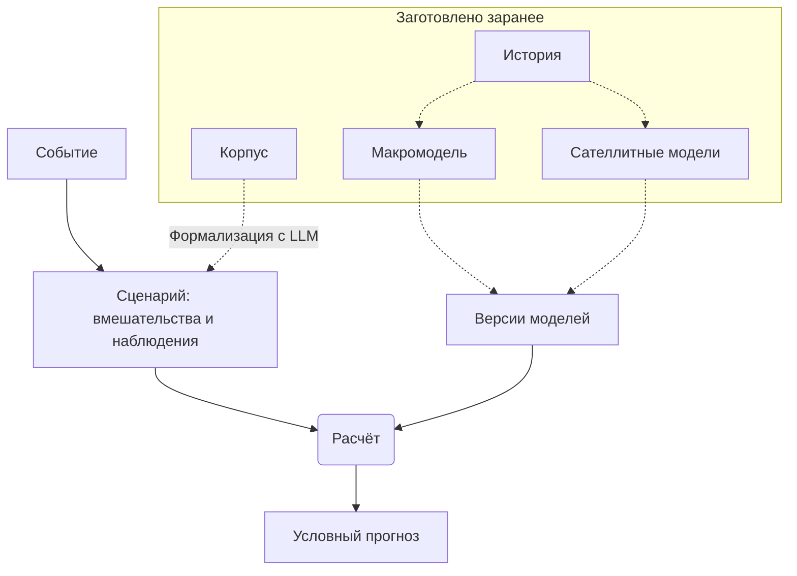

# Общая схема стресс-тестирования

*Условный прогноз* описывает распределение будущих показателей при заданном событии: например, стоимости портфеля, если центральный банк установит определённую ставку. Сценарий отделяет решения, заданные извне, от сведений о результате: решение меняет правило построения траектории, а сведения меняют вероятности допустимых траекторий. Главная теорема устанавливает вид меры, которая выполняет сведения и минимально отклоняется от исходного закона по расхождению Кульбака — Лейблера.

Схема задаёт математические требования к системе, а не перечень уже реализованных функций. Если программа не выполняет требование схемы, расхождение нуждается в отдельной проверке; ограничение программы не меняет определения и теоремы.

## От события к распределению

Траектория — значения величины по месяцам, а один случайный исход определяет траектории всех величин одновременно. *Макропеременными* называем показатели экономики в целом — цены, выпуск продукции, валютный курс и процентные ставки, — а процентная ставка показывает плату за использование денег за год. *Драйвер* — показатель части экономики, от которого зависит изучаемый объект, например цена акции компании или доля просроченных кредитов отрасли. *Сателлитная модель* строит драйверы по более общим показателям, а стоимость портфеля получается из путей его позиций, причём потеря равна уменьшению стоимости.

## Уровни и величины

Фиксируем информацию, доступную на выбранную дату: позднее опубликованные значения к ней не относятся. Горизонт $H$ измеряется месяцами, будущие месяцы имеют номера $t=1,\dots,H$, а номер $t=0$ принадлежит последнему месяцу истории, который может предшествовать календарному месяцу даты расчёта.

Номер уровня $l=0,\dots,L$ задаёт направление зависимости от экономики к отрасли, компании и целевому показателю, а множество величин уровня обозначим $K^l$; оно конечно. Один общий реестр фиксирует смысл и шкалу каждой величины, чтобы сценарий сохранял значение при смене модели. Ставки используют исходные единицы, цены и индексы $X$ — шкалу $100\ln X$, в которой разность приближённо равна процентному изменению.

Значение величины $k\in K^l$ в месяц $t$ обозначим $x_{k,t}\in\mathbb R$, а весь путь уровня — $x^l=(x_{k,t})_{k\in K^l,\,1\le t\le H}$, его пространство — $\mathcal X^l=\mathbb R^{K^l\times\lbrace 1,\dots,H\rbrace}$. Совместный путь всех уровней равен $x=(x^0,\dots,x^L)\in\mathcal X=\prod_l\mathcal X^l$, а $x^{<l}$ собирает уровни с меньшими номерами. Выход последнего уровня $v=x^L$ — тот показатель, распределение которого требуется пользователю.

## Модели

*Макромодель* — это тройка $(\Omega^0,P^0,G^0)$, где $P^0$ — вероятностная мера на пространстве $\Omega^0$ случайных исходов уровня 0, а траектория уровня 0 равна $x^0=G^0(\omega^0)$ при $\omega^0\in\Omega^0$. От макромодели требуется только закон $x^0$ при доступной информации; линейность, шоки и режимы в определение не входят.

*Сателлитная модель* уровня $l\ge 1$ — это тройка $(\Omega^l,P^l,G^l)$, где $P^l$ — вероятностная мера на пространстве $\Omega^l$ случайных исходов этого уровня, и при $\omega^l\in\Omega^l$

$$
x^l=G^l(x^{<l},\omega^l).
$$

Зависимость направлена от общего к частному: показатели компании могут зависеть от экономики, но выход модели компании не меняет рассчитанную экономику. Отсутствие обратной связи относится к уровням; внутри макромодели зависимости могут быть двусторонними.

*Система моделей* — это пространство $\Omega=\prod_l\Omega^l$ с точками $\omega=(\omega^0,\dots,\omega^L)$, произведение мер $P=\bigotimes_lP^l$ и отображение $F:\Omega\to\mathcal X$, а значение $x=F(\omega)$ определено рекурсией: сначала $x^0=G^0(\omega^0)$, затем для $l=1,\dots,L$ по очереди $x^l=G^l(x^{<l},\omega^l)$. Мера $P$ называется *базовой* — это распределение исходов, полученное из истории, без учёта события.

Случайный исход $\omega$ содержит внутренние координаты моделей: *шок* — случайное возмущение, которое модель передаёт другим величинам, а *режим* — скрытое состояние, например состояние с большим разбросом. Параметры — коэффициенты правил и распределений, полученные при оценке по истории; вектор всех параметров обозначим через $\theta$. Сценарий задаётся наблюдаемыми величинами, поэтому знать внутренние координаты его автору не требуется.

### Структурная форма

Одинаковое распределение путей можно получить разными вычислительными механизмами, но для наблюдения различие несущественно: наблюдение только перевзвешивает готовые исходы. Для вмешательства механизм необходим: замена ставки должна либо изменить следующие вычисления, либо остаться заменой одной клетки, поэтому структурная форма сообщает, какие аргументы прочитает модель после замены.

Определение 1. *Структурная форма* модели уровня $l$ — это линейный порядок $\prec$ на множестве пар $(k,t)$, $k\in K^l$, $1\le t\le H$, такой, что $(k,t)\prec(k',t')$ при $t<t'$, вместе с измеримыми отображениями $g_{k,t}$, для которых

$$
x_{k,t}=g_{k,t}\Big(x^{<l},\ (x_{k',t'})_{(k',t')\prec(k,t)},\ \omega^l\Big),
$$

и вычисление значений в порядке $\prec$ даёт $G^l(x^{<l},\omega^l)$.

Порядок $\prec$ запрещает вычислять ранний месяц через поздний. Внутри одного месяца модель также может задать последовательность величин: каждая читает только уже вычисленные значения своего уровня, а значения уровней с меньшими номерами доступны целиком как внешние аргументы.

*Форма по умолчанию* вычисляет каждую клетку непосредственно из исхода: $g_{k,t}(x^{<l},\cdot,\omega^l)=G^l(x^{<l},\omega^l)_{k,t}$. Такая форма существует всегда, даже если у модели нет содержательной рекурсии. Заменённая клетка в ней не становится аргументом другой клетки того же уровня, поэтому отсутствие объявленной связи нельзя читать как утверждение о причинной независимости величин.

Закон без вмешательств не выбирает структурную форму однозначно, поэтому отчёт должен назвать форму: последствия решения зависят от неё даже при неизменном базовом законе. Рекурсивное блуждание в разделе «Частные случаи» показывает, почему установленный уровень может сохраниться в будущем или исчезнуть уже в следующем месяце.

## Сценарий

Сценарий добавляет к базовому будущему два разных вида утверждений: одни назначают значения извне, другие сообщают, какие исходы должны наблюдаться. Различие относится к смыслу события, а не к форме числа: точная ставка может быть решением или наблюдаемым результатом.

Определение 2. *Вмешательство* — это тройка $(k,T,\varphi)$, где $k\in K^l$ — величина некоторого уровня $l$, $T\subseteq\lbrace 1,\dots,H\rbrace$ — месяцы, а $\varphi=(\varphi_t)_{t\in T}$ — отображения $\mathbb R\to\mathbb R$ одного из видов: постоянное $\varphi_t\equiv a_t$ — величина *установлена* равной $a_t$; сдвиг $\varphi_t(z)=z+o_t$ — величина *сдвинута* на $o_t$. Вмешательство заменяет значение, которое дала бы модель, значением $\varphi_t$ от него, а пара $(k,t)$ входит не больше чем в одно вмешательство сценария.

Неопределённость внешнего решения задаётся собственным законом, а не выводится из модели экономики. Соберём отображения всех клеток в $\psi=(\psi_{k,t})\in\Psi$, где нетронутая клетка получает тождественное отображение $\mathrm{id}$. Закон выбора $\psi$ обозначим $\mu_I$: при отсутствии иных сведений интервал $[a_-,a_+]$ трактуется как равномерный выбор установленного значения. Если решение принимается с вероятностью $p$, закон смешивает постоянную установку с весом $p$ и отсутствие вмешательства с весом $1-p$, а точно известному решению соответствует мера Дирака.

Определение 3. *Наблюдение* — это требование к мере $Q$ на исходах одного из видов: $Q(x\in A)=1$ для измеримого множества траекторий $A\subseteq\mathcal X$ (условие на носитель) или $\ell\le\mathbb E_Qf(x)\le r$ для измеримой $f:\mathcal X\to\mathbb R^m$ и векторов $\ell\le r$ (условие на среднее). Например, $Q(x\in C)\ge p$ получается при $f=\mathbf 1_C$, $\ell=p$, $r=1$. Если наблюдение задаёт точное значение величины, берётся отрезок полуширины $\tau>0$: условие на множество меры нуль не определяет меру. Вмешательству допуск не нужен, потому что значение установлено, а не обусловлено.

Высказывание — вмешательство, если величину задаёт субъект вне системы моделей и её значение не зависело бы от остальных величин: решение центрального банка о ставке, запрет экспорта, цена нефти для экономики, на которую она действует извне. Высказывание — наблюдение, если оно утверждает исход, который складывается в самой системе: курс после введения санкций, падение выпуска. Одно и то же число может быть тем или другим: «Brent 130 долларов из-за закрытия пролива» для российской экономики — вмешательство, «Brent 130 долларов на фоне мирового бума» — наблюдение, и последствия у них разные; классификацию делает автор сценария по тексту события, а утверждает её человек.

Определение 4. *Сценарий* — это набор $s=(N,I,\mathcal A)$, где $N$ — описание события текстом со ссылками на источники, $I$ — конечное множество вмешательств с законом $\mu_I$, $\mathcal A$ — конечное множество наблюдений. Условия на носитель из $\mathcal A$ сводятся к одному множеству $A$ — их пересечению, условия на среднее — к одной функции $f$ с границами $\ell,r$. Каждое число в $I$ и $\mathcal A$ помечено событием, если оно названо в описании события, источником, если его даёт источник, или словом «допущение». Числа записываются в единицах величины с календарными датами; в шкалу реестра и номера месяцев их переводит платформа.

Описание события не должно выбирать удобную модель его последствий: версии моделей, горизонт, число путей и начальное значение генератора относятся к запросу *расчёта*. Один сценарий можно вычислить несколькими системами моделей; различие результатов тогда выражает модельную неопределённость, а не изменение события. Обозначение $s_0$ зарезервировано за *пустым сценарием*, в котором нет ни вмешательств, ни наблюдений.

## Наложение сценария

### Вмешательство меняет отображение

Зафиксируем набор отображений $\psi\in\Psi$. Отображение $F^\psi:\Omega\to\mathcal X$ определяется той же рекурсией по уровням, что $F$, но каждый уровень вычисляется по своей структурной форме в порядке $\prec$, и для каждой пары $(k,t)$, входящей во вмешательство, значение $g_{k,t}(\dots)$ заменяется на $\psi_{k,t}\big(g_{k,t}(\dots)\big)$. Последующие значения того же уровня и нижние уровни вычисляются уже от заменённого значения, а при $\psi=\mathrm{id}$ во всех парах $F^\psi=F$.

Лемма 1. Пусть модель уровня $l$ взята в форме по умолчанию, а вмешательство затрагивает только величину $k\in K^l$ в месяцы $T$. Тогда при каждом $\omega$ траектория $F^\psi(\omega)$ совпадает с $F(\omega)$ на уровнях выше $l$ и на всех парах уровня $l$, кроме $(k,t)$ при $t\in T$; нижние уровни отличаются от базовых только через свои модели.

*Доказательство.* Уровни выше $l$ вычисляются раньше и от вмешательства не зависят. В форме по умолчанию $g_{k',t}$ не читает значений своего уровня, поэтому замена значения $x_{k,t}$ не меняет $x_{k',t'}$ при $(k',t')\ne(k,t)$. Нижние уровни получают изменённое $x^l$ как аргумент своих отображений. $\square$

Для формы по умолчанию назначенная величина отличается от исходной только в месяцах $T$. Другие величины того же уровня не читают замену, но следующие уровни получают её как вход. Если автор хочет сохранить замену и в следующих месяцах, такие месяцы должны присутствовать в сценарии: собственное последействие из леммы не следует.

### Пространство со случайными вмешательствами

Положим

$$
\Omega'=\Omega\times\Psi,\qquad P'=P\otimes\mu_I,\qquad F^I(\omega,\psi)=F^\psi(\omega).
$$

Для существования условных законов предполагаем стандартность борелевского пространства $\Psi$ и измеримость $(\omega,\psi)\mapsto F^\psi(\omega)$; при конечном наборе измеримых операций условие выполняется. Произведение мер $P'$ выражает независимый выбор внешнего решения и исхода модели до учёта наблюдений: это уже мир с вмешательствами, но ещё не условный прогноз.

Положим $S=(F^I)^{-1}(A)\subseteq\Omega'$ — множество исходов, при которых выполнено условие на носитель, и $R=(\theta,\psi)$ — координаты, закон которых сценарий сохраняет. Через $\mathcal Q_s$ обозначим множество вероятностных мер $Q\ll P'$ на $\Omega'$, для которых закон $R$ при $Q$ тот же, что при $P'$, $Q(S)=1$, функция $f\circ F^I$ интегрируема при $Q$ и $\ell\le\mathbb E_Q f(F^I)\le r$.

Сохранение закона $R$ отделяет сведения о будущем исходе от переоценки модели, поскольку без сохранения закона параметров редкое событие получило бы больший вес у параметров, при которых событие обычно. Закон вмешательств также фиксирован автором: наблюдение курса 100 рублей за доллар не должно увеличивать назначенную автором вероятность решения центрального банка. Наблюдения меняют остальные координаты, включая шум, шоки и режимы, внутри каждого значения $R$.

### Мера наложения

Для вероятностных мер $Q\ll M$ расхождение Кульбака — Лейблера равно

$$
\mathrm{KL}(Q\Vert M)=\mathbb E_Q\log\frac{dQ}{dM},
$$

а если $Q\not\ll M$, оно равно $+\infty$; *наложение сценария $s$* — это мера

$$
P_s=\arg\min_{Q\in\mathcal Q_s}\mathrm{KL}(Q\Vert P').
$$

Если $\mathcal Q_s$ пусто или минимум бесконечен, сценарий *противоречит моделям*.

Лемма 2. Для вероятностных мер $\mathrm{KL}(Q\Vert M)\ge 0$, и равенство верно только при $Q=M$.

*Доказательство.* При $Q\not\ll M$ утверждение верно по определению. Иначе положим $h=dQ/dM$. Тогда $\mathbb E_Mh=1$ и $\mathrm{KL}(Q\Vert M)=\mathbb E_M[h\log h]$. Функция $u\log u$ строго выпукла на $[0,\infty)$, поэтому неравенство Йенсена даёт $\mathbb E_M[h\log h]\ge 1\cdot\log 1=0$, причём равенство возможно только при постоянной $h$, то есть при $h=1$ почти наверное. $\square$

Лемма 3. Если $P'(S\mid R)=0$ с положительной вероятностью, то $\mathcal Q_s$ пусто.

*Доказательство.* Пусть $B=\lbrace P'(S\mid R)=0\rbrace$ и $P'(B)>0$. Тогда $P'(S\cap B)=\mathbb E_{P'}[\mathbf 1_BP'(S\mid R)]=0$. Для $Q\in\mathcal Q_s$ имеем $Q(S)=1$, а событие $B$ зависит только от $R$, поэтому $Q(S\cap B)=Q(B)=P'(B)>0$, что противоречит $Q\ll P'$. $\square$

Противоречие может не иметь отношения к оценке параметров. Если вмешательство устанавливает курс 100, а наблюдение требует в той же клетке курс от 110 до 120, допустимых исходов нет у любой модели. Для случайного вмешательства достаточно, чтобы такой конфликт возникал на множестве решений положительной меры: закон решений сохраняется, и удалить неудобные решения нельзя.

Теорема. Пусть $P'(S\mid R)>0$ почти наверное, а вектор $\lambda\in\mathbb R^m$ таков, что величина

$$
\Lambda(R)=\mathbb E_{P'}\big[\mathbf 1_S\,e^{\lambda^\top f(F^I)}\mid R\big]
$$

конечна почти наверное и $\log\Lambda(R)$ интегрируема при $P'$. Определим меру $Q^\ast$ плотностью

$$
\frac{dQ^\ast}{dP'}=\frac{\mathbf 1_S\,e^{\lambda^\top f(F^I)}}{\Lambda(R)}.
$$

Пусть $f\circ F^I$ интегрируема при $Q^\ast$, $\ell\le\mathbb E_{Q^\ast}f(F^I)\le r$, и при всех $i=1,\dots,m$

$$
\lambda_i>0\ \Rightarrow\ \mathbb E_{Q^\ast}f_i(F^I)=\ell_i,\qquad \lambda_i<0\ \Rightarrow\ \mathbb E_{Q^\ast}f_i(F^I)=r_i.
$$

Тогда $P_s=Q^\ast$ и

$$
\mathrm{KL}(Q^\ast\Vert P')=\lambda^\top\mathbb E_{Q^\ast}f(F^I)-\mathbb E_{P'}\log\Lambda(R).
$$

*Доказательство.* Для краткости положим $\bar f=f\circ F^I$. Сначала проверим, что $Q^\ast\in\mathcal Q_s$. Величина $\Lambda(R)$ положительна, поскольку $P'(S\mid R)>0$. Для ограниченной измеримой $g$ по свойству условного математического ожидания

$$
\mathbb E_{Q^\ast}g(R)=\mathbb E_{P'}\Big[\frac{g(R)}{\Lambda(R)}\,\mathbb E_{P'}\big[\mathbf 1_S\,e^{\lambda^\top \bar f}\mid R\big]\Big]=\mathbb E_{P'}g(R).
$$

При $g=1$ отсюда следует, что $Q^\ast$ вероятностная, а в целом — что закон $R$ при $Q^\ast$ тот же, что при $P'$. Плотность равна нулю вне $S$, поэтому $Q^\ast(S)=1$, а остальные условия заданы в теореме. Логарифмируя плотность и усредняя по $Q^\ast$, получаем формулу для $\mathrm{KL}(Q^\ast\Vert P')$.

Теперь возьмём $Q\in\mathcal Q_s$ с $\mathrm{KL}(Q\Vert P')<\infty$; мер с бесконечным значением минимум не касается. На $S$ плотность $dQ^\ast/dP'$ положительна, поэтому из $Q\ll P'$ и $Q(S)=1$ следует $Q\ll Q^\ast$, и почти наверное при $Q$

$$
\log\frac{dQ}{dP'}=\log\frac{dQ}{dQ^\ast}+\lambda^\top \bar f-\log\Lambda(R).
$$

Два последних слагаемых интегрируемы при $Q$: первое по определению $\mathcal Q_s$, второе потому, что закон $R$ при $Q$ тот же, что при $P'$. Усредняя по $Q$, получаем

$$
\mathrm{KL}(Q\Vert P')=\mathrm{KL}(Q\Vert Q^\ast)+\lambda^\top\mathbb E_Q\bar f-\mathbb E_{P'}\log\Lambda(R).
$$

Вычитая формулу для $\mathrm{KL}(Q^\ast\Vert P')$, находим

$$
\mathrm{KL}(Q\Vert P')-\mathrm{KL}(Q^\ast\Vert P')=\mathrm{KL}(Q\Vert Q^\ast)+\lambda^\top\big(\mathbb E_Q\bar f-\mathbb E_{Q^\ast}\bar f\big).
$$

Второе слагаемое справа неотрицательно: при $\lambda_i>0$ имеем $\mathbb E_Q\bar f_i\ge\ell_i=\mathbb E_{Q^\ast}\bar f_i$, при $\lambda_i<0$ имеем $\mathbb E_Q\bar f_i\le r_i=\mathbb E_{Q^\ast}\bar f_i$, а при $\lambda_i=0$ слагаемого нет. Первое слагаемое неотрицательно по лемме 2, значит, $\mathrm{KL}(Q\Vert P')\ge\mathrm{KL}(Q^\ast\Vert P')$, и равенство влечёт $\mathrm{KL}(Q\Vert Q^\ast)=0$, то есть $Q=Q^\ast$. $\square$

Следствие. Пусть наблюдения сводятся к условию на носитель, $P'(S\mid R)>0$ почти наверное и $\log P'(S\mid R)$ интегрируема. Тогда

$$
\frac{dP_s}{dP'}=\frac{\mathbf 1_S}{P'(S\mid R)},\qquad P_s(d\omega')=P'(dR)\,P'(d\omega'\mid R,S).
$$

Следствие даёт способ вычисления: сначала выбираются параметры и внешние решения по прежнему закону, затем оставшиеся координаты выбираются условно на $S$ внутри выбранной группы. Выбор только удачных групп нарушил бы требование сохранить закон $R$.

*Доказательство.* Первая формула — это теорема без $f$, где $\Lambda(R)=P'(S\mid R)$. Вторая получается, если разделить первую на маргинал $R$, который не меняется. $\square$

При отсутствии наблюдений нет основания менять меру: $S=\Omega'$ и $P_s=P'$, поэтому случайные решения дают обычную смесь траекторий по $\mu_I$. Когда наблюдения появляются, смесь по решениям сохраняет те же веса, а условный выбор меняет только исходы внутри каждого решения.

## Цена сценария

Термин *цена* обозначает информационное расхождение, не денежную потерю и не вероятность внешнего решения. По определению

$$
\mathrm{dist}(s)=\mathrm{KL}(P_s\Vert P').
$$

Подстановка плотности из теоремы позволяет вычислить цену без отдельной задачи минимизации:

$$
\mathrm{dist}(s)=\lambda^\top\mathbb E_{P_s}f(F^I)-\mathbb E_{P'}\log\Lambda(R).
$$

Для одних условий на носитель экспоненциальный множитель исчезает. Получаем

$$
\mathrm{dist}(s)=\mathbb E_{P'}\big[-\log P'(S\mid R)\big]\ \ge\ -\log P'(S),
$$

а при постоянном $R$ выполнено равенство, так что $e^{-\mathrm{dist}(s)}=P'(S)$. Разность $\mathrm{dist}(s)+\log P'(S)$ равна $\log\mathbb E_{P'}P'(S\mid R)-\mathbb E_{P'}\log P'(S\mid R)$ и по неравенству Йенсена неотрицательна, а растёт она с разбросом $P'(S\mid R)$ по значениям параметров и вмешательств, так что цена может намного превышать $-\log P'(S)$.

Цена измеряет только наблюдения при вмешательствах, а у сценария из одних вмешательств она равна нулю: событие навязано, а не наблюдено. Насколько вмешательство далеко от базового прогноза, отчёт показывает отдельно. Для постоянного вмешательства со значением $a$ на паре $(k,t)$ это *удалённость* $\alpha_{k,t}=P\big(F(\omega)_{k,t}\le a\big)$ — квантиль установленного значения в базовом законе величины; для случайного вмешательства — закон $\alpha_{k,t}$ при $\mu_I$. Удалённость — диагностика: в цену и в допуск расчёта она не входит.

При заданном $R$ обозначим через $P^l_R$ и $Q^l_R$ условные законы уровня $l$ при заданных $x^{<l}$ под мерами $P'$ и $P_s$. Поскольку $S$ и $f$ зависят только от траекторий, цена раскладывается по уровням:

$$
\mathrm{dist}(s)=\mathbb E_{P'}\Big[\sum_{l=0}^{L}\mathbb E_{P_s}\big[\mathrm{KL}(Q^l_R\Vert P^l_R)\mid R\big]\Big].
$$

Каждое слагаемое разложения относится к одному уровню: например, экономика может почти не измениться, тогда как наблюдение о компании потребует сильного изменения её условного закона. Разложение цены различает такие случаи, хотя итоговые потери у случаев могут совпадать.

Пусть при заданном $R$ закон $d$ ограничиваемых величин имеет непрерывную положительную плотность $p_R$, а событие задано ящиком $\mathcal B$ объёма $\lvert\mathcal B\rvert$, стягивающимся к точке $\eta$. Тогда

$$
-\log P'(S\mid R)=-\log p_R(\eta)-\log\lvert\mathcal B\rvert+o(1).
$$

Здесь $o(1)$ стремится к нулю при стягивании ящика к $\eta$. Слагаемое с плотностью зависит от положения точки в законе, а слагаемое с объёмом — от точности, которую выбрал автор сценария; точное значение с допуском $\tau$ — случай $\lvert\mathcal B\rvert=(2\tau)^d$, где цена растёт как $-d\log(2\tau)$. Цена узкого события поэтому говорит прежде всего о его ширине, и напрямую сравнивать цены можно только у событий с равными ящиками.

Тяжесть событий сравнивается по *односторонней цене* $\mathrm{dist}^+(s)$ — цене события $A^+$, в котором каждое интервальное наблюдение величины заменено лучом. Интервал ниже медианы величины при $P'$ заменяется лучом вниз от его верхней границы, интервал выше медианы — лучом вверх от нижней, а наблюдение, интервал которого содержит медиану, снимается. Поскольку $A\subseteq A^+$, при условии на носитель $\mathrm{dist}^+(s)\le\mathrm{dist}(s)$, а ширина интервала в $\mathrm{dist}^+(s)$ не входит, поэтому отчёт приводит обе величины.

## Результат

*Условный прогноз* — это закон $v$, последней компоненты $F^I(\omega')$, при $\omega'\sim P_s$. Система представляет его выборкой, возможно с весами, и считает по ней вероятности событий и функционалы риска $\rho$, например ожидаемые потери в худших 5 % случаев $\mathrm{ES}_{95\%}$.

Показатель $v$ — траектория, поэтому функционал привязан к моменту. Пусть $\Delta_t$ — потеря к месяцу $t$, функция от $v$, а система считает $\rho_t(s)=\rho(\Delta_t)$ для каждого $t\le H$ и значение на всём пути $\rho_{\max}(s)=\rho(\max_{t\le H}\Delta_t)$; для монотонного $\rho$ выполнено $\rho_{\max}(s)\ge\max_t\rho_t(s)$. Значения в конце горизонта недостаточно, потому что в нём не видно ни вмешательства, закончившегося раньше $H$, ни последствий, которые модели погасили к $H$.

Прогноз сравнивается с расчётом при пустом сценарии $s_0$, наложение которого равно $P$. Наблюдение уточняет часть пути, и по закону полной дисперсии разброс показателя, усреднённый по исходам наблюдения, не растёт. Поэтому $\rho(s)<\rho(s_0)$ ещё не означает, что событие снижает риск: закон мог только сузиться. Сравнение разделяет сдвиг центра закона и изменение его ширины $p_{95}-p_5$, разности 95-го и 5-го процентилей, каждое с интервалом ошибки.

Вклад отдельного вмешательства или наблюдения — разность $\rho(s)-\rho(s')$ с интервалом ошибки, где $s'$ получен из $s$ удалением этого элемента. Оба расчёта используют одни случайные числа, и ошибка падает настолько, насколько связаны их пути. Если наблюдений в сценарии нет, мера на $\Omega$ от вмешательств не зависит, и разность путей при одном $\omega$ выражает действие вмешательства. Наблюдение меняет меру, так что один номер розыгрыша при $s$ и $s'$ означает разные исходы, и разность по отдельному пути вкладом наблюдения не считается.

В обратной задаче зафиксированы вмешательства, вид наблюдений с параметром $c$ и один из функционалов $\rho_t$, $\rho_{\max}$, обозначенный через $\rho$, и решается одна из задач

$$
\sup\big\lbrace\rho(s(c)):\ \mathrm{dist}(s(c))\le\kappa\big\rbrace,
\qquad
\inf\big\lbrace\mathrm{dist}(s(c)):\ \rho(s(c))\ge L^\ast\big\rbrace,
$$

где $\kappa$ — допустимая цена, а $L^\ast$ — заданный уровень риска. Вмешательства обязаны быть зафиксированы: они ничего не стоят, и при свободных вмешательствах ограничение по цене перестало бы что-либо ограничивать.

## Метрики качества

### Точность условного прогноза

У исторического эпизода $e$ ставим дату расчёта перед его началом, оцениваем модели только на сведениях, известных к этой дате, и задаём сценарий $s_e$: решения внешних субъектов, которые действительно были приняты, — вмешательствами с фактическими значениями, остальные утверждения эпизода — наблюдениями. Наблюдение — ячейка $(e,t,k)$: эпизод, месяц горизонта и величина любого уровня. Ячейке соответствуют факт $y$ и функция распределения $\Gamma$ этой величины при $P_{s_e}$ с квантилями $q_{05}=\Gamma^{-1}(0{,}05)$ и $q_{95}=\Gamma^{-1}(0{,}95)$. Ячейку, где величина установлена вмешательством или задана точным наблюдением, исключаем: там прогноз совпадает с фактом по построению.

Для сравнения прогнозного закона с фактом используем *непрерывную ранжированную вероятностную оценку*, сокращённо CRPS (continuous ranked probability score). Чем меньше оценка, тем точнее прогноз; ноль достигается у распределения, сосредоточенного на факте, а сама оценка штрафует смещение распределения и его лишнюю ширину:

$$
\mathrm{CRPS}(\Gamma,y)=\int_{-\infty}^{\infty}\big(\Gamma(z)-\mathbf 1\lbrace z\ge y\rbrace\big)^2dz.
$$

Чтобы сравнивать ошибки в разных единицах, CRPS величины $k$ на горизонте $t$ делим на $\sigma_k(t)$ — медиану абсолютного изменения величины за $t$ месяцев по истории. Затем усредняем внутри величины и с равными весами по величинам, отдельно по уровням и горизонтам. Эталоны считаем на тех же ячейках: случайное блуждание с дрейфом, а для целевых показателей ещё значение годом ранее с трендом. Интервал 95 % получаем повторным выбором эпизодов с возвращением, то есть бутстрэпом, с 1000 повторений. Выбираются целые эпизоды, поскольку их ячейки зависимы; при малом числе эпизодов дополнительно применяем кластерный wild-бутстрэп с весами Уэбба — случайное перевзвешивание вкладов эпизодов.

Если $y$ имеет непрерывную функцию распределения $\Gamma$, то $u=\Gamma(y)$ равномерно на $[0,1]$, и факт попадает ниже $q_{05}$, между $q_{05}$ и медианой, между медианой и $q_{95}$ и выше $q_{95}$ с долями 0,05, 0,45, 0,45 и 0,05. *Резкость* характеризует концентрацию прогноза и измеряется медианной шириной $q_{95}-q_{05}$; её сравниваем, только если наблюдаемые доли согласуются с перечисленными.

Для целевого показателя обозначим через $\Delta_e$ реализованную потерю в эпизоде $e$, через $\mathrm{VaR}_e$ — 95-й процентиль прогнозной потери, а через $\mathrm{ES}_e$ — среднюю потерю в худших 5 % прогнозных исходов. Тогда по $E$ эпизодам считаем статистику Acerbi и Székely (2014):

$$
Z=\frac{1}{0{,}05\,E}\sum_{e=1}^{E}\frac{\Delta_e\mathbf 1\lbrace\Delta_e>\mathrm{VaR}_e\rbrace}{\mathrm{ES}_e}-1.
$$

При корректном прогнозе хвоста математическое ожидание $Z$ равно нулю, а положительное $Z$ означает, что реализованные крайние потери в среднем больше предсказанных; при малом числе эпизодов знак статистики нужно читать вместе с интервалом ошибки.

### Когда применима проверка равномерности

Равномерность $u$ требует, чтобы факт был распределён по закону прогноза. Если модели и их структурные формы верны, а событие произошло, факт распределён по $P'(\cdot\mid S)$: это мир с вмешательствами, обусловленный наблюдениями. Положим $P'_R=P'(\cdot\mid R)$. Тогда

$$
P'(d\omega'\mid S)=\int P'_R(d\omega'\mid S)\frac{P'_R(S)}{P'(S)}P'(dR),\qquad
P_s(d\omega')=\int P'_R(d\omega'\mid S)P'(dR).
$$

Меры различаются множителем $P'_R(S)/P'(S)$ и совпадают при постоянном $R$. В эпизоде вмешательства детерминированы, поэтому $R$ сводится к $\theta$, и равномерность выполнена тем точнее, чем меньше неопределённость параметров. Ошибка структурной формы даёт неверный закон и при верной мере $P$, поэтому проверка равномерности проверяет модели вместе с их формами.

Отбор только кризисных эпизодов меняет закон фактов на $P(\cdot\mid S)$ даже при идеальном базовом прогнозе $P$. Поэтому проверка пустого сценария требует заранее заданной сетки всех дат, а не набора известных кризисов, иначе редкие исходы были бы ошибочно приняты за систематическую недооценку хвоста.

### Польза сценария

Сценарий полезен, если на эпизодах CRPS при $s_e$ ниже, чем при $s_0$, а сценарии, размеченные человеком, и сценарии от языковой модели (LLM) считаем отдельно. Языковая модель может знать исходы прошлых эпизодов из обучения, поэтому независимая проверка её сценариев требует событий, исход которых при записи сценария ещё не был известен.

### Проверка цены

Метрики эпизодов не касаются $\mathrm{dist}(s)$. Цену проверяем отдельно на семействе наблюдений $A_1,\dots,A_K$ без вмешательств, заданном до расчёта и не зависящем от дат. Для каждой даты $d$ истории и каждого $A_k$ по моделям, оценённым по сведениям до $d$, считаем прогнозную вероятность $\pi=P(S)$ и индикатор $\xi$ того, что событие произошло. Метрика — средняя логарифмическая оценка

$$
-\xi\log\pi-(1-\xi)\log(1-\pi)
$$

в сравнении с оценкой по исторической частоте и таблица: средняя $\pi$ против частоты $\xi$ в группах по $\pi$. Окна горизонта пересекаются, поэтому интервалы получаем блочным бутстрэпом. На месячной истории в 20 лет событие вероятности 1 % ожидается примерно 2–3 раза, поэтому хвост цены этой проверкой подтверждается слабо, и отчёт об этом сообщает.

Эта проверка касается $-\log P(S)$. Разность $\mathrm{dist}(s)+\log P(S)$ без вмешательств создаётся только неопределённостью параметров, поэтому её отчёт приводит отдельно, а цену при случайных вмешательствах история не проверяет: закон вмешательств задаёт автор сценария.

### Допуск версий

Версия допускается к сравнению, если меньше 5 % ячеек нарушают каждое из условий: полоса $[q_{05},q_{95}]$ лежит в области допустимых значений величины; ширина $q_{95}-q_{05}$ не больше диапазона величины за всю историю. Те же условия проверяем на путях при сценарии, поскольку наблюдения и вмешательства могут расширить веер.

Вероятность каждого интервального наблюдения при $P'$ должна быть выше 1 %, иначе сценарий держится на редком хвосте. Для наблюдения точного значения вероятность измеряла бы допуск $\tau$, а не сценарий, и порог к нему не применяется. У сателлитной модели доля путей, где выход лежит вне диапазона обучающей выборки, должна быть меньше 1 %; пока это не выполнено и бэктест не пройден, хвост целевого показателя помечается как непроверенный.

До выбора коэффициентов эпизоды разделяются на настройку и окончательную проверку, а итоговая таблица может объединять половины, но решение о новой версии опирается на независимую проверочную половину. Обе версии получают одинаковые ячейки целевого уровня; отсутствие неудобной ячейки у кандидата не даёт права сравнить только пересечение:

1. Версия, не прошедшая допуск, отклоняется независимо от CRPS.
2. Версия принимается, если её CRPS лучше CRPS эталона и текущей версии больше чем на две стандартные ошибки и условия допуска не ухудшились.
3. Версия отклоняется, если её CRPS хуже больше чем на две стандартные ошибки.
4. В остальных случаях различие считается необнаруженным, и текущая версия остаётся.

### Допуск расчёта

Условия допуска на путях относятся к паре из версии и сценария, поскольку одна версия может давать допустимые пути при одном сценарии и недопустимые при другом. Расчёт допущен, если на его путях меньше 5 % ячеек из месяца и величины нарушают каждое из этих условий. Иначе его результат не читается как оценка потерь: отчёт получает статус «не допущен» и называет нарушенные условия и величины, а числа сохраняются для диагностики. Пометка о непроверенном хвосте переносится с величины на весь отчёт, потому что потери складываются из всех позиций внутри одного пути.

Удалённость вмешательств и собственные диагностики моделей, например размер шоков, которыми модель выполняет наблюдения, отчёт показывает, но допуск от них не зависит: маловероятность события измеряет цена. Отчёт называет и структурную форму каждой модели, по которой исполнены вмешательства.

### Точность расчёта

Для выборки размера $n$ с весами $w_i$ отчёт приводит эффективный размер $(\sum_iw_i)^2/\sum_iw_i^2$. На выборке проверяем $Q(S)=1$ и $\ell\le\mathbb E_Qf\le r$, а для $\lambda$ — условия теоремы о виде $Q^\ast$. Значения $\mathrm{ES}$ сопровождаются интервалом, чувствительностью к отбрасыванию 1 % крайних путей и пометкой горизонта, а ошибку Монте-Карло оцениваем бутстрэпом по реализациям, отдельно от ошибки выборки. Для воспроизводимости отчёт записывает версии моделей и сведений, дату, начальное значение генератора случайных чисел и идентификатор редакции кода.

Цена оценивается средним по значениям $R$, а слагаемое $-\log P'(S\mid R)$ не ограничено сверху, поэтому среднее могут определять редкие значения $R$, при которых событие почти недостижимо. Каждая оценка цены сопровождается стандартной ошибкой. Если ошибка превышает 10 % оценки, цена считается неоценённой: отчёт приводит её только с этой пометкой, а обратная задача такую точку не использует, иначе ограничение по цене определял бы шум.

## Частные случаи

### Векторная авторегрессия с режимами — MS-VAR

Пусть макромодель задана уравнением

$$
y_t=\mu(\zeta_t)+\sum_{j=1}^{p}A_j(\zeta_t)y_{t-j}+B(\zeta_t)z_t,\qquad t=1,\dots,H,
$$

где $y_t$ — вектор величин уровня 0 в месяц $t$, шоки $z_t$ независимы и имеют закон $N(0,I)$, режим $\zeta_t$ — марковская цепь с матрицей переходов $\Pi$, а значения $y_t$ при $t\le 0$ берутся из истории. Тогда $\omega^0=(\theta,\zeta,\mathbf z)$, где $\theta$ состоит из $\mu,A_j,B,\Pi$, $\zeta$ — путь режимов, $\mathbf z$ — все шоки горизонта. Вероятность пути режимов при заданных параметрах обозначим $\pi_\theta(\zeta)$.

Структурную форму модель задаёт порядком величин внутри месяца. Если матрица $B(\zeta)$ нижнетреугольна в этом порядке, значение величины $k$ в месяц $t$ вычисляется по прошлым значениям, по значениям предшествующих величин того же месяца и по шоку $z_{k,t}$. Вмешательство на ставку в месяц $t$ тогда двигает последующие в порядке величины того же месяца через $B$ и все величины следующих месяцев через $A_j$, а порядок величин — допущение идентификации модели. Самый осторожный выбор — ставить установленную величину последней в месяце: тогда в месяц вмешательства она на остальные величины не действует, и всё её действие идёт через лаги.

Пусть наблюдение имеет вид $Wy\in\mathcal B$, где $W$ — матрица, а $\mathcal B$ — прямоугольник. При заданных $\theta,\psi,\zeta$ вектор $Wy$ аффинен по шокам: $Wy=b+Z\mathbf z$, где $b$ и $Z$ зависят от $\theta,\psi,\zeta$. По следствию теоремы путь режимов при $P_s$ имеет закон

$$
P_s(\zeta\mid\theta,\psi)=\frac{\pi_\theta(\zeta)\,P'(S\mid\theta,\psi,\zeta)}{P'(S\mid\theta,\psi)},
$$

а при заданных $\theta,\psi,\zeta$ шоки имеют нормальный закон, усечённый на $S$, а цена равна $\mathbb E_{P'}[-\log P'(S\mid\theta,\psi)]$.

Режим — скрытая координата модели, а не величина реестра, поэтому сценарий о нём не высказывается, а кризис записывается наблюдаемыми величинами, и вероятность режима при сценарии модель сообщает как диагностику.

### Блуждание

Пусть $y_t=y_{t-1}+\mu+\varepsilon_t$ при независимых приращениях $\varepsilon_t$. Рекурсия по времени — естественная структурная форма: значение месяца $t$ вычисляется от значения месяца $t-1$, поэтому вмешательство, установившее ставку в месяц $t$, переходит в месяц $t+1$ как начальная точка следующего шага. В форме по умолчанию та же ставка в месяц $t+1$ вернулась бы к базовой траектории. Этот пример показывает, что выбор формы меняет результат вмешательства при одном и том же законе траекторий.

### Сателлит с регрессией

Пусть $x^l_t=\beta^\top\chi(x^{<l}_t)+\sigma e_t$, где $\chi$ — заданная функция, а $e_t$ — независимые стандартные шумы. Тогда $\omega^l=(\beta,\sigma,e)$, и $\beta,\sigma$ входят в $\theta$. Структурная форма — форма по умолчанию: значение зависит от верхних уровней и своего шума, поэтому вмешательство на верхнем уровне доходит до сателлита через $\chi$.

### Модель, заданная выборкой путей

Пусть модель задана путями $x_1,\dots,x_n$ с равными весами. Тогда $\Omega=\lbrace 1,\dots,n\rbrace$, $P$ равномерна, $F(i)=x_i$, а структурная форма — форма по умолчанию: вмешательство заменяет компоненты пути. По теореме путь $i$ при заданном $\psi$ получает вес, пропорциональный $\mathbf 1_S(i,\psi)\,e^{\lambda^\top f(F^\psi(i))}$, а при детерминированных вмешательствах и одном условии на носитель цена равна $-\log(\lvert S\rvert/n)$, где $\lvert S\rvert$ — число путей, на которых условие выполнено.

## Прежняя редакция

Математика прежнего контракта сохранена в [исторической схеме](<formalization-legacy.md>), где сценарий называл версии моделей и причины события — координаты исхода конкретной модели, — поэтому один сценарий не переносился между моделями, а разницу между заданным извне и наблюдённым выражал выбор причин. Здесь эту разницу выражают вмешательства, а связи, через которые вмешательство действует, объявляет модель структурной формой.
