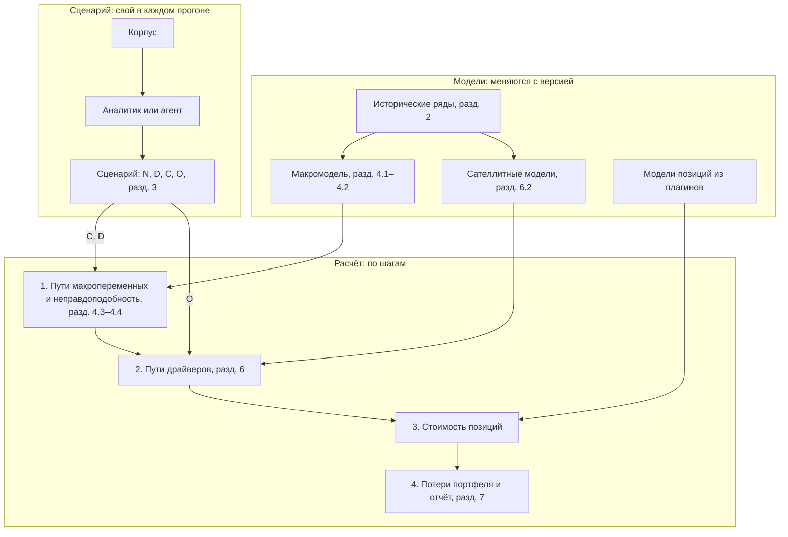

# Метод: формализация и реализация

Общая схема системы — [system-scheme.md](system-scheme.md); этот документ разворачивает её
в метод.

Сценарий стресс-теста задаёт пути нескольких макропеременных, например ключевой ставки и цены нефти, и называет экономические шоки, которые эти пути вызывают. Макромодель, оценённая на истории, достраивает по ним согласованные пути остальных макропеременных, а сателлитные модели переводят макропеременные в драйверы — показатели отраслей, регионов, компаний и других частей экономики, от которых зависит стоимость позиций. По стоимости позиций считается потеря портфеля.

На схеме модели, которые оцениваются по истории и меняются только с новой версией, отделены от сценария, который свой в каждом прогоне; расчёт идёт по шагам и на каждом шаге берёт одну из моделей и часть сценария.

Обратный стресс-тест (разд. 5) запускает тот же расчёт, перебирая значения ограничений сценария.

## 1. Время

Время считаем в месяцах и обозначаем через $t$. Месяц $t=0$ соответствует дате расчёта, месяцы $t\le 0$ относятся к истории, а месяцы $t=1,\dots,H$ составляют горизонт сценария длиной $H$ месяцев. Если отчёту нужны кварталы, месячные значения агрегируются в нём, а модель остаётся месячной.

**Реализация.** Месяц $t=0$ — последний месяц, по которому хоть одна переменная известна на дату расчёта, а не месяц самой даты (`mst.macro.panel.build_panel`). Горизонт ограничен 360 месяцами (`mst.contracts.Horizon`).

## 2. Макропеременные

Платформа ведёт реестр из $n$ макропеременных, пронумерованных индексом $i=1,\dots,n$. Через $X_{i,t}$ обозначим значение переменной $i$ в месяц $t$ в исходных единицах: ставку в процентах, курс в рублях за доллар. Модели работают с преобразованным рядом $y_{i,t}=g_i(X_{i,t})$, где функция $g_i$ записана в реестре ниже. Ставки и спреды не преобразуются, $g_i(X)=X$. Курсы, цены, индексы и объёмы логарифмируются, $g_i(X)=100\ln X$, и тогда разность двух значений примерно равна изменению в процентах. Объёмы и цены берутся с исключённой сезонностью. Вектор всех преобразованных переменных за месяц $t$ обозначим $y_t=(y_{1,t},\dots,y_{n,t})^\top$.

Переменные реестра делятся на глобальный и российский блоки. Глобальные переменные влияют на российские, а российские на глобальные не влияют; в разделе 4.1 это записано запретом на соответствующие коэффициенты.

ВВП публикуется поквартально, поэтому в реестре его заменяет помесячный индекс выпуска базовых видов деятельности.

Ряды хранятся вместе с датой публикации каждого значения, потому что Росстат и Банк России пересматривают опубликованные данные. Расчёт на дату $t=0$ видит каждое значение в той версии, которая была опубликована к этой дате. Без этого проверка на прошлых эпизодах (раздел 9) пользовалась бы данными, которых в момент эпизода ещё не было.

Реестр переменных и их преобразований:

| Идентификатор | Переменная | Блок | $g_i(X)$ | Источник |
|---|---|---|---|---|
| `gl.brent` | нефть Brent, долл. за баррель | глобальный | $100\ln X$ | FRED |
| `gl.fed_rate`, `gl.ust_10y` | ставка ФРС и доходность UST на 10 лет, % | глобальный | $X$ | FRED |
| `gl.vix` | индекс волатильности VIX | глобальный | $100\ln X$ | FRED |
| `ru.key_rate` | ключевая ставка, % | российский | $X$ | Банк России |
| `ru.ruonia` | ставка RUONIA, % | российский | $X$ | Банк России |
| `ru.ofz_1y`, `ru.ofz_5y`, `ru.ofz_10y` | доходность ОФЗ на 1, 5 и 10 лет по G-кривой, % | российский | $X$ | MOEX |
| `ru.spread_aa`, `ru.spread_a`, `ru.spread_bbb` | спред корпоративных облигаций рейтинговой группы к G-кривой, п. п. | российский | $X$ | расчёт по котировкам MOEX |
| `ru.usdrub`, `ru.cnyrub` | официальный курс доллара и юаня | российский | $100\ln X$ | Банк России |
| `ru.cpi` | индекс потребительских цен | российский | $100\ln X$ | Росстат |
| `ru.output` | индекс выпуска базовых видов деятельности | российский | $100\ln X$ | Росстат |
| `ru.unemployment` | безработица, % | российский | $X$ | Росстат |
| `ru.real_wage` | индекс реальной зарплаты | российский | $100\ln X$ | Росстат |
| `ru.retail` | индекс оборота розничной торговли | российский | $100\ln X$ | Росстат |
| `ru.credit` | кредит организациям и населению, руб. | российский | $100\ln X$ | Банк России |
| `ru.mortgage_rate` | средняя ставка ипотеки, % | российский | $X$ | Банк России |
| `ru.housing_price` | цена жилья, руб. за м² | российский | $100\ln X$ | Росстат |
| `ru.imoex` | индекс MOEX | российский | $100\ln X$ | MOEX |

**Реализация.** Реестр — `src/mst/macro/registry.toml`, источники рядов — `src/mst/data/sources.toml`. Ряды Росстата хранятся без сезонной корректировки. Сезонность `ru.cpi`, `ru.output`, `ru.unemployment`, `ru.real_wage` и `ru.retail` (список `seasonal` в `src/mst/macro/spec.toml`) снимается при сборке панели: из ряда вычитается постоянный календарный профиль, оценённый по средним приростам в каждый календарный месяц на данных, известных к дате расчёта. Доходности ОФЗ берутся из таблицы бескупонной кривой на сайте Банка России. Месяц, по которому значения нет (квартальная цена жилья, ряд, начавшийся позже, рваный край публикаций), остаётся пропуском, и модель его разыгрывает (раздел 4.1).

## 3. Сценарий

Запишем путь всех переменных на горизонте одним вектором $\mathbf y=(y_1^\top,\dots,y_H^\top)^\top$ длины $nH$. Сценарий состоит из четырёх частей: нарратива $N$, множества движущих шоков $D$, множества ограничений $C$ на путь $\mathbf y$ и множества прямых воздействий $O$. Каждая часть описана ниже.

Нарратив $N$ объясняет текстом, что происходит и почему, со ссылками на источники корпуса.

Ограничение $c\in C$ записывается тройкой $c=(w_c,a_c,b_c)$ и означает $a_c\le w_c^\top\mathbf y\le b_c$. Вектор весов $w_c$ длины $nH$ выбирает, на что наложено ограничение, а числа $a_c\le b_c$ задают допустимый диапазон; при $a_c=b_c$ значение задано точно. Одна такая запись покрывает все нужные виды ограничений. Если у $w_c$ единственный ненулевой вес 1 при переменной $i$ в месяц $t$, ограничено значение $y_{i,t}$. Вес $+1$ при месяце $t_2$ и $-1$ при месяце $t_1$ той же переменной ограничивает её изменение между этими месяцами. Три веса по $1/3$ ограничивают среднее за квартал, а веса $+1$ и $-1$ при двух разных переменных в одном месяце ограничивают разницу между ними, например спред. Пути, на которые ограничений нет, сценарий не задаёт: их достраивает макромодель. Число ограничений обозначим $m$.

Множество $D$ называет шоки из списка раздела 4.2, которыми в этом сценарии вызваны пути из $C$. Например, «ставка 21 % из-за инфляционного шока» означает ограничение на ключевую ставку и $D=\lbrace\text{инфляционный}\rbrace$. Остальные шоки разыгрываются из своего обычного распределения. Пустое $D$ означает, что причина путей не указана и ограничения может обеспечить любой шок.

Воздействия $O$ описаны в разделе 6.3.

**Реализация.** Контракт — `mst.scenario.contracts.Scenario`: `narrative`, `sources`, `horizon`, `constraints`, `driving_shocks`, `impacts`. Ограничение задаётся списком слагаемых `terms` (переменная, месяц, вес) и границами `low`, `high` в шкале модели $y=g(X)$. Сценарий хранится в workspace файлом `scenarios/<id>.json`, а `scenario(action="validate")` называет каждую невыполнимую связку до расчёта. Поле `overlays` с ключом `driver` — устаревший алиас: старый файл читается как `impacts` с `target`, а файл с обоими полями отвергается.

## 4. Макромодель

### 4.1. Модель

Макропеременные описывает векторная авторегрессия: значение каждой переменной в месяц $t$ линейно зависит от значений всех переменных в предыдущие $p$ месяцев плюс случайная ошибка,

$$
y_t=\kappa+A_1y_{t-1}+\dots+A_py_{t-p}+u_t.
$$

Здесь $p$ — число учитываемых прошлых месяцев, $\kappa$ — вектор констант длины $n$, $A_1,\dots,A_p$ — матрицы коэффициентов размера $n\times n$, $u_t$ — вектор ошибок месяца $t$. Коэффициенты, через которые российские переменные влияли бы на глобальные, равны нулю.

Ошибки складываются из экономических шоков, то есть из независимых друг от друга причин движения: $u_t=B\varepsilon_t$. Вектор $\varepsilon_t=(\varepsilon_{1,t},\dots,\varepsilon_{n,t})^\top$ содержит $n$ шоков, пронумерованных индексом $j$, а квадратная матрица $B$ размера $n\times n$ показывает, как каждый шок в месяц своего появления сдвигает каждую переменную. Глобальные шоки сдвигают российские переменные, российские шоки глобальные переменные не сдвигают.

Шок $j$ в месяц $t$ равен

$$
\varepsilon_{j,t}=e^{h_{j,t}/2}\sqrt{\omega_{j,t}}\,z_{j,t},
$$

где $z_{j,t}$ — стандартная нормальная величина, а два множителя перед ней задают размах шока.

Множитель $e^{h_{j,t}/2}$ — волатильность шока, которая меняется во времени. Логарифм дисперсии $h_{j,t}$ блуждает: $h_{j,t}=h_{j,t-1}+s_j\xi_{j,t}$, где $\xi_{j,t}$ — стандартная нормальная величина, а $s_j$ — скорость изменения волатильности. Так модель учитывает, что в кризис все ряды двигаются сильнее.

Множитель $\omega_{j,t}$ распределён по обратному гамма-закону с параметрами $\nu_j/2$ и $\nu_j/2$. Он делает распределение шока стьюдентовским с $\nu_j$ степенями свободы, то есть с тяжёлыми хвостами, и модель допускает редкие очень большие движения вроде декабря 2014 года. Все величины $z$, $\xi$, $\omega$ независимы между собой и по времени.

Все параметры модели вместе обозначим $\theta$: это $\kappa$, $A_1,\dots,A_p$, $B$, скорости $s_j$ и степени свободы $\nu_j$. Они оцениваются байесовски по истории начиная с месяца $T_0<0$. Априорное распределение тянет коэффициенты к простой модели, в которой нестационарная переменная остаётся на прошлом уровне, а стационарная возвращается к среднему; число $\lambda>0$ задаёт силу этого притяжения. Результат оценки — выборка значений $\theta$ из апостериорного распределения вместе с историческими путями волатильностей $h_{j,t}$ при $t\le 0$. Числа $T_0$, $p$, $\lambda$ и дамми на смену режимов (переход к плавающему курсу в ноябре 2014 года, февраль–март 2022 года) хранятся в версии модели.

**Реализация** (`mst.plugins.bvar.estimate`, `mst.plugins.bvar.sv`, параметры в `src/mst/plugins/bvar/spec.toml`; макромодель — плагин `bvar.sv`, ядро `mst.macro` хранит реестр переменных, панель и версии).

- $T_0$ — январь 2012 года, $p=3$, $\lambda=0{,}2$. Стационарными считаются `gl.vix` и три спреда.
- Сэмплер — треугольный алгоритм Carriero, Clark, Marcellino (2019) в исправленном виде (Carriero, Chan, Clark, Marcellino, 2022): $u_t=Ce_t$ с единичной нижнетреугольной $C$, у каждой компоненты $e_{j,t}$ своя стохастическая волатильность и стьюдентовские хвосты. Матрица $B$ получается из $C$ поворотом (раздел 4.2). Блуждание $h$ разыгрывается смесью Kim, Shephard, Chib (1998).
- Априорное распределение $s_j^2$ — обратное гамма-распределение со средним 0,03 и 60 степенями свободы. Оно взято узким намеренно: при 5 степенях свободы медиана $s_j$ для `gl.fed_rate` доходила до 4,0 в месяц, и пути разлетались за три месяца.
- Априорное распределение $\nu_j$ — равномерное на целых числах от 3 до 50.
- Есть вариант с постоянной волатильностью (`volatility = "constant"`): сопряжённая BVAR с блочной экзогенностью по Zha (1999), без MCMC.
- Пропуски панели разыгрываются внутри сэмплера из условного нормального распределения.
- Дамми: импульсы 2014-11, 2022-02, 2022-03 и ступенька 2021-01 на сшивку спредов (международная шкала рейтингов до 2020-12, национальная с 2021-01).

### 4.2. Идентификация шоков

Данные определяют ковариацию ошибок, но не матрицу $B$: одну и ту же ковариацию дают многие матрицы. Чтобы шоки получили экономический смысл, часть из них задаётся знаковыми ограничениями: шок обязан сдвигать указанные переменные в указанную сторону в месяц своего появления и два следующих месяца. Подходят только те матрицы $B$, при которых все знаки выполнены, и в каждом розыгрыше параметров из них равновероятно выбирается одна (Rubio-Ramírez, Waggoner, Zha, 2010). Остальные шоки остаются безымянными.

| Шок | Растёт | Падает |
|---|---|---|
| денежно-кредитный | `ru.key_rate`, `ru.ruonia`, `ru.ofz_1y` | `ru.usdrub`, `ru.imoex` |
| инфляционный | `ru.cpi`, `ru.key_rate` | `ru.real_wage` |
| курсовой и риск-премии | `ru.usdrub`, `ru.ofz_10y`, `ru.spread_bbb` | `ru.imoex` |
| нефтяной | `gl.brent` | `ru.usdrub` |
| глобальный финансовый | `gl.vix` | `gl.ust_10y`, `ru.imoex` |

Таблица знаков — гипотеза: она хранится в версии модели и проверяется вместе с ней (раздел 9).

**Реализация** (`mst.plugins.bvar.identify`). Идентификаторы шоков в таблице знаков модели (`src/mst/plugins/bvar/signs.toml`): `ru.monetary`, `ru.inflation`, `ru.fx_risk`, `gl.oil`, `gl.financial`; безымянные получают имена `gl.unnamed_k` и `ru.unnamed_k`. Матрица удара — $B=C\operatorname{diag}(e^{h_0/2})Q$, где $h_0$ — волатильности последнего месяца истории, а ортогональная $Q$ блочно-диагональна (сначала глобальный блок), поэтому российский шок не может сдвинуть глобальную переменную. Именованные столбцы $Q$ разыгрываются из равномерного распределения, пока не выполнятся знаки; на каждый розыгрыш параметров даётся до 20 000 поворотов, и розыгрыш без допустимого поворота отбрасывается. Доля оставшихся видна в `model(kind="macro", action="describe")`.

### 4.3. Условный прогноз

Соберём шоки на горизонте в вектор $\boldsymbol\varepsilon=(\varepsilon_1^\top,\dots,\varepsilon_H^\top)^\top$ длины $nH$. При известных параметрах $\theta$ и истории путь линейно выражается через шоки:

$$
\mathbf y=\mu+\Phi\boldsymbol\varepsilon.
$$

Вектор $\mu$ — прогноз при нулевых шоках, а матрица $\Phi$ показывает, как каждый шок сдвигает каждую переменную в этом и последующих месяцах. Если будущие волатильности $h_{j,t}$ и множители $\omega_{j,t}$ уже разыграны, каждый шок $\varepsilon_{j,t}$ нормален с нулевым средним и известной дисперсией $e^{h_{j,t}}\omega_{j,t}$. Диагональную матрицу этих дисперсий обозначим $\Lambda$.

Запишем все ограничения сценария одним неравенством $\mathbf a\le W\mathbf y\le\mathbf b$: строки матрицы $W$ — векторы $w_c^\top$, а векторы $\mathbf a$ и $\mathbf b$ собирают границы $a_c$ и $b_c$.

Разделим шоки на движущие, то есть шоки из $D$ во всех месяцах горизонта, и прочие; при пустом $D$ движущими считаются все шоки. Части вектора шоков обозначим $\boldsymbol\varepsilon_D$ и $\boldsymbol\varepsilon_{\bar D}$, соответствующие части матрицы $\Phi$ — $\Phi_D$ и $\Phi_{\bar D}$, части матрицы $\Lambda$ — $\Lambda_D$ и $\Lambda_{\bar D}$. Прочие шоки разыгрываются как обычно, из нормального распределения $\mathcal N(0,\Lambda_{\bar D})$. Движущие шоки разыгрываются из своего распределения $\mathcal N(0,\Lambda_D)$ при условии, что ограничения выполнены:

$$
\mathbf a-W\mu-W\Phi_{\bar D}\boldsymbol\varepsilon_{\bar D}\ \le\ W\Phi_D\boldsymbol\varepsilon_D\ \le\ \mathbf b-W\mu-W\Phi_{\bar D}\boldsymbol\varepsilon_{\bar D}.
$$

Обозначим $Z=W\Phi_D$. Сценарий допустим, если строки матрицы $Z$ линейно независимы, то есть движущих шоков хватает, чтобы выполнить все ограничения. Иначе расчёт отклоняет сценарий и называет ограничения, которые нельзя выполнить.

Если все ограничения точные, $\mathbf a=\mathbf b$, обозначим общий вектор заданных значений через $\mathbf v$, а остаток $\mathbf v-W\mu-W\Phi_{\bar D}\boldsymbol\varepsilon_{\bar D}$ через $\mathbf g$. Тогда движущие шоки при условии ограничений распределены нормально со средним $G\mathbf g$ и ковариацией $\Lambda_D-GZ\Lambda_D$, где $G=\Lambda_DZ^\top\left(Z\Lambda_DZ^\top\right)^{-1}$. Если среди ограничений есть интервалы, распределение нормальное, усечённое неравенством выше, и движущие шоки разыгрываются из него семплером Гиббса для усечённого нормального распределения (Geweke, 1991). Подход описан в работе Antolín-Díaz, Petrella, Rubio-Ramírez, «Structural scenario analysis with SVARs» (Journal of Monetary Economics, 2021).

**Реализация** (`mst.plugins.bvar.forecast.simulate`; общая механика ограничений — `mst.model_sdk.conditional`). Масштаб шоков перенесён в матрицу удара: $B_t=C\operatorname{diag}(e^{h_t/2}\sqrt{\omega_t})Q$, а $\boldsymbol\varepsilon$ стандартно нормален, так что $\Lambda=I$ и формулы выше упрощаются. Матрица $\Phi$ целиком не строится, считаются только строки $W\Phi$. Ограничение признаётся зависимым, если движущие шоки сдвигают его сверх уже зафиксированных строк меньше чем на $10^{-9}$ от того, насколько его сдвигают все шоки; тогда сценарий отклоняется с номерами ограничений (`InfeasibleScenario`). Для интервальных ограничений делается 50 проходов Гиббса.

### 4.4. Неправдоподобность сценария

Безусловным прогнозом назовём распределение пути $\mathbf y$ без ограничений. Для каждого ограничения $c$ считается число $\pi_c$ — вероятность по безусловному прогнозу того, что $w_c^\top\mathbf y$ не превысит середину диапазона $\tfrac{a_c+b_c}{2}$. Значение около 0 или около 1 означает движение, которое модель считает редким.

Неправдоподобность всех ограничений вместе выражает одно число $\delta$. Обозначим через $\bar{\mathbf c}$ вектор середин диапазонов, а через $\bar\mu$ и $\bar\Omega$ — среднее и ковариацию вектора $W\mathbf y$ по безусловному прогнозу. Тогда

$$
\delta^2=(\bar{\mathbf c}-\bar\mu)^\top\bar\Omega^{-1}(\bar{\mathbf c}-\bar\mu).
$$

Это расстояние Махаланобиса: оно учитывает, что совместное движение коррелированных переменных правдоподобнее, чем те же движения порознь (Breuer и соавторы, 2009). В терминах общей схемы это расстояние $\operatorname{dist}(P_s,P)$ из раздела 4 схемы. Рядом с $\delta$ показывается доля безусловных путей с ещё большим расстоянием.

**Реализация** (`mst.plugins.bvar.forecast.severity`, интерфейс `severity` в `mst.model_sdk`). Внутри одного розыгрыша параметров $W\mathbf y$ нормален, поэтому $\pi_c$ — среднее нормальных вероятностей по розыгрышам, а $\bar\mu$ и $\bar\Omega$ — точные моменты смеси, включая разброс между розыгрышами.

Рядом с $\delta$ платформа считает расстояние из раздела 4 общей схемы: при условной схеме $P_s$ отличается от $P$ только маргинально на движущие шоки, и внутри носителя плотности отличаются на константу, поэтому $\operatorname{dist}(P_s,P)=-\log \mathrm P(C)$, где $\mathrm P(C)$ — совместная вероятность всех ограничений сразу на безусловном прогнозе. Это допущение реализации: канон определяет $\operatorname{dist}(P_s,P)$, но не связывает его с $\mathrm P(C)$. Отличие от $\delta$ двоякое: вероятность бокса ограничений вместо расстояния середин и совместная вероятность вместо характеристик по одному ограничению; ограничения коррелированы, поэтому совместная вероятность не равна произведению $\pi_c$. Вероятность считается по путям безусловного расчёта — тем же, что гейт $\pi_c$ в разделе 9. Когда ни один путь ограничений не выполняет, $\operatorname{dist}(P_s,P)=\infty$ и гейт провален. Если модель измеряет моменты $W\mathbf y$ по розыгрышам параметров (интерфейс `constraint_moments`), вероятность бокса считается точно — как вероятность прямоугольника для смеси нормалей; иначе это доля путей безусловного расчёта, выполняющих все ограничения, — оценка Монте-Карло. Сценарий без ограничений не имеет ни $\delta$, ни $\operatorname{dist}(P_s,P)$.

**Реализация** (`mst.model_sdk.dist`, поле `dist` в `mst.scenario.build.Paths`, в отчёте расчёта рядом с `severity`).

## 5. Обратный стресс-тест

Обратный стресс-тест ищет самый правдоподобный сценарий, при котором потери достигают заданного порога $L^\ast$. Аналитик выбирает, на что накладываются ограничения, то есть матрицу $W$, и множество $D$. Расчёт подбирает точные значения ограничений $\mathbf v$, при которых $\delta$ минимально, а медианная потеря $P_{50}$ из раздела 7 не меньше $L^\ast$. Результат — обычный сценарий, который проходит тот же расчёт и то же утверждение. В терминах общей схемы (раздел 4) это обратная задача, её вторая форма: сценарий наименее неправдоподобен при заданном пороге, функционал $\rho$ — медианная потеря.

**Реализация.** Обратного стресс-теста в коде нет: для готового сценария считаются $\delta$ и отчёт, а перебора ограничений под заданный порог потерь нет.

## 6. Драйверы и сателлитные модели

### 6.1. Драйверы

Макропеременные описывают экономику целиком, а стоимость позиции часто зависит от величин, которые относятся к её части. Такую величину называем драйвером. В терминах общей схемы уровень 0 — макропеременные, а драйверы — величины уровней выше; сателлитная модель — передача $G_l$ (раздел 6.2).

Драйвер задаётся парой из объекта и величины. Объект — то, к чему относится величина: отрасль, регион, рейтинговая группа, класс активов, отдельная компания или выпуск облигаций. Величина — измеримое свойство объекта: цена, ставка, спред, выручка, доля просроченных кредитов, частота дефолтов. Объекты одного уровня образуют класс (все отрасли, все компании), а объекты разных уровней вложены друг в друга: компания относится к отрасли. Типом драйвера назовём пару из класса объектов и величины, например «выручка отрасли» или «спред компании».

Драйверы нумеруются индексом $k=1,\dots,K$. Значение драйвера $k$ в месяц $t$ обозначим $d_{k,t}$ и преобразуем так же, как макропеременные в разделе 2. Величина становится драйвером, если у неё записаны единица и преобразование, есть история наблюдений этого объекта или объектов его класса и она нужна хотя бы одной модели позиции. Наблюдения могут быть реже месяца, например годовая отчётность компании: модель остаётся месячной, а при оценке учитывается, что наблюдается сумма или среднее за период.

Макропеременная отличается от драйвера тем, что влияет на другие макропеременные и нужна для согласованности сценария, а драйвер на макропеременные не влияет. Поэтому одна величина не может быть одновременно и тем и другим. Модель позиции может читать и драйверы, и макропеременные: облигации нужна кривая ОФЗ, а это макропеременная. Модель объявляет, какие величины ей нужны, и не знает, как они получены.

**Реализация** (`src/mst/drivers/registry.toml`, `mst.drivers.catalogs`). Объявлено пять величин:

| Величина | Объекты | Преобразование | Регрессоры | Источник объектов |
|---|---|---|---|---|
| `share_price` | акции под отраслевыми индексами MOEX | $100\ln d$ | `ru.imoex`, `ru.usdrub`, `ru.key_rate`, `gl.brent` | каталог `moex_shares` |
| `bond_spread` | выпуски под эмитентами и рейтинговыми группами | $d$ | три спреда, `ru.key_rate`, `ru.ofz_5y` | каталог `moex_bonds` |
| `overdue_share` | отрасли таблицы ЦБ 01_02_A | логит | `ru.key_rate`, `ru.output`, `ru.usdrub`, `ru.imoex` и ставка сверх 15 % | каталог `cbr_activities` |
| `housing_price_primary`, `housing_price_secondary` | Россия, федеральные округа, субъекты | $100\ln d$, квартальные значения | `ru.mortgage_rate`, `ru.key_rate`, `ru.cpi`, `ru.real_wage` | каталог `rosstat_regions` |

Каталог находит объекты у источника и пишет их в `workspace/drivers/catalog.json`; ряд драйвера хранится как обычный ряд `drv.<величина>.<объект>`. У объекта есть коды (`secid`, `isin`, `inn`, `okved`, `okato`), и позиция сопоставляется с самым глубоким объектом, чей код — префикс её кода (`Registry.match`).

### 6.2. Сателлитная модель

Каждый драйвер связан с макропеременными моделью

$$
d_{k,t}=\alpha_k+\rho_kd_{k,t-1}+\beta_{k,0}^\top x_t+\beta_{k,1}^\top x_{t-1}+\dots+\beta_{k,\bar\ell_k}^\top x_{t-\bar\ell_k}+e_{k,t}.
$$

Вектор $x_t$ содержит макропеременные $y_t$ и заранее объявленные их преобразования, например $\max(0, y_{i,t}-25)$ для ставки выше 25 %. Через такие преобразования в модель входит нелинейность, а оценка остаётся линейной по параметрам. Далее $\alpha_k$ — константа, $\rho_k$ — доля прошлого значения драйвера, которая переходит в текущее, $\beta_{k,\ell}$ — вектор чувствительностей драйвера к элементам $x$, взятым с запаздыванием на $\ell$ месяцев, $\bar\ell_k$ — наибольшее запаздывание, $e_{k,t}$ — случайный остаток.

Остатки разных драйверов в одном месяце коррелированы: вектор $e_t=(e_{1,t},\dots,e_{K,t})^\top$ распределён нормально с нулевым средним и ковариацией $\Sigma_e$. Если драйвер — доля или вероятность, моделью описывается её логит $\ln\frac{d}{1-d}$.

Параметры драйвера $k$ соберём в вектор $\gamma_k=(\alpha_k,\rho_k,\beta_{k,0},\dots,\beta_{k,\bar\ell_k})$. Драйверы оцениваются вместе иерархической моделью, которая повторяет вложенность объектов. Обозначим через $\tau$ тип драйвера $k$, а через $\gamma^\uparrow_k$ параметры драйвера той же величины у объекта уровнем выше: для выручки компании это параметры выручки её отрасли. Если такого объекта нет, $\gamma^\uparrow_k=\bar\gamma_\tau$ — общие параметры всех драйверов типа $\tau$. Тогда

$$
\gamma_k=\gamma^\uparrow_k+\eta_k,
$$

где отклонение $\eta_k$ распределено нормально с нулевым средним и ковариацией $\Psi_\tau$, которая тоже оценивается. Если данных по объекту мало или они мало отличаются от данных объекта уровнем выше, оценка $\eta_k$ близка к нулю и объект получает параметры уровня выше; если отличаются заметно, объект получает свои. Объект без собственной истории получает параметры уровня выше целиком, и результат несёт об этом пометку. Версия модели хранит данные, период оценки, состав $x_t$, выборку параметров из апостериорного распределения и ошибки прогноза вне выборки.

**Реализация** (`mst.plugins.hier.estimate`, параметры в `src/mst/plugins/hier/spec.toml`; подготовка истории величины — `mst.drivers.history`, сборка версии из частей нескольких моделей — `mst.drivers.bundle`).

- $\Psi_\tau$ диагональна — частный случай полной ковариации.
- $\Sigma_e$ оценивается после сэмплера, по остаткам в апостериорном среднем за месяцы, которые два драйвера наблюдают вместе (не меньше 12).
- $\lvert\rho_k\rvert\le 0{,}99$: розыгрыш выше границы отсекается усечённым условным распределением, потому что у взрывного корня нет конечного пути. Первый месяц цепи берётся из стационарного распределения.
- Ненаблюдаемые месяцы драйвера разыгрываются в сэмплере; квартальное значение (`span = 3`) задаёт среднее трёх месяцев. Путь кончается последним месяцем, по которому панель знает $x$.
- Наибольшее запаздывание $\bar\ell_k$ — от 0 до 3; сейчас у всех величин 1.
- Оценка идёт в шкале, где столбцы регрессоров центрированы и поделены на стандартное отклонение внутри объекта, поэтому одно априорное отклонение `spread = 0.1` подходит всем коэффициентам.

### 6.3. Прямые воздействия

Некоторые шоки до драйверов через макропеременные не доходят, например санкции против одной отрасли или запрет экспорта. Для них в сценарии есть воздействие $o=(k,t_1,t_2,\Delta)\in O$: к величине $k$ — драйверу уровня выше 0 или макропеременной уровня 0 — в месяцы с $t_1$ по $t_2$ прибавляется число $\Delta$ в шкале модели её уровня. Воздействие сопровождается текстовым обоснованием со ссылкой на источник и отражается в результате отдельной пометкой.

Воздействие на макропеременную — аддитивный сдвиг $x^0=G_0(\varepsilon,\theta_0)+o_0$: оно применяется к траектории уровня 0 после $G_0$ и внутри уровня 0 не распространяется, поэтому остальные макропеременные не получают реакции, которую дал бы шок $D$. Ограничения $C$ относятся к итоговому пути $F(\omega,O)$, поэтому макромодель решает их против сдвинутой траектории: для каждого слагаемого ограничения с весом $w$, чья переменная затронута воздействием в этом месяце, обе границы уменьшаются на $w\Delta$, а после розыгрыша воздействие прибавляется к путям. Неправдоподобность $\delta$ измеряется по $C$ без $O$.

**Реализация.** `mst.scenario.contracts.Impact` с адресом `target`: макропеременная уровня 0 или драйвер `<величина>:<объект>`; $\Delta$ прибавляется в шкале модели уровня, путь драйвера получает пометку `impact`, воздействие на макропеременную входит в путь до сателлитов. Границы ограничений сдвигает `mst.scenario.build.plan_with_impacts`, путь меняет `mst.scenario.build`.

## 7. Розыгрыш и результат

Расчёт повторяется $R$ раз; номер повторения обозначим $r$. В повторении $r$:

1. из апостериорной выборки берутся параметры макромодели $\theta^{(r)}$ с допустимой по знакам матрицей $B$ и историческими волатильностями;
2. разыгрываются будущие волатильности $h_{j,t}$ и множители $\omega_{j,t}$ на горизонте;
3. по разделу 4.3 разыгрываются шоки и путь макропеременных $\mathbf y^{(r)}$;
4. из апостериорной выборки сателлитов берутся параметры $\gamma_k^{(r)}$ и разыгрываются остатки $e_t^{(r)}$;
5. по разделу 6.2 и воздействиям $O$ считаются пути драйверов $d^{(r)}$;
6. для каждой позиции $q$ её модель $F_q$ из плагина даёт изменение стоимости $V_q^{(r)}=F_q(\mathbf y^{(r)},d^{(r)})$ по тем макропеременным и драйверам, которые она объявила;
7. потеря портфеля равна $L^{(r)}=-\sum_qV_q^{(r)}$.

Отчёт показывает 5-й, 50-й и 95-й процентили $P_5$, $P_{50}$, $P_{95}$ потерь $L^{(1)},\dots,L^{(R)}$ вместе с неправдоподобностью $\delta$. Разброс процентилей отражает неточность макромодели, сателлитов и моделей позиций при заданном сценарии.

**Реализация.** Шаги 1–3 — макромодель-плагин (`mst.plugins.bvar.forecast.simulate`), шаги 4–5 — сателлитные модели через бандл (`mst.drivers.bundle.simulate`, каждая модель со своим потоком `[seed, stream, r]`), поэтому пути воспроизводятся побитно. Драйвер, чьё последнее известное значение старше $t=0$, сначала доводится до $t=0$ по наблюдённой панели. Драйвер без своей истории стартует с уровня ближайшего объекта выше и получает пометку `parameters_from_above`. Шаги 6–7 — `mst.engine` и модели `mst.plugins`, прогон — `mst.runs` (условный прогноз целевых показателей — `forecast.json`), отчёт — `mst.portfolio.report`.

## 8. Кто что задаёт

| Что | Кто задаёт | Когда меняется |
|---|---|---|
| реестр переменных, блоки, преобразования $g_i$ | платформа | с новой версией реестра |
| параметры макромодели $\theta$ и таблица знаков | платформа, оценка по истории | при обновлении данных или гипотез о знаках |
| параметры сателлитов $\gamma_k$, $\Psi_\tau$, $\Sigma_e$ и состав $x_t$ | платформа, оценка по истории | при обновлении данных |
| сценарий: $N$, $D$, $C$, $O$ | аналитик или агент по корпусу; утверждает аналитик | в каждом прогоне |
| модели позиций $F_q$ | плагины | с новой версией плагина |

## 9. Проверка

Макромодель проверяется на исторических эпизодах корпуса с данными в версии на дату расчёта. Дата расчёта ставится перед началом эпизода, в ограничения записываются реально случившиеся пути двух-трёх переменных, в $D$ — шоки, которыми эпизод объясняют источники того времени, а пути остальных переменных прогнозируются. Если модель правильно передаёт неопределённость, реализованные значения непрописанных переменных попадают в интервал от $P_5$ до $P_{95}$ примерно в 90 % случаев. Таблица знаков проверяется там же: если при другой таблице покрытие заметно лучше, выпускается новая версия модели.

Сателлиты проверяются вне выборки. В модель подставляются реализованные пути макропеременных, и ошибка прогноза драйвера сравнивается с ошибкой модели $d_{k,t}=\alpha_k+\rho_kd_{k,t-1}+e_{k,t}$, которая макропеременных не использует. Сателлит, который не точнее её, в реестр не попадает.

**Реализация.** Эпизодный бэктест — `mst.metrics.backtest`, эпизоды в `src/mst/metrics/episodes.toml` (эпизоды — данные, а не модель). Дата расчёта — день перед первым месяцем эпизода из манифеста корпуса, окно — 12 месяцев после него; дамми более поздних месяцев из оценки исключаются моделью сама (модель на дату не может знать будущий режим). Сезонные переменные сравниваются после снятия профиля, оценённого на дату расчёта. Версии эпизодов кэшируются в `models/backtest/` по состоянию данных. Эпизоды R1–R12 не проверяются: история с 2012 года для них короче двух лет.

Метрики §5 схемы считаются в `mst.metrics`: CRPS с $\sigma_q(t)$ и цепочкой замены, калибровка и резкость, допуск по двум правилам и гейт $\pi_c$ — по всем ячейкам и отдельно по половинам плана; равновесный агрегат по уровням и горизонтам; полезность сценария с разрезом вручную/LLM; интервалы трёх видов (эпизодный бутстрэп той же статистики, wild с весами Уэбба, Монте-Карло отдельно); вердикт четырёх шагов по двум стандартным ошибкам на одних и тех же ячейках; хвост Acerbi–Székely портфеля по `--portfolio`; `outside_training_range` по записанному обучающему окну узла с пометкой легаси-части. Фазы 1–3 плана метрик покрыты; уровни $L>1$ и обратная задача в код не входят.

Сателлиты — проверка вне выборки в части версии (`mst.plugins.hier.check`): модели оцениваются без последних 24 месяцев, из каждого наблюдения этого периода драйвер прогнозируется на 12 месяцев вперёд в апостериорном среднем, а сравнение идёт по среднеквадратичной ошибке. Драйвер, не прошедший проверку, остаётся в версии, но помечен как не обслуживаемый, и пути для него не строятся (`NotServed`). Драйвер без своей истории обслуживается, если обслуживается ближайший проверенный драйвер над ним.

## 10. Чего метод не делает

Метод не учитывает обратного влияния портфеля на экономику, потому что портфель не двигает ставки и курсы. Такие петли нужны в надзорном стресс-тесте всей банковской системы, где потери банков сокращают кредит и бьют по выпуску. Метод не оценивает вероятность того, что сценарий случится, как не оценивают её и регуляторы; насколько сценарий необычен, показывает неправдоподобность $\delta$.
