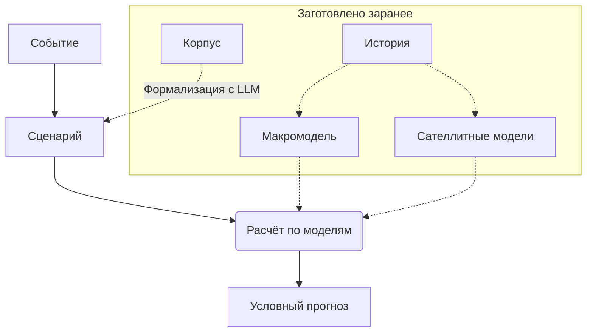

# Общая схема работы системы стресс-тестирования

Цель — спрогнозировать, как поведут себя целевые показатели выбранного объекта, если произойдёт заданное событие. Условным прогнозом называем распределение целевых показателей во времени при условии наступления события.

## 1. Модели

Зафиксируем дату расчёта, совпадающую с датой наступления события, и горизонт из $H$ месяцев; месяцы горизонта нумеруем $t=1,\dots,H$. Шоки $\varepsilon=(\varepsilon_{j,t})_{j\in J,\ t=1,\dots,H}$ — имеющие экономический смысл случайные величины: $\varepsilon_{j,t}$ — значение шока $j$ в месяц $t$, где $J$ — конечное множество номеров шоков. Через $\varepsilon_j=(\varepsilon_{j,1},\dots,\varepsilon_{j,H})$ обозначим траекторию шока $j$.

Неопределённость будущего описывает реализация $\omega=(\varepsilon,\eta,\theta)$, где $\varepsilon$ — шоки, $\eta=(\eta_1,\dots,\eta_L)$ — шум уровней, а $\theta=(\theta_0,\dots,\theta_L)$ — параметры моделей, известные неточно. Базовое распределение $P$ на реализациях описывает обычный ход событий и получено из истории.

Наблюдаемые величины разбиты на уровни с номерами $l=0,\dots,L$, упорядоченные от общего к частному. Траектория уровня $l$ строится по траекториям уровней выше него:

$$
x^0=G_0(\varepsilon,\theta_0),\qquad
x^l=G_l\big(x^0,\dots,x^{l-1},\ \eta_l,\ \theta_l,\ o_l\big),\quad l=1,\dots,L,
$$

где $G_l$ — передача на уровень $l$, а $o_l$ — прямое воздействие на этот уровень, которое по умолчанию отсутствует. Влияние идёт только сверху вниз, поэтому нижние уровни не меняют верхние, а любой уровень можно заменить, сохранив его вход и выход. Последний уровень содержит целевые показатели, и их траекторию обозначим $v=x^L$. Вся цепочка задаёт отображение $\omega\mapsto x=F(\omega,O)$, где $x=(x^0,\dots,x^L)$ и $O=(o_1,\dots,o_L)$. Макромодель — это распределение шоков и $G_0$, а сателлитные модели — $G_1,\dots,G_L$.

Множество $J$ может содержать решения ЦБ сверх обычной реакции и курсовое давление. Уровни — это обычно экономика (ставка, курс, инфляция), отрасль (цена и спрос на продукцию), компания (выручка, EBITDA, долг).

## 2. Сценарий

Сценарий — формальная запись события: $s=(N,D,C,O)$. Здесь $N$ — нарратив с источниками, $D\subseteq J$ — множество номеров шоков события, $C$ — множество ограничений на траектории любых уровней, $O=(o_1,\dots,o_L)$ — набор прямых воздействий на уровни для тех эффектов, которые не проходят через верхние уровни.

Формализация события $\mathcal T$ строит сценарий по информации $I$, доступной на дату расчёта: $\mathcal T(I)=\lbrace s_1,\dots,s_K\rbrace$. Если исходы расходятся, сценариев несколько, и каждый считается отдельно. Формализация обязана пометить каждый элемент $D$ и $C$ и каждое воздействие из $O$ источником или словом «допущение»; утверждает сценарий человек.

Например, событие — это «из-за обвала рубля ЦБ поднимет ставку до 18–21 % к марту, экспорт компании запретят». Тогда $D=\lbrace\text{курсовое давление}\rbrace$, $C$ состоит из одного ограничения — диапазона ставки в марте, а в $O$ задано только воздействие на уровень компании: снижение объёма продаж на время запрета.

## 3. Наложение сценария

Сценарий меняет только распределение шоков события $\varepsilon_D=(\varepsilon_j)_{j\in D}$. Распределение параметров, шума и остальных шоков $\varepsilon_{\bar D}=(\varepsilon_j)_{j\in J\setminus D}$ сохраняется:

$$
P_s(d\omega)=P(d\theta,d\eta,d\varepsilon_{\bar D})\ Q_s(d\varepsilon_D\mid\theta,\eta,\varepsilon_{\bar D}),
$$

где $Q_s$ — ближайшее к исходному условному распределению $\varepsilon_D$ распределение, при котором $F(\omega,O)$ выполняет все ограничения из $C$. Способ выбрать ближайшее распределение зависит от конкретной реализации системы. Если при данном $D$ такого распределения нет, сценарий противоречит моделям, и система называет несовместимые элементы.

Заметим, что ближайшее распределение можно получить условным распределением или минимумом расхождения Кульбака — Лейблера. Одно и то же ограничение при разных $D$ даёт разные условные прогнозы. Например, ставка 18–21 % из-за курсового давления идёт вместе со слабым рублём, а та же ставка из-за политики ЦБ — с укреплением рубля, поэтому у экспортёра результаты будут разными.

## 4. Результат

Условный прогноз — распределение траектории целевых показателей $v=x^L$, где вектор $x=F(\omega,O)$ и $\omega\sim P_s$. Система представляет его выборкой из $R$ реализаций $\omega^{(1)},\dots,\omega^{(R)}$, возможно с весами, и для любого множества $A$ траекторий показателей оценивает $\mathbb P(v\in A\mid s)$. Из этой же выборки следуют квантили по времени и любые другие функционалы $\rho$ распределения $v$.

Условный прогноз при $s$ сравниваем с расчётом при сценарии $s_0$ с пустыми $D$, $C$ и $O$. Чтобы оценить вклад отдельного шока, ограничения или воздействия, убираем его из сценария и повторяем расчёт с теми же случайными числами. Неправдоподобность сценария измеряем расстоянием $\operatorname{dist}(P_s,P)$.

В обратной задаче ищем сценарий с наихудшим $\rho(v)$ при неправдоподобности не выше $\kappa$ или наименее неправдоподобный сценарий, при котором $\rho(v)$ достигает заданного порога.

Пример. Множество $A$ — траектории, у которых EBITDA за год ниже заданного уровня, а функционал $\rho$ — $\mathrm{ES}_{95\%}$.

## 5. Метрики качества

Качество измеряем бэктестом, для этого у исторического события, или эпизода, $e$ ставим дату расчёта перед его началом, оцениваем модели только на данных, известных к этой дате, задаём сценарий $s_e$ и сравниваем условный прогноз с фактом. Наблюдением служит ячейка $(e,t,q)$: эпизод $e$, месяц горизонта $t$ и величина $q$ любого уровня. Ячейке сопоставлены факт $y_{e,t,q}$ и прогнозная функция распределения $\hat F_{e,t,q}$ с квантилями $p_{5;e,t,q}$ и $p_{95;e,t,q}$. Далее индексы ячейки опускаем: $y$, $\hat F$, $p_5$, $p_{95}$. Если сценарий записан по факту и точно задаёт значение величины в месяце, прогноз в этой ячейке совпадает с фактом и ничего не проверяет, поэтому такую ячейку исключаем. Все остальные ячейки оцениваем.

Версия моделей допускается к сравнению, если меньше 5 % ячеек нарушают каждое из двух условий:

- полоса $[p_5,p_{95}]$ лежит в области допустимых значений величины;
- ширина $p_{95}-p_5$ не больше диапазона величины за всю историю.

Главная метрика — непрерывная ранжированная вероятностная оценка (CRPS), которая штрафует и смещение, и лишнюю ширину:

$$
\mathrm{CRPS}(\hat F,y)=\int_{-\infty}^{\infty}\big(\hat F(x)-\mathbf 1\lbrace x\ge y\rbrace\big)^2dx.
$$

Чтобы величины в разных единицах были сравнимы, CRPS величины $q$ на горизонте $t$ делим на типичное движение $\sigma_q(t)$ — медиану абсолютного изменения величины за $t$ месяцев по истории. Затем усредняем сначала внутри величины, потом с равными весами по величинам, отдельно по каждому уровню и горизонту.

При верной калибровке, по свойству любого непрерывного распределения, значения $u=\hat F(y)$ распределены равномерно на $[0,1]$, поэтому факт попадает в области ниже $p_5$, от $p_5$ до $p_{50}$, от $p_{50}$ до $p_{95}$ и выше $p_{95}$ с долями 0,05, 0,45, 0,45 и 0,05. Резкость — медианная ширина $p_{95}-p_5$; она имеет смысл только при пройденной калибровке. Покрытие интервала отчитываем справочно, потому что оно растёт с шириной.

CRPS сравниваем с эталоном: на тех же ячейках считаем его для случайного блуждания с дрейфом, а для целевых показателей ещё и наивного прогноза: значение годом ранее с трендом. Интервал 95 % получаем бутстрэпом по эпизодам с 1000 повторений, потому что ячейки одного эпизода зависимы; при малом числе эпизодов обычный бутстрэп занижает интервал, поэтому результат проверяем кластерным wild-бутстрэпом с весами Уэбба.

Для целевого показателя с потерей $\ell_e$, квантилем $\mathrm{VaR}_e$ и прогнозным $\mathrm{ES}_e$ уровня 95 % по $n$ эпизодам считаем статистику Acerbi и Székely (2014):

$$
Z=\frac{1}{0{,}05\,n}\sum_{e=1}^{n}\frac{\ell_e\,\mathbf 1\lbrace\ell_e>\mathrm{VaR}_e\rbrace}{\mathrm{ES}_e}-1.
$$

При верном прогнозе хвоста $\mathbb E Z=0$, а $Z>0$ означает, что хвост занижен.

Сценарий полезен, если на фактах эпизода CRPS условного прогноза при $s_e$ ниже CRPS базового расчёта. Различие считаем отдельно для сценариев, размеченных вручную, и для сценариев от LLM, причём вторые надёжны только в расчётах вперёд, поскольку LLM помнит исходы прошлых эпизодов.

Те же два условия допуска проверяем на путях при сценарии, потому что ограничения могут расширить веер, хотя базовый расчёт допуск прошёл. Вероятность выполнения каждого ограничения в базовом расчёте должна быть выше 1 %: иначе сценарий держится на редком хвосте распределения. У сателлитной модели доля путей, где выход лежит вне диапазона её обучающей выборки, должна быть меньше 1 %; пока она не прошла эту проверку и бэктест, хвост целевого показателя помечается как непроверенный.

Эпизоды заранее делим на две половины: на первой настраиваем модели, на второй проверяем, а итоговую таблицу строим по всем эпизодам. Версии сравниваем попарно на одних и тех же ячейках. Решение принимается по целевым показателям в таком порядке:

1. Версия, не прошедшая допуск, отклоняется независимо от CRPS.
2. Версия принимается, если её CRPS лучше CRPS эталона и текущей версии больше чем на две стандартные ошибки и условия допуска не ухудшились.
3. Версия отклоняется, если её CRPS хуже больше чем на две стандартные ошибки.
4. В остальных случаях различие считается необнаруженным, и текущая версия остаётся.

Метрики по отдельным уровням показывают, где искать ошибку. Значения $\mathrm{ES}$ в отчёте сопровождаются интервалом, чувствительностью к отбрасыванию 1 % крайних путей и пометкой горизонта. Ошибку Монте-Карло оцениваем бутстрэпом по реализациям, отдельно от ошибки выборки. Чтобы результат можно было воспроизвести, в отчёте записываем версии моделей и данных, дату, начальное значение генератора случайных чисел и коммит.

## 6. Что постоянно, а что меняется

Макромодель и сателлитные модели оцениваются по истории и меняются с версией, а сценарий создаётся для каждого расчёта. Новый объект добавляется новой передачей на последний уровень с объявленными входами, и остальная система не меняется. Новый тип события требует новых элементов $J$ или новых видов прямых воздействий лишь тогда, когда его нельзя выразить имеющимися шоками.
