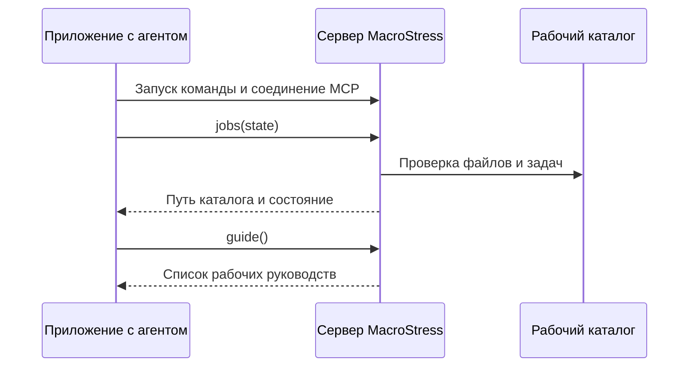

# Подключение MacroStress через MCP

[English](<mcp.en.md>)

Чтобы агент работал с MacroStress, приложение запускает локальный Python-сервер
и вызывает его инструменты по MCP (Model Context Protocol). Настройка соединения
требует команды запуска и одного рабочего каталога для данных. После подключения
вызов `jobs(action="state")` должен показать именно выбранный каталог, а не просто
подтвердить существование процесса.

Сервер использует `stdio`: запросы идут через стандартный ввод процесса,
ответы — через стандартный вывод. Приложение запускает процесс само;
открывать сетевой порт или держать отдельное окно терминала не требуется.
DeepSeek Harness добавляет к серверу [собственную интеграцию](<install.md>),
но расчётные инструменты остаются теми же в любом совместимом MCP-клиенте.



Схема показывает проверку соединения без расчёта и загрузки внешних данных.
Если сервер отвечает, но возвращает другой путь, подключение нужно исправить
до подготовки моделей и сценариев.

## Выбрать источник программы

Нужны Python 3.12 или новее и [uv](https://docs.astral.sh/uv/).
Опубликованный пакет удобен для обычной установки; локальный репозиторий нужен
для разработки и возможностей ветки main, ещё не вошедших в выпуск.
Условия источников экономических данных действуют отдельно от лицензии программы.

Вариант без клонирования репозитория задаётся конфигурацией клиента:

```json
{
  "mcpServers": {
    "macrostress": {
      "command": "uvx",
      "args": ["macrostress", "--workspace", "C:/data/macrostress"],
      "env": {"PYTHONUTF8": "1"}
    }
  }
}
```

`C:/data/macrostress` — пример абсолютного пути, который нужно заменить своим.
На macOS и Linux используйте абсолютный путь своей системы.
Если приложение не находит `uvx`, укажите полный путь к исполняемому файлу;
окружение графического приложения может отличаться от окружения терминала.

Для локальной копии установите проект:

```powershell
git clone https://github.com/LeoLourson/MacroStress-DSH
cd MacroStress-DSH
uv sync
uv run python -m mst.mcp --help
```

Справка проверяет импорт и аргументы запуска, не создавая рабочего каталога.
После установки клиент может запускать Python виртуальной среды напрямую,
без повторного разрешения зависимостей при каждом соединении:

```json
{
  "mcpServers": {
    "macrostress": {
      "command": "C:/src/MacroStress-DSH/.venv/Scripts/python.exe",
      "args": ["-u", "-m", "mst.mcp", "--workspace", "C:/data/macrostress"],
      "env": {"PYTHONUTF8": "1"}
    }
  }
}
```

В macOS и Linux команда указывает на `.venv/bin/python`.
JSON использует прямые слеши в примерах Windows, поскольку обратный слеш
начинает управляющую последовательность. Не копируйте условный путь без замены.

## Сохранить конфигурацию клиента

В Claude Desktop блок `mcpServers` помещается в файл конфигурации пользователя:
`%APPDATA%/Claude/claude_desktop_config.json` в Windows или
`~/Library/Application Support/Claude/claude_desktop_config.json` в macOS.
Если файл уже содержит другие серверы, добавьте запись `macrostress`,
не заменяя весь список. После изменения переподключите сервер или перезапустите клиент.

В Cursor аналогичный блок хранится в `~/.cursor/mcp.json` либо в проектной
конфигурации `.cursor/mcp.json`. Расположение и способ перезапуска соединения
могут зависеть от версии клиента; при отличии интерфейса используйте документацию
самого приложения. Имена полей примеров относятся к клиентам с форматом `mcpServers`.

Для DeepSeek Harness используйте [руководство установки бандла](<install.md>).
Бандл одновременно подключает сервер, рабочие руководства и раздел состояния,
поэтому копировать блок Claude Desktop в профиль DeepSeek Harness не нужно.

## Зафиксировать каталог и секреты

Рабочий каталог хранит ряды, версии моделей, корпус, сценарии, портфели и результаты.
Явный абсолютный `--workspace` снижает риск открыть другой набор данных при запуске
из другого каталога. Если аргумент не задан, действует правило выбора пути,
которое описывает [руководство установки](<install.md>).

Ряды из FRED требуют `FRED_API_KEY`; бесплатный ключ выдаётся по
[инструкции FRED](https://fred.stlouisfed.org/docs/api/api_key.html).
Передавайте ключ в окружение серверного процесса через механизм секретов клиента
или поле `env`. Значение не должно попадать в общий конфигурационный файл,
репозиторий, переписку и пример отчёта. Наличие ключа в терминале не доказывает,
что графический клиент передал его дочернему процессу.

## Проверить соединение

Попросите агента вызвать `jobs(action="state")`, затем `guide()`.
Первый ответ возвращает путь рабочего каталога и доступные версии;
второй перечисляет руководства по сценариям, расчётам, драйверам и опросам моделей.
При подключении сервер также передаёт инструкции и промпт `scenario_from_event`,
который начинает подготовку сценария по тексту события.

Пустой каталог не содержит готовой экономической истории и моделей.
Если соединение исправно, переходите к [первому сеансу](<first-session.md>):
там загрузка, оценка, утверждение сценария и расчёт разделены на проверяемые шаги.
Полные действия инструментов перечислены в [справочнике](<../reference/tools.md>).

## Если соединение или задача не работают

| Симптом | Что проверить | Следующее действие |
|---|---|---|
| Клиент не показывает инструменты | Существует ли команда и запускается ли она с `--help` | Исправить абсолютный путь или установить зависимости в выбранной среде |
| Процесс молчит при ручном запуске без `--help` | Сервер ждёт сообщения MCP, а не печатает приглашение | Проверять соединение из клиента; завершить ручной процесс сочетанием Ctrl+C |
| `jobs(state)` показывает другой каталог | Аргумент `--workspace`, окружение и конфигурацию сервера | Выбрать один явный абсолютный путь и переподключить сервер |
| Источник сообщает об отсутствии ключа | Окружение именно серверного процесса | Передать секрет через клиент и повторить загрузку |
| Ресурс занят задачей | Идентификатор и состояние задачи | Дождаться `jobs(wait)`; отменять только после решения остановить работу |
| Источник возвращает ошибку TLS | Журнал и доверенные сертификаты источника | Исправить цепочку доверия, не отключая проверку сертификата |

Если задача завершилась с ошибкой, `jobs(action="log", id=...)` показывает её журнал.
Не запускайте вторую такую же загрузку или оценку, пока первая ещё работает:
каждый ресурс защищён блокировкой, чтобы процессы не записывали одно состояние одновременно.
