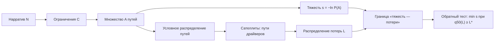

# Сценарное стресс-тестирование портфеля: тяжесть сценария и обратный стресс-тест

Диссертация строится на методе, реализованном в MacroStress. Предмет — теория сценарного
стресс-теста: как задать сценарий, чем измерить его необычность, как поставить и решить
обратную задачу. Программная часть проекта в диссертацию не входит: она служит вычислительным
стендом для проверки утверждений.

## 1. Название

Основной вариант:

**«Сценарное стресс-тестирование портфеля: тяжесть макроэкономического сценария и обратный
стресс-тест»**

Варианты с другим акцентом:

| Акцент | Формулировка |
|---|---|
| Мера тяжести | «Тяжесть и правдоподобие макроэкономических сценариев в стресс-тестировании портфеля: метод условных прогнозов и обратная задача» |
| Обратная задача | «Обратный стресс-тест портфеля в модели структурной BVAR со стохастической волатильностью» |
| Методология | «От согласованности сценария к границе „тяжесть — потери“: теория и приложение к российскому портфелю» |

Для титульного листа короче: «Сценарное стресс-тестирование портфеля: тяжесть сценария и
обратный стресс-тест». Английский вариант для публикаций: *Scenario Stress Testing of a
Portfolio: Scenario Severity and the Reverse Stress Test*.

Три объекта названия — три части работы: сценарий, тяжесть, обратный тест. «Портфель»
обозначает выход метода, «макроэкономический сценарий» — вход. Слова «разработка», «система»,
«платформа» в название не входят: они увели бы тему в инженерию.

## 2. Замысел

Стресс-тест отвечает на вопрос «сколько потеряет портфель, если ...». Регуляторная практика
отвечает на него сценарием: эксперт задаёт пути нескольких переменных, модель достраивает
остальные. За пределами строгой теории остаются два вопроса.

1. Чем измеряется необычность сценария, если вероятность события сценария под безусловным
   прогнозом равна нулю.
2. Как найти наименее необычный сценарий, при котором потери достигают заданной величины.

Оба вопроса — про одно отображение «сценарий → распределение потерь»: первый требует меры на
входе, второй — обращения. Работа строит это отображение, доказывает его свойства и оценивает
их на российских данных.

### 2.1. Теория и стенд

Предмет диссертации — отображение $S\colon (C,D,O)\mapsto\bigl(s,\ \text{закон } L\bigr)$.
Программа, которая его считает, — инструмент проверки: доказываемые утверждения касаются
существования, единственности, инвариантности, монотонности и асимптотики отображения, а
вычисления проверяют их на данных, как стенд проверяет физическую теорию.

| Инженерный вопрос проекта | Теоретический вопрос диссертации |
|---|---|
| как передать сценарий в код | при каких условиях сценарное распределение существует и как оно устроено |
| как посчитать $\delta$ | какими свойствами обязана обладать мера тяжести |
| как перебрать значения ограничений | существует ли решение обратной задачи и как оно зависит от порога потерь |
| как ускорить прогон | какова цена тяжести и как её оценить при редких событиях |

Код, MCP-инструменты, каталоги данных, подключение к DSH и устройство плагинов в диссертацию
не входят; они упоминаются как средство воспроизведения экспериментов.

### 2.2. Научная проблема

Единой теории, связывающей сценарий стресс-теста, меру его необычности и распределение
потерь, нет. Сценарии сравниваются по несопоставимым критериям — вероятность, экспертный
балл, расстояние до среднего, — а обратный стресс-тест не имеет общепринятой постановки.
Диссертация формулирует такую теорию для одного класса методов: сценарного стресс-теста
портфеля, который опирается на структурную BVAR с условными прогнозами.

## 3. Разрыв в литературе

Работы по теме делятся на четыре кластера, и ни один не покрывает задачу целиком.

| Кластер | Что даёт | Чего не даёт |
|---|---|---|
| Регуляторная практика: BCBS, EBA, Банк России | процедуры, наборы сценариев, требования к надзору | аксиоматики тяжести; обратной задачи как задачи оптимизации |
| Макроэконометрика: SVAR, знаковая идентификация, условные прогнозы | распределение путей при линейных ограничениях; разделение шоков | связи с потерями портфеля; меры необычности сценария |
| Риск-менеджмент: меры правдоподобия и обратный тест | расстояние Махаланобиса, энтропийные ограничения, постановка обратной задачи | динамической макромодели, сателлитов, винтажных данных |
| Русскоязычная литература | практика Банка России, обзоры методов | формальных результатов по тяжести и обратному тесту |

Работа соединяет эти подходы: распределение путей берётся из динамической модели,
необычность измеряется информационной неожиданностью события, потери считаются через
сателлиты и модели позиций, обратная задача ставится как оптимизация на границе
«тяжесть — потери» и проверяется на российских винтажных данных.

Отличие от ближайших работ:

- Antolín-Díaz, Petrella, Rubio-Ramírez (2021) вводят сценарий как условное распределение
  путей, но не определяют меру тяжести, не передают пути в портфель и не решают обратную
  задачу;
- Breuer и соавторы (2009) и Breuer, Csiszár (2016) дают меры правдоподобия и энтропийные
  ограничения в статической факторной модели, без идентификации шоков и динамики;
- McNeil, Smith (2012) ставят обратный тест в статической модели, без макромодели и
  сателлитов;
- регуляторные методики задают процедуру, но не свойства меры, которой сценарии сравниваются.

## 4. Паспорт темы

| Пункт | Содержание |
|---|---|
| Направление подготовки | 38.04.08 «Финансы и кредит» либо 38.04.01 «Экономика», профиль финансовой экономики; уточняется программой |
| Объект исследования | процесс сценарного стресс-тестирования портфеля финансовых инструментов |
| Предмет исследования | методы построения согласованного макроэкономического сценария, измерения его тяжести и решения обратной задачи стресс-теста |
| Цель | построить и обосновать метод сценарного стресс-тестирования, в котором сценарий задаётся ограниченным условным распределением путей, тяжесть измеряется информационной неожиданностью, а обратный стресс-тест формулируется как минимизация тяжести при заданном уровне потерь, и проверить метод на российских данных |
| Методы | байесовская макроэконометрика (BVAR со стохастической волатильностью, знаковая идентификация, условные прогнозы); теория вероятностей и теория меры риска; стохастическая оптимизация; анализ чувствительности; Монте-Карло и имитационное моделирование редких событий; проверка покрытия на исторических эпизодах |
| Информационная база | винтажные месячные ряды 23 макропеременных за 2012–2026 годы (Банк России, Росстат, MOEX, FRED); 205 драйверов пяти видов; 20 исторических эпизодов; портфель из 12–20 позиций четырёх классов активов |

### 4.1. Задачи

1. Систематизировать теорию сценарного стресс-тестирования: регуляторные подходы, условные
   прогнозы в SVAR, меры правдоподобия сценария, обратный стресс-тест; выделить разрывы.
2. Формализовать сценарий как ограниченное условное распределение путей при частичной
   идентификации шоков; вывести условия совместной выполнимости ограничений и вид
   распределения.
3. Ввести меру тяжести, сформулировать её свойства и связать с используемым в практике
   расстоянием Махаланобиса; вывести следствия для смеси по параметрам модели.
4. Поставить обратную задачу как оптимизацию на границе «тяжесть — потери», доказать
   существование и монотонность решения, построить алгоритм.
5. Оценить влияние неопределённости идентификации шоков и моделей-сателлитов на тяжесть и на
   распределение потерь; предложить версию метода, устойчивую к этой неопределённости.
6. Провести эмпирическую проверку на российских данных: покрытие прогнозных интервалов,
   сравнение мер тяжести, оценка границы, декомпозиция неопределённости потерь.
7. Сформулировать рекомендации по применению метода в риск-менеджменте кредитной организации
   и в надзорной практике.

### 4.2. Гипотезы

H1. Информационная неожиданность $s=-\ln P(A)$ и расстояние Махаланобиса $\delta$
упорядочивают сценарии одинаково, пока интервалы ограничений узкие; с ростом ширины
интервалов порядок расходится, и расхождение связано с тяжестью хвостов безусловного прогноза.

H2. Ранговая корреляция между $\delta$ и медианой потерь убывает с горизонтом и с ростом
нелинейности сателлитов и моделей позиций: мера тяжести — не мера риска.

H3. Граница «тяжесть — потери» монотонна по порогу потерь, а исторические эпизоды лежат не
ниже неё; систематическое нарушение указывает на недооценку тяжести моделью.

H4. Неопределённость идентификации шоков не влияет на тяжесть, но влияет на условные пути и
потери; при непустом множестве движущих шоков её вклад в ширину распределения потерь
сопоставим с вкладом стохастической волатильности.

Числовые пороги гипотез уточняются после пилотных расчётов; в тексте они фиксируются до
основного эксперимента, чтобы проверка не подгонялась под результат.

### 4.3. Научная новизна

1. Сценарий формализован как усечённое условное распределение путей при частичной
   идентификации движущих шоков; получены условия выполнимости и явный вид распределения,
   включая экспертные надбавки как сдвиг меры на путях драйверов.
2. Введена и аксиоматизирована мера тяжести как информационная неожиданность события
   сценария; показано, что расстояние Махаланобиса есть её нормированная версия для точечного
   сценария, и что смешивание по параметрам модели не увеличивает тяжесть.
3. Обратный стресс-тест поставлен как минимизация тяжести при ограничении на квантиль
   потерь; доказаны свойства границы «тяжесть — потери», предложен алгоритм с общими
   случайными числами и версия, устойчивая к выбору идентификации.
4. Получены оценки метода на российских винтажных данных: покрытие прогнозных интервалов на
   исторических эпизодах, сравнение мер тяжести, наклон границы и декомпозиция
   неопределённости потерь по блокам модели.

### 4.4. Положения, выносимые на защиту

1. Сценарий стресс-теста задаёт условное распределение путей на множестве линейных
   ограничений: при точных ограничениях оно гауссовское со средним $G\mathbf g$ и
   ковариацией $\Lambda_D-GZ\Lambda_D$, при интервальных — усечённое; сценарий выполним тогда
   и только тогда, когда $\operatorname{rank}Z=m$.
2. Тяжесть сценария — информационная неожиданность $s=-\ln\mathbb P_0(A)$; расстояние
   Махаланобиса есть её нормированная версия для точечного сценария
   ($\varsigma=\tfrac12\delta^2+H$), а смешивание по параметрам модели не увеличивает тяжесть.
3. Обратный стресс-тест — задача минимизации тяжести при ограничении на квантиль потерь; её
   значение существует и монотонно по порогу, а граница «тяжесть — потери» служит корректным
   объектом сравнения сценариев, тогда как отдельная точка $\delta$ — нет.
4. Неопределённость идентификации шоков не меняет тяжесть при $\Lambda=I$, но меняет условные
   пути и потери; поэтому она входит в отчёт о потерях отдельным слагаемым, а не в меру
   тяжести.

### 4.5. Теоретическая и практическая значимость

Теоретическая значимость: три подхода — условные прогнозы в SVAR, меры правдоподобия сценария
и обратный стресс-тест — сводятся в одну постановку, и мера тяжести получает свойства,
пригодные для сравнения сценариев между собой и с историческими эпизодами.

Практическая значимость: совет по рискам получает оценку тяжести сценария и сравнение с
историческими эпизодами; обратный тест даёт минимальный набор ограничений для заданного
уровня потерь и максимальные потери при заданной тяжести; отчёт показывает вклад блоков
модели в разброс потерь; аналитик получает правило выбора ширины интервала и способа оценки
редких событий.

## 5. Теоретическая рамка

### 5.1. Информационное множество и безусловный прогноз

Дата расчёта $t_0$; $\mathcal F_{t_0}$ — информация, доступная к этой дате, включая версии
опубликованных значений (винтажи). Параметры макромодели $\theta$ имеют апостериорное
распределение $\Pi$. При известном $\theta$ путь $\mathbf y\in\mathbb R^{nH}$ распределён
нормально: $\mathcal N(\mu_\theta,\Sigma_\theta)$. Безусловный прогноз — смесь

$$
\mathbb P_0=\int \mathcal N(\mu_\theta,\Sigma_\theta)\,d\Pi(\theta),
$$

где разброс $\Sigma_\theta$ включает будущие волатильности и стьюдентовские множители.

### 5.2. Сценарий

Сценарий $\mathcal S=(N,C,D,O)$: нарратив $N$, ограничения $C$, движущие шоки $D$, надбавки
$O$. Ограничение $c=(w_c,a_c,b_c)$ означает $a_c\le w_c^\top\mathbf y\le b_c$. Множество
допустимых путей — параллелепипед

$$
A=\{\mathbf y:\ \mathbf a\le W\mathbf y\le \mathbf b\}.
$$

Шоки делятся на движущие и прочие: $\boldsymbol\varepsilon=(\boldsymbol\varepsilon_D,
\boldsymbol\varepsilon_{\bar D})$, $\mathbf y=\mu+\Phi_D\boldsymbol\varepsilon_D+
\Phi_{\bar D}\boldsymbol\varepsilon_{\bar D}$.

Выполнимость. Сценарий выполним тогда и только тогда, когда матрица $Z=W\Phi_D$ имеет полный
ранг строк: иначе найдутся ограничения, которые движущие шоки не сдвигают, и при почти любом
розыгрыше прочих шоков система неразрешима.

Распределение. При точных ограничениях ($\mathbf a=\mathbf b=\mathbf v$) и
$\Lambda_D=\operatorname{diag}\lambda_j$

$$
G=\Lambda_D Z^\top\bigl(Z\Lambda_D Z^\top\bigr)^{-1},\qquad
\mathbf g=\mathbf v-W\mu-W\Phi_{\bar D}\boldsymbol\varepsilon_{\bar D},
$$

$$
\boldsymbol\varepsilon_D\mid \text{ограничения}\sim
\mathcal N\bigl(G\mathbf g,\ \Lambda_D-GZ\Lambda_D\bigr).
$$

При интервальных ограничениях условное распределение — безусловное, усечённое множеством
$A$; по розыгрышам параметров это смесь усечённых нормальных распределений.

Надбавка $o=(k,t_1,t_2,\Delta)$ сдвигает путь драйвера $k$ на $\Delta$ в месяцы
$t_1,\dots,t_2$ и переводит сценарий в сдвинутую меру на путях драйверов; на макропеременные
она не влияет.

### 5.3. Тяжесть

Тяжесть сценария — информационная неожиданность (собственная информация) события $A$ под
безусловным прогнозом:

$$
s(A)=-\ln \mathbb P_0(A).
$$

Для точечного сценария $A=\{\mathbf c\}$ вероятность равна нулю и $s=\infty$; конечной
величиной служит плотность. Положим $\varsigma(\mathbf c)=-\ln f_0(\mathbf c)$ и

$$
\delta^2=(\mathbf c-\mu)^\top\Omega^{-1}(\mathbf c-\mu),\qquad
\Omega=\operatorname{Cov}_0(W\mathbf y).
$$

Для одного нормального распределения $\varsigma=\tfrac12\delta^2+H$, где
$H=\tfrac12\bigl(nH\ln 2\pi+\ln\det\Omega\bigr)$; для смеси $\mu$ и $\Omega$ — точные моменты
смеси: среднее средних и средняя ковариация плюс ковариация средних.

Три свойства, которые нужно доказать и проверить.

- На практике $\delta$ иногда читают как вероятность. Это нормированная неожиданность точки;
  для интервальных сценариев вместо неё работает $s$.
- Смешивание по параметрам не увеличивает тяжесть:
  $s(A)=-\ln\mathbb E_\theta[P_\theta(A)]\le\mathbb E_\theta[-\ln P_\theta(A)]$ по неравенству
  Йенсена. Разрыв — вклад неопределённости параметров; игнорирование смеси завышает тяжесть.
- Тяжесть инвариантна к обратимым аффинным перепараметризациям пути при согласованном
  преобразовании $W$; поэтому сценарии, заданные в разных единицах, сравнимы.

### 5.4. Потери

Сателлиты переводят макропути в пути драйверов $d=G(\mathbf y)+O$, модели позиций — в
изменения стоимости $V_q=F_q(\mathbf y,d)$, потеря портфеля $L=-\sum_q V_q$. Закон потерь —
образ сценарной меры при отображении $\mathcal L$. Отчёт: квантили $P_5,P_{50},P_{95}$,
ожидаемый дефицит $ES_{95}$ и тяжесть $s$ (или $\delta$). Разброс квантилей отражает
неопределённость параметров, волатильностей, идентификации и остатков сателлитов.

### 5.5. Обратная задача и граница «тяжесть — потери»

Для фиксированных $W$ и $D$ обратный стресс-тест ищет сценарий, при котором потери достигают
порога $L^*$, а тяжесть минимальна:

$$
s^*(L^*)=\inf\bigl\{s(A):\ q_{50}\bigl(L(A)\bigr)\ge L^*\bigr\}.
$$

Симметричная постановка: при бюджете тяжести $\bar s$ найти максимальный квантиль потерь

$$
\overline L(\bar s)=\sup\bigl\{q_\alpha(L(A)):\ s(A)\le\bar s\bigr\}.
$$

Обе постановки задают одну границу. Обратная задача ставится на интервалах, а не на точных
ограничениях: точный сценарий имеет нулевую вероятность и бесконечную неожиданность, поэтому
минимизировать нечего. Ширина интервала — параметр метода, и её влияние на границу входит в
эмпирическую часть.

Свойства, которые предстоит установить: существование решения при ограниченной
параметризации параллелепипедов, монотонность $s^*$ по $L^*$, непрерывность по границам
(слабая непрерывность условного закона), конечность при $L^*$ ниже максимально достижимых
потерь.

### 5.6. Устойчивость к идентификации

Знаковая идентификация определяет множество допустимых поворотов $\mathcal Q$; матрица удара
$B$ в нём не единственна. Если масштабы шоков перенесены в матрицу удара ($\Lambda=I$) и
$B=C D_h Q$ с нижнетреугольной $C$ и ортогональной $Q$, то $BB^\top=C D_h^2 C^\top$ не
зависит от $Q$, а вместе с ним и ковариация безусловного прогноза. Значит, $\delta$
инвариантна к повороту, а условные пути при непустом $D$ — нет, потому что $D$ называет
конкретные столбцы $B$. Отсюда две версии отчёта: байесовская (смесь по $\mathcal Q$) и
минимаксная (наихудший допустимый поворот). Сравнение версий объясняет, какая часть ширины
распределения потерь приходится на идентификацию.

### 5.7. Утверждения, которые предстоит доказать

| Метка | Утверждение | Статус |
|---|---|---|
| П1 | Сценарий выполним тогда и только тогда, когда $\operatorname{rank}Z=m$; при точных ограничениях условный закон гауссовский с указанными средним и ковариацией | следует из теории условных гауссовских распределений; в работе — с учётом смеси и надбавок |
| П2 | Тяжесть инвариантна к обратимым аффинным преобразованиям пути | доказывается заменой переменных |
| П3 | $\varsigma=\tfrac12\delta^2+H$; $s\le\mathbb E_\theta[-\ln P_\theta(A)]$ | первое — алгебра, второе — Йенсен |
| П4 | $\delta$ инвариантна к повороту $Q$ при $\Lambda=I$; условные пути и потери — нет | новое для этой постановки |
| П5 | $s^*$ монотонна по $L^*$ и полунепрерывна снизу при регулярных границах | новое |
| П6 | Разложение дисперсии потерь по блокам модели (макро, волатильность, идентификация, сателлиты, позиции) | новое; блоки зависимы, поэтому разложение по Шепли, а не индексы Соболя |
| П7 | Согласованность границы с историческими эпизодами как критерий калибровки | новое; проверяется эмпирически |

## 6. Эмпирический дизайн

### 6.1. Данные и портфель

- 23 макропеременные, 2012-01–2026-10, с датой публикации каждого значения; источники:
  Банк России, Росстат, MOEX, FRED. Винтажи обязательны: расчёт на дату видит значения в той
  редакции, которая была опубликована к этой дате.
- Пять именованных шоков (денежно-кредитный, инфляционный, курсовой и риск-премии, нефтяной,
  глобальный финансовый) и безымянные; таблица знаков — проверяемая гипотеза.
- 205 драйверов пяти видов: цены акций, спреды облигаций, просрочка отраслей, цены жилья
  первичного и вторичного рынка.
- 20 исторических эпизодов (2014–2025) с реализовавшимися путями двух-трёх переменных и
  шоками, которыми эпизод объясняют источники того времени.
- Портфель: 12–20 позиций четырёх классов (акции, облигации, кредиты и депозиты,
  недвижимость). Основной вариант — модельный портфель на публичных данных; дополнительный —
  агрегированный банковский портфель, если доступны данные.

### 6.2. Модели

- Макромодель: BVAR, $p=3$, миннесотский приор $\lambda=0{,}2$, стохастическая
  волатильность, стьюдентовские хвосты, 1000 розыгрышей из постериорного распределения,
  знаковые ограничения на три месяца, до 20 000 поворотов на розыгрыш.
- Сателлиты: иерархические модели драйверов, $\lvert\rho\rvert\le0{,}99$, проверка вне
  выборки на 24 месяцах с горизонтом 12 месяцев, сравнение с авторегрессией без
  макропеременных.
- Модели позиций: акция (цена), облигация (спред и дюрация), кредит (доля просрочки, LGD),
  недвижимость (цена, регион).

### 6.3. Эксперименты

| Метка | Что проверяется | Как |
|---|---|---|
| E1 | Калибровка условных прогнозов | покрытие 90 % интервалов на 20 эпизодах; CRPS; сравнение таблиц знаков |
| E2 | Согласованность мер тяжести (H1) | $s$ против $\delta$ на сетке ширин интервалов; оценка $s$ Монте-Карло и импортанс-сэмплингом; сходимость |
| E3 | Тяжесть против потерь (H2) | ранговая корреляция $\delta$ и $P_{50}$ по сетке сценариев при разных $W$, $D$, $H$ |
| E4 | Обратная задача (H3) | граница $s^*(L^*)$ для порогов потерь 5, 10, 15, 20 %; положение исторических эпизодов; чувствительность к $W$ и $D$ |
| E5 | Декомпозиция неопределённости (H4) | вклад блоков в $P_{95}-P_5$ и $ES_{95}$; разложение по Шепли |
| E6 | Устойчивость | бутстрэп по сидам, постериорному распределению и составу портфеля; ошибки Монте-Карло |

Критерии: покрытие в диапазоне 0,85–0,95; монотонность границы без нарушений; нарушения
условия «эпизод не ниже границы» разбираются поимённо, систематическое нарушение считается
сигналом о калибровке и не отбрасывается.

### 6.4. Оценивание редких событий

Тяжесть редкого сценария — малая вероятность, и оценка $-\ln P(A)$ по выборке неустойчива.
В работе сравниваются три способа: прямое моделирование, импортанс-сэмплинг с
экспоненциальным наклоном и оценка по условному закону из сэмплера Гиббса. Сравнение даёт
числа и правило: при какой тяжести какой способ применим.

## 7. Структура работы

Объём 80–100 страниц; оформление по ГОСТ Р 7.0.11-2011 и методическим указаниям программы.

| Часть | Содержание | Объём, стр. |
|---|---|---|
| Введение | проблема, разрыв, цель, задачи, гипотезы, новизна, положения на защиту | 8–10 |
| Глава 1. Теория сценарного стресс-тестирования | регуляторная практика; сценарий как объект; SVAR и идентификация; условные прогнозы; сателлиты; меры правдоподобия; обратный тест; разрывы | 25–30 |
| Глава 2. Метод | сценарий как условное распределение; тяжесть и её свойства; передача в потери; обратная задача и граница; устойчивость; алгоритмы; доказательства П1–П7 | 30–35 |
| Глава 3. Эмпирика | данные и портфель; калибровка; E1–E6; обсуждение | 25–30 |
| Заключение | выводы по гипотезам, ограничения, направления развития | 5 |
| Библиография | 80–100 источников | 6–8 |
| Приложения | доказательства, таблицы, описание стенда | 10–15 |

## 8. План и контрольные точки

Сроки даны для двухлетней программы; при другом начале обучения сдвигаются на фактический
срок.

| Семестр | Работа | Результат |
|---|---|---|
| 1 | литература, формализация, глава 1, протокол экспериментов | черновик главы 1, 80 источников, утверждённая тема |
| 2 | П1–П5, алгоритм обратной задачи, глава 2 | черновик главы 2, тезисы, выступление на конференции |
| 3 | E1–E6, глава 3 | черновик главы 3, статья |
| 4 | сборка текста, апробация, оформление | текст, доклад, защита |

Контрольные точки внутри семестров: раз в две недели — разбор раздела с руководителем; раз в
семестр — семинар кафедры. Риск срыва сроков сосредоточен в главе 1: литература по четырём
кластерам широка, и её нужно ограничить заранее (80–100 источников, не больше).

## 9. Апробация и публикации

- Одна статья в журнале из перечня ВАК или РИНЦ: «Прикладная эконометрика», «Экономический
  журнал ВШЭ», «Финансы и кредит», «Деньги и кредит», «Управление финансовыми рисками».
- Два тезиса: «Ломоносов» (МГУ), апрельская конференция НИУ ВШЭ, конференции по финансовой
  стабильности.
- Семинар кафедры и, при возможности, семинар Банка России: тема обратного стресс-теста
  близка надзорной практике.

## 10. Ограничения, риски, сужения

### 10.1. Границы метода

Работа не оценивает вероятность нарратива: $N$ остаётся вне модели, вероятность есть только
у события $A$. Обратного влияния портфеля на экономику, общего равновесия и поведенческих
реакций банка работа не рассматривает. Горизонт ограничен длиной надёжной истории; для
России это 2012–2026 годы, около 178 месяцев.

### 10.2. Риски

| Риск | Что делаем |
|---|---|
| короткая история, 20 эпизодов | расширять нечем; компенсируем числом розыгрышей и разбором каждого нарушения, а не агрегатом |
| стоимость обратной задачи | общие случайные числа, поверхность отклика по параметрам интервалов, распараллеливание |
| слабая идентификация (пять именованных шоков) | версия, устойчивая к выбору идентификации, и отчёт о доле принятых поворотов |
| тема широка для магистерской | сужения ниже |
| требования кафедры к эмпирике | запасной вариант — модельный портфель на публичных данных |

### 10.3. Сужения

- Только тяжесть — «Меры тяжести макроэкономических сценариев: аксиоматика и сравнение».
  Глава 2 без обратной задачи, эмпирика E1–E3.
- Только обратный тест — «Обратный стресс-тест портфеля: постановка, алгоритм, проверка на
  российских данных». Глава 2 без аксиоматики, эмпирика E4–E6.
- Только идентификация — «Влияние неопределённости идентификации шоков на результаты
  сценарного стресс-теста». П4, H4, E5.

## 11. Литература

Библиографические данные ниже приведены по памяти и требуют сверки с каталогом библиотеки;
номера страниц указаны там, где они надёжны. Русскоязычный блок — 10–15 источников по практике
Банка России и банковскому риск-менеджменту — собирается при сверке; здесь он представлен
отчётом Банка России.

**Регуляторная практика и обзоры**

1. Basel Committee on Banking Supervision. Principles for sound stress testing practices and
   supervision. — Basel: BIS, 2009.
2. Basel Committee on Banking Supervision. Stress testing principles. — Basel: BIS, 2018.
3. Borio C., Drehmann M., Tsatsaronis K. Stress-testing macro stress testing: Does it live up
   to expectations? // Journal of Financial Stability. 2014. Vol. 12. P. 3–15.
4. Sorge M. Stress-testing financial systems: an overview of current methodologies. — BIS
   Working Paper No. 165, 2004.
5. Blaschke W., Jones M. T., Majnoni G., Peria M. S. M. Stress testing of financial systems: an
   overview of issues, methodologies, and FSAP experiences. — IMF Working Paper, 2001.
6. European Banking Authority. 2023 EU-wide stress test: methodological note. — 2023.
7. European Central Bank. Guide to the internal capital adequacy assessment process (ICAAP). —
   2018.
8. Банк России. Отчёт о финансовой стабильности. — М.: Банк России, регулярное издание.

**Макроэконометрика и условные прогнозы**

9. Sims C. A. Macroeconomics and reality // Econometrica. 1980. Vol. 48. P. 1–48.
10. Christiano L. J., Eichenbaum M., Evans C. L. Monetary policy shocks: What have we learned
    and to what end? // Handbook of Macroeconomics. 1999. Vol. 1A. P. 65–148.
11. Uhlig H. What are the effects of monetary policy on output? Results from an agnostic
    identification procedure // Journal of Monetary Economics. 2005. Vol. 52. P. 381–419.
12. Rubio-Ramírez J. F., Waggoner D. F., Zha T. Structural vector autoregressions: Theory of
    identification and algorithms for inference // Review of Economic Studies. 2010. Vol. 77.
    P. 665–696.
13. Waggoner D. F., Zha T. Conditional forecasts in dynamic multivariate models // Review of
    Economics and Statistics. 1999. Vol. 81, No. 4. P. 639–651.
14. Antolín-Díaz J., Petrella I., Rubio-Ramírez J. F. Structural scenario analysis with SVARs
    // Journal of Monetary Economics. 2021. Vol. 117. P. 798–815.
15. Antolín-Díaz J., Rubio-Ramírez J. F. Narrative sign restrictions for SVARs // American
    Economic Review. 2018. Vol. 108, No. 10. P. 2802–2829.
16. Carriero A., Clark T. E., Marcellino M. Large Bayesian vector autoregressions with
    stochastic volatility and non-conjugate priors // Journal of Econometrics. 2019. Vol. 212,
    No. 1. P. 137–154.
17. Carriero A., Chan J., Clark T. E., Marcellino M. Corrigendum to «Large Bayesian vector
    autoregressions with stochastic volatility and non-conjugate priors» // Journal of
    Econometrics. 2022.
18. Kim S., Shephard N., Chib S. Stochastic volatility: likelihood inference and comparison
    with ARCH models // Review of Economic Studies. 1998. Vol. 65. P. 361–393.
19. Geweke J. Efficient simulation from the multivariate normal and Student-t distributions
    subject to linear constraints // Computing Science and Statistics: Proceedings of the 23rd
    Symposium on the Interface. 1991. P. 571–578.
20. Zha T. Block recursion and structural vector autoregressions // Journal of Econometrics.
    1999. Vol. 90. P. 291–316.
21. Kilian L., Lütkepohl H. Structural Vector Autoregressive Analysis. — Cambridge: Cambridge
    University Press, 2017.

**Меры риска, тяжесть сценария, обратный тест**

22. Breuer T., Jandacka M., Rheinberger K., Summer M. How to find plausible, severe, and
    useful stress scenarios // International Journal of Central Banking. 2009. Vol. 5, No. 3.
    P. 205–224.
23. Breuer T., Csiszár I. Systematic stress tests with entropic plausibility constraints //
    Journal of Banking & Finance. 2016. Vol. 65.
24. McNeil A. J., Smith A. D. A general framework for guessing a reverse stress test //
    Journal of Banking & Finance. 2012. Vol. 36, No. 4.
25. Artzner P., Delbaen F., Eber J.-M., Heath D. Coherent measures of risk // Mathematical
    Finance. 1999. Vol. 9. P. 203–228.
26. Acerbi C., Tasche D. On the coherence of expected shortfall // Journal of Banking &
    Finance. 2002. Vol. 26. P. 1487–1503.
27. McNeil A. J., Frey R., Embrechts P. Quantitative Risk Management. — Princeton: Princeton
    University Press, 2015.
28. Glasserman P. Monte Carlo Methods in Financial Engineering. — New York: Springer, 2003.

**Сателлиты, передача шока, декомпозиция**

29. Wilson T. Portfolio credit risk // Risk. 1997. Vol. 10, No. 9–10.
30. Buncic D., Melecky M. Macroprudential stress testing of credit risk: A practical approach
    for policy makers // Journal of Financial Stability. 2013. Vol. 9, No. 3. P. 347–370.
31. Gelman A., Hill J. Data Analysis Using Regression and Multilevel/Hierarchical Models. —
    Cambridge: Cambridge University Press, 2007.
32. Sobol I. M. Global sensitivity indices for nonlinear mathematical models and their Monte
    Carlo estimates // Mathematics and Computers in Simulation. 2001. Vol. 55. P. 271–280.
33. Homma T., Saltelli A. Importance measures in global sensitivity analysis of nonlinear
    models // Reliability Engineering & System Safety. 1996. Vol. 52. P. 1–17.

## 12. Роль проекта MacroStress

Стенд уже даёт винтажные ряды, макромодель с идентификацией шоков, условным прогнозом и
тяжестью, сателлиты с проверкой вне выборки, 205 драйверов, модели четырёх классов активов,
отчёт с квантилями потерь и ожидаемым дефицитом, повторяемость прогона по сиду.

Диссертация добавляет к стенду совместную вероятность $P(A)$ и информационную неожиданность
$s$, интервальные сценарии для обратной задачи, саму обратную задачу с общими случайными
числами, декомпозицию неопределённости по блокам и версию, устойчивую к выбору идентификации.
Обратного стресс-теста в стенде нет: его реализация — часть работы.

## 13. Что уточнить у научного руководителя

1. Направление подготовки и профиль: от них зависит формулировка объекта и требования к
   эмпирической части.
2. Требования программы к объёму, структуре и оформлению: ГОСТ Р 7.0.11-2011 или методичка
   кафедры.
3. Допустим ли модельный портфель на публичных данных вместо банковского: от этого зависит
   доступ к данным.
4. Нужна ли отдельная глава по регуляторной практике или её достаточно в главе 1.
5. Согласование использования кода проекта: стенд как приложение, без претензии на
   программный результат.
6. Сроки утверждения темы на кафедре и форма промежуточной аттестации.
