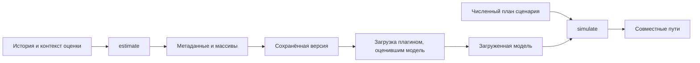

# mst.model_sdk: договор с моделями показателей

Пакет `mst.model_sdk` задаёт договор между платформой и моделями, которые строят распределение будущих показателей. Макромодель описывает экономику в целом; сателлитная модель строит показатели объектов по более общим входам. Комплект средств разработки, или SDK, определяет, как оценить модель, сохранить результат и получить пути при сценарии, не передавая модели управление сервером или портфелем.

Действующая версия модельного контракта — `4.0.0`, заданная в [version.py](<version.py>). Плагин объявляет совместимый диапазон, например `model_sdk=">=4.0,<5.0"`; несовместимость обнаруживается при сборке реестра. Контракт модели позиции устроен отдельно и описан в [plugin_sdk](<../plugin_sdk/README.md>).

## Жизненный цикл модели



Плагин оценивает и читает свою модель, а платформа проверяет обязательные поля и публикует версию. Хеш защищает сохранённое содержимое от изменения; он не заменяет совместимый код загрузчика модели.

[Контракты contracts.py](<contracts.py>) задают интерфейсы `MacroModel` и `SatelliteModel`. Метод `estimate(context)` возвращает метаданные и массивы, `load(...)` восстанавливает модель версии, а `simulate(...)` строит пути по загруженной модели и начальному значению генератора `seed`. Повторяемость проверяется для одинаковых входов и численного окружения; переносимость байтов между любыми платформами из контракта не следует.

Для макроверсии обязательны `model`, `as_of`, `ids`, `months`, `shocks`, а среди массивов — `panel_y` и `panel_approximate`; хранилище макроверсий дополнительно требует `n_global`. Сателлитная оценка возвращает `SatelliteEstimate` с частями `SatellitePart` по величинам и остаточными рядами `residuals`. Часть содержит месяцы, дерево объектов, соответствие драйверов, число строк и проверки; платформа добавляет название модели и проверяет диапазоны обучения, нужные для диагностики выхода за историю.

## План, группы и вмешательства

Сценарий пользователя описывает календарные месяцы и исходные единицы, а `ScenarioPlan` содержит уже численные инструкции в шкалах моделей. План включает горизонт, линейные ограничения `LinearConstraint`, реализованные вмешательства `Intervention` и размер внутренней группы `inner`. Пользовательский файл сценария в модель не передаётся.

Параметр `draws` у макромодели означает число групп с общими параметрами и реализацией вмешательств. Каждая группа содержит `inner` путей, поэтому выход `MacroSimulation.paths` имеет форму `(draws * inner, horizon + 1, n)`, где `n` — число переменных; месяц `0` хранит конец истории. Метки `group` должны быть последовательными и согласованными с размером групп. Наблюдения изменяют случайные исходы внутри группы, сохраняя закон параметров и заданную случайность вмешательств.

В `Intervention.values` строки соответствуют группам, столбцы — записанным месяцам. `set` устанавливает координату, `shift` прибавляет сдвиг; `active=False` оставляет значение нетронутым и не заменяется нулём. Контракт копирует массивы и делает их неизменяемыми.

Самодостаточный пример создаёт план без чтения версий:

```python
import numpy as np
from mst.model_sdk.contracts import Intervention, ScenarioPlan

intervention = Intervention(
    target="ru.key_rate", months=(1,), kind="set",
    values=np.array([[15.0], [16.0]])
)
plan = ScenarioPlan(horizon=3, interventions=(intervention,), inner=4)
assert plan.interventions[0].values.shape == (2, 1)
```

Учебные числа означают две реализации решения по ставке в модельной шкале `identity`; при симуляции с двумя группами план требует восемь путей. Создание плана проверяет форму, но не наличие переменной в конкретной версии.

## Структурная форма и цена

Структурная форма сообщает, какие значения модели читают другие значения того же уровня. `structural_form(model)` возвращает `None` для формы по умолчанию либо `StructuralForm` с порядком внутри месяца и признаком временной рекурсии. В форме по умолчанию макроплагин учитывает подстановку вмешательства в ограничениях, а [apply_default](<interventions.py>) применяет вмешательство после розыгрыша; другие координаты того же уровня от замены не меняются. Рекурсивная модель исполняет вмешательство внутри собственного алгоритма, поэтому последующие значения могут отреагировать.

`constraint_law` возвращает условный закон наблюдаемых линейных выражений в `ConstraintLaw`: средние, ковариации, логарифмы весов и метки групп. Границы относятся к исходным выражениям уже после вмешательств, даже если установка сделала часть выражения детерминированной. Если модель не возвращает такой закон, она может отдельно реализовать `log_box_probability`; отсутствие обоих методов означает отсутствие оценки цены этим способом.

[Модуль dist.py](<dist.py>) рассчитывает цену наблюдений при фиксируемых группами параметрах и вмешательствах, стандартную ошибку и односторонний вариант для сравнения событий разной ширины. Цена измеряет изменение вероятностного закона, а не стоимость потерь. [conditional.py](<conditional.py>) содержит общие численные операции условного нормального закона, а [overlay.py](<overlay.py>) — перевзвешивание модели, представленной готовой выборкой путей. Математическая норма задана в [общей схеме](<../../../docs/concept/formalization.md>).

## Сателлиты по уровням

Номера уровней растут от общего к частному: уровень 0 — экономика, уровень 1 — драйверы по макровходам, уровень 2 — драйверы, читающие также уровень 1. `UpperPaths` содержит `macro` и `levels` с уже рассчитанными путями уровней с меньшими номерами; соответствующие вмешательства применены до передачи входов следующему уровню. `UpperHistory` даёт их наблюдаемую историю при оценке.

Платформа разыгрывает совместные стандартизованные остатки одного уровня и передаёт каждой сателлитной модели её столбцы `shocks` формы `(R, steps, k)`, где `R` — число путей, `steps` — число шагов, `k` — число передаваемых драйверов с историей. Модель обязана использовать переданные столбцы для драйверов с собственной историей и читать только нужное число шагов; независимый повторный розыгрыш разрушит измеренную связь между моделями. Между уровнями остатки независимы, а зависимость передаётся через входные пути.

Добавление следующего уровня требует величины с `level=2`, входами меньших уровней и явного назначения модели при оценке. Рабочий пример регрессии находится в [reflevel2](<../plugins/reflevel2/REFERENCE.md>), учебный каталог — в [level2_catalog.json](<../../../tests/drivers/level2_catalog.json>), а последовательность и передачу вмешательств проверяет [test_levels.py](<../../../tests/drivers/test_levels.py>).

## Длительная оценка и дополнительные входы

Контексты оценки содержат необязательный каталог `checkpoints`; [checkpoint.py](<checkpoint.py>) даёт сохранение готовой части и чтение по ключу. Ключ должен учитывать спецификацию, историю и версию алгоритма, иначе повтор может принять устаревший результат. Платформа передаёт отдельный каталог каждой модели и удаляет его после публикации, но возобновление вычислений реализует сам плагин.

Макромодель может объявить `input_keys` и методы вопросов, проверки частей ответа, сборки и аудита. Платформа хранит ответы, а содержание вопроса и экономические ограничения задаёт модель; незавершённые части не подменяют законченный вход оценки. Контексты и методы перечислены в [contracts.py](<contracts.py>), проверки вмешательств и использования общих остатков — в [testing.py](<testing.py>), тесты нейтральных операций — в [tests/model_sdk](<../../../tests/model_sdk/>).
