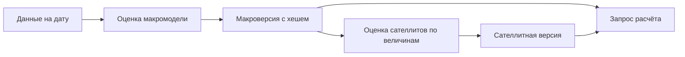

# mst.models: оценка и сохранение моделей

Пакет `mst.models` управляет жизненным циклом версий: выбирает установленную модель, готовит доступную историю, вызывает оценку и сохраняет результат. Модель — алгоритм из плагина; версия — неизменяемые метаданные и численные массивы одной оценки. Сателлитный набор, или бандл, объединяет модели показателей объектов, оценённые для одной макроверсии.

## Последовательность операций



Схема показывает зависимость версий: сателлитный набор привязан к панели конкретной макроверсии, поэтому произвольные две версии нельзя соединить только по совпадению даты.

В [__init__.py](<__init__.py>) функция `selected` требует явный `model_id`, если установлено несколько макромоделей. Функция `assignment` назначает сателлитную модель каждой величине: единственный объявитель используется по умолчанию, несколько объявителей требуют выбора, отсутствие объявителя записывается как `unserved`. Явное назначение может передать величину установленной модели, даже если модель не объявляла величину по умолчанию; пригодность такого назначения нужно проверять по контракту самой модели.

## Командная строка

Из корня репозитория сначала узнайте доступные модели и сохранённые версии:

```powershell
uv run python -m mst.models catalog
uv run python -m mst.models list --models workspace/models
```

Оценка требует заранее заполненного хранилища. Дата `--as-of` ограничивает доступные публикации; пример ниже создаёт новую версию модели `rw.joint`:

```powershell
uv run python -m mst.models estimate-macro rw.joint --as-of 2026-10-29 --store workspace/series --models workspace/models
```

Для модели, которая объявляет экспертные входы, дополнительно нужен `--inputs DIR` с завершёнными ответами. Необязательный `--form default` или `--form recursive` выбирает структурную форму — правило распространения вмешательств внутри модели; модель без переключателя форм отклоняет параметр.

Оценка сателлитов принимает полный хеш макроверсии вместо `SHA256`:

```powershell
uv run python -m mst.models estimate-satellites --macro SHA256 --store workspace/series --models workspace/models --drivers workspace/drivers/catalog.json
```

При неоднозначном назначении добавьте `--model QUANTITY=MODEL_ID`; параметр повторяется для каждой величины. Команда печатает хеш и таблицу проверок драйверов, причём опубликованная версия может содержать отклонённые драйверы: сохранение версии не означает допуск каждого её показателя.

## Диагностика и продолжение оценки

[Команды cli.py](<cli.py>) отделяют чтение сохранённой версии от новой оценки. `describe --version SHA256` описывает макроверсию; `diagnose --version SHA256` исследует доступные диагностики макромодели; `diagnose-satellites SHA256` читает сателлитный набор и выводит свойства его уравнений без переоценки. Состав диагностик зависит от типа модели, поэтому спектральный радиус и режимы не следует ожидать у любого плагина.

Каждая модель получает собственный каталог точек сохранения. Платформа передаёт каталог, а решение, какие законченные части сохранить и как проверить ключ совместимости, принимает модель через [model_sdk](<../model_sdk/README.md>). Поэтому повтор той же команды возобновляет только ту работу, для которой плагин действительно поддерживает точки сохранения; после успешной публикации платформа удаляет соответствующий каталог.

Точные параметры команд заданы в [cli.py](<cli.py>), проверки выбора и публикации — в [test_models.py](<../../../tests/models/test_models.py>), а сборки частей — в [test_bundle.py](<../../../tests/drivers/test_bundle.py>). Качество прогнозов оценивается отдельно через [mst.metrics](<../metrics/README.md>), а не по факту успешной оценки.
