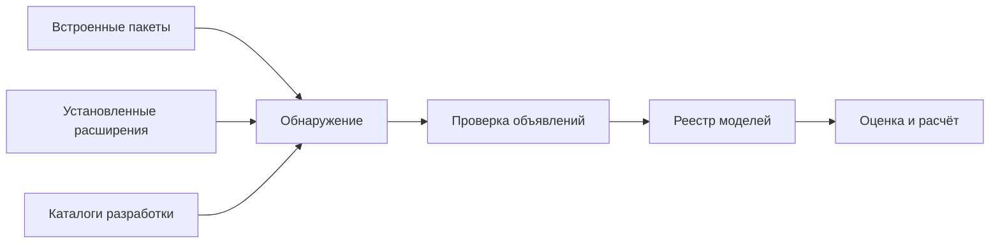

# mst.plugins: подключаемые модели

Пакет `mst.plugins` обнаруживает модели расширений и собирает общий реестр для расчётной платформы. Плагин — Python-пакет с объявлением `plugin = Plugin(...)`; один плагин может нести макромодель, сателлитную модель показателей объектов или модель стоимости позиции. Разделение нужно, чтобы новый метод оценки или новый вид инструмента подключался через контракт, без добавления его формулы в движок.

## Виды моделей

Макромодель строит совместные пути показателей экономики. Сателлитная модель строит показатель объекта по более общим путям; модель позиции переводит нужные пути в изменение стоимости. Различие видов относится к ответственности, а не к качеству: наличие модели в реестре не означает, что её прогноз прошёл историческую проверку.

| Вид | Объявления встроенных плагинов | Роль |
| --- | --- | --- |
| Позиционная модель | [equity](<equity/plugin.py>), [bond](<bond/plugin.py>), [credit](<credit/plugin.py>), [housing](<housing/plugin.py>) | Акции, облигации, кредитные позиции и недвижимость |
| Макромодель | [rw](<rw/plugin.py>), [bvar](<bvar/plugin.py>), [msvar](<msvar/plugin.py>), [expert](<expert/plugin.py>) | Альтернативные способы построить распределение экономики |
| Сателлитная модель | [hier](<hier/plugin.py>), [reflevel2](<reflevel2/plugin.py>) | Показатели объектов и пример следующего уровня зависимости |

`rw.joint` — совместное случайное блуждание; `bvar.sv` — байесовская векторная авторегрессия с меняющимся разбросом; `msvar.markov` — авторегрессия со скрытыми режимами; `expert.elicited.rw` и `expert.elicited.market` используют структурированные экспертные ответы. Названия не задают общую ранжировку моделей: выбор зависит от проверяемого закона и доступных входов.

## Как пакет обнаруживается

[Реестр __init__.py](<__init__.py>) читает пакеты пространства имён `mst.plugins`, точки подключения установленных дистрибутивов группы `mst.plugins` и каталоги из `MST_PLUGINS_PATH`. Переменная содержит пути, разделённые системным разделителем; для Windows им служит точка с запятой. Пакет должен экспортировать объект `plugin`, даже если само объявление расположено в отдельном модуле.



Схема показывает общий вход для встроенной и внешней модели. Проверка совместимости комплектов разработки, уникальности имён и объявленных метрик выполняется до использования набора; противоречивый набор отклоняется целиком, а не превращается в частично рабочую установку.

Несколько сателлитных моделей могут объявлять одну величину: конфликт разрешается явным назначением при оценке. Для позиционных моделей несколько обработчиков одного типа дают отказ выбора в движке; отдельного поля выбора модели в `Position` нет. Установленный сторонний плагин исполняется как Python-код процесса, поэтому подключать следует только доверенные пакеты.

## Создание и проверка

Из корня репозитория доступны справка генератора и самодостаточная демонстрация встроенной модели:

```powershell
uv run python -m mst.plugin new --help
uv run python -m mst.plugin check equity
uv run python -m mst.plugin demo-run equity
uv run python -m mst.models catalog
```

`new` создаёт пакет выбранного вида; `check` проверяет объявление и демонстрации, а `demo-run` выполняет демонстрационный расчёт позиции. Для внешнего пакета используется `--path DIR`. Подробные шаги и цена вариантов подключения описаны в [руководстве по плагинам](<../../../docs/howto/plugins.md>), контракты разделены между [plugin_sdk](<../plugin_sdk/README.md>) и [model_sdk](<../model_sdk/README.md>).

Обнаружение, несовместимые объявления и границы ядра проверяются в [tests/plugins](<../../../tests/plugins/README.md>). Экономическое поведение каждой модели проверяется отдельно в её тестах и исторических оценках качества.
