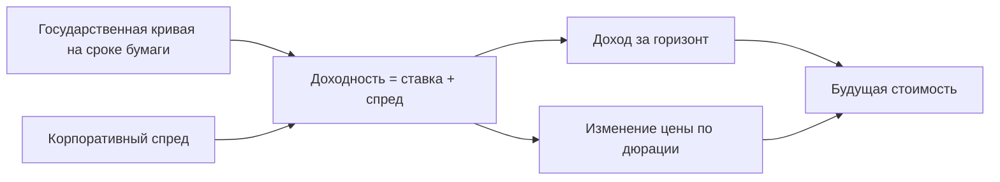

# Стоимость облигации по кривой доходности и спреду

Модель `bond.paths.v1` версии 2.0.0 переоценивает корпоративную облигацию по доходу за горизонт и изменению доходности. Доходность складывается из ставки государственной кривой на выбранном сроке и корпоративного спреда — надбавки за риск эмитента. Модель учитывает оба источника изменения, но заменяет точный график платежей приближением через дюрацию.

Формула сверена с [реализацией модели](<model.py>). Сценарий и цепочку моделей задаёт [общая формализация](<../../../../docs/concept/formalization.md>); модель позиции читает уже рассчитанные пути и не строит прогноз ставки или спреда самостоятельно.

Рисунок 1. Источники изменения стоимости облигации. Текстовый эквивалент: модель складывает ставку кривой и спред, начисляет доход по начальной доходности и приближает переоценку через оставшуюся дюрацию. Схема не показывает результаты конкретной бумаги.

## Входы и обозначения

Позиция имеет тип `bond`. Поле `notional` задаёт текущую стоимость $N$ в миллионах валюты позиции $c$, поле `currency` — код валюты, `codes` — биржевой или международный код выпуска и другие коды для поиска драйвера. Обязательное `terms.duration` задаёт модифицированную дюрацию $D>0$ в годах. Модифицированная дюрация приближает чувствительность цены к доходности: увеличение доходности на один процентный пункт уменьшает цену примерно на $D$ процентов.

Если источник публикует дюрацию Маколея в днях, переход к модифицированной дюрации имеет вид $D=\mathrm{days}/365/(1+y/f)$, где $y$ — годовая доходность долей, а $f$ — число купонов в год. Дюрация не равна сроку погашения; их смешение является отдельным приближением модели.

Пусть $r=1,\dots,R$ — номер пути, $h=0,\dots,H$ — месяц. Драйвер `bond_spread` даёт спред $s_{r,h}$ в процентных пунктах. Макропути `ru.key_rate`, `ru.ofz_1y`, `ru.ofz_5y`, `ru.ofz_10y` задают ставки $r_{r,h}(\tau)$ на сроках 0, 1, 5 и 10 лет в процентах. Ключевая ставка обязательна; отсутствующие остальные узлы пропускаются. Между имеющимися сроками ставка интерполируется линейно, за крайними сроками остаётся постоянной.

Для валюты $c$ макропуть $X_{r,h}$ выражен рублями за единицу валюты; для рубля $X=1$. Начальную рублёвую стоимость обозначим через $V_0=NX_0$. Месяц 0 — последний месяц истории модели, а не обязательно календарный месяц даты расчёта.

## Формула оценки

Через $h$ месяцев модель использует эффективную оставшуюся дюрацию $D_h=\max(D-h/12,0)$. Начальная и будущая доходности равны

$$
y_{r,0}=r_{r,0}(D)+s_{r,0},\qquad y_{r,h}=r_{r,h}(D_h)+s_{r,h}.
$$

Стоимость в валюте позиции приближается выражением

$$
P_{r,h}=N\,(1+y_{r,0}/100)^{h/12}\left(1-\frac{D_h\,(y_{r,h}-y_{r,0})}{100}\right).
$$

Первый множитель начисляет доход по начальной доходности. Второй — линейная переоценка по изменению доходности; выпуклость, то есть второй порядок зависимости цены от доходности, не учитывается. Чтение будущей кривой на более коротком сроке также передаёт скольжение по кривой.

Для результата в рублях формула применяется к начальной рублёвой стоимости и отношению курсов:

$$
V_{r,h}=V_0\frac{P_{r,h}}{N}\frac{X_{r,h}}{X_{r,0}},\qquad
\delta_r=V_{r,H}-V_0,\qquad L_r=-\delta_r.
$$

При постоянных кривой и спреде, а также постоянном курсе облигация зарабатывает $N((1+y_0/100)^{h/12}-1)$. При равном росте государственной ставки и спреда формула даёт одинаковое изменение цены: оба движения увеличивают полную доходность.

## Ограничения приближения

Линейное уменьшение дюрации на прошедшее время не является общим законом дюрации купонной облигации. В частности, достижение $D_h=0$ не доказывает наступления погашения. Реализация после нулевой дюрации снимает ставочную чувствительность и продолжает начисление дохода; для точного учёта погашения нужны срок и график платежей.

У облигации без встроенных опционов положительная выпуклость обычно делает линейное приближение цены ниже точной цены при отклонении доходности. Размер ошибки зависит от выпуклости и величины движения; без денежных потоков универсальная граница ошибки не задана. При достаточно большом росте доходности линейный множитель может стать отрицательным: условие $D_h(y_h-y_0)>100$ уже выходит за содержательную область оценки.

Спред — единственный канал корпоративного риска. Модель не разыгрывает дефолт, выплату возмещения или прекращение купонов отдельно. Несовпадение срока измерения спреда и срока кривой также требует проверки данных бумаги; название драйвера не гарантирует их равенства.

## Результат и проверки

Контракт `CalculationResult` возвращает $R$ изменений `value_change`. Метрики `bond.value_current`, `bond.pnl`, `bond.loss`, `bond.return` обозначают начальную стоимость, изменение, потерю и относительную доходность. P5, P50 и P95 — процентили 5, 50 и 95 %; ES95 — средняя потеря в худших 5 % исходов. Для промежуточного месяца применяется та же формула к обрезанным путям.

[Тесты моделей позиций](<../../../../tests/engine/test_models.py>) проверяют неизменную доходность, чувствительность к кривой и спреду, интерполяцию и нулевую эффективную дюрацию. [Тесты расчётов](<../../../../tests/test_runs.py>) проверяют интеграцию с искусственными макропутями. Проверки формулы не подтверждают правильность приближения дюрации для конкретной бумаги.

Первая версия модели использовала только $N(1-D\Delta s/100)$: она не учитывала государственную кривую, доход за время владения и уменьшение чувствительности. Версия 2.0.0 устраняет первые два пропуска и вводит приближение для третьего; точный купонный расчёт остаётся отдельной задачей.
