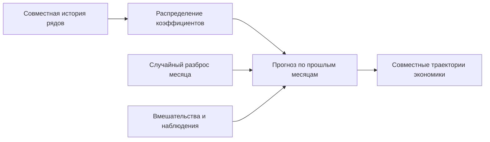

# Байесовская авторегрессия `bvar.sv`

Модель `bvar.sv` строит совместное распределение месячных показателей экономики по их прошлым значениям. Байесовская векторная авторегрессия, сокращённо BVAR, сохраняет неопределённость коэффициентов; меняющаяся во времени дисперсия ошибок и распределение Стьюдента добавляют месяцы с крупными движениями. Модель служит одним из вариантов уровня 0, а не обязательной частью MacroStress: сравнение с другими макромоделями проводится на одинаковых исторических датах.

Процентная ставка — годовая плата за использование денег; спред — разность доходностей двух инструментов. Глобальный блок содержит мировые показатели, российский — внутренние. *Блочная экзогенность* означает запрет влияния российских лагов и ошибок на глобальные показатели. Запрет — исходное предположение модели, а не вывод из корреляций.



Рисунок 1. Механизм BVAR. Текстовый эквивалент: оценка по истории даёт распределение коэффициентов, из которого строятся будущие месяцы со случайными ошибками; сценарий меняет значения или ограничивает исходы. Схема показывает зависимости, а не результат числового расчёта.

## Что оценивается и что хранится

Модель читает месячную панель реестра [макропеременных](<../../macro/registry.toml>). Ставки и спреды сохраняют исходные единицы, а цены, курсы, индексы и объёмы преобразуются в сто логарифмов уровня. Поэтому разность логарифмических значений примерно равна процентному изменению.

Переменные из `differences` в [спецификации](<spec.toml>) оцениваются на месячных изменениях, остальные — на уровнях. Если $y_t$ — вектор в шкале модели, а $S$ — диагональная матрица с единицами у переменных в изменениях, оценка работает с $w_t=y_t-Sy_{t-1}$. При коэффициентах $G_1,\dots,G_p$ уравнения для $w_t$ сохраняемый эквивалент на уровнях имеет $p+1$ лагов:

$$
A_1=S+G_1,\qquad A_k=G_k-G_{k-1}S\ (k=2,\dots,p),\qquad A_{p+1}=-G_pS.
$$

Здесь $p$ — число прошлых месяцев оценки, а $A_k$ — коэффициенты сохранённой авторегрессии. Прогноз и идентификация читают одну форму уровней независимо от способа оценки. Постоянная уравнения изменения задаёт месячный дрейф, то есть среднее изменение за месяц.

Фиктивные переменные, или дамми, обозначают известные разрывы истории: импульс действует один месяц, ступенька — с заданного месяца постоянно. Для уравнения изменения берётся изменение дамми: ступенька превращается в импульс, а импульс — в пару противоположных импульсов. Если у ряда нет наблюдения в активные месяцы дамми, её коэффициент не оценивается. Искусственные наблюдения `mu` и `delta`, выражающие ограничения на уровни, несовместимы с `differences`.

## Сценарий, шоки и границы

Наблюдение сообщает о результате, например о диапазоне будущего курса; вмешательство задаёт величину извне, например решение о ставке. Операции различаются по [общей формализации](<../../../../docs/concept/formalization.md>). Условный прогноз наблюдений использует общую линейно-гауссову механику, описанную в [SDK моделей](<../../model_sdk/README.md>), с выбором будущей волатильности по вероятности наблюдений.

Экономические имена случайных возмущений задают знаковые ограничения в [таблице шоков](<signs.toml>): именованный шок должен сдвигать перечисленные величины в заданные стороны. Необязательное поле `shares` задаёт нижнюю долю объяснённой дисперсии и отсекает почти нулевой отклик величины, по которой назван шок. Имена нужны диагностике; сценарий обращается к наблюдаемым величинам, а не к внутренним шокам модели.

Для величин с нижней границей модель строит неограниченную *теневую траекторию*, а платформа преобразует выход по правилу $x_t=\max(s_t,\mathrm{lower})$, где $s_t$ — тень. Лаги и наблюдения работают с тенью, поэтому точное наблюдение на границе означает узкий интервал тени около границы. Оценка исторических значений как теневых остаётся приближением. Границы задаёт реестр; отсутствие отрицательных ставок не следует из линейного уравнения.

## Подключение и устройство

Оценка версии запускается явным выбором модели; пути хранилища и дату подставляет пользователь:

```powershell
python -m mst.models estimate-macro bvar.sv --as-of DATE --store STORE --models MODELS
```

| Часть | Ответственность |
|---|---|
| [Объявление плагина](<plugin.py>) и [адаптер](<model.py>) | Регистрация `bvar.sv`, оценка, загрузка и интерфейс прогноза |
| [Оценка](<estimate.py>), [волатильность](<sv.py>), [алгебра VAR](<var.py>) | Построение выборки параметров, пропуски, разности и искусственные наблюдения |
| [Идентификация](<identify.py>) | Фильтр спектрального радиуса и поиск поворотов с заданными знаками |
| [Прогноз](<forecast.py>) | Кандидаты волатильности, условные пути, закон наблюдений и диагностика |
| [Спецификация](<spec.toml>) и [таблица шоков](<signs.toml>) | Настройки, сохраняемые вместе с версией |

Математический механизм и требования к реализации раскрывает [справочник модели](<REFERENCE.md>), а способы оценки качества — [руководство по метрикам](<../../metrics/README.md>). Набор [тестов BVAR](<../../../../tests/bvar/>) проверяет вычислительные свойства, но сам по себе не подтверждает качество прогноза на новых данных.
