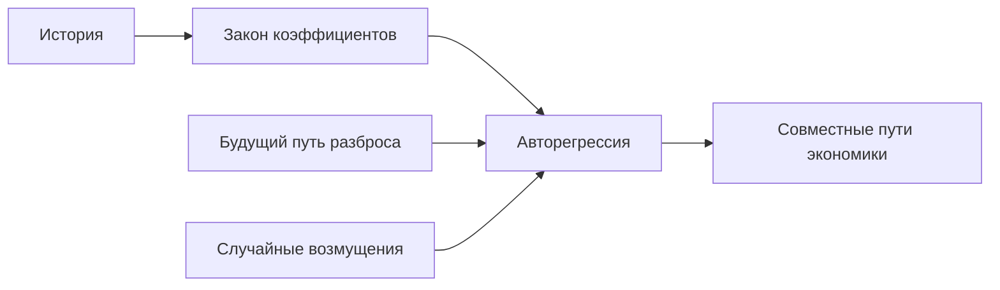

# Байесовская авторегрессия с меняющейся волатильностью: математический справочник

Модель `bvar.sv` задаёт совместное распределение месячных показателей экономики по их прошлым значениям. Здесь определены уравнения, оценка неизвестных коэффициентов, работа сценария и проверяемые требования к реализации. Байесовская оценка означает, что прогноз усредняется по распределению коэффициентов, а не строится только по одной точечной оценке.

Нормой для сценария служит [общая формализация](<../../../../docs/concept/formalization.md>); конкретные настройки оценки записаны в [спецификации](<spec.toml>), единицы величин — в [реестре макропеременных](<../../macro/registry.toml>). Исторические варианты, оставленные для сравнения, отделены от действующих настроек. Программные ограничения не меняют математических требований: нерешённые вопросы перечислены в конце.

Процентная ставка — годовая плата за использование денег; доходность облигации — ставка, согласующая её цену с будущими платежами; спред — разность доходностей. Векторная авторегрессия (VAR) объясняет несколько рядов их совместными лагами, то есть прошлыми значениями. *Стохастическая волатильность* означает случайно меняющийся разброс ошибок; тяжёлые хвосты допускают больше крупных ошибок, чем нормальный закон того же масштаба.

Рисунок 1. Механизм базового прогноза BVAR. Текстовый эквивалент: история задаёт закон коэффициентов, а каждый будущий путь соединяет выбранные коэффициенты, путь разброса и возмущения. Сценарий меняет механизм или отбирает исходы по правилам дальнейших разделов. Рисунок не содержит чисел оценённой версии.

## 1. Назначение

Система отвечает на вопрос, как распределены целевые показатели объекта (потери портфеля), если произошло заданное событие. Величины разбиты на уровни: уровень 0 — макропеременные экономики, уровни выше — драйверы отраслей, компаний и выпусков, последний уровень — целевые показатели. *Макромодель* — модель уровня 0: она задаёт закон траектории макропеременных на горизонте при информации, доступной на дату расчёта.

`bvar.sv` — одна из макромоделей платформы, плагин `mst.plugins.bvar`. Это байесовская векторная авторегрессия (BVAR) со стохастической волатильностью, стьюдентовскими хвостами, блочной экзогенностью глобального блока и шоками, названными по знаковым ограничениям. Модель отвечает на два вопроса:

- *безусловный прогноз*: как распределены пути макропеременных на $H$ месяцев вперёд без сценария (базовая мера $P$ общей схемы);
- *условный прогноз*: как распределены эти пути, если на них наложены наблюдения сценария и исполнены его вмешательства (наложение $P_s$ общей схемы).

Кроме путей модель возвращает закон ограничиваемых величин при заданных остальных координатах; по нему платформа считает цену сценария $\mathrm{dist}(s)=\mathrm{KL}(P_s\Vert P')$.

Выход потребляют: сателлитные модели уровней выше (читают пути макропеременных как регрессоры), модели позиций (читают макропеременные напрямую, например кривую ОФЗ), отчёт расчёта (цена, допуск, диагностика) и проверки качества `mst.metrics` (скользящая проверка на сетке дат и эпизодный бэктест).

## 2. Данные

### 2.1. Время

Время измеряется в месяцах, $t$ — номер месяца. Месяц $t=0$ — последний месяц, по которому на дату расчёта известно значение хотя бы одной переменной; месяцы $t\le 0$ — история, месяцы $t=1,\dots,H$ — горизонт длины $H$. Горизонт не длиннее 360 месяцев. Квартальные значения, если нужны отчёту, агрегируются вне модели.

### 2.2. Переменные

Реестр `src/mst/macro/registry.toml` содержит $n=23$ макропеременные. Через $X_{i,t}$ обозначено значение переменной $i$ в месяц $t$ в исходных единицах, через $y_{i,t}=g_i(X_{i,t})$ — значение в *шкале модели*. Преобразование $g_i$ — либо тождественное (`identity`, для ставок, доходностей, спредов и безработицы), либо $g_i(X)=100\ln X$ (`log100`, для цен, курсов, индексов и объёмов): разность двух значений в этой шкале приближённо равна изменению в процентах. Вектор $y_t=(y_{1,t},\dots,y_{n,t})^\top$ упорядочен так, что глобальный блок (`gl.`) идёт первым.

| Идентификатор | Переменная | Единица | $g_i$ | Сезонность | Нижняя граница $\underline x_i$ |
|---|---|---|---|---|---|
| `gl.brent` | нефть Brent | долл. за баррель | $100\ln X$ | — | — |
| `gl.fed_rate` | ставка ФРС | % | $X$ | — | 0 |
| `gl.ust_10y` | доходность UST 10 лет | % | $X$ | — | 0 |
| `gl.vix` | индекс VIX | пункты | $100\ln X$ | — | — |
| `ru.key_rate` | ключевая ставка | % | $X$ | — | 0 |
| `ru.ruonia` | RUONIA | % | $X$ | — | 0 |
| `ru.ofz_1y` | доходность ОФЗ 1 год, G-кривая | % | $X$ | — | 0 |
| `ru.ofz_5y` | доходность ОФЗ 5 лет | % | $X$ | — | 0 |
| `ru.ofz_10y` | доходность ОФЗ 10 лет | % | $X$ | — | 0 |
| `ru.spread_aa` | спред группы AA к G-кривой | п. п. | $X$ | — | нет (`negative = true`) |
| `ru.spread_a` | спред группы A к G-кривой | п. п. | $X$ | — | нет (`negative = true`) |
| `ru.spread_bbb` | спред группы BBB к G-кривой | п. п. | $X$ | — | 0 |
| `ru.usdrub` | официальный курс доллара | руб. за долл. | $100\ln X$ | — | — |
| `ru.cnyrub` | официальный курс юаня | руб. за юань | $100\ln X$ | — | — |
| `ru.cpi` | индекс потребительских цен | индекс | $100\ln X$ | да | — |
| `ru.output` | выпуск базовых видов деятельности | индекс | $100\ln X$ | да | — |
| `ru.unemployment` | безработица | % | $X$ | да | 0 |
| `ru.real_wage` | реальная зарплата | индекс | $100\ln X$ | да | — |
| `ru.retail` | оборот розничной торговли | индекс | $100\ln X$ | да | — |
| `ru.credit` | кредит организациям и населению | млн руб. | $100\ln X$ | — | — |
| `ru.mortgage_rate` | средняя ставка ипотеки | % | $X$ | — | 0 |
| `ru.housing_price` | цена жилья | руб. за м² | $100\ln X$ | — | — |
| `ru.imoex` | индекс MOEX | пункты | $100\ln X$ | — | — |

Глобальные переменные влияют на российские, российские на глобальные не влияют: так задано исходное предположение о внешних показателях. Для событий, в которых внутренние события меняют мировой рынок, предположение нуждается в отдельной оценке. ВВП публикуется поквартально, поэтому месячный выпуск представлен индексом базовых видов деятельности.

*Стационарные переменные* — `gl.vix`, `ru.spread_aa`, `ru.spread_a`, `ru.spread_bbb`; остальные 19 считаются нестационарными. Различие задаёт центр сжатия коэффициентов (раздел 4.1).

### 2.3. Сезонность

Ряды Росстата хранятся без сезонной корректировки. У пяти сезонных переменных (`ru.cpi`, `ru.output`, `ru.unemployment`, `ru.real_wage`, `ru.retail`) при сборке панели вычитается постоянный календарный профиль: среднее приращение ряда в каждый календарный месяц, оценённое только на данных, известных к дате расчёта. Профиль постоянен, потому что короткая история не держит меняющуюся сезонность; оценка на дату нужна, чтобы проверка на прошлых датах не видела будущих данных.

### 2.4. Выборка, публикации, пропуски

Оценка начинается с месяца $T_0$ = январь 2012 года: с него начинаются ряды хранилища. Каждое значение ряда хранится с датой публикации, и оценка на дату $d$ видит каждое значение в той версии, которая была опубликована к $d$; так проверка на прошлых датах не пользуется пересмотрами, которых тогда не было. Для макрорядов дата публикации приближённая (`approximate`), история уже пересмотрена.

Месяц, по которому значения нет (квартальная цена жилья, ряд, начавшийся позже $T_0$, рваный край публикаций у $t=0$), остаётся пропуском в панели. Модель не заполняет пропуски до оценки, а разыгрывает их внутри сэмплера (раздел 4.4). Значение `ru.retail` в месяце $t=0$ при пустой панели тоже разыгрывается моделью и у разных макромоделей различается; это не дефект.

### 2.5. Границы

Для ставок, доходностей, безработицы и спреда BBB реестр задаёт нижние границы. Границы выражают принятые ограничения применения, а не универсальное утверждение об экономике: отрицательные ставки возможны в других режимах. Для переменной с границей $\underline x_i$ (поле `lower` реестра) модель симулирует *теневое значение* $s_{i,t}$, а наблюдаемое значение равно

$$
x_{i,t}=\max\big(s_{i,t},\,\underline x_i\big)
$$

в шкале модели. Лаги, наблюдения, вмешательства и цена работают с тенью: это гауссовский закон, который знает вся условная механика, а последующий рост ставки начинается с тени, а не с границы. Спреды AA и A границы не имеют: их история опускалась ниже нуля. Оценка читает историю как наблюдаемые значения; это приближение, полная оценка теневой ставки в задачу не входит.

## 3. Модель

### 3.1. Уравнение

Обозначим через $p$ число лагов, через $\kappa\in\mathbb R^n$ вектор констант, через $A_1,\dots,A_p$ матрицы коэффициентов размера $n\times n$, через $d_t\in\mathbb R^{q}$ вектор детерминированных регрессоров-дамми (раздел 3.4), через $\Gamma$ матрицу их коэффициентов размера $n\times q$, через $u_t$ вектор ошибок. Тогда

$$
y_t=\kappa+\sum_{\ell=1}^{p}A_\ell y_{t-\ell}+\Gamma d_t+u_t.
$$

Блочная экзогенность: разобьём $y_t=(y_t^{g},y_t^{r})$ на глобальный и российский блоки. Для всех $\ell$ блок $A_\ell^{gr}$ (влияние российских лагов на глобальные уравнения) равен нулю.

### Оценка в изменениях и сохранение в уровнях

Для переменных списка `differences` оценивается $w_t=y_t-Sy_{t-1}$, где $S$ диагональна с единицами у выбранных переменных. Остальные компоненты остаются уровнями. Если у $w_t$ коэффициенты $G_1,\dots,G_p$, то эквивалентная авторегрессия уровней имеет коэффициенты

$$
A_1=S+G_1,\qquad A_k=G_k-G_{k-1}S\ (k=2,\dots,p),\qquad A_{p+1}=-G_pS.
$$

Число лагов оценки $p$ и число лагов сохранённой формы различаются на один. В форме изменений постоянная — месячный дрейф; дамми читаются после взятия разности. Искусственные наблюдения `mu` и `delta`, заданные для уровней, с формой изменений не совмещаются.

### 3.2. Ошибки, волатильность, хвосты

Ошибки записаны через единичную нижнетреугольную матрицу $C$ (единицы на диагонали, порядок переменных из раздела 2.2):

$$
u_t=C\,e_t,\qquad e_{j,t}=e^{h_{j,t}/2}\sqrt{\omega_{j,t}}\,z_{j,t},\quad j=1,\dots,n.
$$

Здесь $z_{j,t}\sim\mathcal N(0,1)$. Логарифм дисперсии $h_{j,t}$ — случайное блуждание

$$
h_{j,t}=h_{j,t-1}+s_j\xi_{j,t},\qquad \xi_{j,t}\sim\mathcal N(0,1),
$$

где $s_j>0$ — скорость изменения волатильности: в кризис ряды двигаются сильнее, и постоянная дисперсия занизила бы хвост. Множитель $\omega_{j,t}\sim\mathrm{IG}(\nu_j/2,\nu_j/2)$ (обратное гамма-распределение) делает $e_{j,t}$ при данном $h_{j,t}$ стьюдентовским с $\nu_j$ степенями свободы, чтобы модель допускала редкие большие движения вроде декабря 2014 года. Величины $z$, $\xi$, $\omega$ независимы между собой и по времени. Треугольная запись нужна для поуравненной оценки (раздел 4.3).

Необязательная форма `jumps` заменяет стьюдентовский множитель выбранных ставок скачком: $\omega_{j,t}=\kappa_j$ с вероятностью $\pi_j$ и $\omega_{j,t}=1$ иначе (Chib, Nardari, Shephard, 2002). Исходные предположения: $\pi_j\sim\mathrm{Beta}(1,19)$, $\kappa_j$ — обратное гамма-распределение с формой 2 и средним 25, усечённое выше единицы. В действующей спецификации список `jumps` пуст: вариант сохраняется для сравнения, но по умолчанию не используется. Скачковая форма предназначена для ставки, которая меняется преимущественно на заседаниях. Волатильность в форме случайного блуждания при узком исходном предположении о $s_j$ не успевает за скачком, а при свободном падает до нуля между решениями и взрывает годовые пути (12.11.2026: СКО ключевой ставки за 12 месяцев 35 п. п. против 4,25 в истории). Импульсные фиктивные переменные 2014 и 2022 годов не входят в уравнения ставок (`spares`): по этим месяцам оцениваются скачки.

Блочная экзогенность распространяется на ошибки: элементы $C$, через которые российская компонента $e^r_t$ входила бы в глобальные ошибки $u^g_t$, равны нулю; при глобальном блоке первым и нижнетреугольной $C$ это выполнено по построению.

### 3.3. Структурные шоки

*Структурные шоки* $\varepsilon_t\in\mathbb R^n$ месяца $t$ получаются из $e_t$ ортогональным поворотом $Q$ ($Q^\top Q=I$):

$$
u_t=B_t\,\varepsilon_t,\qquad B_t=C\,\mathrm{diag}\big(e^{h_{t}/2}\sqrt{\omega_{t}}\big)\,Q,\qquad \varepsilon_t\sim\mathcal N(0,I),
$$

где корень и экспонента берутся поэлементно. $B_t$ — *матрица удара*: столбец $j$ показывает, как шок $j$ сдвигает каждую переменную в месяц своего появления. $Q$ блочно-диагональна, $Q=\mathrm{diag}(Q^{g},Q^{r})$, поэтому российский шок не сдвигает глобальную переменную. Для идентификации (раздел 5) используется матрица удара последнего месяца истории $B_0=C\mathrm{diag}(e^{h_0/2})Q$.

### 3.4. Дамми режимов

Вектор $d_t$ содержит импульсы в месяцы 2014-11 (переход к плавающему курсу), 2022-02 и 2022-03 и ступеньку с 2021-01 (сшивка спредов: международная шкала рейтингов до 2020-12, национальная с 2021-01). Импульс снимает с оценки одиночный выброс, который иначе завысил бы волатильность и исказил коэффициенты. Дамми, чей месяц позже даты расчёта, из оценки исключаются: модель на прошлую дату не может знать будущий режим. На горизонте прогноза импульсы равны нулю, ступенька равна единице, если её месяц не позже даты расчёта.

### 3.5. Параметры и представление

Параметры $\theta=(\kappa,A_{1:p},\Gamma,C,s_{1:n},\nu_{1:n},Q)$ вместе с историческими путями $h_{j,t}$, $t\le 0$, — розыгрыш апостериорной выборки. В терминах общей схемы исходы уровня 0 — $\omega^0=(\theta,h_{1:H},\omega_{1:H},\varepsilon_{1:H})$, где индекс $1:H$ обозначает горизонт; путь $x^0=G^0(\omega^0)$ получается рекурсией раздела 3.1 от истории, затем применяется граница раздела 2.5.

### 3.6. Матрица-компаньон

Для набора лагов $A_{1:p}$ *матрица-компаньон* —

$$
F=\begin{pmatrix}A_1&A_2&\cdots&A_{p-1}&A_p\\ I_n&0&\cdots&0&0\\ 0&I_n&\cdots&0&0\\ \vdots&&\ddots&&\vdots\\ 0&0&\cdots&I_n&0\end{pmatrix}\in\mathbb R^{np\times np},
$$

а *радиус* $\rho(A_{1:p})$ — её спектральный радиус, наибольший модуль собственного значения. При $\rho>1$ возможен экспоненциальный рост отклика; реализованная траектория также зависит от начального состояния и ошибок. Порог 1,005 ограничивает скорость роста, но не является строгим условием стационарности $\rho<1$.

## 4. Оценка

### 4.1. Исходное предположение о коэффициентах лагов (Minnesota)

Исходное предположение о коэффициентах тянет модель к простой: нестационарная переменная остаётся на прошлом уровне, стационарная возвращается к среднему (Litterman, 1986; Doan, Litterman, Sims, 1984). Обозначим через $a_{ij,\ell}$ коэффициент при $y_{j,t-\ell}$ в уравнении $i$. Его исходное распределение нормально со средним

$$
\mathbb E\,a_{ij,\ell}=\begin{cases}1,&i=j,\ \ell=1,\ i\ \text{нестационарна},\\0&\text{иначе},\end{cases}
$$

и стандартным отклонением, которое растёт с общей жёсткостью $\lambda$ (`tightness`) и убывает с лагом. Историческая форма использовала $\lambda=0{,}2$; действующая спецификация задаёт 0,1. Значение выбирается на датах настройки, а не на датах окончательной проверки. Скорость убывания по лагу, множитель для чужих лагов и масштабы $\sigma_i$ проект не задаёт (раздел 11). Коэффициенты блока $A_\ell^{gr}$ не оцениваются и равны нулю. Исходное предположение о $\kappa$ и $\Gamma$ проект не задаёт.

### 4.2. Дамми-наблюдения

Аудит 30.10.2026 показал, что предположение Minnesota при регрессорах в уровнях весит очень мало: доля $P_0/(X^\top X+P_0)$ на диагонали лагового блока на порядки меньше номинальной. Требования к оценке добавляет два набора дамми-наблюдений, которые действуют на уровни и тянут систему к единичным корням и от взрывных (Sims, Zha, 1998; Giannone, Lenza, Primiceri, 2015). Обозначим через $\bar y_0$ среднее первых $p$ наблюдений выборки.

*Дамми суммы коэффициентов* с параметром $\mu$ (`mu`): по одной строке на переменную $i$,

$$
y^{+}_{i}=\frac{\bar y_{0,i}}{\mu}e_i^\top,\qquad x^{+}_{i}=\Big(0,\ \underbrace{\tfrac{\bar y_{0,i}}{\mu}e_i^\top,\ \dots,\ \tfrac{\bar y_{0,i}}{\mu}e_i^\top}_{p\ \text{раз}},\ 0\Big),
$$

где $e_i$ — $i$-й единичный вектор, первый ноль стоит при константе, последний — при дамми $d_t$. Они выражают, что если все лаги переменной $i$ равны $\bar y_{0,i}$, её прогноз тоже равен $\bar y_{0,i}$.

*Дамми начального наблюдения* с параметром $\delta$ (`delta`): одна строка

$$
y^{++}=\frac{\bar y_0^\top}{\delta},\qquad x^{++}=\Big(\frac1\delta,\ \underbrace{\tfrac{\bar y_0^\top}{\delta},\ \dots,\ \tfrac{\bar y_0^\top}{\delta}}_{p\ \text{раз}},\ 0\Big).
$$

В записи Giannone, Lenza, Primiceri меньшие $\mu$ и $\delta$ означают более сильное притяжение. Кандидаты для сравнения — $\mu=\delta\in\lbrace 1;5\rbrace$ при каждом $\lambda$ из $\lbrace 0{,}05;0{,}1;0{,}2\rbrace$, а также действующее предположение без дамми как точка отсчёта. Дамми-регрессия должна совпадать с аналитическим апостериорным законом.

Кандидат выбирается только на настраивающей половине сетки дат скользящей проверки, по относительному CRPS безусловного прогноза против случайного блуждания; победитель затем проверяется на проверочной половине (проверка качества). Других способов настройки, кроме этой сетки, нет: иначе выбор подгонялся бы под проверочные данные.

### 4.3. Сэмплер

Апостериорная выборка строится MCMC по треугольному алгоритму Carriero, Clark, Marcellino (2019) в исправленном виде Carriero, Chan, Clark, Marcellino (2022): при данных волатильностях и $\omega$ уравнение $i$ в треугольной записи оценивается отдельно, с регрессорами из лагов и из текущих ошибок предыдущих уравнений, и стоимость шага растёт как $n^4$, а не $n^6$. Блоки одной итерации:

1. коэффициенты $(\kappa,A_{1:p},\Gamma)$ поуравненно, с исходным предположением раздела 4.1 и дамми раздела 4.2, при нулевом блоке $A^{gr}$;
2. внедиагональные элементы $C$;
3. пути $h_{j,t}$ при $t\le 0$ по смеси нормальных Kim, Shephard, Chib (1998);
4. скорости $s_j^2$;
5. множители $\omega_{j,t}$ и степени свободы $\nu_j$;
6. пропуски панели (раздел 4.6).

Число сохраняемых розыгрышей `sampler.draws` поднято планом ремонта до 4000, прореживание `thin` сохранено; его значение, длина разгона и начальные значения проектом не заданы. Оценка детерминирована сидом, записанным в спецификации.

### 4.4. Стохастическая волатильность

Исходное предположение о $s_j^2$ — обратное гамма-распределение со средним 0,03 и 60 степенями свободы. Оно намеренно узкое: при 5 степенях свободы медиана $s_j$ для `gl.fed_rate` доходила до 4,0 в месяц, и пути разлетались за три месяца. Исходное предположение о начальном значении $h_{j}$ проект не задаёт.

### 4.5. Хвосты

Степени свободы $\nu_j$ разыгрываются на сетке целых чисел от $\nu_{\min}$ (`dof_min`) до 50 с равномерным исходным распределением. Устаревшее описание метода начинает сетку с 3; требования к оценке начинает её с `dof_min`, в спецификации равного 5, а 3 оставляет кандидатом для сравнения. Причина: дисперсия бесконечна при $\nu=2$, эксцесс — при $\nu=4$, и для ставок, которые стоят и потом скачут, нижняя граница сетки поглощала то, что должна нести волатильность (медианный розыгрыш сидел на 3 у пяти переменных). Изменение сохраняется, только если проверка качества выполнены против победителя раздела 4.2.

### 4.6. Пропуски

Пропущенные значения панели разыгрываются на каждой итерации из их условного нормального распределения при текущих параметрах и наблюдённых значениях; так оценка использует все месяцы, а неопределённость пропуска входит в апостериорный закон.

### 4.7. Фильтр устойчивости

После сэмплирования и до поиска поворотов сохраняются только розыгрыши с

$$
\rho(A_{1:p})\le\rho_{\max},\qquad \rho_{\max}=1{,}005.
$$

Единичный корень допустим и ожидаем, потому что большинство переменных нестационарно; рост без ограничения недопустим. Это апостериорный закон, суженный на устойчивую область, тем же механизмом, что фильтр идентификации. Число розыгрышей после фильтра записывается в диагностику как `stable`, рядом с `estimated` (после сэмплера) и `identified` (после идентификации). Если устойчивых розыгрышей нет, оценка завершается ошибкой, которая называет модель и $\rho_{\max}$. Если их меньше 200, $\rho_{\max}$ не поднимается: это повод остановиться и сообщить.

## 5. Идентификация именованных шоков

Данные определяют ковариацию ошибок, но не матрицу удара: любой ортогональный $Q$ даёт ту же ковариацию. Часть шоков получает экономический смысл через знаковые ограничения (Uhlig, 2005; Rubio-Ramírez, Waggoner, Zha, 2010): шок обязан сдвигать указанные переменные в указанную сторону в месяц появления и в следующие месяцы до лага `sign_lag` = 2 включительно, то есть на горизонтах отклика 0, 1 и 2. Таблица — гипотеза: она хранится в версии модели (`signs.toml`) и проверяется вместе с ней на эпизодах.

| Шок | Блок | Растут | Падают |
|---|---|---|---|
| `ru.monetary` (денежно-кредитный) | российский | `ru.key_rate`, `ru.ruonia`, `ru.ofz_1y` | `ru.usdrub`, `ru.imoex`, `ru.cpi` |
| `ru.inflation` (инфляционный) | российский | `ru.cpi`, `ru.key_rate` | `ru.real_wage` |
| `ru.fx_risk` (курс и риск-премия) | российский | `ru.usdrub`, `ru.ofz_10y`, `ru.spread_bbb` | `ru.imoex` |
| `gl.oil` (нефтяной) | глобальный | `gl.brent` | `ru.usdrub` |
| `gl.financial` (глобальный финансовый) | глобальный | `gl.vix` | `gl.ust_10y`, `ru.imoex` |

`ru.cpi` в столбце «падают» у `ru.monetary` добавлен планом ремонта: в прежней версии после снижения ставки инфляция месяцами падала относительно базы, то есть шок не вёл себя как денежно-кредитный. Остальные $n-5$ шоков безымянные: `gl.unnamed_k` в глобальном блоке, `ru.unnamed_k` в российском.

Процедура для каждого устойчивого розыгрыша: разыграть блоки $Q^g$ и $Q^r$ из равномерного (хааровского) распределения на ортогональных матрицах, построить отклики $\Psi_h B_0$ на горизонтах $h=0,\dots,$ `sign_lag`, где $\Psi_h$ — коэффициенты представления скользящего среднего по $A_{1:p}$, и проверить знаки. Повторять до 20 000 поворотов на розыгрыш; розыгрыш без допустимого поворота отбрасывается. Первый допустимый поворот — равномерный выбор из допустимого множества. Доля сохранённых розыгрышей видна в описании версии. Если выживание падает ниже 20 %, ограничения не добавляются: выбор ограничений — решение владельца.

## 6. Прогноз

### 6.1. Безусловный прогноз

Для каждого из $R$ повторений $r$: взять розыгрыш $\theta^{(r)}$ с историей волатильностей; разыграть $h_{j,1:H}$ по блужданию от $h_{j,0}$, $\omega_{j,1:H}$ и $\varepsilon_{1:H}\sim\mathcal N(0,I)$; вычислить путь рекурсией раздела 3.1 от последних $p$ месяцев истории (пропуски у края — разыгранные значения); применить границу раздела 2.5; вернуть пути в исходных единицах через $g_i^{-1}$. Результат — функция сида: тот же сид даёт те же числа побитно.

### 6.2. Ограничения сценария

Путь горизонта в шкале модели собран в вектор $\mathbf y=(y_1^\top,\dots,y_H^\top)^\top$ длины $nH$. Ограничение $c$ — тройка $(w_c,a_c,b_c)$ и требование $a_c\le w_c^\top\mathbf y\le b_c$; оно покрывает значение переменной, её изменение, среднее за квартал и разность двух переменных. Точное значение $v$ расширяется до отрезка $[v-\tau,v+\tau]$ с *допуском* $\tau>0$, потому что непрерывный закон попадает в точку с вероятностью ноль. Все ограничения: $\mathbf a\le W\mathbf y\le\mathbf b$, строки $W$ — $w_c^\top$. Ограничения стоят на тени: точное условие на границе («ФРС на нуле») значит тень в пределах $\tau$ от границы.

Вмешательство — решение субъекта вне моделей: `set` ставит величину $k$ в месяцы $T$ равной заданному значению, `shift` сдвигает её. Модель исполняет вмешательства сама, в рекурсивной структурной форме VAR: установка заменяет значение уравнения в своём месяце, и приведённый шок этой переменной в этот месяц не разыгрывается; сдвиг прибавляется к уравнению. Следующие месяцы читают установленное значение через лаги, поэтому оно не возвращается к базовому пути. Прочие переменные того же месяца сохраняют свои приведённые ошибки: внутри уровня 0 вмешательство действует через лаги, а не одновременно. Платформа вмешательства повторно не применяет, а отчёт расчёта называет исполненную форму.

### 6.3. Наблюдения и закон при условии

При данных $\theta$, истории и будущих $h$, $\omega$ путь линеен по шокам:

$$
\mathbf y=\mu_\theta+\Phi\boldsymbol\varepsilon,\qquad \boldsymbol\varepsilon=(\varepsilon_1^\top,\dots,\varepsilon_H^\top)^\top\sim\mathcal N(0,I_{nH}),
$$

где $\mu_\theta$ — путь при нулевых шоках, а $\Phi$ — накопленные отклики с матрицами удара $B_t$. После подстановки вмешательств слагаемые установленных клеток уходят из $W\mathbf y$ в правую часть: столбцы установленных переменных в строке обнуляются, а их вклад становится константой; сдвиг прибавляет к правой части известное число. Пусть $\mu^\psi$ — путь при нулевых свободных шоках с исполненными вмешательствами, $\Phi^\psi$ — отклики на свободные шоки, а установленные шоки не разыгрываются. Наблюдения:

$$
\mathbf a-W\mu^\psi\ \le\ W\Phi^\psi\boldsymbol\varepsilon_{\text{free}}\ \le\ \mathbf b-W\mu^\psi,
$$

и свободные шоки разыгрываются из $\mathcal N(0,I)$, усечённого на этот отрезок, семплером Гиббса для усечённого нормального закона (Geweke, 1991) с 50 проходами; подход — Antolín-Díaz, Petrella, Rubio-Ramírez (2021). Матрица $\Phi^\psi$ целиком не строится, считаются только строки $W\Phi^\psi$ с учётом установленных клеток.

Строка, целиком определённая установленными значениями, из системы уходит; если значение вне её границ, сценарий противоречит модели (`ContradictsModels`). Сценарий отклоняется и тогда, когда строка линейно зависима от уже учтённых с точностью $10^{-9}$ от того, насколько её двигают все шоки: такие наблюдения не добавляют новой информации, и сценарий назвает их номерами (`InfeasibleScenario`).

### 6.4. Скрытая координата: путь волатильности

Будущий путь волатильности $h_{1:H}$ — *скрытая координата* модели (`volatility_path`); сценарий её не называет. Её нельзя разыграть до наблюдений: на значение $R$ разыгрывается `LATENT_CANDIDATES` = 64 кандидата, каждый получает вес, пропорциональный вероятности ящика $P(S\mid\theta,h)$, и кандидат выбирается по весу; без наблюдений путь разыгрывается из базового закона. Логарифм вероятности ящика даёт GHK-сэмплер `log_box_probability`. Эффективный размер весов уходит в диагностику. Так при каждом $R$ закон пути равен базовому закону, обусловленному событием, как требует следствие общей схемы.

### 6.5. Закон условий и цена

Положим $P'=P\otimes\mu_I$ — закон исходов модели и вмешательств до учёта наблюдений, а $R=(\theta,\psi)$ — параметры и реализованные вмешательства, закон которых сценарий сохраняет. По следствию общей схемы при одном наблюдении на носитель

$$
\frac{dP_s}{dP'}=\frac{\mathbf 1_S}{P'(S\mid R)},\qquad \mathrm{dist}(s)=\mathbb E_{P'}\big[-\log P'(S\mid R)\big].
$$

Метод `constraint_law` возвращает закон $W\mathbf y$ при заданном $R$ **после вмешательств**: по каждому значению $R$ гауссовский закон строк (средние и ковариации), кандидатов скрытой координаты и их логарифмические веса. Платформа сводит его в $P(S\mid R)$ и цену, считает одностороннюю цену и стандартную ошибку. Наклон под наблюдения на средние и вероятности делает платформа (`mst.scenario.overlay`), модель его не знает. Распределение $\theta$ под $P_s$ не меняется.

### 6.6. Диагностика прогноза

Размер шока, который нужен наблюдениям, в стандартных отклонениях по месяцам горизонта записывается в `diagnostics` симуляции и попадает в `meta.json` расчёта: снижение ставки на 5 п. п. одним шоком требует большого шока, и это число должно быть видно.

## 7. Параметры

| Символ | Ключ | Смысл | Значение | Источник значения |
|---|---|---|---|---|
| $n$ | — | число переменных | 23 | реестр переменных |
| $T_0$ | — | первый месяц выборки | 2012-01 | устаревшее описание метода; README `mst.metrics` |
| $p$ | — | число лагов | 3 | устаревшее описание метода |
| $\lambda$ | `tightness` | общая жёсткость Minnesota | кандидаты 0,05; 0,1; 0,2 (прежнее 0,2) | требования к оценке; устаревшее описание метода |
| — | — | убывание по лагу, множитель чужих лагов, $\sigma_i$ | не задано проектом | — |
| $\mu$ | `mu` | вес дамми суммы коэффициентов | кандидаты 1; 5, $\mu=\delta$ | требования к оценке |
| $\delta$ | `delta` | вес дамми начального наблюдения | кандидаты 1; 5 | требования к оценке |
| — | — | стационарные переменные | `gl.vix`, три спреда | устаревшее описание метода |
| $d_t$ | — | дамми режимов | импульсы 2014-11, 2022-02, 2022-03; ступенька 2021-01 | устаревшее описание метода |
| $\mathbb E s_j^2$, df | — | исходное распределение $s_j^2$ | IG, среднее 0,03, 60 степеней свободы | устаревшее описание метода |
| $\nu_{\min}$ | `dof_min` | нижняя граница сетки $\nu_j$ | 5 (кандидат 3) | требования к оценке |
| $\nu_{\max}$ | — | верхняя граница сетки $\nu_j$ | 50 | устаревшее описание метода |
| — | `sampler.draws` | сохраняемые розыгрыши | 4000 | требования к оценке |
| — | `thin`, разгон | прореживание, разгон | не задано проектом | — |
| $\rho_{\max}$ | `rho_max` | порог радиуса | 1,005 | требования к оценке |
| — | — | минимум выживших розыгрышей до остановки | 200 | требования к оценке |
| — | `sign_lag` | последний горизонт знаковых ограничений | 2 | требования к оценке |
| — | — | поворотов на розыгрыш | 20 000 | устаревшее описание метода |
| — | — | минимум выживания идентификации | 20 % | требования к оценке |
| $\underline x_i$ | `lower` | нижняя граница | 0 для 10 переменных (раздел 2.2) | реестр переменных |
| $\tau$ | — | допуск точного значения | не задано проектом | — |
| — | — | проходов Гиббса | 50 | устаревшее описание метода |
| — | `LATENT_CANDIDATES` | кандидатов скрытой координаты на $R$ | 64 | устаревшее описание метода |
| — | — | порог зависимости ограничения | $10^{-9}$ | устаревшее описание метода |
| $H$ | — | наибольший горизонт | 360 | устаревшее описание метода |

## 8. Входы и выходы

Плагин объявляет одну макромодель: `plugin = Plugin(...)` с `macro=(MODEL,)`, id модели `bvar.sv`, id начинается с `bvar.`. Ядро знает модель только через реестр `mst.plugins`. Модель реализует абстрактный `MacroModel` из `mst.model_sdk` и опирается только на разрешённые модули (`mst.model_sdk`, `mst.contracts`, `mst.macro.panel`, `mst.macro.registry` и свой пакет).

| Шаг | Вход | Выход |
|---|---|---|
| `estimate(контекст)` | хранилище рядов, реестр, дата расчёта, спецификация | метаданные и массивы версии: розыгрыши $\theta$ после фильтров, исторические $h$, имена шоков, таблица знаков, спецификация, реестр, панель, диагностика `estimated`, `stable`, `identified`; обязательные ключи (даты, переменные, шоки, панель) проверяет платформа |
| `load(мета, массивы)` | версия, оценённая этим плагином (`meta["model"]` = `bvar.sv`) | модель версии |
| `simulate(модель, план, draws, seed)` | `ScenarioPlan`: горизонт, наблюдения, реализованные вмешательства (по строке на группу путей), `inner` | `MacroSimulation`: пути `(R, H+1, n)` в шкале модели с исполненными вмешательствами, группы $R$, диагностика кандидатов и размера шока |
| `constraint_law(...)` | модель, план | `ConstraintLaw`: гауссовский закон $W\mathbf y$ по группам $R$ с кандидатами скрытой координаты и весами |

Атрибут `latents` объявляет скрытую координату `volatility_path`; сценарий её не называет, наблюдения перевзвешивают её кандидатов. Версия неизменяема и адресуется хешем `sha256` метаданных и массивов; изменённая спецификация даёт новый хеш, старые версии не перезаписываются.

Платформа, а не модель, переводит пути в исходные единицы, применяет наклон, считает цену, допуск и отчёт; вмешательства уровня 0 исполняет модель своей структурной формой. Позиции получают `Paths.macro(name)` формы `(R, H+1)` в исходных единицах; месяц 0 — последний месяц истории.

## 9. Допущения и пределы применимости

- Обратной связи нет: портфель и драйверы не влияют на макропеременные.
- Россия не влияет на глобальный блок ни через лаги, ни через ошибки.
- Коэффициенты постоянны во времени; разрывы режима учтены только дамми 2014-11, 2022-02, 2022-03 и ступенькой 2021-01. Новый режим после даты расчёта модель не предвидит.
- Знаки — гипотеза об экономике, а не следствие данных. Безымянные шоки экономического смысла не несут.
- Граница по нулю применяется только к выходу; оценка видит историю как наблюдаемую.
- Сезонный профиль постоянен; пути сезонных переменных — в очищенной шкале.
- Даты публикаций макрорядов приближённые, история пересмотрена; проверки на прошлых датах поэтому оптимистичны.
- Фильтр $\rho_{\max}$ сужает апостериорный закон; модель с ним не описывает взрывную динамику, даже если та была в данных.
- Цена точного условия зависит от $\tau$; цены сравнимы только при равных допусках.
- Под условием ES95 может упасть: условие сужает закон. Это не дефект модели.

## 10. Проверки, которые должен пройти код

1. Модель читает ровно 23 переменные реестра в порядке «глобальный блок, затем российский», с преобразованиями `identity` и `log100` из раздела 2.2.
2. Сезонный профиль вычитается у пяти переменных с `seasonal = true` и только у них; профиль оценён по данным, известным к дате расчёта.
3. Оценка на дату $d$ не читает значений, опубликованных после $d$, и не использует месяцы раньше 2012-01.
4. Пропуски панели не заполняются до оценки и разыгрываются внутри сэмплера; на панели без пропусков этот шаг не меняет данных.
5. Число лагов $p=3$; стационарными (с нулевым центром собственного первого лага) считаются ровно `gl.vix`, `ru.spread_aa`, `ru.spread_a`, `ru.spread_bbb`.
6. В каждом сохранённом розыгрыше коэффициенты российских лагов в глобальных уравнениях равны нулю точно, а не приближённо.
7. В каждом розыгрыше $C$ — единичная нижнетреугольная, и блок «российская компонента в глобальной ошибке» равен нулю.
8. Дамми режимов: импульсы 2014-11, 2022-02, 2022-03 и ступенька 2021-01; дамми с месяцем позже даты расчёта в оценку не входят.
9. Дамми суммы коэффициентов и начального наблюдения строятся по формулам раздела 4.2 из среднего первых $p$ наблюдений; на данных с известным апостериорным законом регрессия с дамми совпадает с аналитической формулой.
10. Кандидат без дамми-наблюдений (точка отсчёта настройки) остаётся доступен в спецификации, и его оценка совпадает с оценкой только по предположению Minnesota.
11. Исходное распределение $s_j^2$ — обратное гамма со средним 0,03 и 60 степенями свободы.
12. Сетка $\nu_j$ — целые числа от `dof_min` до 50; `draw_dof` не возвращает значения ниже `dof_min`; при `dof_min` = 5 ни один розыгрыш не имеет $\nu_j<5$.
13. На смоделированных данных с известными степенями свободы сэмплер их восстанавливает.
14. Число сохраняемых розыгрышей по умолчанию 4000.
15. Оценка с тем же сидом и данными даёт побитно ту же версию.
16. Радиус каждого сохранённого розыгрыша не больше `rho_max` = 1,005; радиус считается как спектральный радиус матрицы-компаньона раздела 3.6, на матрицах с известными корнями функция `companion_radius` даёт известный ответ.
17. Фильтр устойчивости применяется до поиска поворотов; вставленный в смоделированную выборку взрывной розыгрыш удаляется, и только он.
18. Ноль устойчивых розыгрышей вызывает ошибку, которая называет модель и `rho_max`.
19. Диагностика версии содержит `estimated`, `stable`, `identified`, и $\text{estimated}\ge\text{stable}\ge\text{identified}$.
20. Именованные шоки — ровно `ru.monetary`, `ru.inflation`, `ru.fx_risk`, `gl.oil`, `gl.financial` со знаками таблицы раздела 5, включая `ru.cpi` в «падают» у `ru.monetary`; безымянные названы `gl.unnamed_k` и `ru.unnamed_k`.
21. У каждого сохранённого розыгрыша все знаки выполнены на горизонтах отклика 0, 1, 2 по матрице $B_0=C\mathrm{diag}(e^{h_0/2})Q$.
22. $Q$ ортогональна и блочно-диагональна: отклик любой глобальной переменной на российский шок равен нулю на всех горизонтах.
23. Повороты разыгрываются из хааровского распределения; на розыгрыш даётся не больше 20 000 попыток, розыгрыш без допустимого поворота отбрасывается.
24. Безусловная симуляция с тем же сидом даёт побитно те же пути; пути имеют форму `(R, H+1, n)`, месяц 0 равен последнему месяцу истории.
25. Будущие $h_{j,t}$ разыгрываются блужданием от последнего исторического значения с той же $s_j$; $\omega_{j,t}\sim\mathrm{IG}(\nu_j/2,\nu_j/2)$.
26. На выходе нет значения ниже `lower` у переменных с границей; у переменных без `lower` пути совпадают с путями без этого шага.
27. Тень продолжается ниже границы, и следующий рост начинается с тени: лаги рекурсии берут $s_t$, а не $\max(s_t,\underline x)$.
28. Условие на переменную с границей выполняется на тени; условие «на нуле» выполняется для тени в пределах $\tau$ от нуля.
29. При прогнозе под наблюдениями каждый путь выполняет все ограничения $\mathbf a\le W\mathbf y\le\mathbf b$ (на тени, с учётом исполненных вмешательств).
30. Свободные шоки при наблюдениях имеют базовый закон $\mathcal N(0,I)$, усечённый на границы; установленные клетки шоков не разыгрываются.
31. Установка ставит значение на каждом пути своей группы в свой месяц, сдвиг прибавляется; следующие месяцы читают установленное значение через лаги, а прочие переменные того же месяца своих ошибок не теряют.
32. Строка наблюдения, целиком определённая установленными значениями, уходит из системы; её значение вне границ — `ContradictsModels`. Сценарий с линейно зависимой строкой (порог $10^{-9}$) отклоняется с `InfeasibleScenario` и номерами ограничений.
33. При наблюдениях путь волатильности выбирается из 64 кандидатов с весами по $P(S\mid\theta,h)$; без наблюдений он разыгрывается из базового закона.
34. `latents` объявляет `volatility_path`.
35. `constraint_law` возвращает гауссовский закон строк $W\mathbf y$ после вмешательств, сгруппированный по $R$, совпадающий со средним и ковариацией путей `simulate` при тех же $R$ (проверяется на выборке).
36. `diagnostics` симуляции содержат размер шока, который нужен наблюдениям, по месяцам в стандартных отклонениях.
37. Плагин объявляет одну макромодель с id `bvar.sv`; версия читается обратно только моделью, чьё имя записано в `meta["model"]`.
38. Плагин импортирует только разрешённые модули платформы.
39. Распределение $\theta$ при наблюдениях совпадает с безусловным: при каждом $R$ используются те же розыгрыши параметров, что без наблюдений.

## Открытые математические соглашения

1. **Структурная форма вмешательства.** Рекурсивное описание в разделе о прогнозе требует, чтобы установленный уровень попадал в будущие лаги. Форма по умолчанию заменяет только готовую клетку. Эти формы имеют одинаковый базовый закон, но разные последствия решения; применённая форма должна быть явно записана в версии и отчёте.
2. **Граница и наблюдение.** Вероятность события на наблюдаемом выходе $\max(s,\mathrm{lower})$ отличается от вероятности узкого интервала тени около границы. Текущее соглашение использует тень; для содержательного наблюдения «ставка на границе» такое соглашение требует отдельного обоснования.
3. **Неопределённость ковариации.** Конечная выборка будущих путей волатильности приближает смесь. Эффективный размер весов и ошибка вероятности нужны, даже когда все полученные пути выполняют наблюдения.
4. **Порог радиуса.** Значение 1,005 допускает слабый рост; на длинном горизонте проверка диапазонов необходима дополнительно к фильтру радиуса.
5. **Проверка качества.** Требования к тестам задают свойства алгоритма. Они не подтверждают числовое качество отдельной версии без скользящей проверки на датах, которые не использовались для настройки.
