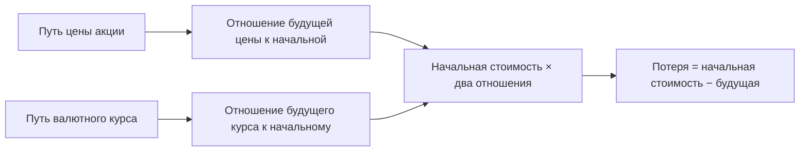

# Стоимость акции по пути её цены

Модель `equity.paths.v1` переоценивает позицию в обыкновенной акции по относительному изменению её цены и валютного курса. Путь цены уже построен сателлитной моделью при сценарии; модель позиции не прогнозирует цену повторно и не добавляет случайность. Две позиции в одной акции поэтому используют одни и те же будущие движения.

Описание формулы сверено с [реализацией модели](<model.py>). Направление расчёта и значение сценария задаёт [общая формализация](<../../../../docs/concept/formalization.md>); контракт результата описан в [SDK моделей позиций](<../../plugin_sdk/README.md>). Формула — правило оценки, а не утверждение о полноте экономического риска акции.

Рисунок 1. Переоценка акции. Текстовый эквивалент: модель умножает начальную стоимость на относительное изменение цены и курса, затем берёт разность с начальной стоимостью. Схема не задаёт ни будущего роста, ни вероятности потери.

## Входы и обозначения

Позиция типа `common_stock` задаёт `notional` — текущую стоимость $N$ в миллионах валюты позиции, `currency` — код валюты $c$ и `codes` — коды бумаги. По кодам, например биржевому `secid` или международному `isin`, платформа ищет драйвер `share_price`. Драйвер — пара из величины и объекта, в данном случае цена конкретной акции. Собственных условий `terms` модель не требует; посторонние поля отклоняются контрактом.

Обозначим через $r=1,\dots,R$ номер случайной траектории, через $t=0,\dots,H$ — месяц, через $H$ — горизонт. Месяц 0 соответствует последнему месяцу истории модели. Драйвер даёт $S_{r,t}>0$, цену акции в рублях; макромодель даёт $X_{r,t}>0$, рублей за единицу валюты $c$. Для рублёвой позиции $X_{r,t}=1$. Пути передаются в исходных единицах массивами размера $(R,H+1)$.

Начальную стоимость позиции в рублях обозначим через $V_0=NX_0$, где $X_0$ — курс, использованный платформой для начальной оценки. В будущем применяется отношение курсов $X_{r,t}/X_{r,0}$, а не повторное умножение уже рублёвой стоимости на полный курс.

## Формула переоценки

Стоимость в рублях на каждом пути равна

$$
V_{r,t}=V_0\frac{S_{r,t}}{S_{r,0}}\frac{X_{r,t}}{X_{r,0}},\qquad
\delta_r=V_{r,H}-V_0,\qquad L_r=-\delta_r.
$$

Здесь $\delta_r$ — изменение стоимости, а $L_r$ — потеря: положительное $L_r$ означает убыток, отрицательное — прибыль. Для рублёвой позиции формула сводится к $\delta_r=N(S_{r,H}/S_{r,0}-1)$. Удвоение начальной цены при том же относительном движении не меняет результат, поскольку количество акций уже отражено в стоимости позиции.

Модель использует последний месяц переданных путей. Для оценки к промежуточному месяцу платформа обрезает пути; отдельной формулы внутри модели нет. Если хотя бы одна цена неположительна, расчёт отклоняется. Отсутствующий обслуживаемый драйвер или необходимый курс оставляет позицию без расчёта; причина должна сохраняться в покрытии отчёта.

## Результат и чтение риска

Результат `CalculationResult` содержит `value_change` из $R$ изменений $\delta_r$. Метрики `equity.value_current`, `equity.pnl`, `equity.loss`, `equity.return` дают начальную стоимость, изменение стоимости, потерю и относительную доходность. Для распределений выводятся 5-й, 50-й и 95-й процентили, сокращённо P5, P50 и P95. Для потерь выводится ES95 — средняя потеря в худших 5 % исходов.

Пометки о происхождении параметров драйвера, приближённых данных и выходе за обучающий диапазон добавляет платформа. Успешное вычисление формулы не снимает такие ограничения и не подтверждает хвост распределения.

## Допущения и проверки

Дивиденды, корпоративные действия, комиссии, ликвидность и отдельное событие дефолта не моделируются. Изменение риска эмитента может войти только через путь цены. Цена конкретной компании зависит от качества сателлита: линейная переоценка позиции не исправляет ошибочный прогноз драйвера.

Проверяемые свойства формулы:

1. На постоянных ценах и курсах $\delta_r=0$.
2. При росте цены на 10 % и постоянном курсе стоимость $N=100$ даёт изменение $+10$ в тех же денежных единицах.
3. Рост цены на 10 % и курса на 20 % даёт множитель $1{,}1\cdot1{,}2=1{,}32$, а не сумму процентов.
4. На одинаковых путях и при одинаковой начальной стоимости результат повторяется без новой случайности; порядок позиций не влияет на переоценку.
5. Расчёт на обрезанных путях совпадает с формулой соответствующего промежуточного месяца.
6. Неположительная цена и неразрешённый обязательный вход дают диагностируемый отказ, а не бесконечность или молчаливый ноль.

Для позиции с нерублёвой валютой и драйвером, уже выраженным в рублях, нужно отдельно обосновать валютную конвенцию: дополнительное движение курса может учесть валютный эффект дважды. Формула реализации названа явно, но экономическое соответствие валюты позиции и валюты котировки остаётся обязанностью составителя портфеля.
