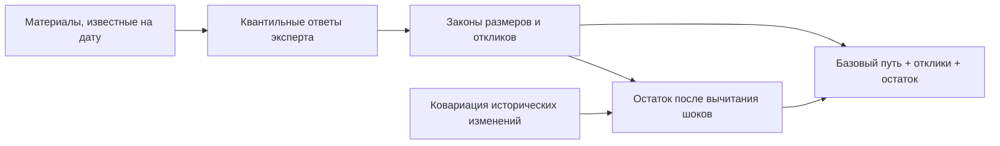

# Макромодель по опросу эксперта

Экспертные макромодели строят распределение показателей экономики из количественных суждений о случайных событиях и реакции экономики на события. Плагин предоставляет `expert.elicited.rw` с историческим базовым движением и `expert.elicited.market` с рыночными ожиданиями. В обоих случаях форма закона фиксирована заранее: эксперт заполняет квантили, то есть значения, ниже которых лежит заданная доля исходов, а не выбирает уравнение по своему усмотрению.

Экспертом служит агент на основе языковой модели (LLM). Он получает материалы и записывает ответы через протокол доступа к инструментам Model Context Protocol, сокращённо MCP. Подход использует идеи структурированного экспертного опроса SHELF и классической модели Кука, но существование опроса не доказывает калибровку эксперта. Согласованность ответов проверяется отдельно от точности будущего прогноза.

Рисунок 1. Построение закона из экспертных ответов. Текстовый эквивалент: эксперт оценивает частоты, размеры и отклики событий; плагин достраивает совместный закон, а исторический разброс ограничивает допустимый остаток. Схема не изображает ответы или прогноз конкретной версии.

## Место в системе и границы вывода

Макромодель задаёт показатели экономики в целом: процентные ставки, цены, курс валют и выпуск продукции. Сателлитные модели затем переводят пути экономики в показатели отраслей и компаний. [Общая формализация](<../../../../docs/concept/formalization.md>) отделяет базовый закон модели от сценария: ответы описывают обычное будущее на дату, а не конкретное событие стресс-теста.

Текст задаёт нормативную форму модели; отклонение реализации должно быть названо, а не скрыто правкой определения. Выбор экспертного закона вместо исторической авторегрессии заменяет ошибку оценивания по короткой истории ошибкой суждений и достраивания зависимостей. Ни один вариант не принимается только по названию метода.

## Модель

Обозначим через $x_t\in\mathbb R^n$ вектор $n=23$ макропеременных реестра `src/mst/macro/registry.toml` в месяц $t$ в шкале модели, через $t=0$ — последний месяц истории, через $t=1,\dots,H$ — месяцы горизонта, $H\le 12$. Модель:

$$
x_t=b_t+\sum_{j=1}^{J}\sum_{\tau=1}^{t}r_j(t-\tau,\varepsilon_{j\tau})+u_t,
$$

где

- $b_t$ — базовый путь (раздел «Базовый путь»);
- $\varepsilon_{j\tau}$ — размер шока $j$ в месяц $\tau$, ноль, если в этот месяц шока $j$ нет;
- $r_j(k,\varepsilon)\in\mathbb R^n$ — отклик всех переменных через $k$ месяцев после шока $j$ размера $\varepsilon$, $r_j(k,0)=0$;
- $u_t$ — остаток, движение переменных, не объяснённое шоками (раздел «Остаток»).

Отклики разных шоков складываются, а отклик на один шок зависит от размера нелинейно: $r_j$ задаётся ответами эксперта при нескольких размерах, а не умножением одного отклика на $\varepsilon$.

Исход уровня 0 в смысле общей схемы

$$
\omega^0=(\theta,\varepsilon,u),
$$

где $\theta$ — ответы эксперта и оценки по истории, $\varepsilon=(\varepsilon_{j\tau})$ — шоки горизонта, $u=(u_1,\dots,u_H)$ — остатки. Эксперт отвечает один раз, поэтому $\theta$ при данной версии модели постоянно. Сценарий шоков не называет: вмешательство задаёт величину и её значение, а наблюдения выполняются всеми шоками и остатком горизонта — в форме по умолчанию модель решает их против путей, в которые установленные значения уже подставлены.

## Шоки

Набор шоков фиксирован и одинаков для всех дат расчёта; $J=18$.

| Шок | Смысл |
|---|---|
| `gl.oil` | Цена нефти от предложения: ОПЕК+, перебои добычи |
| `gl.oil_demand` | Цена нефти от мирового спроса: рецессия, Китай |
| `gl.gas` | Цены на газ и экспорт газа |
| `gl.metals` | Цены металлов и удобрений |
| `gl.grain` | Мировые цены на зерно и продовольствие |
| `gl.financial` | Бегство от риска, расширение спредов |
| `gl.us_rates` | Ставка ФРС и доходности США |
| `gl.dollar` | Курс доллара к мировым валютам, в том числе к юаню |
| `ru.monetary` | Решение ЦБ сверх правила |
| `ru.inflation` | Инфляция со стороны предложения: урожай, тарифы |
| `ru.inflation_expect` | Сдвиг инфляционных ожиданий без изменения издержек |
| `ru.fx_risk` | Отток капитала, спрос на валюту |
| `ru.sanctions_trade` | Ограничения экспорта и импорта, потолок цен |
| `ru.sanctions_finance` | Ограничения платежей, блокировка активов, отключение банков |
| `ru.fiscal` | Расходы и налоги бюджета сверх плана |
| `ru.credit` | Кредитный импульс: льготные программы, макропруденциальные лимиты |
| `ru.labor` | Дефицит труда, мобилизация, миграция |
| `ru.capital_controls` | Валютный контроль и обязательная продажа выручки |

Шоки `gl.oil`, `gl.financial`, `ru.monetary`, `ru.inflation` и `ru.fx_risk` носят те же имена, что в остальных макромоделях: имена нужны диагностике и отчёту о вкладах, а сценарий на них не ссылается.

## Опрос эксперта

На каждую дату расчёта агент заполняет $J=18$ полных наборов ответов, по одному на шок. Инструмент выдаёт набор частями, поэтому полный набор не является одним сообщением. Ответ на вопрос о шоке $j$ содержит:

- частоту $\lambda_j$ — сколько раз в год шок случается;
- квантили 5, 50 и 95 % размера шока со знаком при условии, что шок случился. У шока, который бывает в обе стороны, как решение ЦБ сверх правила, квантиль 5 % лежит ниже нуля, а 95 % — выше, поэтому отдельные частоты «вверх» и «вниз» не нужны;
- отклики всех 23 переменных через 1, 3, 6 и 12 месяцев после шока при трёх размерах, равных квантилям 5, 50 и 95 % закона размера; каждый отклик задан квантилями 5, 50 и 95 %;
- корреляцию $\rho_j\in[0,1]$: насколько согласованно отклики разных переменных на одно срабатывание шока оказываются сильнее или слабее своих медиан.

Месяц шока считается первым: отклик «через 1 месяц» — изменение переменной в сам месяц шока, $k=0$ в обозначениях раздела «Модель».

Размеры шока задаются в одном полном наборе ответов, чтобы сравнение масштабов оставалось согласованным. Части набора должны учитывать ранее заданные размеры. В вопросе сказано, что пропорциональность откликов размеру не требуется, и агент должен объяснить, где отклик от неё отходит. Если отношения откликов при всех переменных и горизонтах равны отношениям размеров, ответ считается линейным, и вопрос переформулируется.

Сервер выдаёт вопрос и материалы корпуса модели через инструменты MCP, агент записывает ответ, а сервер проверяет его форму и сохраняет в хранилище ответов рабочего каталога. Человек ответы не утверждает, потому что в 18 ответах около 15 тыс. чисел и вручную их не проверить. Ответы проверяют форма ответа, экономический аудит и условие на остаток из раздела «Остаток». Модель оценивается, когда на дату записаны все 18 ответов; ответы и их хеш входят в версию модели $m$ и переиспользуются всеми сценариями этой даты.

## Как идёт опрос

Опрос разбит на части: сначала закон шока, затем одна переменная и один горизонт — три объекта квантилей. Части сохраняются в промежуточном хранилище шагов, полный ответ публикуется в хранилище ответов рабочего каталога только после последней части. Билет вопроса адресует модель, дату, шок и шаг; агент возвращает билет без изменения, чтобы ответ попал в нужную часть. Повтор одного и того же ответа безопасен, а другой ответ на уже сохранённую часть отклоняется; билет чужой модели или даты — тоже.

Опрос ведёт оркестратор, а не один агент: на каждый шок — свой субагент. Оркестратор читает `interview(action="progress")`, выдаёт шок через `claim`, следит за `needs_review` и запускает оценку только после `accepted` по всем ключам. Владение хранится сервером и истекает через 45 минут без продления. Если субагент остановился — ошибка сети, таймаут, падение клиента, — оркестратор перезапускает того же агента через `restart`: сохранённые части остаются, владение продлевается, а `next` возвращает первую недостающую часть, так что заново ничего не спрашивается и ключ не переходит второму имени. Каждый вопрос, ответ, публикация, замечание, принятие и переоткрытие попадают в журнал опроса — с агентом, шагом, хешем и числом замечаний, но без чисел ответа.

Проверки бывают жёсткие и экономические. Жёсткие — это схема части, порядок квантилей, полная проверка модели и нулевой отклик при нулевом размере: нарушение отклоняет ответ, и шаг спрашивается снова. Экономические только предупреждают: `audit` возвращает находки (`same_cell`, `flat_medians`, `zero_width`, `large_first`, `copied_reference`, `same_shock`, `rule`), публикация проходит, шок получает состояние `needs_review`. Оркестратор либо принимает ответ с причиной (`accept`), либо переоткрывает названные шаги (`reopen`): прежний ответ сохраняется отдельной версией, а шок возвращается в `in_progress`, пока не собран заново.

Правила экономического аудита лежат в `audit.toml`, и у каждого правила есть пояснение; это предупреждения, а не приговор. Руководства для агентов — `model-inputs` (как отвечать) и `elicitation-orchestration` (как вести опрос); они принадлежат плагину, и сервер отдаёт их любому клиенту через `guide`.

## Как ответы становятся законом

Ответ эксперта задаёт три квантиля каждой величины, а модели нужен закон всего пути, так что часть закона достраивает плагин.

В каждый месяц горизонта шок $j$ случается с вероятностью $1-e^{-\lambda_j/12}$, не больше одного раза, независимо от других месяцев и шоков. Одно срабатывание в месяц нужно, чтобы у события месяца был один размер шока. Пуассоновский поток с той же частотой дал бы два срабатывания в месяц с вероятностью около 1 % при $\lambda_j=2$, так что ограничение почти ничего не отнимает у частых шоков и ничего — у редких.

Размер шока и каждый отклик заданы квантилями $q_5$, $q_{50}$, $q_{95}$, и о том, что лежит за 5 и 95 %, ответ ничего не говорит. Поэтому хвосты задаёт одно допущение на всю модель — показатель хвоста $\alpha$ из спецификации плагина, по умолчанию 4. Он больше 2, чтобы у откликов была дисперсия: без неё не считается $\Sigma_{\text{шоки}}$ в разделе «Остаток». Семейство выбирается в спецификации и записывается в версию; бэктест сравнивает версии с разными семействами:

- `pareto`: функция квантилей линейна по вероятности между 5, 50 и 95 %, а за ними идут хвосты Парето с показателем $\alpha$. При $p<0{,}05$ квантиль равен $q_5-s_-\bigl((0{,}05/p)^{1/\alpha}-1\bigr)$, при $p>0{,}95$ — $q_{95}+s_+\bigl((0{,}05/(1-p))^{1/\alpha}-1\bigr)$, где $s_-=\alpha(q_{50}-q_5)/9$ и $s_+=\alpha(q_{95}-q_{50})/9$ выбраны так, чтобы плотность на 5 и 95 % не прыгала. Ответ воспроизводится точно, но плотность ступенчатая;
- `skew_t`: скошенное $t$-распределение Аззалини с $\nu=\alpha$ степенями свободы, у которого положение, масштаб и асимметрия подбираются по трём квантилям наименьшими квадратами. Распределение гладкое, но через квантили проходит приближённо; если подгонка промахивается больше чем на 1 % ширины $q_{95}-q_5$, отчёт оценки называет величину.

Ответ с $q_5=q_{50}=q_{95}$ задаёт число без неопределённости, например нулевой отклик.

Каждый квантиль отклика интерполируется линейно между $k=0,2,5,11$, то есть между ответами через 1, 3, 6 и 12 месяцев. Линейная интерполяция сохраняет порядок $q_5\le q_{50}\le q_{95}$, а сплайн может его нарушить между узлами.

При данном уровне квантиля отклик как функция размера шока — ломаная через точку $(0,0)$ и три спрошенных размера; за крайними точками он постоянен. За квантилями 5 и 95 % размера эксперт ничего не сказал, и отклик за ними не продолжается: шок крупнее спрошенного получает отклик на крупнейший спрошенный размер, а остальную часть наблюдения берут на себя другие координаты. У одностороннего шока, все три размера которого одного знака, крайней точкой с другой стороны служит $(0,0)$, и размер противоположного знака из хвоста закона не даёт отклика.

Эксперт даёт закон каждого отклика по отдельности, а как связаны их отклонения от медиан, ответ не говорит, поэтому связь задаёт модель. При каждом срабатывании шока $j$ разыгрывается уровень $v_i\in(0,1)$ для каждой переменной $i$ по $t$-связке с $\nu=\alpha$ степенями свободы и одинаковой корреляцией $\rho_j$ между всеми парами переменных. Уровень означает силу отклика: в ячейке (горизонт, размер) с неотрицательной медианой берётся квантиль $v_i$, с отрицательной — квантиль $1-v_i$, так что высокий $v_i$ отодвигает от нуля весь отклик переменной, в каком бы направлении он ни шёл. Уровень общий для всех горизонтов и размеров одной переменной, поэтому отклик остаётся одной кривой. Срабатывания и шоки независимы.

$t$-связка — стандартная замена гауссовой связки (McNeil, Frey, Embrechts, «Quantitative Risk Management»). Гауссова связка, которой обычно соединяют частные распределения экспертов (Clemen, Reilly, 1999), не имеет зависимости в хвостах: совместные крайние отклики в ней становятся независимыми и выходят реже, чем подсказывает корреляция, а для стресс-теста эта ошибка опасна. У $t$-связки зависимость в хвостах есть. При $\rho_j=1$ все переменные берут один уровень, и сильная трансмиссия шока сильна по всем каналам сразу; при $\rho_j=0$ уровни некоррелированы, но совместные крайние отклики всё равно чаще, чем при независимости. Число степеней свободы равно $\alpha$, чтобы тяжесть хвоста задавал один параметр модели.

## Корпус модели

У модели свой корпус, то есть собрание источников, отдельное от корпуса сценариев, с собственными перечнем документов и поисковым индексом; инструмент `corpus` выбирает его параметром `corpus="model"`. Агент видит только материалы, опубликованные до даты расчёта. Корпус делится на части:

1. Исторические эпизоды шоков с фактическими откликами рядов: калибровочный материал для частот и откликов.
2. Состояние на дату: последние значения 23 рядов, решения и прогнозы ЦБ, параметры бюджета.
3. Обзоры о трансмиссии: материалы ЦБ и МВФ о том, как ставка, курс и сырьё влияют на экономику.
4. Рыночные ожидания: фьючерсы, форварды, кривая ОФЗ, консенсус аналитиков из опроса ЦБ — вид источника `market` в манифесте.

## Базовый путь

Варианты модели различаются только $b_t$:

- `expert.elicited.market` берёт рыночные ожидания на дату расчёта там, где они есть (нефть — фьючерсы, курс — форварды или паритет ставок, ставка ЦБ — кривая ОФЗ и ROISfix, инфляция и ВВП — консенсус), а для остальных переменных — случайное блуждание с дрейфом;
- `expert.elicited.rw` берёт случайное блуждание с дрейфом для всех переменных.

Случайное блуждание с дрейфом: $b_t=x_0+t(\hat\mu-\mu_{\text{шоки}})$, где $\hat\mu$ — средний месячный прирост переменной по истории до даты расчёта, как у эталона `random_walk` в `mst.metrics.baselines`, а $\mu_{\text{шоки}}$ — средний месячный прирост, который создают шоки по ответам эксперта, из того же моделирования, что и $\Sigma_{\text{шоки}}$. Без вычитания среднее движение шоков входит в закон дважды — один раз из истории через $\hat\mu$, второй из ответов, — как и ковариация входила бы дважды без вычитания в разделе «Остаток». При $\lambda_j=0$ для всех шоков $\mu_{\text{шоки}}=0$, и модель совпадает с эталоном `random_walk`.

Рыночные ожидания записывает тот же агент тем же опросом, потому что фьючерсов, форвардов, кривой ОФЗ и консенсуса в хранилище рядов нет. Для каждой переменной, у которой ожидания есть, ответ содержит ожидаемое значение через 1, 3, 6 и 12 месяцев в шкале модели и фрагмент корпуса модели, из которого взято число; между горизонтами значения интерполируются линейно. Ответ без фрагмента сервер не принимает: число рынка, которого нет в корпусе, — суждение эксперта, а суждения входят в модель только через шоки.

Рыночные ожидания уже учитывают вероятность шоков: фьючерс на нефть примерно равен среднему с учётом возможного падения. Поэтому в варианте `market` базовый путь получается вычитанием ожидаемого вклада шоков:

$$
b_t=\mathbb E[x_t]_{\text{рынок}}-\mathbb E\sum_{j}\sum_{\tau\le t}r_j(t-\tau,\varepsilon_{j\tau}),
$$

где второе среднее берётся по закону шоков из ответов эксперта.

## Остаток

$u_t$ — то, что двигает переменные в месяц, когда ни один из 18 шоков не произошёл. Его ковариация оценивается по истории до даты расчёта:

$$
\operatorname{Cov}(u_t-u_{t-1})=\hat\Sigma_{\Delta x}-\Sigma_{\text{шоки}},
$$

где $\hat\Sigma_{\Delta x}$ — выборочная ковариация месячных приростов 23 переменных, а $\Sigma_{\text{шоки}}$ — ковариация месячных приростов, которую создают шоки по ответам эксперта; она считается моделированием потока шоков по законам раздела «Как ответы становятся законом». Остаток нормален: $u_t-u_{t-1}\sim N(0,\hat\Sigma_{\Delta x}-\Sigma_{\text{шоки}})$ независимо по месяцам. Если разность не положительно полуопределена, заданная экспертами ковариация несовместима с принятым историческим ограничением; такая версия не допускается, и отчёт называет переменные, где разность отрицательна.

Формула следует из разложения дисперсии: полную ковариацию приростов мы знаем из истории, долю шоков — из ответов эксперта, а фон получаем как разность. Нормальность фона — исходное предположение: разложение ковариации само по себе не доказывает форму распределения. Предположение относит крупные редкие движения к шокам и оставляет фону сумму мелких влияний. При $\lambda_j=0$ для всех шоков модель совпадает с эталоном `random_walk`, поэтому всё, чем она от эталона отличается, внёс эксперт. Условие положительной полуопределённости проверяет ответы без человека.

Два других варианта отвергнуты. Бутстрэп исторических приростов, очищенных от шоков, требует знать, когда и какого размера случались в истории все 18 шоков, а этих данных нет. Использование полной ковариации $\hat\Sigma_{\Delta x}$ без вычитания считает движение от шоков дважды, в истории и в ответах, и веер выходит шире эталона даже при верных ответах.

## Наложение сценария

Наложение — общий случай, описанный в [общей схеме](../../../../docs/concept/formalization.md). При наблюдениях $R=(\theta,\psi)$ сохраняет базовый закон, а прочие координаты — все шоки горизонта и остаток $u$ — разыгрываются из $P(\varepsilon,u\mid R,S)$. Вмешательства приходят реализованными: установленные значения подставляются в ограничения, а на пути ставятся после розыгрыша.

Закон функции наблюдений при данном $R$ — смесь гауссовых строк: строка — кандидат вклада шоков (детерминированная нелинейная функция их стандартных нормальных входов), а ковариация строки — блуждание остатка. `constraint_law` возвращает эти строки с их весами, и платформа считает цену смеси; моделирование выбирает кандидата по вероятности, которую его закон даёт ящику наблюдений, и разыгрывает остаток из усечённого нормального (Антолин-Диас, Петрелла, Рубио-Рамирес, 2021). Вероятность ящика при кандидате даёт GHK-сэмплер `log_box_probabilities` из `mst.model_sdk.conditional`, а цена сценария — среднее $-\log P(S\mid R)$ по значениям $R$.

## Проверка

Метрики качества описаны в [общей схеме](../../../../docs/concept/formalization.md). Сравнения идут на одних и тех же ячейках:

- `expert.elicited.rw` против эталона `random_walk` показывает, что дают шоки и отклики эксперта;
- `expert.elicited.market` против `expert.elicited.rw` показывает, что дают рыночные ожидания;
- обе модели против остальных макромоделей.

Агент знает исходы прошлых эпизодов, поэтому бэктест на них справочный, а чистой проверкой требует неизвестных агенту исходов. Дата после окончания обучения — полезное ограничение, но доступ к поздним источникам также должен быть исключён при записи ответов.
