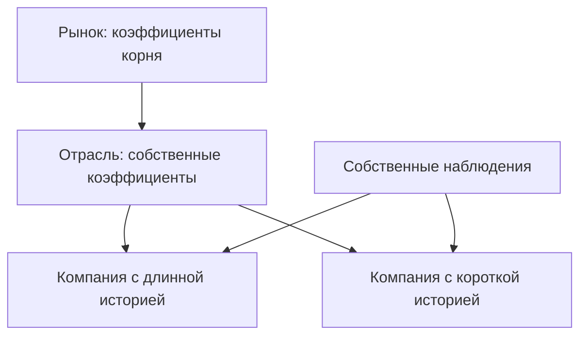

# Иерархическая регрессия драйверов: математический справочник

Модель `hier.gibbs` строит совместные пути показателей частей экономики по макропеременным и собственному прошлому показателей. Она объединяет информацию родственных объектов через дерево коэффициентов: короткая история компании дополняется информацией её отрасли, но коэффициенты компании не обязаны совпадать с отраслевыми.

Драйвер — пара из величины и объекта, например цена акции конкретной компании. Сателлитная модель переводит более общие пути в драйверы, которые затем читает модель позиции. [Общая формализация](<../../../../docs/concept/formalization.md>) задаёт направление уровней и действие сценария; [реестр драйверов](<../../drivers/registry.toml>) задаёт преобразования и входы, а [спецификация модели](<spec.toml>) — форму уравнения и настройки оценки.

Дерево объектов не является цепочкой уровней системы. Рынок, отрасль и компания могут быть узлами одного сателлитного уровня; дерево задаёт сходство коэффициентов. Уровни системы задают направление вычислений: экономика, драйвер, стоимость. Спред — разность доходностей инструментов; доля просрочки — отношение суммы просроченного долга к общей сумме долга.

Рисунок 1. Частичное объединение информации. Текстовый эквивалент: отраслевые коэффициенты тяготеют к рыночным, а коэффициенты компании — к отраслевым; собственная история уточняет коэффициенты каждой компании. Чем короче история, тем больше роль родителя. Схема не задаёт числовую силу объединения.

## 1. Назначение и место в системе

Общая формализация разбивает величины на уровни $l=0,\dots,L$. Уровень 0 — макропеременные, их пути строит макромодель (`bvar.sv` или `msvar.markov`, 23 переменные). Сателлитная модель уровня $l\ge 1$ — тройка $(\Omega^l,P^l,G^l)$ с

$$
x^l=G^l(x^{<l},\omega^l),
$$

то есть выход уровня зависит от уровней ниже и собственных случайных исходов, но не влияет на них (обратной связи нет).

`hier.gibbs` — сателлитная модель первого уровня. Она переводит пути макропеременных в пути драйверов. *Величина* — показатель, измеряемый на объектах (цена акции, спред облигации). *Объект* — эмитент, выпуск, отрасль, регион; у объекта есть класс, родитель и коды. *Драйвер* — величина одного объекта, обозначается `<величина>:<объект>`, его ряд — `drv.<величина>.<объект>`. По умолчанию модель обслуживает все величины реестра драйверов; другая модель получает величину только явным назначением `--model ВЕЛИЧИНА=МОДЕЛЬ`.

Входы — макропеременные, перечисленные в реестре как регрессоры величины:

| Величина | Регрессоры |
|---|---|
| `share_price` | `ru.imoex`, `ru.usdrub`, `ru.key_rate`, `gl.brent` |
| `bond_spread` | `ru.spread_aa`, `ru.spread_a`, `ru.spread_bbb`, `ru.key_rate`, `ru.ofz_5y` |
| `overdue_share` | `ru.key_rate`, `ru.output`, `ru.usdrub`, `ru.imoex`; признак $\max(0,z-15)$, где $z$ — `ru.key_rate` |
| `housing_price_primary`, `housing_price_secondary` | `ru.mortgage_rate`, `ru.key_rate`, `ru.cpi`, `ru.real_wage` |

Выход читают позиционные плагины: `equity` (`share_price`), `bond` (`bond_spread`), `credit` (`overdue_share`), `housing` (`housing_price_*`). Позиция находит драйвер в каталоге сателлитной версии по величине и коду; неразрешённый обязательный драйвер оставляет позицию без расчёта. Модель второго уровня (эталон `reflevel2`) может читать драйверы `hier.gibbs` через `UpperPaths.levels[1]`.

## 2. Данные

**Величины и единицы.** Реестр задаёт для каждой величины единицу и преобразование $g$ в шкалу модели $y=g(X)$, где $X$ — значение в исходных единицах:

| Величина | Единица $X$ | Преобразование | Шкала модели $y$ | `lags` | `span` |
|---|---|---|---|---|---|
| `share_price` | руб. за акцию | `log100` | $100\ln X$ | 1 | 1 |
| `bond_spread` | п. п. | `identity` | $X$ | 1 | 1 |
| `overdue_share` | доля | `logit` | $\ln\frac{X}{1-X}$ | 1 | 1 |
| `housing_price_primary` | руб. за м² | `log100` | $100\ln X$ | 1 | 3 |
| `housing_price_secondary` | руб. за м² | `log100` | $100\ln X$ | 1 | 3 |

`lags` — наибольший лаг $x$ в уравнении. `span` — сколько месяцев покрывает одно хранимое значение: 3 у цен жилья (среднее за квартал), месяцы между значениями разыгрываются. Отсутствующий `span` означает одно значение на месяц.

Преобразование выбрано так, чтобы шкала модели была неограниченной: $100\ln$ держит цену положительной, logit держит долю в $(0,1)$, а спред может быть отрицательным и остаётся без преобразования.

**Уровни и разности.** Действующая спецификация применяет месячные изменения к `share_price`; цены жилья, спреды облигаций и доли просрочки остаются уровнями. Две формы приведены отдельно, поскольку постоянная и собственный лаг имеют в них разный смысл.

**Объекты и дерево.** Объекты и их ряды находят каталоги источников, записанные в реестре. Каждый объект стоит под родителем, родитель несёт ту же величину уровнем выше:

| Величина | Корень | Промежуточные узлы | Листья |
|---|---|---|---|
| `share_price` | «Акции Московской биржи» | 10 отраслевых индексов MOEX (`oil_gas`, `metals`, `financials`, `telecom`, `consumer`, `electric`, `transport`, `chemicals`, `it`, `real_estate`) | акции режимов торгов |
| `bond_spread` | «Корпоративные облигации» | рейтинговые группы `group_aa`, `group_a`, `group_bbb`; эмитент под группой своего первого выпуска | выпуски |
| `overdue_share` | «ВСЕГО» | отрасли таблицы ЦБ 01_02_A, уровень по отступу подписи | — |
| `housing_price_*` | Россия (643) | федеральные округа | субъекты по ОКАТО |

Объект без ряда (драйвер без `series`) не имеет своей истории и берёт параметры уровня выше; путь такого драйвера получает пометку `parameters_from_above`.

**Выборка.** Ряды хранят каждое значение с датой публикации; оценка читает только данные, известные к дате расчёта (`as_of`). Сателлиты оцениваются на панели конкретной макроверсии и хранят её хеш: история $x_t$ берётся из панели этой версии. Историю величины на панели (месяцы, дерево объектов, наблюдения в шкале модели, $x$ из регрессоров и признаков) готовит платформа (`mst.drivers.history`), а не плагин.

**Обучающий диапазон.** Для каждого узла $i$ при оценке записываются границы $[\underline y_i,\overline y_i]$ (`train_low`, `train_high`) — наименьшее и наибольшее наблюдённое значение. Часть версии без них не читается. При оценке в разностях границы записываются по уровням, чтобы пометка выхода за диапазон сохранила смысл.

## 3. Модель

Обозначения. Узел $i$ — объект дерева величины; $\pi(i)$ — его родитель; $t$ — месяц; $y_{i,t}$ — значение драйвера узла $i$ в шкале модели; $x_t\in\mathbb R^{p}$ — вектор регрессоров месяца $t$ (макропеременные в шкале модели и объявленные признаки $\max(0,z_t-a)$ с переменной $z$ и порогом $a$ из реестра). Число регрессоров $p$ задаёт реестр.

**Форма уровней.** Для величины, не включённой в `differences`, уравнение драйвера с `lags = 1`:

$$
y_{i,t}=c_i+\rho_i\,y_{i,t-1}+\beta_{0,i}^\top x_t+\beta_{1,i}^\top x_{t-1}+\sigma_i\varepsilon_{i,t},
$$

где $c_i$ — постоянная, $\rho_i$ — коэффициент собственного лага, $\beta_{0,i},\beta_{1,i}\in\mathbb R^p$ — нагрузки на текущие и лаговые регрессоры, $\sigma_i>0$ — стандартное отклонение остатка, $\varepsilon_{i,t}$ — стандартизованный остаток. Собственный лаг нужен, потому что проверка сравнивает модель с авторегрессией без макро, и модель должна её содержать как частный случай.

Долгосрочная эластичность по регрессорам и уровень притяжения:

$$
\eta_i=\frac{\beta_{0,i}+\beta_{1,i}}{1-\rho_i},\qquad d_i^\ast(x)=\frac{c_i+(\beta_{0,i}+\beta_{1,i})^\top x}{1-\rho_i}.
$$

Общая формализация допускает рекурсию внутри уровня через объявленную структурную форму. Собственное прошлое здесь входит во внутреннее построение траектории; направление зависимости между уровнями от этого не меняется.

**Стационарность.** $\lvert\rho_i\rvert\le\rho_{\max}<1$, где $\rho_{\max}$ — параметр спецификации `rho_max`. Ограничение нужно, чтобы $\eta_i$ и $d^\ast_i$ существовали и пути не взрывались на горизонте.

**Форма изменений, действующая для `share_price`.** Уравнение имеет вид:

$$
\Delta y_{i,t}=c_i+\rho_i\,\Delta y_{i,t-1}+\beta_{0,i}^\top\Delta x_t+\beta_{1,i}^\top\Delta x_{t-1}+\sigma_i\varepsilon_{i,t},
$$

где $\Delta y_{i,t}=y_{i,t}-y_{i,t-1}$, $\Delta x_t=x_t-x_{t-1}$. Здесь $c_i$ — месячный дрейф, $\beta_{0,i}$ — эластичности, и долгосрочного уровня притяжения нет. Мотив: в форме уровней уровни трендовых регрессоров создают ложный уровень $d^\ast_i$ вдали от текущей цены, и медианная доходность акций в базовом сценарии определяется этим притяжением. Вариант Б оценивается тем же сэмплером на разностях. Состав макровходов определяется реестром, а не автоматически расширяется по экономическому объяснению.

**Совместные остатки.** Стандартизованные остатки всех драйверов с историей совместно нормальны в каждом месяце и независимы во времени:

$$
\varepsilon_t=(\varepsilon_{1,t},\dots,\varepsilon_{k,t})^\top\sim\mathcal N(0,\Sigma),\qquad \Sigma_{jj}=1,
$$

где $k$ — число драйверов с историей во всём бандле, $\Sigma$ — корреляционная матрица остатков, оценённая по остаткам при апостериорном среднем параметров (раздел 4) и приведённая к положительно определённой при сборке бандла. $\Sigma$ — параметр бандла, а не отдельной части; модель получает свой срез.

**Иерархия.** Обозначим $\phi_i=(c_i,\rho_i,\beta_{0,i},\beta_{1,i})$ — вектор коэффициентов узла. README плагина: параметры объекта распределены вокруг параметров родителя, параметры класса — вокруг среднего. Естественная запись этого (Lindley, Smith, 1972) для объекта:

$$
\phi_i\mid\phi_{\pi(i)}\sim\mathcal N\big(\phi_{\pi(i)},\ \operatorname{diag}(\tau^2)\big),
$$

где $\tau$ — вектор масштабов отклонения от родителя (параметры спецификации). Объединение (pooling) частичное: узел с короткой историей стягивается к родителю, с длинной — определяется своими данными. Мотив: сотни объектов с короткими рядами нельзя оценить по отдельности, а единая регрессия на всех стёрла бы различия отраслей. Что такое «класс» и «среднее», форма распределения корня и $\sigma_i$ проектом не заданы (раздел 10, вопрос 4).

**Квартальные данные.** При `span = 3` хранимое значение покрывает три месяца, уравнение остаётся месячным, а промежуточные месяцы — ненаблюдаемые и разыгрываются. Как хранимое значение связано с месячными $y_{i,t}$ (среднее в шкале модели или в исходных единицах), проект не задаёт (раздел 10, вопрос 6).

## 4. Оценка

**Исходное предположение о параметрах.** Проект задаёт его через спецификацию: отклонения узла от родителя (README плагина), `rho_max`, разброс постоянной `constant_spread`. Числа в проектных документах не записаны, кроме кандидатов `constant_spread` $\in\lbrace 10,1,0{,}1\rbrace$ для формы изменений, выбираемых по CRPS драйверов на половине настройки эпизодов. Столбцы регрессоров шкалируются перед сэмплером, чтобы один масштаб отклонения имел одинаковый смысл для регрессоров разного порядка. Способ шкалирования проектом не задан.

**Сэмплер Гиббса** (Gelfand, Smith, 1990). Один шаг по очереди разыгрывает из полных условных законов:

1. $\phi_i$ каждого узла при его данных, $\sigma_i$, родителе и детях — нормальный закон линейной регрессии с исходным предположением $\mathcal N(\phi_{\pi(i)},\operatorname{diag}(\tau^2))$, усечённый по $\lvert\rho_i\rvert\le\rho_{\max}$;
2. $\sigma_i^2$ при остатках;
3. параметры верхних узлов при детях;
4. ненаблюдаемые значения $y_{i,t}$ при параметрах (расширение данных, Tanner, Wong, 1987).

Действующая спецификация задаёт 1000 сохраняемых выборок после 500 начальных итераций. Начальные итерации не включаются в прогноз; воспроизводимость задаёт сохранённое начальное значение генератора случайных чисел. Сохраняется выборка апостериорных розыгрышей параметров; остатки для $\Sigma$ считаются при апостериорном среднем.

**Пропуски.** Месяц без наблюдения — ненаблюдаемая величина, а не исключённая строка; она разыгрывается внутри шага 4. В форме изменений пропуск уровня в месяце $t$ даёт пропуски $\Delta y$ в месяцах $t$ и $t+1$, и они разыгрываются тем же механизмом. Начальное значение ряда берётся из стационарного закона узла.

**Проверка вне выборки.** Для каждого узла последние месяцы истории откладываются (holdout), модель оценивается без них и прогнозирует на горизонт `reach`. Её RMSE сравнивается с RMSE авторегрессии AR(1) того же узла без макропеременных на тех же месяцах. Узел обслуживается (`served`), если модель точнее. Если собственное уравнение узла проиграло, на тех же месяцах и против той же авторегрессии проверяются коэффициенты ближайшего узла выше, оценённого на своих данных; если они точнее, узел обслуживается ими, часть записывает источник в `sources`, а путь драйвера получает пометку `parameters_from_above`. Иначе часть фиксирует причину: «не точнее, чем без макро», «мало наблюдений», «нет прогноза на holdout». В форме изменений сравнение идёт в уровнях с той же авторегрессией в уровнях, чтобы вердикт оставался сопоставимым. Длины holdout и `reach` задаёт спецификация.

**Мотив проверки:** макро-регрессоры полезны драйверу только тогда, когда они улучшают прогноз относительно его собственной инерции.

## 5. Симуляция

На вход приходят $R$ путей макропеременных на месяцах $t=0,\dots,H$ ($t=0$ — месяц расчёта, последний месяц истории), уже с вмешательствами уровня 0. Для пути $r$:

1. Выбирается апостериорный розыгрыш параметров; номер розыгрыша определяет собственный поток случайных чисел модели.
2. Регрессоры $x_t$ строятся из путей тем же способом, что при оценке (`mst.drivers.history`).
3. **Старт.** Путь драйвера начинается с последнего известного значения. Если оно старше $t=0$, месяцы между ним и $t=0$ дорисовываются уравнением. Драйвер без истории стартует по параметрам уровня выше.
4. **Шум.** Модель использует столбцы `shocks` формы $(R,\text{ шаги},k_m)$ — стандартизованные совместные остатки своих $k_m$ драйверов с историей, в порядке аргумента `drivers`, читая первые нужные строки. Платформа разыгрывает их как $z\mathrm{chol}(\Sigma)^\top$ при $z\sim\mathcal N(0,I)$ из потока `default_rng([seed, 0, l, r])`. Драйверы `parameters_from_above` получают независимый шум из потока модели. Если `shocks` не переданы, модель разыгрывает совместный шум сама по корреляции версии. Использовать `shocks` обязательно: иначе корреляция между моделями не дойдёт до совместных путей.
5. **Рекурсия.** $y_{i,t}=c_i+\rho_i y_{i,t-1}+\beta_{0,i}^\top x_t+\beta_{1,i}^\top x_{t-1}+\sigma_i\varepsilon_{i,t}$; в форме изменений моделируются $\Delta y_{i,t}$ и накапливаются от последнего известного уровня.
6. **Вмешательства.** Вмешательство на драйвер — `Intervention` с `target`, `months`, `kind` (`set` или `shift`) и `values` формы (группы, месяцы). `set` ставит значение в своём месяце, `shift` прибавляет; модель применяет их один раз после рекурсии (`apply_default`), поэтому установленное значение не входит в собственный лаг и не накапливается, а соседние драйверы на него не реагируют. В форме по умолчанию прочие месяцы и переменные остаются выходом модели; пути уровня уходят уровням ниже уже с вмешательствами.
7. **Обратное преобразование.** Путь возвращается в исходных единицах: $X=e^{y/100}$ для `log100`, $X=1/(1+e^{-y})$ для `logit`, $X=y$ для `identity`.
8. **Выход за обучающий диапазон.** Путь драйвера, который хотя бы в одном месяце выходит за $[\underline y_i,\overline y_i]$, учитывается в доле выхода. Общая формализация: доля таких путей должна быть меньше 1 %; пока это не выполнено и бэктест не пройден, хвост целевого показателя помечается как непроверенный. Позиция на таком драйвере получает пометку `outside_training_range:<драйвер>`, отчёт — `tail_unverified`; статус расчёта от этого не меняется. Модель не обрезает пути по диапазону: правило только помечает.

Других границ, кроме области значений преобразования, проект не задаёт.

## 6. Параметры

| Символ | Смысл | Значение | Источник |
|---|---|---|---|
| $c_i$ | постоянная (в форме изменений — месячный дрейф) | оценивается | описание регрессии |
| $\rho_i$ | коэффициент собственного лага | оценивается, $\lvert\rho_i\rvert\le\rho_{\max}$ | описание регрессии, README плагина |
| $\beta_{0,i},\beta_{1,i}$ | нагрузки на $x_t$ и $x_{t-1}$ | оцениваются | описание регрессии |
| $\sigma_i$ | СКО остатка | оценивается | общая формализация (частный случай с регрессией) |
| $\Sigma$ | корреляция стандартизованных остатков бандла | оценивается при апостериорном среднем | `docs/howto/plugins.md` |
| $\rho_{\max}$ | граница стационарности | проектом не задано | README плагина (`rho_max`) |
| $\tau$ | отклонения узла от родителя | проектом не задано | README плагина |
| `constant_spread`, `constant_spreads` | разброс исходного предположения о $c_i$ | 0,1 у акций и жилья, 10 у спредов и просрочки: из кандидатов $\lbrace 10,1,0{,}1\rbrace$ плана выбран вариант с меньшим средним RMSE отложенной проверки | `spec.toml` |
| `lags` | наибольший лаг $x$ | 1 у всех величин | реестр драйверов |
| `span` | месяцев на хранимое значение | 3 у `housing_price_*`, иначе 1 | реестр драйверов |
| $a$ | порог признака `key_rate_above_15` | 15,0 | реестр драйверов |
| holdout, `reach` | длина отложенной части и горизонт проверки | проектом не задано | README плагина |
| итерации сэмплера | число шагов, прогрев, прореживание | проектом не задано | README плагина |
| порог выхода за диапазон | доля путей вне $[\underline y_i,\overline y_i]$ | 1 % | общая формализация |
| порог допуска расчёта | доля ячеек, нарушающих условие | 5 % | общая формализация |

## 7. Входы и выходы по контрактам SDK

Модель объявляется в `plugin.py` как `Plugin(..., satellites=(MODEL,))` с `model_id = "hier.gibbs"` и реализует `SatelliteModel` из `mst.model_sdk` (Model SDK 4.0).

**`estimate(контекст) → мета и массивы`.** Контекст несёт стор, реестры, дату и подготовленную платформой историю величины. Возвращается часть на каждую назначенную величину с обязательными ключами `months`, `nodes`, `driver`, `rows` (число месяцев, по которым оценён каждый узел), `checks` (результат проверки вне выборки), а также `train_low`, `train_high`. Ключ `model` пишет платформа; часть, называющая другую модель, отклоняется. Часть несёт объявление величины, поэтому загрузка не требует реестра.

**`load(мета, массивы) → модель версии`.** Читает только часть, оценённую `hier.gibbs`.

**`simulate(модель, upper, drivers, interventions, seed, shocks) → DriverPaths`.** `upper` — `UpperPaths`; модель первого уровня читает только `upper.macro`. `drivers` — запрошенные драйверы; `interventions` — реализованные вмешательства своих драйверов; `shocks` — массив $(R,\text{ шаги},k_m)$ или его отсутствие. Выход — пути $(R,H+1)$ на драйвер в исходных единицах с применёнными вмешательствами и пометки (`parameters_from_above`, `outside_training_range`). Функция чистая: одинаковые входы и сид дают одинаковые пути. `mst.model_sdk.testing.check_shocks` проверяет, что модель принимает `shocks`, использует их и не меняет форму путей.

## 8. Допущения и пределы применимости

- Обратной связи нет: драйверы не влияют на макропеременные (определение сателлитной модели в общая формализацияе).
- Остатки нормальны, независимы во времени и имеют постоянную корреляцию $\Sigma$; режимы и стохастическая волатильность приходят только через макропути.
- Связь линейна в шкале модели; нелинейность задаётся только объявленными признаками $\max(0,z-a)$.
- Параметры постоянны на выборке; под сценарием их закон сохраняется (общая формализация: распределение $\theta$ не меняется).
- Модель надёжна внутри обучающего диапазона. По спецификации регрессии в базовом сценарии медиана доли путей с выходом за него — 29 % для акций, 56 % для облигаций и выше 90 % для жилья, то есть правило 1 % сейчас не выполняется ни на одном измеренном драйвере.
- Узлы, не прошедшие проверку вне выборки, не обслуживаются: из 263 узлов акций 138 не обслуживались на версии `a08a…`.
- Макромодель не имеет переменной золота, поэтому у золотодобытчиков нет золотого регрессора.

## 9. Проверки, которые должен пройти код

1. Для каждой величины используется преобразование из реестра: `log100` даёт $y=100\ln X$, `logit` — $y=\ln\frac{X}{1-X}$, `identity` — $y=X$; пути возвращаются в исходных единицах обратным преобразованием.
2. Регрессоры величины — ровно перечисленные в реестре плюс объявленные признаки; признак `key_rate_above_15` равен $\max(0,z-15)$, где $z$ — `ru.key_rate`.
3. Уравнение содержит $x_t$ и $x_{t-1}$ (`lags = 1`), собственный лаг $y_{t-1}$ и постоянную.
4. На симулированных данных с известными $c,\rho,\beta_0,\beta_1,\sigma$ апостериорные средние попадают в интервал, согласованный с апостериорным разбросом.
5. Каждый апостериорный розыгрыш удовлетворяет $\lvert\rho_i\rvert\le\rho_{\max}$.
6. Узел с коротким рядом стягивается к родителю: при уменьшении числа наблюдений его апостериорное среднее $\phi_i$ приближается к $\phi_{\pi(i)}$.
7. Драйвер без ряда берёт параметры узла выше и получает пометку `parameters_from_above`. Драйвер с рядом, обслуживаемый коэффициентами узла выше (`sources`), получает ту же пометку, а старт, шум и разброс остатка сохраняет свои.
8. Ненаблюдаемые месяцы внутри выборки разыгрываются, а не исключаются; при `span = 3` промежуточные месяцы разыгрываются.
9. Оценка читает только данные с датой публикации не позже `as_of` и историю $x$ из панели своей макроверсии.
10. Часть версии содержит `months`, `nodes`, `driver`, `rows`, `checks`, `train_low`, `train_high`; часть без `train_low`/`train_high` не читается.
11. `checks` для каждого узла записывает RMSE модели и AR(1) без макро на одном holdout и одном `reach`; узел обслуживается только при меньшем RMSE модели; причина отказа — одна из трёх названных в разделе 4.
12. $\Sigma$ оценивается по остаткам при апостериорном среднем, имеет единичную диагональ и после сборки положительно определена.
13. При переданных `shocks` модель берёт их столбцы в порядке `drivers` и первые нужные строки; пути с `shocks` и без них различаются (`check_shocks` не возвращает находки).
14. Драйверы `parameters_from_above` получают шум из потока модели, независимый от `shocks`.
15. Путь стартует с последнего известного значения драйвера; если оно старше $t=0$, месяцы до $t=0$ дорисованы уравнением, а значение в месяце последнего наблюдения равно наблюдению.
16. Одинаковые входы и сид дают одинаковые пути.
17. Установка ставит значение в своём месяце на каждом пути своей группы и ни в каком другом; сдвиг прибавляет значение к уровню в своих месяцах.
18. Вмешательство на драйвер не входит в его собственный лаг и не меняет другие драйверы.
19. Вмешательство на макропеременную меняет драйверы, читающие её, через $x_t$.
20. Группы путей с разными значениями вмешательства не смешиваются: значение стоит на путях своей группы.
21. Путь каждого драйвера имеет форму $(R,H+1)$; значения `log100` положительны, `logit` лежат в $(0,1)$.
22. Доля путей вне $[\underline y_i,\overline y_i]$ вычисляется по узлу; при доле не меньше 1 % позиция на драйвере получает пометку `outside_training_range:<драйвер>`; пути не обрезаются.
23. Модель первого уровня не читает `upper.levels`.
24. Если включён форма изменений: путь уровня равен стартовому уровню плюс накопленная сумма симулированных изменений; вмешательство применяется после накопления и не накапливается; `train_low`, `train_high` записаны в уровнях; без формы изменений результаты не меняются.
25. Если включён регрессор `ru.spread_bbb` для `share_price`: сдвиг `ru.spread_bbb` в сценарии меняет `share_price:vtbr`, без регрессора — не меняет.

## Открытые математические соглашения

1. **Объединение коэффициентов.** Нормальная иерархия задаёт связь узлов, но выбор масштаба объединения определяет, насколько компания может отличаться от отрасли. Масштаб следует проверять на отложенных данных; название «иерархическая» его не обосновывает.
2. **Квартальное наблюдение.** Среднее цен в исходных единицах и среднее логарифмов не совпадают. Для квартального `span` нужно явно фиксировать оператор наблюдения и не подменять один другим.
3. **Общий шум.** Независимый шум объектов, обслуживаемых родительскими параметрами, ослабляет совместные хвосты. Пометка происхождения параметров не заменяет проверки итоговой корреляции портфеля.
4. **Вмешательство на свой уровень.** Применение к готовому пути не передаёт установленное значение в собственный лаг. Если нужен такой перенос, модель должна объявить другую структурную форму; изменение готового пути не равно замене уравнения внутри рекурсии.
5. **Доказанность хвоста.** Диапазон обучения — наблюдённый минимум и максимум, а не запрет выхода из него. Пометка об экстраполяции не делает хвост проверенным; нужен исторический тест целевого показателя.

## Литература

- Lindley D. V., Smith A. F. M. (1972). Bayes estimates for the linear model. *JRSS B*, 34(1).
- Tanner M. A., Wong W. H. (1987). The calculation of posterior distributions by data augmentation. *JASA*, 82(398).
- Gelfand A. E., Smith A. F. M. (1990). Sampling-based approaches to calculating marginal densities. *JASA*, 85(410).
- Gelman A., Carlin J. B., Stern H. S., Dunson D. B., Vehtari A., Rubin D. B. (2013). *Bayesian Data Analysis*, 3rd ed. CRC Press.
