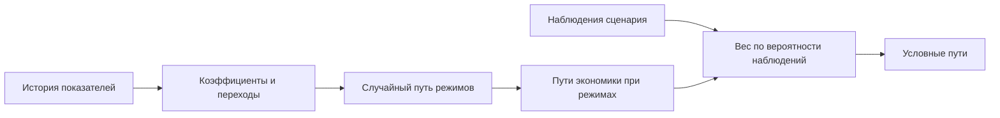

# Авторегрессия с переключением режимов `msvar.markov`

Модель `msvar.markov` строит распределение месячных показателей экономики, допуская скрытые состояния с разными средними и разбросом. Состояние называется *режимом*, а вероятности перехода зависят только от режима предыдущего месяца: переходы образуют марковскую цепь. Такая модель может описывать чередование спокойных и нестабильных периодов, но название режима само по себе не доказывает экономического объяснения кризиса.

Векторная авторегрессия предсказывает текущие значения нескольких рядов по их совместному прошлому. При `switching = "mean_covariance"` постоянная и ковариация ошибок зависят от режима, а лаговые коэффициенты общие. При `switching = "all"` меняются также лаговые коэффициенты. Действующий выбор и параметры оценки записаны в [спецификации](<spec.toml>); вариант с общими лагами требует меньше данных редкого режима, но не описывает смену динамики лагов.



Рисунок 1. Смесь по скрытым режимам. Текстовый эквивалент: модель строит кандидаты пути режимов, для каждого вычисляет закон показателей и выбирает кандидата с учётом наблюдений. Без наблюдений путь режимов подчиняется обычной матрице переходов. Схема учебная и не показывает вероятности конкретной версии.

## Оценка и идентификация

Оценка чередует условные выборки параметров и ненаблюдаемых величин; такой алгоритм называется сэмплером Гиббса. Путь режимов строится прямой фильтрацией с обратным выбором состояний, коэффициенты — по уравнениям с исходным предположением Minnesota, ковариации — из обратного распределения Уишарта, строки переходов — из распределения Дирихле. Пропущенные значения истории также разыгрываются условно на известные значения.

После обхода алгоритма режимы перенумеровываются по возрастанию следа ковариации, то есть суммы дисперсий показателей. Правило не даёт спокойному и нестабильному режимам случайно поменять имена между выборками параметров. Порядок режимов в [таблице режимов и шоков](<signs.toml>) следует тому же правилу.

Знаковые ограничения именуют случайные возмущения по направлениям откликов показателей. Пять экономических имён совпадают с именами [BVAR](<../bvar/README.md>), поэтому диагностику можно сопоставлять; равенство имён не означает равенства величин откликов. Перед поиском поворота проверяется спектральный радиус авторегрессии в каждом режиме. Устойчивость каждого режима отдельно ещё не гарантирует устойчивости любого их чередования.

## Как действует сценарий

Сценарий задаёт вмешательства и наблюдения о наблюдаемых величинах по [общей формализации](<../../../../docs/concept/formalization.md>). Режим — скрытая координата модели, поэтому автор сценария не назначает его напрямую. Сведения о кризисе записываются через показатели экономики; вероятность режима после учёта сведений становится результатом модели.

При фиксированном пути режимов наблюдения задают ограничения на линейно-гауссов закон. Кандидат пути режимов получает вес, равный вероятности области наблюдений при кандидате. Каждый итоговый путь несёт собственную последовательность режимов, но сателлитные модели получают только пути наблюдаемых показателей.

Для рядов с нижней границей модель строит теневую, то есть неограниченную, траекторию. Платформа ограничивает наблюдаемый выход снизу после вмешательств и учёта наблюдений; лаги и вероятность наблюдений остаются на тени. При точном наблюдении на границе тень должна попасть в узкий допуск около границы. Оценка обычной истории как теневой — приближение, а не полноценная оценка модели с цензурированием.

## Подключение и устройство

Модель выбирается явно. Дату и пути каталогов нужно заменить своими значениями:

```powershell
python -m mst.models estimate-macro msvar.markov --as-of DATE --store STORE --models MODELS
```

| Часть | Ответственность |
|---|---|
| [Объявление плагина](<plugin.py>) и [адаптер](<model.py>) | Регистрация модели, сохранение версии, загрузка и прогноз |
| [Оценка](<estimate.py>) | Режимы, коэффициенты, ковариации, переходы и пропуски |
| [Идентификация](<identify.py>) | Проверка радиуса и знаковые ограничения внутри режимов |
| [Прогноз](<forecast.py>) | Кандидаты режимов, условный закон наблюдений и диагностика |
| [Алгебра VAR](<var.py>) | Регрессоры, блочные ограничения, отклики и рекурсия |
| [Спецификация](<spec.toml>) и [режимы и шоки](<signs.toml>) | Настройки, сохраняемые вместе с оценённой версией |

Подробную математическую постановку содержит [справочник модели](<REFERENCE.md>). [Руководство по метрикам](<../../metrics/README.md>) описывает проверку качества на истории, а [тесты MS-VAR](<../../../../tests/msvar/>) проверяют восстановление известных параметров, ограничения и условные законы на искусственных данных. Успешные тесты не заменяют сравнения с эталоном прогноза.
