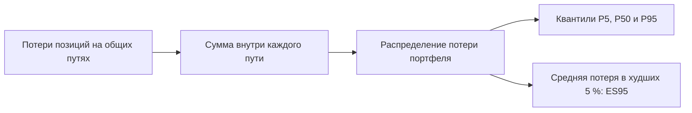

# mst.portfolio: состав портфеля и смысл отчёта

Пакет `mst.portfolio` хранит состав портфеля, проверяет возможность расчёта его позиций и собирает отчёт о потерях. Портфель — набор вложений; позиция задаёт инструмент, стоимость и данные для выбора модели. Потеря положительна при уменьшении стоимости и отрицательна при прибыли, поэтому знак потери противоположен изменению стоимости позиции.

## Контракт и операции

[Контракт Portfolio](<spec.py>) содержит имя, базовую валюту и непустой список позиций с уникальными идентификаторами. Базовая валюта — `RUB`; номиналы позиций задаются в миллионах их собственных валют, а итоговый отчёт выражается в миллионах рублей. Сценарий и версии моделей не записываются в портфель: один состав можно исследовать при разных событиях.

[Операции tool.py](<tool.py>) дают `list`, `get`, `save`, `delete`, `check` и `exposure`. `save` проверяет форму портфеля и перезаписывает запись с тем же идентификатором, а `delete` удаляет сохранённый состав. `check` выясняет, доступны ли модель позиции, необходимые макропеременные и обслуживаемые драйверы; `exposure` оценивает текущую стоимость по начальному месяцу макроверсии без розыгрыша будущих путей.

Пример формы портфеля можно проверить без сети и без файлов:

```python
from mst.portfolio.spec import Portfolio

portfolio = Portfolio.model_validate({
    "name": "Учебная акция",
    "base_currency": "RUB",
    "positions": [{
        "id": "demo", "type": "common_stock", "notional": 10.0,
        "codes": {"secid": "SBER"}
    }]
})
assert portfolio.positions[0].notional == 10.0
```

Учебный номинал равен 10 млн рублей. Успешная проверка формы не подтверждает наличие истории или драйвера акции: для возможности расчёта нужен отдельный `check` против выбранных версий.

## Как складываются потери

[Модуль report.py](<report.py>) сначала складывает потери рассчитанных позиций внутри каждого общего пути, затем считает квантили портфеля. P50 — медиана потери; P5 и P95 ограничивают центральные 90 % значений; ES95 — средняя потеря в худших 5 %. Сумма отдельных P95 не равна P95 суммы, потому что самые плохие исходы разных позиций могут приходиться на разные пути.



Квантили и ES95 описывают одно распределение потери, но выделяют разные его свойства. При сравнении сценариев нужно отделять изменение медианы от изменения ширины диапазона: наблюдение может сузить прогноз, не улучшая экономическое положение.

Результат содержит потери к концу горизонта; если переданы месячные массивы, отчёт также показывает потери по месяцам и максимум потери за путь. Интервал для ES95 оценивает численную неопределённость хвостовой статистики, а усечённая оценка показывает чувствительность к удалению самых тяжёлых путей. Ни одна из двух диагностик сама по себе не подтверждает историческую точность хвоста.

## Покрытие и ограничения

Отчёт исключает позиции со статусом `invalid` и называет причину; позиции `needs_review` входят в сумму. `coverage.share` показывает долю измеримой стоимости, покрытую рассчитанными позициями; если хотя бы одна стоимость неизвестна, доля равна `null`. Непокрытая доля больше 5 % или неизвестная стоимость даёт `incomplete`, а переданный отказ допуска даёт более сильный статус `not_admitted`: числа сохраняются для диагностики, но не читаются как оценка потерь.

Цена сценария `dist` измеряет, насколько наблюдения изменили закон при заданных вмешательствах; цена не выражена в рублях и не складывается с потерей. Математическая цена сценария без наблюдений равна нулю, однако сборщик путей может не сформировать отдельный блок оценки, и тогда в отчёте стоит `null`. Если сборщик передал блок цены, отчёт сохраняет стандартную ошибку, разложение по уровням и доступную одностороннюю цену.

[Модуль runs.py](<../runs.py>) отвечает за запись файлов полного расчёта, а проверки арифметики, исключений, месячных потерь и статусов находятся в [tests/portfolio](<../../../tests/portfolio/README.md>). Правила допуска и цены заданы в [общей схеме](<../../../docs/concept/formalization.md>).
