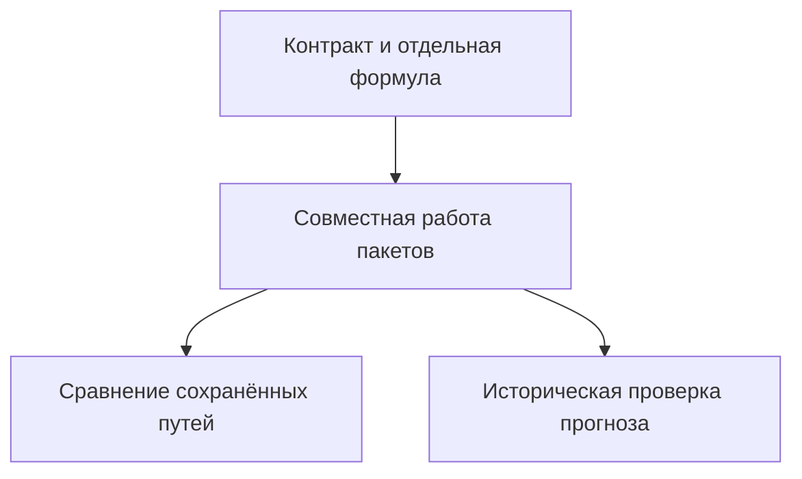

# Тесты MacroStress: что проверять после изменения

Каталог содержит проверки формы данных, численных операций и совместной работы расчётных пакетов MacroStress. Тесты помогают обнаружить нарушение контракта, но не заменяют историческую проверку точности моделей. Для разработчика, который меняет один пакет, первым шагом служит его тематический набор; полный набор нужен для проверки связей с остальной системой.

Фикстура — подготовленный вход теста; здесь фикстуры задают ответы источников, искусственную историю с известными параметрами или сохранённые численные образцы. Большинство наборов использует временные каталоги и подменяет сетевые ответы. Отдельное исключение по внешним данным — [опорные сценарии golden](<scenario/golden/README.md>), которым нужны конкретные сохранённые макроверсии.

## Как запустить

Команды выполняются из корня репозитория в установленном окружении проекта:

```powershell
.venv\Scripts\python.exe -m pytest -q -m "not slow"
.venv\Scripts\python.exe -m pytest tests/scenario -q
.venv\Scripts\python.exe -m pytest -q
```

Первая команда исключает тесты с маркером `slow`, вторая проверяет один пакет, третья включает весь набор. Маркер обозначает вычислительно тяжёлые проверки оценки, прежде всего BVAR — байесовской векторной авторегрессии. Не следует пропускать `slow` при изменении соответствующего метода только потому, что быстрый набор уже прошёл.



Схема различает основания вывода: проверка формулы подтверждает отдельную операцию, совместная проверка — передачу входов, а сравнение с историческими фактами нужно для оценки качества прогноза. Побитовое совпадение сохранённого пути подтверждает отсутствие численного изменения, но не экономическую правдоподобность.

## Тематические наборы

| Что изменилось | Набор и предмет проверки |
| --- | --- |
| Загрузка истории | [data](<data/README.md>) проверяет форматы источников и даты публикаций. |
| Поиск оснований сценария | [corpus](<corpus/README.md>) проверяет документы, карточки эпизодов и индекс. |
| Общие показатели экономики | [macro](<macro/README.md>) проверяет реестр, панель и версии. |
| Алгоритм BVAR | [bvar](<bvar/README.md>) проверяет оценку, ограничения, формы и воспроизводимость. |
| Показатели объектов | [drivers](<drivers/README.md>) проверяет каталоги, связь ошибок моделей и уровни. |
| Иерархическая сателлитная модель | [hier](<hier/README.md>) проверяет уравнения, заимствование параметров и пути. |
| Событие и его численный перевод | [scenario](<scenario/README.md>) проверяет вмешательства, наблюдения и обратную задачу. |
| Стоимость позиции | [engine](<engine/README.md>) проверяет выбор модели и расчёт на общих путях. |
| Подключение расширения | [plugins](<plugins/README.md>) проверяет объявления, обнаружение и демонстрации. |
| Состав и потери портфеля | [portfolio](<portfolio/README.md>) проверяет арифметику, покрытие и статусы отчёта. |
| Оценка качества | [metrics](<metrics/README.md>) проверяет метрики, сравнения и исторические расчёты. |

Другие каталоги сохраняют тесты собственных методов: [msvar](<msvar/>) — модели со скрытыми режимами, [expert](<expert/>) — экспертных входов, [model_sdk](<model_sdk/>) — общих численных контрактов, [models](<models/>) — управления версиями, [rw](<rw/>) — совместного случайного блуждания. При выборе набора смотрите зависимость изменённого поведения, а не только совпадение имени каталога.

## Общие проверки платформы

[conftest.py](<conftest.py>) создаёт общие версии и рабочий каталог во временных папках. [test_store.py](<test_store.py>) и [test_versions.py](<test_versions.py>) проверяют атомарную запись, хеш содержимого и отказ чтения повреждённой версии. [test_jobs.py](<test_jobs.py>) проверяет запуск задач, журнал, блокировку ресурса, завершение и отмену.

[test_mcp.py](<test_mcp.py>), [test_mcp_schema.py](<test_mcp_schema.py>) и [test_mcp_stdio.py](<test_mcp_stdio.py>) проверяют сервер и форму инструментов Model Context Protocol — протокола вызовов агента. [test_series_tool.py](<test_series_tool.py>) и [test_corpus_tool.py](<test_corpus_tool.py>) проверяют операции истории и корпуса; [test_runs.py](<test_runs.py>) — запрос и выходы полного расчёта. [test_bench.py](<test_bench.py>) проверяет согласованность наборов событий и исторических эпизодов.

Зелёный набор не подтверждает доступность внешнего сайта или точность модели на будущем событии. Если тест пропущен, отчёт о проверке должен назвать причину; пропуск опорной версии не равен совпадению с опорным результатом.
