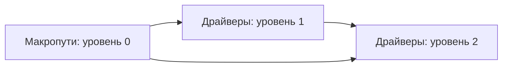

# Проверки показателей объектов и сателлитных версий

Набор проверяет платформенную часть `mst.drivers`: реестр величин, каталоги объектов, подготовку истории и объединение результатов моделей. Драйвер — величина конкретного объекта, например цена акции компании; сателлитная версия — сохранённый набор моделей таких драйверов, связанный с одной макроверсией. Собственный статистический алгоритм иерархической модели проверяет [tests/hier](<../hier/README.md>).

## Запуск

Из корня репозитория выполните набор драйверов:

```powershell
.venv\Scripts\python.exe -m pytest tests/drivers -q
```

Для изменения передачи между уровнями начните с [test_levels.py](<test_levels.py>), а для изменения связи ошибок нескольких моделей — с [test_bundle.py](<test_bundle.py>). Искусственная история в [simulated.py](<simulated.py>) задаёт известные зависимости, чтобы ожидания не опирались на текущую рабочую базу.

## Контракты и обновление

[test_registry.py](<test_registry.py>) проверяет дерево объектов, уникальность имён, обратимость преобразований и сопоставление по кодам. Преобразование — перевод из исходной единицы в шкалу модели; тест насыщенного значения отдельно проверяет возврат собственного рассчитанного пути в модельную шкалу.

[test_catalogs.py](<test_catalogs.py>) проверяет устойчивые имена и родителей объектов: акции под отраслевыми индексами, облигации под эмитентами и группы отраслей по кодам. [test_update.py](<test_update.py>) проверяет обновление каталога и загрузку рядов, а [test_tool.py](<test_tool.py>) — запрос обновления величины и инструмент работы с сателлитными версиями. Эти проверки подменяют сетевой ответ, поэтому не измеряют полноту текущего внешнего каталога.

## Общая версия и уровни

[test_bundle.py](<test_bundle.py>) объединяет части нескольких моделей, проверяет обязательные поля, выбор исполнителя величины и отказ неоднозначного назначения. Набор проверяет, что платформа разыгрывает связанные остатки один раз для всего уровня и передаёт каждой модели её столбцы; повторный независимый розыгрыш внутри модели разрушил бы измеренную связь.



Схема иллюстрирует проверяемый порядок: следующий уровень читает только уровни с меньшими номерами. [test_levels.py](<test_levels.py>) восстанавливает известные коэффициенты учебной цепочки, проверяет независимость остатков разных уровней и передачу вмешательства только в разрешённом направлении. [test_interventions.py](<test_interventions.py>) проверяет групповые установки и сдвиги без повторного применения.

Отдельные случаи проверяют пометку выхода за диапазон обучения, отказ повреждённой корреляционной матрицы и очистку точек сохранения после успешной публикации. Контракт пакета находится в [mst.drivers](<../../src/mst/drivers/README.md>); прохождение набора подтверждает сборку и передачу данных, но не качество будущего прогноза каждого объекта.
