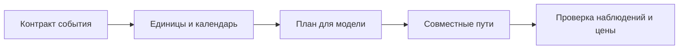

# Проверки сценария и построения путей

Набор проверяет перевод описанного события в численный план и пути показателей. Вмешательство устанавливает или сдвигает величину извне; наблюдение ограничивает возможный исход или его вероятность. Тесты разделяют форму записи, численный перевод и исполнение, чтобы правильная форма сценария не воспринималась как доказательство достижимости события.

## Запуск

Из корня репозитория выполните набор сценариев без опорных внешних версий либо весь набор:

```powershell
.venv\Scripts\python.exe -m pytest tests/scenario -q --ignore=tests/scenario/test_golden.py
.venv\Scripts\python.exe -m pytest tests/scenario -q
```

[simulated.py](<simulated.py>) готовит модели с известными зависимостями; [golden](<golden/README.md>) сравнивает сохранённые пути конкретных исторических версий. Второй тип проверки требует внешних моделей и может быть пропущен при их отсутствии, поэтому результат с пропусками не равен подтверждённому побитовому совпадению.

## Форма и перевод

[test_spec.py](<test_spec.py>) и [test_intervention_contract.py](<test_intervention_contract.py>) проверяют поля события, календарные месяцы, единицы, основание чисел и уникальность вмешательств. Интервал должен иметь строго разные границы, а точное наблюдение записывается через `value`. Случайные значения вмешательств допустимы в предусмотренных формах, но произвольный объект вместо закона отклоняется.

[test_translate.py](<test_translate.py>) проверяет, что календарь начинается от конца панели, процентный сдвиг переводится один раз, а изменение ставки привязано к последнему известному уровню. Наблюдение на логарифмические величины требует точного прочтения взвешенной суммы: отношение цен не должно молча превращаться в сумму денежных уровней.



Схема показывает цепочку проверок: ошибка перевода может дать неверный план, даже если сама модель исполняет план точно.

## Исполнение и повторяемость

[test_build.py](<test_build.py>) проверяет установки и сдвиги, интервальные и точечные наблюдения, условия на средние и вероятности, драйверы и цену. [test_intervention_build.py](<test_intervention_build.py>) и [test_any_model.py](<test_any_model.py>) проверяют единственное применение вмешательства, исходные границы закона и точность контекста. Если установленное значение противоречит наблюдению, расчёт должен назвать противоречие.

[test_stochastic_interventions.py](<test_stochastic_interventions.py>) проверяет частоту включения вероятностного вмешательства и независимость его розыгрыша от добавленного наблюдения. Группа путей сохраняет общие параметры и реализацию вмешательства, а [test_overlay.py](<test_overlay.py>) проверяет, что перевзвешивание сохраняет закон групп и исключает пути нулевого веса.

[test_tool.py](<test_tool.py>) и [test_intervention_tool.py](<test_intervention_tool.py>) проверяют сохранение события, выбор согласованных версий и доступность фрагментов корпуса на дату. [test_reverse.py](<test_reverse.py>) проверяет поиск на семействе сценариев, фиксированные вмешательства и отказ точек с чрезмерной ошибкой цены.

## Перенос старого формата и границы

[test_legacy.py](<test_legacy.py>) проверяет точный перенос прежних чисел и сохранение текстового смысла старых причин. [test_migrate.py](<test_migrate.py>) проверяет предварительную проверку всех файлов и восстановление после ошибки записи. Пересекающиеся или неточно переводимые старые элементы должны останавливать перенос, а не молча менять смысл события.

Ответственность пакета описана в [mst.scenario](<../../src/mst/scenario/README.md>). Набор проверяет исполнение численного сценария; экономическое основание выбора числа и классификации «решение или наблюдение» требует чтения события и источников человеком.
